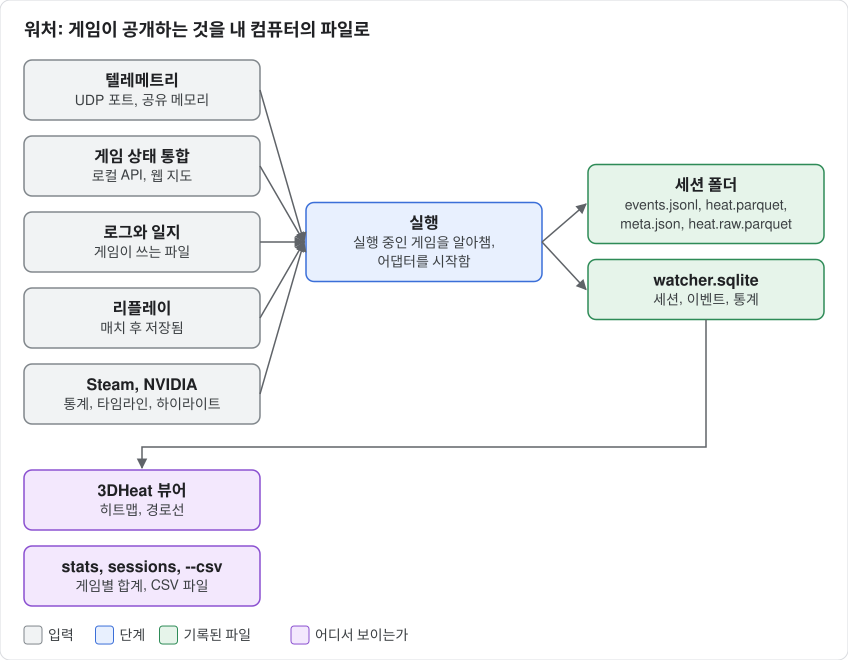

# 3DHeat Watcher {#dheat-watcher}

**무엇입니까?** 여러분이 게임을 합니다. 이 프로그램은 조용히, 여러분이 어디에 갔고 무슨 일이 있었는지를 기록합니다. 나중에 3DHeat 뷰어에서 색을 칠한 맵으로 볼 수 있습니다.

**왜 씁니까?** 웹사이트 없이, 게임을 바꾸지 않고도, 모든 플레이 기록을 직접 보관하기 위해서입니다. 어디서 운전하고, 비행하고, 싸웠는지, 게임별 합계가 얼마인지를 남길 수 있습니다.

**예시:** Watcher를 켠 채 레이싱 게임에서 랩 하나를 달립니다. 나중에 `sessions\<game>\` 안의 파일에 여러분이 달린 선이 들어 있고, 뷰어가 그것을 그립니다.

조금 더 자세히 말하면, 3DHeat Watcher는 게임이 여러분의 플레이에 대해 공개하는 것을 백그라운드에서 기록하는 프로그램입니다. 어디에 갔는지, 어디서 무슨 일이 있었는지, 그 뒤의 수치를 여러분의 컴퓨터 안의 파일로 남깁니다. 이 파일들은 여러분 자신의 통계와, 3DHeat 뷰어의 히트맵과 경로선을 위한 것입니다.

조용히 실행되며, 여러분이 어떤 게임을 시작했는지 알아채고, 그 게임 자체의 출력을 읽습니다. 대시보드용으로 게임이 공개하는 텔레메트리 포트나 공유 메모리, 게임 상태 연동(game-state integration), 게임이 쓰는 저널이나 로그, 매치 후에 저장하는 리플레이, Steam이 보관하는 통계, NVIDIA App이 저장하는 클립입니다. 기록은 여러분의 컴퓨터에만 남습니다. 프로그램이 외부 서비스와 통신하는 경우는 두 가지뿐입니다. 더 새로운 릴리스를 찾기 위한 GitHub([업데이트](../updates.md) 참고)와, 여러분이 직접 입력한 Riot API 키를 쓸 때의 Riot Match-V5 API([리그 오브 레전드 리플레이](../game-lol-replays.md) 참고)입니다.



## 무엇을 기록하나 {#what-it-records}

- **위치**: 자동차, 항공기, 영웅, 또는 플레이어. 게임이 위치를 공개하는 곳에서는 초당 여러 번, 속도, 방향, 그리고 게임이 함께 보내는 것을 같이 기록합니다.
- **이벤트**: 생성, 사망, 킬, 랩, 스테이지, 라운드, 골, 임무, 이륙과 착륙, 구역 변경, 업적, 하이라이트. 각 이벤트는 시간과 함께 저장되며, 게임이 위치를 주면 그 위치도 함께 저장됩니다.
- **세션별 통계**: 킬, 사망, 랩, 최고 랩, 거리, 최고 속도, 플레이 시간, 그리고 게임이 자체로 보관하는 통계가 있다면 그것.

각 게임이 무엇을, 어디에서 주는지는 [게임들](../games.md)에 게임마다 한 페이지씩 있습니다. 한 가지 출처로는 모든 것을 기록할 수 없습니다. 멀티플레이 게임은 게임이 공개하는 것을 통해서만 기록하며, Watcher는 그 메모리를 절대 읽지 않습니다([출처와 규칙](../sources-and-rules.md) 참고).

## 설치 {#install}

명령줄이 처음입니까? 먼저 [시작하기 전에](before-you-start.md)를 읽으세요.

Watcher는 Windows용 Python 프로그램입니다(Python 3.10 이상). 출처 중 많은 것이 Windows에서만 존재합니다. 공유 메모리, 레지스트리, Windows 알림이 그렇습니다.

```bash
git clone https://github.com/Holdi601/3DHeat-Watcher.git
cd 3DHeat-Watcher
pip install -r requirements.txt
```

내려받은 릴리스 압축 파일도 같은 방식으로 작동합니다. 압축을 풀고, 그 폴더 안에서 `pip install -r requirements.txt`를 실행하세요. 자세한 내용과 일부 게임에 필요한 추가 항목은 [설치와 실행](../installing-and-running.md)에 있습니다.

## 빠른 시작 {#quick-start}

```bash
python -m heat3d_watch games            # 게임마다 무엇을, 어디에서 주는지
python -m heat3d_watch setup all        # 무엇을 켜야 하는지 (아무것도 바꾸지 않습니다)
python -m heat3d_watch setup f1-25 --apply   # 게임 하나의 출력을 켭니다 (원래 파일은 백업됩니다)
python -m heat3d_watch run              # 기록합니다. 플레이하는 동안 켜 두세요
python -m heat3d_watch stats            # 게임별 합계
python -m heat3d_watch stats --csv out  # 세션, 이벤트, 통계를 CSV 파일로
```

이렇게 보여야 합니다: `games` 뒤에 게임마다 한 줄씩 있는 표가 나오고, `run`은 Ctrl+C를 누르거나 창을 닫을 때까지 계속 실행됩니다.

모든 것은 `%LOCALAPPDATA%\3DHeat\Watcher`에 씁니다. 다른 폴더를 쓰려면 `HEAT3D_WATCH_HOME` 환경 변수를 설정하거나 `python -m heat3d_watch config --set data=D:\somewhere`를 실행하세요.

- `sessions\<game>\<date>_<adapter>\` - 세션(플레이 한 번)마다 폴더 하나. 그 안에는 `events.jsonl`(일어나는 모든 이벤트), `heat.parquet`(위치가 있는 행들, 3DHeat 뷰어용), `meta.json`(게임, 출처, 축, 개수, 통계)이 있습니다
- `watcher.sqlite` - 모든 세션의 통계, 세 개의 평범한 표로
- `watcher.log` - Watcher가 한 일

뷰어는 세션의 `heat.parquet`을 아무 설정 없이 바로 엽니다(축과 단위는 파일 안에 있습니다). 변환한 리플레이는 그 옆에 표와 매치 문서로 씁니다. 뷰어 자체의 매치 하나당 파일 한 개 형식은 뷰어의 [`.3dheat` 컨테이너](https://holdi601.github.io/3DHeat/container.html) 페이지에 설명되어 있고, 표의 모든 열은 [데이터](../the-data.md)에 있습니다.

## 문서 {#the-documentation}

| 페이지 | 내용 |
|---|---|
| [시작하기 전에](before-you-start.md) | Python, 터미널, 자리 표시자, 성공과 흔한 오류의 모습 |
| [설치와 실행](../installing-and-running.md) | 요구 사항, 백그라운드 실행, Windows와 함께 시작, 잠금 파일, 로그, 모든 설정과 환경 변수 |
| [게임들](../games.md) | 게임마다 한 페이지: 무엇을 기록하는지, 어디에서, 켜는 방법, 작동 원리, 축, 통계, 검증한 내용 |
| [데이터](../the-data.md) | 세션 폴더, `events.jsonl`, `heat.parquet`와 그 바닥글, `meta.json`, `watcher.sqlite`, 충돌 후 복구, CSV 내보내기, 3DHeat 뷰어에서 세션 열기 |
| [명령](../commands.md) | `python -m heat3d_watch`의 모든 명령과 옵션 |
| [출처와 규칙](../sources-and-rules.md) | 여섯 종류의 출처, 멀티플레이 규칙, 빠진 게임과 그 이유 |
| [NVIDIA Highlights](../nvidia-highlights.md) | NVIDIA Highlights가 할 수 있는 것과 없는 것, 하이라이트가 위치를 얻는 방법 |
| [서버 기록 모드](../server-mods.md) | 임무 전체를 뷰어를 위해 기록하는 Arma 3와 Arma Reforger 서버 모드 |
| [메모리 읽기](../memory-reading.md) | 싱글플레이어 메모리 프로필: 형식, 검사, 하나를 쓰고 검증하는 방법 |
| [업데이트](../updates.md) | Watcher가 새 릴리스를 찾고 스스로 업데이트하는 방법 |
| [개발](../development.md) | 어댑터 쓰기: API, 테스트, 정직한 `verified`, 게임 페이지 다시 만들기 |
| [한 표의 모든 게임](../watcher.md) | `games --markdown`이 출력하는 것처럼 모든 게임을 한 표에, 조사만 하고 아직 만들지 않은 게임 포함 |
| [명령 참조](../cli-reference.md) | 모든 명령의 `--help`, 코드에서 생성 |
| [문서 관리](../maintaining.md) | 이 페이지들의 릴리스 체크리스트 |

## 3DHeat의 일부 {#part-of-3dheat}

3DHeat Watcher는 3DHeat 뷰어 주변의 무료 도구 중 하나입니다(Watcher는 CS2 데모를 변환할 때 3DHeat CS2를 씁니다). 각각 자기 프로젝트, 릴리스, 라이선스를 가집니다:

| 도구 | 하는 일 | 문서 |
|---|---|---|
| [3DHeat](https://github.com/Holdi601/3DHeat) | 뷰어: 3D 히트맵, 레이스 분석, 매치 리뷰 | [사이트](https://holdi601.github.io/3DHeat/) |
| [GameFiles](https://github.com/Holdi601/3DHeat-GameFiles) | 게임이 배포하는 파일에서 코스와 레벨을 3D 모델로 | [사이트](https://holdi601.github.io/3DHeat-GameFiles/) |
| [GameCapture](https://github.com/Holdi601/3DHeat-GameCapture) | 레이싱 게임의 랩 텔레메트리. 게임플레이 영상에서 다시 만든 레벨 | [사이트](https://holdi601.github.io/3DHeat-GameCapture/) |
| [Unreal Exporter](https://github.com/Holdi601/3DHeat-UnrealExporter) | 레벨을 3D 모델 하나로 내보내는 Unreal 에디터 플러그인 | [사이트](https://holdi601.github.io/3DHeat-UnrealExporter/) |
| [CS2](https://github.com/Holdi601/3DHeat-CS2) | Counter-Strike 2 데모를 표와 매치 문서로, 맵을 3D 모델로 | [사이트](https://holdi601.github.io/3DHeat-CS2/) |
| [Watcher](https://github.com/Holdi601/3DHeat-Watcher) | 게임이 여러분의 플레이에 대해 공개하는 것을 백그라운드에서 기록 | [사이트](https://holdi601.github.io/3DHeat-Watcher/) |
| [Ext-WarThunder](https://github.com/Holdi601/3DHeat-Ext-WarThunder) | 워 썬더 리플레이를 표와 매치 문서로 | [사이트](https://holdi601.github.io/3DHeat-Ext-WarThunder/) |
| [Ext-WoT](https://github.com/Holdi601/3DHeat-Ext-WoT) | 월드 오브 탱크 리플레이를 표와 매치 문서로 | [사이트](https://holdi601.github.io/3DHeat-Ext-WoT/) |
| [Ext-WoWs](https://github.com/Holdi601/3DHeat-Ext-WoWs) | 월드 오브 워십 리플레이를 표와 매치 문서로 | [사이트](https://holdi601.github.io/3DHeat-Ext-WoWs/) |
| [Ext-Squad](https://github.com/Holdi601/3DHeat-Ext-Squad) | Squad 서버 데모를 표와 매치 문서로 | [사이트](https://holdi601.github.io/3DHeat-Ext-Squad/) |
| [Ext-DCS](https://github.com/Holdi601/3DHeat-Ext-DCS) | DCS World 맵을 3D 모델로 | [사이트](https://holdi601.github.io/3DHeat-Ext-DCS/) |
| [Ext-IL2](https://github.com/Holdi601/3DHeat-Ext-IL2) | IL-2 Sturmovik 맵을 3D 모델로 | [사이트](https://holdi601.github.io/3DHeat-Ext-IL2/) |

라이선스: MIT([LICENSE](https://github.com/Holdi601/3DHeat-Watcher/blob/main/LICENSE)). 이 프로그램이 쓰는 제3자 패키지의 라이선스와, 이 프로그램이 읽는 게임들이 요구하는 것은 [LICENSES.md](https://github.com/Holdi601/3DHeat-Watcher/blob/main/LICENSES.md)에 나열되어 있습니다.
