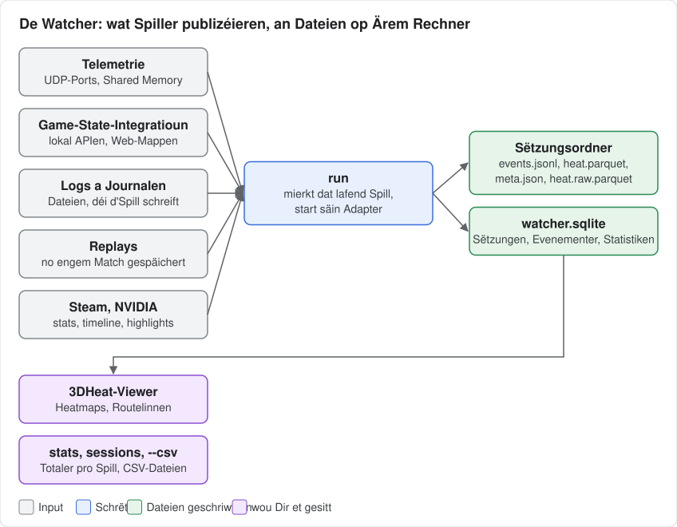

# 3DHeat Watcher {#dheat-watcher}

**Wat ass et?** Dir spillt e Spill. Dëse Programm schreift roueg op, wou Dir higaange sidd a wat geschitt ass.
Méi spéit kënnt Dir et als faarweg Kaart am 3DHeat-Viewer kucken.

**Firwat sollt ech et benotzen?** Fir Är eegen Opnam vun all Sëtzung ze halen - wou Dir gefuer, geflunn oder gekämpft hutt,
Är Totaler pro Spill - ouni iergendeng Websäit an ouni dat Spill ze änneren.

**Beispill:** Dir fuert eng Ronn an engem Rennspill, wärend de Watcher leeft; duerno hält eng Datei an
`sessions\<game>\` d'Linn, der Dir gefollegt sidd, an de Viewer zeechent se.

Méi genau: 3DHeat Watcher ass en Hannergrondprogramm, dat opzeechent, wat Spiller iwwer Äert Spillen publizéieren - wou Dir
higaange sidd, wat wou geschitt ass, an d'Zuelen dohannert - an Dateien op Ärem eegene Rechner. D'Dateie sinn
fir Är eege Statistiken an fir d'Heatmaps a Routelinnen vum 3DHeat-Viewer.

Et leeft roueg, mierkt, wéi ee Spill Dir gestart hutt, a liest d'eegen Ausgabe vun dësem Spill: e Telemetrie-Port
oder eng Shared Memory, déi d'Spill fir Dashboards publizéiert, eng Game-State-Integratioun, d'Journal oder de Log, dee
d'Spill schreift, d'Replay, dat et no engem Match späichert, d'Statistiken, déi Steam hält, d'Clips, déi d'NVIDIA App
späichert. D'Opnamen bleiwen op Ärem Rechner. De Programm kontaktéiert nëmmen zwee extern Servicer, an nëmmen an
dëse Fäll: GitHub, fir no enger méi neier Versioun ze kucken (kuckt [Updates](../updates.md)), an dem Riot seng Match-V5-API,
an nëmmen, wann Dir Ären eegene Riot-API-Schlëssel aginn ([League-of-Legends-Replays](../game-lol-replays.md)).



## Wat et opzeechent {#what-it-records}

- **Positiounen**: d'Auto, de Fliger, den Held oder de Spiller, e puer Mol d'Sekonn, wou d'Spill se
  publizéiert, mat Geschwindegkeet, Richtung a wat d'Spill soss nach derbäi schéckt.
- **Evenementer**: Spawns, Doudesfäll, Kills, Ronnen, Etappen, Match-Ronnen, Goler, Jobs, Opstieger a Landungen, Zone-
  Wiesselen, Erfolleger, Highlights. All Evenement gëtt mat senger Zäit gespäichert, a mat sengem Plaz, wann d'
  Spill een gëtt.
- **Statistiken pro Sëtzung**: Kills, Doudesfäll, Ronnen, bescht Ronn, Distanz, Héchstgeschwindegkeet, Spillzäit, an d'
  eegen Statistike vum Spill, wou et se hält.

Wat all Spill gëtt, a vu wou, steet op senger eegener Säit ënner [Spiller](../games.md). Eng Quell kann net
alles opzeechnen: Multiplayer-Spiller ginn nëmmen duerch dat opgeholl, wat si publizéieren, an de Watcher
liest ni hir Gedächtnis (kuckt [Quellen a Reegelen](../sources-and-rules.md)).

## Installéieren {#install}

Nei op der Kommandozeil? Liest fir d'éischt [Ier Dir ufänkt](before-you-start.md).

De Watcher ass e Python-Programm fir Windows (Python 3.10 oder méi nei). Vill vu senge Quelle gëtt et nëmmen op Windows: Shared
Memory, d'Registry, Windows-Notifikatiounen.

```bash
git clone https://github.com/Holdi601/3DHeat-Watcher.git
cd 3DHeat-Watcher
pip install -r requirements.txt
```

Eng erofgeluede Release-Archiv funktionéiert op déiselwecht Aart: entpackt se, dann féiert `pip install -r requirements.txt`
am Dossier aus. D'Detailer, an d'Extras, déi e puer Spiller brauchen, si bei
[Installéieren a Lafen](../installing-and-running.md).

## Séier Start {#quick-start}

```bash
python -m heat3d_watch games            # what each game gives, and from where
python -m heat3d_watch setup all        # what would have to be switched on (nothing is changed)
python -m heat3d_watch setup f1-25 --apply   # switch one game's output on (the original file is backed up)
python -m heat3d_watch run              # watch; leave it running while you play
python -m heat3d_watch stats            # totals per game
python -m heat3d_watch stats --csv out  # sessions, events and stats as CSV files
```

Dir sollt gesinn: no `games` eng Tabell mat enger Zeil pro Spill; `run` geet weider, bis Dir
Ctrl+C dréckt oder d'Fënster zoumécht.

Alles gëtt a `%LOCALAPPDATA%\3DHeat\Watcher` geschriwwen. Fir en aneren Dossier ze benotzen, setzt d'
Ëmgéigungsvariabel `HEAT3D_WATCH_HOME` oder féiert `python -m heat3d_watch config --set data=D:\somewhere` aus.

- `sessions\<game>\<date>_<adapter>\` - ee Dossier pro Sëtzung, mat `events.jsonl` (all Evenement,
  wéi et geschitt), `heat.parquet` (d'Zeilen mat enger Positioun, prett fir den 3DHeat-Viewer) an
  `meta.json` (Spill, Quell, Achsen, Zuelen, Statistiken)
- `watcher.sqlite` - d'Statistike vun all Sëtzung, an dräi einfachen Tabellen
- `watcher.log` - wat de Watcher gemaach huet

De Viewer mécht dem `heat.parquet` vun enger Sëtzung direkt op, ouni eppes anzestellen (seng Achsen an Eenheeten sinn an
der Datei). Konvertéiert Replays ginn als Tabellen a Match-Dokumenter doniewendrun geschriwwen; dem Viewer säi eegent
Format mat enger Datei pro Match ass op senger Säit [`.3dheat`-Container](https://holdi601.github.io/3DHeat/container.html)
beschriwwen, an d'Kolonne vun all Tabell an [D'Daten](../the-data.md).

## D'Dokumentatioun {#the-documentation}

| Säit | Wat se ofdeckt |
|---|---|
| [Ier Dir ufänkt](before-you-start.md) | Python, e Terminal, Platzhalter, wéi Erfolleg an heefeg Feeler ausgesinn |
| [Installéieren a Lafen](../installing-and-running.md) | Ufuerderungen, am Hannergrond lafen, mat Windows starten, d'Lock-Datei, de Log, all Astellung an Ëmgéigungsvariabel |
| [Spiller](../games.md) | eng Säit pro Spill: wat opgeholl gëtt, vu wou, wéi een et uschalt, wéi et funktionéiert, Achsen, Statistiken, wat gepréift gouf |
| [D'Daten](../the-data.md) | Sëtzungsdossier, `events.jsonl`, `heat.parquet` a säi Footer, `meta.json`, `watcher.sqlite`, Recovery no engem Crash, CSV-Export, eng Sëtzung am 3DHeat-Viewer opmaachen |
| [Kommandoen](../commands.md) | all Kommando an Optioun vun `python -m heat3d_watch` |
| [Quellen a Reegelen](../sources-and-rules.md) | déi sechs Zorte vu Quellen, d'Multiplayer-Reegelen, wéi eng Spiller ausgelooss sinn a firwat |
| [NVIDIA Highlights](../nvidia-highlights.md) | wat NVIDIA Highlights liwwere kënnen a wat net, a wéi e Highlight eng Positioun kritt |
| [Server-Recorder-Mods](../server-mods.md) | d'Arma-3- an Arma-Reforger-Server-Mods, déi ganz Missiounen fir de Viewer opzeechnen |
| [Gedächtnis liesen](../memory-reading.md) | Singleplayer-Gedächtnisprofiler: d'Format, d'Chekken, wéi ee Profil schreift a verifizéiert |
| [Updates](../updates.md) | wéi de Watcher no neie Releases sicht a sech selwer aktualiséiert |
| [Entwécklung](../development.md) | en Adapter schreiwen: d'API, Tester, e ehrleche `verified`, d'Spillsäiten nei generéieren |
| [All Spiller an enger Tabell](../watcher.md) | all Spill an enger Tabell, wéi `games --markdown` se ausgëtt, plus d'Spiller, déi ersicht, awer nach net gebaut sinn |
| [Kommando-Referenz](../cli-reference.md) | den `--help` vun all Kommando, aus dem Code generéiert |
| [Ënnerhalen](../maintaining.md) | d'Release-Checklëscht fir dës Säiten |

## Deel vun 3DHeat {#part-of-3dheat}

3DHeat Watcher ass ee vun de fräien Tools ronderëm den 3DHeat-Viewer (de Watcher benotzt 3DHeat CS2,
fir CS2-Demoen ze konvertéieren). All ass e getrennte Projet, mat eegene Releases a Lizenz:

| Tool | Wat et mécht | Docs |
|---|---|---|
| [3DHeat](https://github.com/Holdi601/3DHeat) | de Viewer: Heatmaps, Course-Analys a Match-Iwwerpréiwung an 3D | [Site](https://holdi601.github.io/3DHeat/) |
| [GameFiles](https://github.com/Holdi601/3DHeat-GameFiles) | Course a Levelen aus de Dateie vu Spiller, als 3D-Modeller | [Site](https://holdi601.github.io/3DHeat-GameFiles/) |
| [GameCapture](https://github.com/Holdi601/3DHeat-GameCapture) | Ronn-Telemetrie vu Rennspiller; Levelen aus Gameplay-Video nei opgebaut | [Site](https://holdi601.github.io/3DHeat-GameCapture/) |
| [Unreal Exporter](https://github.com/Holdi601/3DHeat-UnrealExporter) | en Unreal-Editor-Plugin, dat e Level als een 3D-Modell exportéiert | [Site](https://holdi601.github.io/3DHeat-UnrealExporter/) |
| [CS2](https://github.com/Holdi601/3DHeat-CS2) | Counter-Strike-2-Demoen a Tabellen a Match-Dokumenter; Mappen a 3D-Modeller | [Site](https://holdi601.github.io/3DHeat-CS2/) |
| [Watcher](https://github.com/Holdi601/3DHeat-Watcher) | hält am Hannergrond fest, wat Spiller iwwer Äert Spill publizéieren | [Site](https://holdi601.github.io/3DHeat-Watcher/) |
| [Ext-WarThunder](https://github.com/Holdi601/3DHeat-Ext-WarThunder) | War-Thunder-Replays a Tabellen a Match-Dokumenter | [Site](https://holdi601.github.io/3DHeat-Ext-WarThunder/) |
| [Ext-WoT](https://github.com/Holdi601/3DHeat-Ext-WoT) | World-of-Tanks-Replays a Tabellen a Match-Dokumenter | [Site](https://holdi601.github.io/3DHeat-Ext-WoT/) |
| [Ext-WoWs](https://github.com/Holdi601/3DHeat-Ext-WoWs) | World-of-Warships-Replays a Tabellen a Match-Dokumenter | [Site](https://holdi601.github.io/3DHeat-Ext-WoWs/) |
| [Ext-Squad](https://github.com/Holdi601/3DHeat-Ext-Squad) | Squad-Server-Demoen a Tabellen a Match-Dokumenter | [Site](https://holdi601.github.io/3DHeat-Ext-Squad/) |
| [Ext-DCS](https://github.com/Holdi601/3DHeat-Ext-DCS) | DCS-World-Mappen a 3D-Modeller | [Site](https://holdi601.github.io/3DHeat-Ext-DCS/) |
| [Ext-IL2](https://github.com/Holdi601/3DHeat-Ext-IL2) | IL-2-Sturmovik-Mappen a 3D-Modeller | [Site](https://holdi601.github.io/3DHeat-Ext-IL2/) |

Lizenz: MIT ([LICENSE](https://github.com/Holdi601/3DHeat-Watcher/blob/main/LICENSE)). D'Lizenze
vun den Drëtt-Packagen, déi et benotzt, a wat d'Spiller, déi et liest, verlaangen, stinn an
[LICENSES.md](https://github.com/Holdi601/3DHeat-Watcher/blob/main/LICENSES.md).
