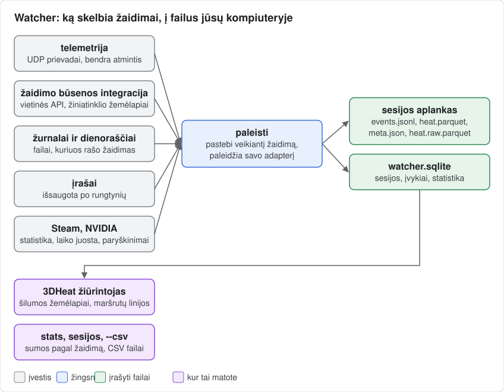

# 3DHeat Watcher {#dheat-watcher}

**Kas tai?** Jūs žaidžiate žaidimą. Ši programa tyliai užrašo, kur nuvykote ir kas įvyko.
Vėliau tai galite pažiūrėti kaip spalvotą žemėlapį 3DHeat žiūrintuve.

**Kam tai naudoti?** Kad turėtumėte savo įrašą apie kiekvieną sėdėjimą – kur važiavote, skridote ar kovojote,
savo sumas pagal žaidimą – be jokios svetainės ir nekeisdami žaidimo.

**Pavyzdys:** važiuojate ratą lenktynių žaidime su veikiančiu watcher; vėliau aplanke `sessions\<game>\` esantis failas
laiko jūsų važiuotą liniją, o žiūrintojas ją nupiešia.

Išsamiau: 3DHeat Watcher yra fono programa, kuri įrašo, ką žaidimai skelbia apie jūsų žaidimą – kur nuėjote, kas kur įvyko,
ir skaičius, esančius už to – į failus jūsų kompiuteryje. Failai skirti jūsų pačių statistikai ir 3DHeat žiūrintojo šilumos
žemėlapiams bei maršrutų linijoms.

Ji veikia tyliai, pastebi, kurį žaidimą pradėjote, ir skaito to žaidimo paties išvestis: telemetrijos prievadą ar bendrąją atmintį, kurią
žaidimas skelbia skydeliams, žaidimo būsenos integraciją, žurnalą ar žurnalo failą, kurį žaidimas rašo, po rungtynių išsaugotą įrašą, Steam
laikomą statistiką, NVIDIA App išsaugotus klipus. Įrašai lieka jūsų kompiuteryje. Programa kreipiasi tik į dvi išorines paslaugas, ir tik šiais atvejais:
GitHub – ieškoti naujesnio išleidimo (žr. [Atnaujinimai](../updates.md)), ir Riot Match-V5 API – tik jei įvedate savo Riot API raktą
(žr. [League of Legends įrašai](../game-lol-replays.md)).



## Ką jis įrašo {#what-it-records}

- **Pozicijos**: automobilis, lėktuvas, herojus ar žaidėjas, kelis kartus per sekundę, kur žaidimas jas skelbia, su greičiu, kryptimi
  ir visa kita, ką žaidimas siunčia kartu.
- **Įvykiai**: atsiradimai, mirtys, žudynės, ratai, etapai, raundai, įvarčiai, darbai, pakilimai ir nusileidimai, zonų pakeitimai, laimėjimai,
  paryškinimai. Kiekvienas įvykis saugomas su savo laiku ir vieta, kai žaidimas ją pateikia.
- **Statistika kiekvienam sėdėjimui**: žudynės, mirtys, ratai, geriausias ratas, atstumas, didžiausias greitis, žaidimo laikas, o kur žaidimas jas
  laiko – ir pačio žaidimo statistika.

Ką duoda kiekvienas žaidimas ir iš kur, nurodyta jo puslapyje skyriuje [Žaidimai](../games.md). Vienas šaltinis negali įrašyti visko:
daugelio žaidėjų žaidimai įrašomi tik per tai, ką jie skelbia, o watcher niekada neskaito jų atminties
(žr. [Šaltiniai ir taisyklės](../sources-and-rules.md)).

## Įdiegimas {#install}

Nesate įpratę prie komandinės eilutės? Pirmiausia perskaitykite [Prieš pradedant](before-you-start.md).

Watcher yra Python programa Windows sistemai (Python 3.10 ar naujesnė). Daugelis jo šaltinių egzistuoja tik Windows:
bendroji atmintis, registras, Windows pranešimai.

```bash
git clone https://github.com/Holdi601/3DHeat-Watcher.git
cd 3DHeat-Watcher
pip install -r requirements.txt
```

Išleidimo archyvas veikia taip pat: išskleiskite, tada vykdykite `pip install -r requirements.txt`
aplanke. Detalės ir kai kuriems žaidimams reikalingi priedai aprašyti
[Įdiegimas ir paleidimas](../installing-and-running.md).

## Greita pradžia {#quick-start}

```bash
python -m heat3d_watch games            # kiekvienas žaidimas: ką duoda ir iš kur
python -m heat3d_watch setup all        # ką reiktų įjungti (nieko nekeičiama)
python -m heat3d_watch setup f1-25 --apply   # įjungti vieno žaidimo išvestį (originalus failas atsarginis)
python -m heat3d_watch run              # stebėti; palikite veikti, kol žaidžiate
python -m heat3d_watch stats            # sumos pagal žaidimą
python -m heat3d_watch stats --csv out  # sesijos, įvykiai ir statistika kaip CSV failai
```

Turėtumėte matyti: po `games` – lentelę su po eilutę kiekvienam žaidimui; `run` tęsiasi, kol paspausite Ctrl+C arba uždarysite langą.

Viskas įrašoma į `%LOCALAPPDATA%\3DHeat\Watcher`. Norėdami naudoti kitą aplanką, nustatykite aplinkos kintamąjį
`HEAT3D_WATCH_HOME` arba paleiskite `python -m heat3d_watch config --set data=D:\somewhere`.

- `sessions\<game>\<date>_<adapter>\` – po aplanką kiekvienam sėdėjimui, jame `events.jsonl` (kiekvienas įvykis, kai jis įvyksta),
  `heat.parquet` (eilutės su pozicija, paruoštos 3DHeat žiūrintojui) ir `meta.json` (žaidimas, šaltinis, ašys, skaičiai, statistika)
- `watcher.sqlite` – kiekvienos sesijos statistika trijose paprastose lentelėse
- `watcher.log` – ką darė watcher

Žiūrintojas atidaro sesijos `heat.parquet` tiesiogiai, nieko nekonfigūruojant (jo ašys ir vienetai yra faile). Konvertuoti įrašai
rašomi kaip lentelės ir rungtynių dokumentai šalia jo; žiūrintojo vieno failo rungtynių formatas aprašytas jo
[`.3dheat` konteinerio](https://holdi601.github.io/3DHeat/container.html) puslapyje, o kiekvienos lentelės stulpeliai –
[Duomenys](../the-data.md).

## Dokumentacija {#the-documentation}

| Puslapis | Ką jame rasite |
|---|---|
| [Prieš pradedant](before-you-start.md) | Python, terminalas, žymekliai, kaip atrodo sėkmė ir dažnos klaidos |
| [Įdiegimas ir paleidimas](../installing-and-running.md) | reikalavimai, paleidimas fone, paleidimas su Windows, užrakto failas, žurnalas, kiekviena nuostata ir aplinkos kintamasis |
| [Žaidimai](../games.md) | kiekvienas žaidimas atskirai: kas įrašoma, iš kur, kaip įjungti, kaip veikia, ašys, statistika, kas patikrinta |
| [Duomenys](../the-data.md) | sesijų aplankai, `events.jsonl`, `heat.parquet` ir jo poraštė, `meta.json`, `watcher.sqlite`, atkūrimas po avarijos, CSV eksportas, sesijos atidarymas 3DHeat žiūrintuve |
| [Komandos](../commands.md) | kiekviena `python -m heat3d_watch` komanda ir parinktis |
| [Šaltiniai ir taisyklės](../sources-and-rules.md) | šeši šaltinių tipai, daugelio žaidėjų taisyklės, kurie žaidimai praleidžiami ir kodėl |
| [NVIDIA Highlights](../nvidia-highlights.md) | ką NVIDIA Highlights gali ir ko negali pateikti ir kaip paryškinimas gauna poziciją |
| [Serverio įrašymo modai](../server-mods.md) | Arma 3 ir Arma Reforger serverio modai, įrašantys visas misijas žiūrintojui |
| [Atminties skaitymas](../memory-reading.md) | vieno žaidėjo atminties profiliai: formatas, patikros, kaip parašyti ir patikrinti |
| [Atnaujinimai](../updates.md) | kaip watcher ieško naujų išleidimų ir atsinaujina pats |
| [Kūrimas](../development.md) | adapterio rašymas: API, testai, sąžiningas `verified`, žaidimų puslapių generavimas iš naujo |
| [Visi žaidimai vienoje lentelėje](../watcher.md) | kiekvienas žaidimas vienoje lentelėje, kaip ją išveda `games --markdown`, ir žaidimai, ištirti, bet dar nepadaryti |
| [Komandų nuoroda](../cli-reference.md) | kiekvienos komandos `--help`, sugeneruotas iš kodo |
| [Šių dokumentų priežiūra](../maintaining.md) | šių puslapių išleidimo kontrolinis sąrašas |

## Dalis 3DHeat {#part-of-3dheat}

3DHeat Watcher yra vienas iš nemokamų įrankių aplink 3DHeat žiūrintoją (watcher naudoja 3DHeat CS2 CS2 demo konvertavimui).
Kiekvienas yra atskiras projektas su savo išleidimais ir licencija:

| Įrankis | Ką daro | Dokumentacija |
|---|---|---|
| [3DHeat](https://github.com/Holdi601/3DHeat) | žiūrintojas: šilumos žemėlapiai, lenktynių analizė ir rungtynių apžvalga 3D | [svetainė](https://holdi601.github.io/3DHeat/) |
| [GameFiles](https://github.com/Holdi601/3DHeat-GameFiles) | trasos ir lygiai iš žaidimų pristatomų failų kaip 3D modeliai | [svetainė](https://holdi601.github.io/3DHeat-GameFiles/) |
| [GameCapture](https://github.com/Holdi601/3DHeat-GameCapture) | ratų telemetrija iš lenktynių žaidimų; lygiai, atkurti iš žaidimo vaizdo | [svetainė](https://holdi601.github.io/3DHeat-GameCapture/) |
| [Unreal Exporter](https://github.com/Holdi601/3DHeat-UnrealExporter) | Unreal Editor papildinys, eksportuojantis lygį kaip vieną 3D modelį | [svetainė](https://holdi601.github.io/3DHeat-UnrealExporter/) |
| [CS2](https://github.com/Holdi601/3DHeat-CS2) | Counter-Strike 2 demo į lenteles ir rungtynių dokumentus; žemėlapiai į 3D modelius | [svetainė](https://holdi601.github.io/3DHeat-CS2/) |
| [Watcher](https://github.com/Holdi601/3DHeat-Watcher) | fone įrašo, ką žaidimai skelbia apie jūsų žaidimą | [svetainė](https://holdi601.github.io/3DHeat-Watcher/) |
| [Ext-WarThunder](https://github.com/Holdi601/3DHeat-Ext-WarThunder) | War Thunder įrašai į lenteles ir rungtynių dokumentus | [svetainė](https://holdi601.github.io/3DHeat-Ext-WarThunder/) |
| [Ext-WoT](https://github.com/Holdi601/3DHeat-Ext-WoT) | World of Tanks įrašai į lenteles ir rungtynių dokumentus | [svetainė](https://holdi601.github.io/3DHeat-Ext-WoT/) |
| [Ext-WoWs](https://github.com/Holdi601/3DHeat-Ext-WoWs) | World of Warships įrašai į lenteles ir rungtynių dokumentus | [svetainė](https://holdi601.github.io/3DHeat-Ext-WoWs/) |
| [Ext-Squad](https://github.com/Holdi601/3DHeat-Ext-Squad) | Squad serverių demo į lenteles ir rungtynių dokumentus | [svetainė](https://holdi601.github.io/3DHeat-Ext-Squad/) |
| [Ext-DCS](https://github.com/Holdi601/3DHeat-Ext-DCS) | DCS World žemėlapiai į 3D modelius | [svetainė](https://holdi601.github.io/3DHeat-Ext-DCS/) |
| [Ext-IL2](https://github.com/Holdi601/3DHeat-Ext-IL2) | IL-2 Sturmovik žemėlapiai į 3D modelius | [svetainė](https://holdi601.github.io/3DHeat-Ext-IL2/) |

Licencija: MIT ([LICENSE](https://github.com/Holdi601/3DHeat-Watcher/blob/main/LICENSE)). Trečiųjų šalių paketų, kuriuos
jis naudoja, licencijos ir tai, ko reikalauja žaidimai, kuriuos jis skaito, išvardytos
[LICENSES.md](https://github.com/Holdi601/3DHeat-Watcher/blob/main/LICENSES.md).
