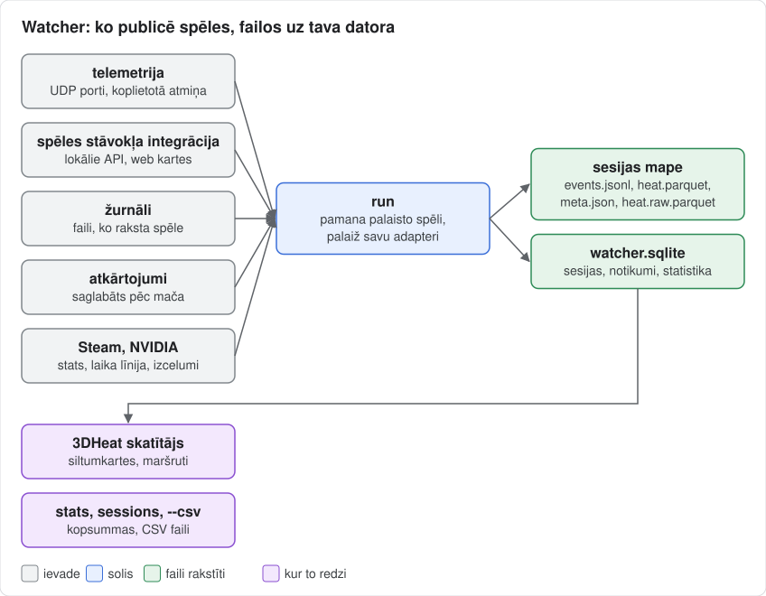

# 3DHeat Watcher {#dheat-watcher}

**Kas tas ir?** Jūs spēlējat spēli. Šī programma klusi pieraksta, kur jūs gājāt un kas notika.
Vēlāk to var apskatīt kā krāsainu karti 3DHeat skatītājā.

**Kāpēc to lietot?** Lai glabātu savu ierakstu par katru sesiju - kur braucāt, lidojāt vai cīnījāties,
savus kopsummas katrā spēlē - bez jebkādas vietnes un bez spēles mainīšanas.

**Piemērs:** jūs braucat braucienu sacensību spēlē, kamēr darbojas Watcher; pēc tam fails
`sessions\<game>\` satur līniju, pa kuru jūs braucāt, un skatītājs to uzzīmē.

Sīkāk: 3DHeat Watcher ir fona programma, kas pieraksta to, ko spēles publicē par jūsu spēli - kur jūs gājāt,
kas kur notika un skaitļus aiz tā - failos uz jūsu paša datora. Faili ir domāti jūsu pašu statistikai un
3DHeat skatītāja siltumkartēm un maršrutu līnijām.

Tā darbojas klusi, pamana, kuru spēli jūs sākāt, un nolasa šīs spēles pašas izvades: telemetrijas portu vai
koplietoto atmiņu, ko spēle publicē panelēm, spēles stāvokļa integrāciju, žurnālu vai reģistru, ko spēle raksta,
atkārtojumu, ko tā saglabā pēc mača, statistiku, ko glabā Steam, klipus, ko saglabā NVIDIA App. Ieraksti paliek
tavā datorā. Programma sazinās tikai ar diviem ārējiem pakalpojumiem un tikai šajos gadījumos: GitHub, lai meklētu
jaunāku versiju (skat. [Atjauninājumi](../updates.md)), un Riot Match-V5 API, un tikai tad, ja ievadāt savu Riot API atslēgu
(skat. [League of Legends atkārtojumi](../game-lol-replays.md)).



## Ko tas ieraksta {#what-it-records}

- **Pozīcijas**: auto, lidmašīna, varonis vai spēlētājs, vairākas reizes sekundē, kur spēle tās publicē, ar ātrumu, virzienu un visu citu, ko spēle sūta kopā ar tām.
- **Notikumi**: dzimšanas, nāves, nogalināšanas, apļi, posmi, raundi, vārti, darbi, pacelšanās un nolaišanās, zonu maiņas, sasniegumi, izcelumi. Katrs notikums tiek saglabāts ar savu laiku un ar savu vietu, kad spēle to dod.
- **Statistika katrai sesijai**: nogalināšanas, nāves, apļi, labākais aplis, attālums, maksimālais ātrums, spēles laiks un spēles pašas statistika, kur tā to glabā.

Ko katra spēle dod un no kurienes, ir tās pašas lapā sadaļā [Spēles](../games.md). Neviens avots nevar ierakstīt visu: daudzspēlētāju spēles tiek ierakstītas tikai ar to, ko tās publicē, un watcher nekad nenolasa to atmiņu (skat. [Avoti un noteikumi](../sources-and-rules.md)).

## Uzstādīšana {#install}

Nekad neesat strādājis ar komandrindu? Vispirms izlasiet [Pirms sākat](before-you-start.md).

Watcher ir Python programma Windows videi (Python 3.10 vai jaunāks). Daudzi tā avoti pastāv tikai Windows: koplietotā
atmiņa, reģistrs, Windows paziņojumi.

```bash
git clone https://github.com/Holdi601/3DHeat-Watcher.git
cd 3DHeat-Watcher
pip install -r requirements.txt
```

Lejupielādēts izlaides arhīvs darbojas tāpat: izpakojiet to, tad palaidiet `pip install -r requirements.txt`
mapē. Sīkāka informācija un papildinājumi, kas vajadzīgi dažām spēlēm, ir lapā
[Uzstādīšana un palaišana](../installing-and-running.md).

## Ātrais sākums {#quick-start}

```bash
python -m heat3d_watch games            # katra spēle: ko tā dod un no kurienes
python -m heat3d_watch setup all        # kas būtu jāieslēdz (nekas nav mainīts)
python -m heat3d_watch setup f1-25 --apply   # ieslēdz vienas spēles izvadi (oriģinālais fails tiek saglabāts kopijā)
python -m heat3d_watch run              # ieraksta; atstāj darbojamies, kamēr spēlē
python -m heat3d_watch stats            # kopsummas katrai spēlei
python -m heat3d_watch stats --csv out  # sesijas, notikumi un statistika kā CSV faili
```

Jums vajadzētu redzēt: pēc `games` tabulu ar vienu rindu katrai spēlei; `run` darbojas, līdz nospiediet
Ctrl+C vai aizverat logu.

Viss tiek rakstīts `%LOCALAPPDATA%\3DHeat\Watcher`. Lai izmantotu citu mapi, iestatiet vides mainīgo
`HEAT3D_WATCH_HOME` vai palaidiet `python -m heat3d_watch config --set data=D:\somewhere`.

- `sessions\<game>\<date>_<adapter>\` - viena mape katrai sesijai, kurā ir `events.jsonl` (katrs notikums, kā tas notiek),
  `heat.parquet` (rindas ar pozīciju, gatavas 3DHeat skatītājam) un `meta.json` (spēle, avots, asis, skaitļi, statistika)
- `watcher.sqlite` - katras sesijas statistika trīs vienkāršās tabulās
- `watcher.log` - ko watcher darīja

Skatītājs atver sesijas `heat.parquet` tieši, nekas nav jāiestata (tā asis un vienības ir failā). Konvertētie
atkārtojumi tiek rakstīti kā tabulas un mača dokumenti blakus tam; skatītāja pašu formāts vienam mačam vienā failā
ir aprakstīts tā lapā [`.3dheat` konteiners](https://holdi601.github.io/3DHeat/container.html), un katras tabulas
kolonnas - lapā [Dati](../the-data.md).

## Dokumentācija {#the-documentation}

| Lapa | Ko tā aptver |
|---|---|
| [Pirms sākat](before-you-start.md) | Python, termināls, vietturi, kā izskatās veiksme un biežākās kļūdas |
| [Uzstādīšana un palaišana](../installing-and-running.md) | prasības, darbība fonā, palaišana kopā ar Windows, bloķēšanas fails, žurnāls, katrs iestatījums un vides mainīgais |
| [Spēles](../games.md) | viena lapa katrai spēlei: kas tiek ierakstīts, no kurienes, kā to ieslēgt, kā tas darbojas, asis, statistika, kas pārbaudīts |
| [Dati](../the-data.md) | sesiju mapes, `events.jsonl`, `heat.parquet` un tā kājene, `meta.json`, `watcher.sqlite`, atkopšana pēc avārijas, CSV eksports, sesijas atvēršana 3DHeat skatītājā |
| [Komandas](../commands.md) | katra komanda un iespēja `python -m heat3d_watch` |
| [Avoti un noteikumi](../sources-and-rules.md) | seši avotu veidi, daudzspēlētāju noteikumi, kuras spēles ir izlaistas un kāpēc |
| [NVIDIA Highlights](../nvidia-highlights.md) | ko NVIDIA Highlights var un ko nevar dot, un kā izcelums iegūst pozīciju |
| [Servera ierakstītāju modifikācijas](../server-mods.md) | Arma 3 un Arma Reforger servera modifikācijas, kas ieraksta veselas misijas skatītājam |
| [Atmiņas nolasīšana](../memory-reading.md) | vienspēlētāja atmiņas profili: formāts, pārbaudes, kā uzrakstīt un pārbaudīt vienu |
| [Atjauninājumi](../updates.md) | kā watcher meklē jaunas versijas un atjaunina pats sevi |
| [Izstrāde](../development.md) | adaptera rakstīšana: API, testi, godīgs `verified`, spēļu lapu ģenerēšana no jauna |
| [Visas spēles vienā tabulā](../watcher.md) | katra spēle vienā tabulā, kā to izdrukā `games --markdown`, plus spēles, kas izpētītas, bet vēl nav uzbūvētas |
| [Komandu atsauce](../cli-reference.md) | katras komandas `--help`, ģenerēts no koda |
| [Uzturēšana](../maintaining.md) | izlaides kontrolsaraksts šīm lapām |

## Daļa no 3DHeat {#part-of-3dheat}

3DHeat Watcher ir viens no bezmaksas rīkiem ap 3DHeat skatītāju (watcher izmanto 3DHeat CS2, lai
konvertētu CS2 demo). Katrs ir atsevišķs projekts ar savām izlaidēm un licenci:

| Rīks | Ko tas dara | Dokumentācija |
|---|---|---|
| [3DHeat](https://github.com/Holdi601/3DHeat) | skatītājs: 3D siltumkartes, sacensību analīze un maču pārskats | [vietne](https://holdi601.github.io/3DHeat/) |
| [GameFiles](https://github.com/Holdi601/3DHeat-GameFiles) | trases un līmeņi no spēļu piegādātajiem failiem kā 3D modeļi | [vietne](https://holdi601.github.io/3DHeat-GameFiles/) |
| [GameCapture](https://github.com/Holdi601/3DHeat-GameCapture) | braucienu telemetrija no sacensību spēlēm; līmeņi, atjaunoti no spēles video | [vietne](https://holdi601.github.io/3DHeat-GameCapture/) |
| [Unreal Exporter](https://github.com/Holdi601/3DHeat-UnrealExporter) | Unreal Editor spraudnis, kas eksportē līmeni kā vienu 3D modeli | [vietne](https://holdi601.github.io/3DHeat-UnrealExporter/) |
| [CS2](https://github.com/Holdi601/3DHeat-CS2) | Counter-Strike 2 demo tabulās un mača dokumentos; kartes 3D modeļos | [vietne](https://holdi601.github.io/3DHeat-CS2/) |
| [Watcher](https://github.com/Holdi601/3DHeat-Watcher) | fona režīmā ieraksta to, ko spēles publicē par jūsu spēli | [vietne](https://holdi601.github.io/3DHeat-Watcher/) |
| [Ext-WarThunder](https://github.com/Holdi601/3DHeat-Ext-WarThunder) | War Thunder atkārtojumi tabulās un mača dokumentos | [vietne](https://holdi601.github.io/3DHeat-Ext-WarThunder/) |
| [Ext-WoT](https://github.com/Holdi601/3DHeat-Ext-WoT) | World of Tanks atkārtojumi tabulās un mača dokumentos | [vietne](https://holdi601.github.io/3DHeat-Ext-WoT/) |
| [Ext-WoWs](https://github.com/Holdi601/3DHeat-Ext-WoWs) | World of Warships atkārtojumi tabulās un mača dokumentos | [vietne](https://holdi601.github.io/3DHeat-Ext-WoWs/) |
| [Ext-Squad](https://github.com/Holdi601/3DHeat-Ext-Squad) | Squad servera demo tabulās un mača dokumentos | [vietne](https://holdi601.github.io/3DHeat-Ext-Squad/) |
| [Ext-DCS](https://github.com/Holdi601/3DHeat-Ext-DCS) | DCS World kartes 3D modeļos | [vietne](https://holdi601.github.io/3DHeat-Ext-DCS/) |
| [Ext-IL2](https://github.com/Holdi601/3DHeat-Ext-IL2) | IL-2 Sturmovik kartes 3D modeļos | [vietne](https://holdi601.github.io/3DHeat-Ext-IL2/) |

Licence: MIT ([LICENSE](https://github.com/Holdi601/3DHeat-Watcher/blob/main/LICENSE)). Trešo pušu pakotņu
licences, ko tas izmanto, un to, ko prasa spēles, ko tas nolasa, uzskaitītas lapā
[LICENSES.md](https://github.com/Holdi601/3DHeat-Watcher/blob/main/LICENSES.md).
