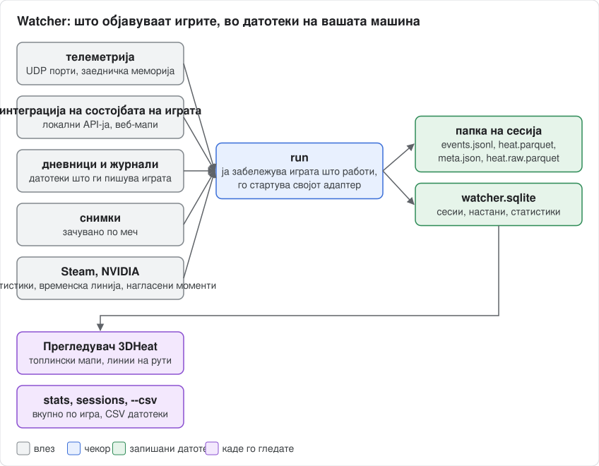
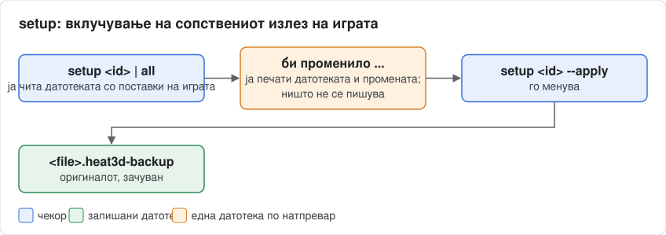
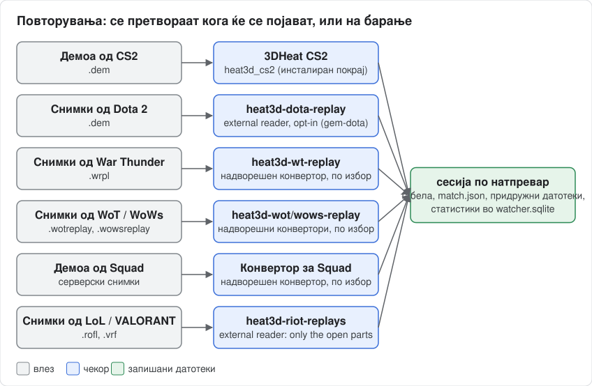
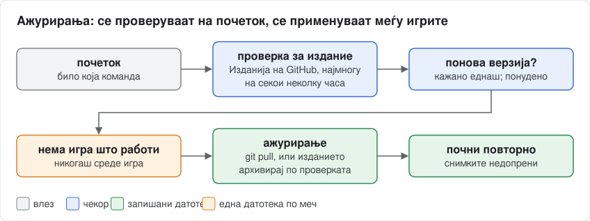

# Команди {#commands}

Нови сте со командната линија? Прво прочитајте [Пред да започнете](before-you-start.md). Секоја команда
се пишува во терминал отворен во папката што сте ја распакувале или клонирале (во File Explorer
напишете `powershell` во адресната лента), вака

```bash
python -m heat3d_watch <command> [options]
```


| Команда | Што прави |
|---|---|
| [`run`](#run) | набљудува во позадина и ја снима секоја игра што работи |
| [`games`](#games) | што дава секоја игра и од каде |
| [`setup`](#setup) | го вклучува сопствениот излез на играта |
| [`status`](#status) | кои игри работат сега и кои адаптери би работеле |
| [`sessions`](#sessions) | досегашните снимки |
| [`stats`](#stats) | збирови по игра, или табелите како CSV |
| [`table`](#table) | повторно го гради `heat.parquet` на една сесија од нејзиниот `events.jsonl` |
| [`replays`](#replays) | ги претвора повторувањата што веќе се на дискот |
| [`dota-replay`](#dota-replay) | го презема повторувањето на јавен натпревар во Dota 2 според неговиот id |
| [`dota-map`](#dota-map) | мапата на Dota 2 од вашата инсталација како 3D ниво за прегледувачот |
| [`update`](#update) | се ажурира до најновото издание |
| [`config`](#config) | ги прикажува или менува поставките |

Опции за секоја команда: `-h` / `--help` ја печати помошта, а `python -m heat3d_watch --version`
ја печати верзијата (датотеката `VERSION`).

Сликите на оваа страница се од извршувања на синтетички примерни сесии (`Example Racer`, `Example Arena`),
а не од вистински снимки.

Секоја команда освен `update` прво бара поново издание (најмногу на секои шест часа; се прескокнува со
`HEAT3D_NO_UPDATE=1`, видете [Ажурирања](updates.md)). `run` само печати известување. Другите команди
прашуваат `Update now? [Y/n]` кога работат во терминал, а кога не работат, печатат како да се ажурира.
Излезот е UTF-8, па имињата на игрите во кое било писмо се печатат во секоја конзола.

## run {#run}

```bash
python -m heat3d_watch run [--once] [-v]
```



Набљудува додека не го запрете (Ctrl+C): на секои `scan_seconds` ја чита листата на процеси и
пушта адаптер за секоја игра што ќе ја најде, плус адаптерите што секогаш работат. Пред првото
гледање ги завршува сесиите што претходното извршување ги оставило отворени. Додека не работи
ниедна игра, може сам да се ажурира (кога `auto_update` е вклучено). Подробностите се во
[Инсталирање и пуштање](installing-and-running.md#running).

| Опција | Ефект |
|---|---|
| `--once` | еден поглед на играта што работи, па излегување. Се пуштаат адаптерите за играта што работи сега (и оние што секогаш работат), секој прашува еднаш (за тоа се чека најмногу 10 секунди), а потоа сите се запираат како кога играта ќе заврши: нивните сесии се затвораат, запишуваат и бројат. За проверка на откривањето, не за снимање. |
| `-v`, `--verbose` | редови за дебагирање во `watcher.log` и на конзолата |

`run` пишува `<data>\watcher.lock` и одбива да се пушти втор пат за истата папка со податоци (излезен
код 1); видете [Датотеката за заклучување](installing-and-running.md#the-lock-file).

## games {#games}

```bash
python -m heat3d_watch games [--markdown]
```


Ги наведува сите адаптери подредени по игра: името, id-то и видот, од каде чита, што снима и
како се вклучува. Адаптер што не може да работи на овој компјутер е означен
`[unavailable: <why>]` - SimConnect.dll не е најден, нема папка на Minecraft, 3DHeat CS2 не е инсталиран,
Steam или NVIDIA App не се најдени. Адаптерски модул што не успеал да се увезе се именува на крајот
со грешката.

```text
EA SPORTS F1 25  (f1-25, telemetry)
    from: UDP telemetry 127.0.0.1:20777 (Documents\My Games\F1 25\hardwaresettings\hardware_settings_config.xml)
    - every car's position (world XYZ, m) at 10 Hz, by driver name, team, own car marked, ...
    switch on: In the game: Settings > Telemetry Settings > UDP Telemetry On, IP 127.0.0.1, port 20777 - ...
```

`--markdown` го печати истото како една Markdown табела (игра, што се снима, од каде, како да се
вклучи, онлајн игра, проверено). Табелата во [Сите игри во една табела](watcher.md) е тој излез. Ќелиите
се прилагодени за Markdown: текстот во обратни наводници останува код, а надвор од нив `<`, `>`, `&`, `*`, `|`
и обратна коса црта пред интерпункција се пишуваат така што се покажуваат како што се впишани (`<CS2>`
инаку би исчезнало како HTML ознака во kramdown). Единственото парче HTML е `<br>` меѓу ставките на
„Што се снима“.

## setup {#setup}

```bash
python -m heat3d_watch setup <adapter id | all> [--apply]
```




Го вклучува сопствениот излез на играта, кога на играта ѝ треба променета датотека за тоа. Без `--apply`
ништо не се менува: секој ред кажува што би се променило, а кога има што да се промени, последниот
ред вели `Nothing was changed. Run again with --apply to make these changes.` Кога нема што да се
промени, вели `<id>: nothing to change` (`Nothing to change.` за `all`). Со `--apply` промените
се прават, а пред датотеката да се промени за прв пат, нејзиниот оригинал се зачувува како
`<file>.heat3d-backup`. Резервна копија што веќе постои никогаш не се пребришува, па секогаш ја содржи
датотеката каква што била пред watcher-от првпат да ја допре.

```text
f1-25: would change: hardware_settings_config.xml <udp>: enabled="false" -> "true"
Nothing was changed. Run again with --apply to make these changes.
```

`all` го пушта поставувањето на секој адаптер што има такво. Адаптер без поставување, наведен сам,
печати `<id>: nothing for setup to change; ` проследено со тоа како се вклучува играта (нејзиниот
`enable` текст, или дека не ѝ треба ништо). Непознат id печати `no adapter '<id>'; games lists them` и
излегува со код 2. Адаптерите што имаат што да се постави:

| Адаптер | Што менува `--apply` |
|---|---|
| `beamng` | го инсталира модот за протокол `heat3d` во корисничката папка `mods` на BeamNG (само кога го нема таму); потоа вклучете Options > Other > Protocols > "others" во играта |
| `cs2-gsi` | пишува `<CS2>\game\csgo\cfg\gamestate_integration_heat3d.cfg`: праќај ја состојбата на играта до `http://127.0.0.1:3311/` со случаен токен што watcher-от потоа го бара (токен што веќе е во датотеката се задржува); CS2 ја чита кога ќе се стартува |
| `dota2-gsi` | исто за Dota 2: `<Dota>\game\dota\cfg\gamestate_integration\gamestate_integration_heat3d.cfg`, порта 3312 |
| `dcs` | додава `Scripts\Hooks\heat3d-watch.lua` во секоја папка `%USERPROFILE%\Saved Games\DCS*`. Неговата постара копија се ажурира; датотека со тоа име што watcher-от не ја напишал се остава на мира. Рестартирајте го DCS. |
| `dirt-rally-2` | `hardware_settings_config.xml`: `<udp enabled="true" extradata="3" ip="127.0.0.1" port="20777">`; прво стартувајте ја играта еднаш за да постои датотеката |
| `ea-wrc` | `Documents\My Games\WRC\telemetry\config.json`: пакетот `session_update` на структурата `wrc` вклучен, кон овој компјутер |
| `f1-23`, `f1-24`, `f1-25` | `hardware_settings_config.xml`: `<udp enabled="true" ip="127.0.0.1" port="20777">`; играта мора да е затворена |
| `hearthstone` | додава дел `[Power]` (`LogLevel=1`, `FilePrinting=true`) во `%LOCALAPPDATA%\Blizzard\Hearthstone\log.config`; рестартирајте ја играта |
| `il2` | `<game>\data\startup.cfg`, `[KEY = telemetrydevice]`: уште една цел `addrN = "127.0.0.1:41995"` и `enable = true` (делот се додава, на 10 Hz, кога го нема); рестартирајте го IL-2 |
| `il2-tacview` | `<game>\data\startup.cfg`, `[KEY = track_record]`: `tacviewrecord = 1` |
| `rocketleague-stats` | `TAStatsAPI.ini` (или `DefaultStatsAPI.ini` кога тој не постои) во `<RL>\TAGame\Config`: `PacketSendRate=30` кога API-то е исклучено, и `Port` кога ниеден не е зададен; се чита кога Rocket League ќе се стартува |

`richard-burns-rally` нема поставување: неговата телеметрија е на приклучокот RSF/NGP, вклучена рачно во
`RichardBurnsRally.ini` (видете [неговата страница](game-richard-burns-rally.md)); `setup richard-burns-rally`
го кажува тоа. Секоја друга игра или не бара ништо или се вклучува во играта; страницата на секоја игра кажува како.

## status {#status}

```bash
python -m heat3d_watch status
```

```text
3DHeat Watcher 1.0.2; data in C:\Users\...\AppData\Local\3DHeat\Watcher
Games running: EA SPORTS F1 25 (f1-25)
Always on: il2-tacview, steam-stats, steam-timeline, nvidia-highlights, cs2-demos, osu-replays, lol-replays, valorant-replays
```

Кажува кои адаптери би ги пуштил `run` сега, по истите правила: процесот на играта работи,
адаптерот не е во `disabled`, нема што му треба да недостасува, адаптерите за повторувања само со вклучено `replays`,
адаптерите за меморија само со вклучено `memory` и сите проверки на меморијата поминати. Не стартува ништо.

## sessions {#sessions}

```bash
python -m heat3d_watch sessions [--game NAME] [--limit N]
```


Најновите сесии од `watcher.sqlite`, по еден ред: почеток (локално време), игра, минути, настани,
позиции, папка.

| Опција | Ефект |
|---|---|
| `--game NAME` | само оваа игра, по нејзиното точно име како во листата (`"EA SPORTS F1 25"`) |
| `--limit N` | најмногу N сесии (стандардно 40) |

## stats {#stats}

```bash
python -m heat3d_watch stats [--game NAME] [--csv DIR]
```


Без опции: табела на секоја игра (сесии, часови, настани, позиции, последно играно), најмногу играните
први, па за секоја игра нејзините 25 најчести настани и секоја бројчена статистика со бројот на
сесии што ја имаат, збирот, најдобрата вредност (`best`) и просекот. `best` знае која насока е
подобра: најниската вредност за времињата што се чуваат како најдобри (`best_lap`, `best_stage` и секој друг клуч што
почнува со `best_`) и за местата (`race_position`, `grid_position`, секој клуч што завршува на `_position`),
највисоката за сè друго (убиства, растојание, максимална брзина, сопствени бројачи на играта).

| Опција | Ефект |
|---|---|
| `--game NAME` | само настаните и статистиката на оваа игра, без прегледот |
| `--csv DIR` | наместо тоа ги пишува `sessions.csv`, `events.csv` и `stats.csv` (секој ред од трите табели) во `DIR`; `--game` не го стеснува |

## table {#table}

```bash
python -m heat3d_watch table <session folder>
```


Го гради повторно `heat.parquet` во папката на една сесија од нејзиниот `events.jsonl`, со оските од
нејзиниот `meta.json`. Ја печати патеката на табелата, или `no positions in this session`. Користете го за сесија снимена
додека `pyarrow` недостасувал, или откако `events.jsonl` е изменет рачно.

## replays {#replays}

```bash
python -m heat3d_watch replays <adapter id> [folder] [-v]
```



Ги претвора повторувањата што веќе се на дискот, сега, едно по едно, секое во сесија како што би го
направило следењето на папката. Првиот пат кога watcher-от ќе види папка со повторувања, само запишува што има во неа (видете
[Инсталирање и пуштање](installing-and-running.md#replays-already-on-disk)); вака тие се претвораат
на барање. Без `folder` се читаат сопствените папки на адаптерот (на играта, плус `replay_folders`); со
него, повторувањата во таа папка. Секое претворено се запишува како видено, па watcher-от што работи не го
претвора повторно. Повторување што не успее да се претвори се запишува во дневникот и се прескокнува.

| Адаптер | Повторувања |
|---|---|
| `cs2-demos` | демоа на Counter-Strike 2 (`*.dem`), преку 3DHeat CS2 |
| `lol-replays` | повторувања на League of Legends (`*.rofl`) |
| `osu-replays` | повторувања на osu! (`*.osr`) |
| `valorant-replays` | повторувања на VALORANT (`*.vrf`) |
| `warthunder-replays` | повторувања на War Thunder (`*.wrpl`), преку надворешниот конвертор `heat3d-wt-replay` (exporters/ext/warthunder-replay) |
| `wot-replays` | повторувања на World of Tanks (`*.wotreplay`), преку надворешниот конвертор `heat3d-wot-replay` (exporters/ext/wot-replay) |
| `wows-replays` | повторувања на World of Warships (`*.wowsreplay`), преку надворешниот конвертор `heat3d-wows-replay` (exporters/ext/wows-replay) |
| `dota-replays` | повторувања на Dota 2 (`*.dem`), преку gem (`pip install gem-dota`) |

```text
osu-replays: converted 12 replay(s); `sessions --game` lists them
```

Id што не е едно од овие печати `no replay adapter '<id>'` со листата и излегува со код 2;
исто така и `folder` што не постои. Адаптер што не може да работи тука (3DHeat CS2 не е инсталиран)
печати зошто и излегува со код 1. Tacview-записите на IL-2 не се во листата: тој адаптер сам го претвора секој
завршен запис што ќе го најде.

## dota-replay {#dota-replay}

```bash
python -m heat3d_watch dota-replay <match id> [<match id> ...] [-o FOLDER] [--convert] [-v]
```

Го презема повторувањето на јавен натпревар во Dota 2 од серверите за повторувања на Valve. Му треба интернет. Id-то
на натпреварот е бројот на страницата на натпреварот во клиентот на Dota (деталите за натпреварот) или на веб-страницата
на OpenDota; Valve чува повторување неколку недели, по што преземањето не успева. Серверот и солта на повторувањето
доаѓаат од записот на OpenDota за натпреварот (`api.opendota.com/api/matches/<id>`, не треба клуч), а
датотеката од `replay<cluster>.valve.net/570/<id>_<salt>.dem.bz2`; се распакува додека пристигнува (Valve
под тоа име служи и bzip2 и Zstandard) и се зачувува како `<match id>.dem`. Без `-o` оди
во сопствената папка за повторувања на Dota кога Dota 2 е инсталирана - каде што watcher-от што работи го претвора - а инаку во
`<data>/replays/dota`. Датотека што веќе е таму се задржува. `--convert` ги претвора преземените
повторувања веднаш, како што би го направило `replays dota-replays`, и ги запишува како видени.

```text
match 9000000000: C:\Program Files (x86)\Steam\steamapps\common\dota 2 beta\game\dota\replays\9000000000.dem
```

Valve чува повторувања неколку недели; постар натпревар печати `Valve no longer has the replay of match
<id>` и излегува со код 1. Натпревар што OpenDota сè уште не го видел нема сол: пораката кажува да ја побарате
од OpenDota (`curl -X POST https://api.opendota.com/api/request/<id>`) и да се обидете повторно по неколку
минути. Приватните лобија и натпреварите со скриен профил воопшто ги нема на серверите за повторувања.

## dota-map {#dota-map}

```bash
python -m heat3d_watch dota-map [<map>] -o <file.glb> [--game FOLDER] [--source2viewer EXE] [--detail UNITS]
```

Ја пишува мапата на Dota 2 - земја, карпи, вода, дрва и згради - како ниво `.glb` во рамката во која
се цртаат табелите од повторувањата на Dota, од вашата сопствена инсталација на Dota 2, прочитана преку командната линија на
Source2Viewer. Ништо не се презема. `<map>` е стандардно `dota`; `--game` е папката на Dota 2 кога
не е во библиотека на Steam; `--source2viewer` е патеката до CLI-то кога не е ниту во `HEAT3D_SOURCE2VIEWER`
ниту во `PATH`; `--detail` е ќелијата за здружување на темиња за згради во единици на играта (стандардно 8, 0 го задржува
секој триаголник). Излегува со код 1 и `dota-map: <why>` кога Dota 2, мапата или Source2Viewer не се
најдени. Секој чекор, деловите на датотеката и како е проверена: [Мапа на Dota 2](dota-map.md).

## update {#update}

```bash
python -m heat3d_watch update [--check]
```



Го пита GitHub за најновото издание, игнорирајќи го кешираниот одговор, и ја ажурира оваа копија кога е
поново (видете [Ажурирања](updates.md)). `--check` само кажува дали има поново издание. Оваа команда работи дури
и со поставено `HEAT3D_NO_UPDATE`: самото барање е одлука. `python -m heat3d_update [--check]` го
прави истото.

## config {#config}

```bash
python -m heat3d_watch config [--set KEY=VALUE ...]
```


Ја печати секоја поставка како `key = value`. Со `--set` прво ги менува зададените и ја зачувува
`settings.json` (`saved <path>`). Вредностите се читаат според типот на поставката:

- поставки точно/неточно: `1`, `true`, `yes`, `on` или `ja` е точно; `0`, `false`, `no`, `off`, `nein` или
  ништо е неточно;
- броеви: децимален број (`scan_seconds=5`);
- листи: одделени со запирки или JSON листа (`disabled=steam-stats,steam-timeline`; празна вредност ја
  празни листата);
- речници (`replay_folders`, `player_names`): целиот речник како JSON, или една ставка како
  `KEY.ID=VALUE` - `replay_folders.cs2-demos=D:\Demos,E:\More Demos` ги поставува папките на тој адаптер
  (одделени со запирки), `player_names.warthunder-webmap=Name` го поставува името за тој адаптер; празна вредност ја отстранува
  ставката;
- текст: како што е зададен (`data=D:\Heat`, `riot_id=Name#TAG`).

```bash
python -m heat3d_watch config --set memory=true scan_seconds=5
python -m heat3d_watch config --set riot_id=Name#TAG riot_platform=EUW1
python -m heat3d_watch config --set replay_folders.cs2-demos=D:\Demos player_names.rocketleague-stats=Name
```

Непознат клуч печати `no setting '<key>'`, а вредност што не е од типот на поставката (`memory=perhaps`,
`scan_seconds=often`, речник што не е JSON) печати `not saved: ...`; двете излегуваат со код 2
без ништо да зачуваат. `settings.json` изменет рачно се чита на ист начин: вредност зададена како текст
таму каде што поставката е број, точно/неточно или речник се чита како што е впишана, а вредност што не може да
се прочита се остава на стандардната. Секоја поставка е опишана во
[Инсталирање и пуштање](installing-and-running.md#settings).
