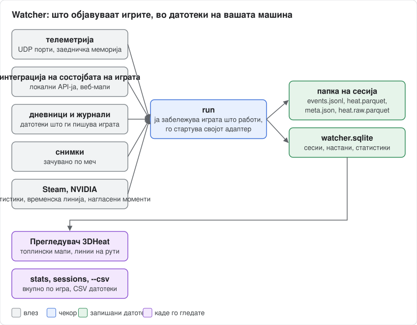

# 3DHeat Watcher {#dheat-watcher}

**Што е тоа?** Играте игра. Оваа програма тивко запишува каде сте отишле и што се случило.
Подоцна можете да го погледнете како обоена мапа во прегледувачот 3DHeat.

**Зошто би ја користеле?** За да чувате своја евиденција за секоја сесија - каде сте возеле, летале или се борееле,
вашите вкупни бројки по игра - без никаков веб-сајт и без менување на играта.

**Пример:** возите круг во тркачка игра додека Watcher работи; потоа датотека во
`sessions\<game>\` ја содржи линијата што сте ја следеле, а прегледувачот ја црта.

Подетално: 3DHeat Watcher е програма во заднина што снима што играта објавува за вашата игра - каде сте
отишле, што се случило каде, и бројките зад тоа - во датотеки на вашата сопствена машина. Датотеките се
за вашата сопствена статистика и за топлинските мапи и линиите на рути на прегледувачот 3DHeat.

Работи тивко, забележува која игра сте ја започнале и ги чита сопствените излези на таа игра: порта за
телеметрија или заедничка меморија (shared memory) што играта ја објавува за табли, интеграција на состојбата на играта, дневникот или логот
што го пишува играта, реплејот што го зачувува по натпревар, статистиките што ги чува Steam, клиповите што
ги зачувува апликацијата NVIDIA. Снимките остануваат на вашата машина. Програмата контактира само две надворешни услуги, и само во
овие случаи: GitHub, за да побара понов издание (видете [Ажурирања](updates.md)), и API-то Match-V5 на Riot,
и само ако внесете свој Riot API клуч (видете [Реплеи од League of Legends](game-lol-replays.md)).



## Што снима {#what-it-records}

- **Позиции**: автомобилот, авионот, херојот или играчот, неколку пати во секунда таму каде што играта ги
  објавува, со брзина, правец и сè друго што играта го испраќа заедно со нив.
- **Настани**: појавувања, смртни случаи, убиства, кругови, етапи, рунди, голови, задачи, полетувања и слетувања, промени
  на зона, достигнувања, нагласени моменти (highlights). Секој настан се чува со своето време, и со своето место кога
  играта дава такво.
- **Статистики по сесија**: убиства, смртни случаи, кругови, најдобар круг, растојание, максимална брзина, време на играње, и
  сопствените статистики на играта таму каде што ги чува.

Што дава секоја игра, и од каде, е на нејзината сопствена страница под [Игри](games.md). Еден извор не може да
снима сè: мултиплејер игрите се снимаат само преку она што го објавуваат, а Watcher
никогаш не ја чита нивната меморија (видете [Извори и правила](sources-and-rules.md)).

## Инсталација {#install}

Нови сте со командната линија? Прво прочитајте [Пред да започнете](before-you-start.md).

Watcher е програма на Python за Windows (Python 3.10 или понов). Многу од неговите извори постојат само на Windows: заедничката
меморија, регистарот, известувањата на Windows.

```bash
git clone https://github.com/Holdi601/3DHeat-Watcher.git
cd 3DHeat-Watcher
pip install -r requirements.txt
```

Преземена архива на издание работи на ист начин: распакувајте ја, потоа пуштете `pip install -r requirements.txt`
внатре во папката. Деталите, и дополнувањата што ги бараат некои игри, се во
[Инсталирање и пуштање](installing-and-running.md).

## Брз почеток {#quick-start}

```bash
python -m heat3d_watch games            # what each game gives, and from where
python -m heat3d_watch setup all        # what would have to be switched on (nothing is changed)
python -m heat3d_watch setup f1-25 --apply   # switch one game's output on (the original file is backed up)
python -m heat3d_watch run              # watch; leave it running while you play
python -m heat3d_watch stats            # totals per game
python -m heat3d_watch stats --csv out  # sessions, events and stats as CSV files
```

Треба да видите: по `games`, табела со по една линија за игра; `run` продолжува додека не притиснете
Ctrl+C или го затворите прозорецот.

Сè се пишува во `%LOCALAPPDATA%\3DHeat\Watcher`. За да користите друга папка, поставете ја
променливата на околината `HEAT3D_WATCH_HOME` или пуштете `python -m heat3d_watch config --set data=D:\somewhere`.

- `sessions\<game>\<date>_<adapter>\` - една папка по сесија, што ги содржи `events.jsonl` (секој настан
  како што се случува), `heat.parquet` (редовите со позиција, подготвени за прегледувачот 3DHeat) и
  `meta.json` (игра, извор, оски, броеви, статистики)
- `watcher.sqlite` - статистиките на секоја сесија, во три обични табели
- `watcher.log` - што направил Watcher

Прегледувачот ја отвора `heat.parquet` на сесијата директно, без ништо за поставување (неговите оски и единици се во
датотеката). Претворените снимки се пишуваат како табели и документи за натпревари покрај неа; сопствениот формат на прегледувачот
со една датотека по натпревар е опишан на неговата страница за [контејнерот `.3dheat`](https://holdi601.github.io/3DHeat/container.html),
а колоните на секоја табела во [Податоците](the-data.md).

## Документацијата {#the-documentation}

| Страница | Што опфаќа |
|---|---|
| [Пред да започнете](before-you-start.md) | Python, терминал, места за пополнување, како изгледаат успехот и честите грешки |
| [Инсталирање и пуштање](installing-and-running.md) | барања, работа во заднина, стартување со Windows, датотеката за заклучување, дневникот, секоја поставка и променлива на околината |
| [Игри](games.md) | една страница по игра: што се снима, од каде, како да се вклучи, како работи, оски, статистики, што е проверено |
| [Податоците](the-data.md) | папките на сесиите, `events.jsonl`, `heat.parquet` и неговото подножје, `meta.json`, `watcher.sqlite`, обновување по пад, CSV извоз, отворање сесија во прегледувачот 3DHeat |
| [Команди](commands.md) | секоја команда и опција на `python -m heat3d_watch` |
| [Извори и правила](sources-and-rules.md) | шесте видови извори, правилата за мултиплејер, кои игри се изоставени и зошто |
| [NVIDIA Highlights](nvidia-highlights.md) | што NVIDIA Highlights може и не може да достави, и како нагласениот момент добива позиција |
| [Модови за серверски снимачи](server-mods.md) | серверските модови за Arma 3 и Arma Reforger што снимаат цели мисии за прегледувачот |
| [Читање меморија](memory-reading.md) | профили на меморија за single-player: форматот, проверките, како да се напише и провери еден |
| [Ажурирања](updates.md) | како Watcher бара нови изданија и се ажурира сам |
| [Развој](development.md) | пишување адаптер: API, тестови, чесно `verified`, повторно генерирање на страниците за игри |
| [Сите игри во една табела](watcher.md) | секоја игра во една табела, како ја печати `games --markdown`, плус игрите истражени но сè уште не изградени |
| [Упатство за команди](../cli-reference.md) | `--help` на секоја команда, генерирано од кодот |
| [Одржување](maintaining.md) | списокот за проверка при издание за овие страници |

## Дел од 3DHeat {#part-of-3dheat}

3DHeat Watcher е една од бесплатните алатки околу прегледувачот 3DHeat (Watcher користи 3DHeat CS2
за претворање на демоа од CS2). Секоја е посебен проект, со свои изданија и лиценца:

| Алатка | Што прави | Документација |
|---|---|---|
| [3DHeat](https://github.com/Holdi601/3DHeat) | прегледувачот: топлински мапи, анализа на трки и преглед на натпревари во 3D | [сајт](https://holdi601.github.io/3DHeat/) |
| [GameFiles](https://github.com/Holdi601/3DHeat-GameFiles) | патеки и нивоа од датотеките што ги испорачуваат игрите, како 3D модели | [сајт](https://holdi601.github.io/3DHeat-GameFiles/) |
| [GameCapture](https://github.com/Holdi601/3DHeat-GameCapture) | телеметрија на кругови од тркачки игри; нивоа обновени од видео од игра | [сајт](https://holdi601.github.io/3DHeat-GameCapture/) |
| [Unreal Exporter](https://github.com/Holdi601/3DHeat-UnrealExporter) | приклучок за Unreal Editor што извезува ниво како еден 3D модел | [сајт](https://holdi601.github.io/3DHeat-UnrealExporter/) |
| [CS2](https://github.com/Holdi601/3DHeat-CS2) | демоа од Counter-Strike 2 во табели и документи за натпревари; мапи во 3D модели | [сајт](https://holdi601.github.io/3DHeat-CS2/) |
| [Watcher](https://github.com/Holdi601/3DHeat-Watcher) | снима што играта објавува за вашата игра, во заднина | [сајт](https://holdi601.github.io/3DHeat-Watcher/) |
| [Ext-WarThunder](https://github.com/Holdi601/3DHeat-Ext-WarThunder) | снимки од War Thunder во табели и документи за натпревари | [сајт](https://holdi601.github.io/3DHeat-Ext-WarThunder/) |
| [Ext-WoT](https://github.com/Holdi601/3DHeat-Ext-WoT) | снимки од World of Tanks во табели и документи за натпревари | [сајт](https://holdi601.github.io/3DHeat-Ext-WoT/) |
| [Ext-WoWs](https://github.com/Holdi601/3DHeat-Ext-WoWs) | снимки од World of Warships во табели и документи за натпревари | [сајт](https://holdi601.github.io/3DHeat-Ext-WoWs/) |
| [Ext-Squad](https://github.com/Holdi601/3DHeat-Ext-Squad) | демоа од Squad сервери во табели и документи за натпревари | [сајт](https://holdi601.github.io/3DHeat-Ext-Squad/) |
| [Ext-DCS](https://github.com/Holdi601/3DHeat-Ext-DCS) | мапи од DCS World во 3D модели | [сајт](https://holdi601.github.io/3DHeat-Ext-DCS/) |
| [Ext-IL2](https://github.com/Holdi601/3DHeat-Ext-IL2) | мапи од IL-2 Sturmovik во 3D модели | [сајт](https://holdi601.github.io/3DHeat-Ext-IL2/) |

Лиценца: MIT ([LICENSE](https://github.com/Holdi601/3DHeat-Watcher/blob/main/LICENSE)). Лиценците
на пакетите од трети страни што ги користи, и што бараат игрите што ги чита, се наведени во
[LICENSES.md](https://github.com/Holdi601/3DHeat-Watcher/blob/main/LICENSES.md).
