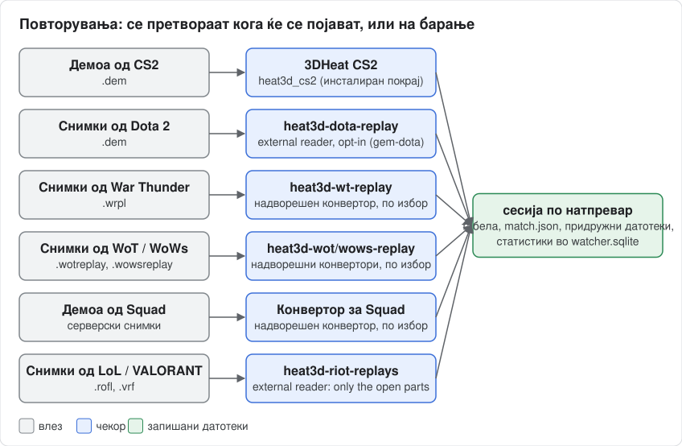

# Инсталирање и пуштање {#installing-and-running}

## Барања {#requirements}

- **Windows.** Watcher-от е напишан за Windows, а повеќето негови извори постојат само таму: заедничка
  меморија што ја создаваат игрите (мапирања `Local\...`), регистарот (каде е Steam), известувањата на Windows,
  листата на процеси со патеки до извршните датотеки. На друг систем програмата стартува, но
  тие извори не наоѓаат ништо, известувањата само се запишуваат во дневникот, а читањето меморија одбива („only
  implemented on Windows“).
- **Python 3.10 или поново**, од <https://www.python.org/downloads/>: штиклирајте **Add python.exe to PATH**
  во инсталаторот, па проверете со `python --version` во нов терминал. Нови сте во ова? Прво прочитајте
  [Пред да започнете](before-you-start.md).
- **Пакети** (`requirements.txt`): `psutil>=6.0` (кои игри работат, која програма држи
  порта, врските на играта; постар psutil сè уште работи, преку неговото постаро име за врските на процесот),
  `pyarrow>=15` (пишување на `heat.parquet`), `numpy>=1.24` и
  `pytest>=8.0` за тестовите. `requirements-optional.txt` моментално не наведува пакети.

Без `pyarrow` сесиите сепак се снимаат: `events.jsonl` е записот, а табелата може да се
изгради подоцна со [`table`](commands.md#table).

### Додатоци што ги бараат некои игри {#extras-some-games-need}

| Игра | Што ѝ треба |
|---|---|
| Демоа на Counter-Strike 2 | [3DHeat CS2](https://github.com/Holdi601/3DHeat-CS2) и неговите барања (`demoparser2`). Watcher-от го бара во `HEAT3D_CS2`, потоа во папка `3DHeat-CS2` или `cs2` покрај сопствената папка на watcher-от, потоа насекаде од каде Python може да увезе `heat3d_cs2`. Без него, `games` го наведува адаптерот како недостапен. |
| Microsoft Flight Simulator 2020 / 2024 | `SimConnect.dll` - не се испорачува. MSFS 2020 има една во својата папка на инсталацијата; за MSFS 2024 инсталирајте го MSFS 2024 SDK. `MSFS_SDK` / `MSFS2024_SDK` покажуваат кон папката на SDK. |
| Euro Truck Simulator 2, American Truck Simulator | приклучокот RenCloud `scs-telemetry.dll` (ревизија 12) во `<game>\bin\win_x64\plugins` |
| BeamNG.drive | модот за протокол `heat3d`, инсталиран со `python -m heat3d_watch setup beamng --apply` |
| League of Legends (во живо) | по избор: основниот сертификат на Riot како `<data>\riotgames.pem`, за локалната врска да биде потврдена |
| Minecraft | папка `%APPDATA%\.minecraft` (Java Edition) |

Страницата на секоја игра под [Игри](games.md) кажува што треба да се вклучи во самата игра.
`python -m heat3d_watch games` го означува адаптерот `[unavailable: ...]` кога нешто што му треба недостасува
на овој компјутер.

## Инсталирање {#installing}

Нови сте со командната линија? Прво прочитајте [Пред да започнете](before-you-start.md). Ако `pip` не е пронајден,
користете `python -m pip install -r requirements.txt`.

Од клон:

```bash
git clone https://github.com/Holdi601/3DHeat-Watcher.git
cd 3DHeat-Watcher
pip install -r requirements.txt
```

Од издание: преземете ја архивата од изданијата на складиштето, распакувајте ја, па пуштете
`pip install -r requirements.txt` во папката. Двата вида копија се ажурираат сами
(видете [Ажурирања](updates.md)).

Пуштајте ја секоја команда од папката на складиштето: `python -m heat3d_watch` го увезува пакетот од таму,
а ажурирачот (`heat3d_update`) стои покрај него.

## Пуштање {#running}

```bash
python -m heat3d_watch run        # watch until stopped
python -m heat3d_watch run -v     # the same, with debug lines in the log
python -m heat3d_watch run --once # one look at the games running now, then stop and exit
```

При стартување, `run`:

1. ја пишува [датотеката за заклучување](#the-lock-file);
2. ги завршува сите сесии што претходното извршување ги оставило отворени, на пример по пад
   (видете [Обновување](the-data.md#recovery-after-a-crash));
3. на секои `scan_seconds` (2 s) ја чита листата на процеси (само имиња и патеки, ниту еден процес не се отвора)
   и пушта адаптер, во своја нишка, за секоја игра што ќе ја најде. Кога процесот на играта
   ќе исчезне, нејзиниот адаптер се запира, а сесиите што ги имал отворени се затвораат, со што се пишуваат нивната табела и
   нивниот ред во статистиката. Адаптерите што не чекаат игра (статистика на Steam, Steam
   Timeline, NVIDIA highlights, папките со повторувања) работат цело време;
4. додека ниедна игра не работи, бара поново издание најмногу еднаш на час (самиот одговор се кешира шест часа) и, со вклучено `auto_update`,
   го инсталира и повторно се стартува сам (видете [Ажурирања](updates.md)).

Адаптер што не успева се запишува во дневникот и не ги запира другите. Ако прашањето на адаптерот не успее 20 пати по
ред, или неговото стартување не успее, адаптерот се запира и не се рестартира додека играта не се стартува пак (нов
id на процес).

Запрете го watcher-от со Ctrl+C. Адаптерите ги затвораат своите сесии пред да излезе. Ако watcher-от
се убие (Task Manager, пад, прекин на струја), ништо што веќе било напишано не се губи: следниот
`run` ги завршува тие сесии.

`--once` прави еден поглед: ги пушта адаптерите за играта што работи во тој момент (и оние што се
секогаш вклучени), остава секој да праша еднаш - чекајќи најмногу 10 секунди за тоа - па ги запира на
начинот на кој би ги запрело завршувањето на играта, така што сесиите што ги отвориле се затвораат, нивните табели се пишуваат и нивните редови
се бројат во статистиката пред да излезе. Користете го за да проверите дали играта е откриена, не за снимање.

### Повторувања што веќе се на дискот {#replays-already-on-disk}



Првиот пат кога адаптер за повторувања ќе види една од своите папки, само запишува кои повторувања веќе се во неа: играч
со демоа од години инаку би открил дека watcher-от е зафатен со претворање цел ден. Од тогаш
секое ново повторување се претвора штом играта ќе заврши со пишувањето. Старите се претвораат на
барање со [`replays`](commands.md#replays):

```bash
python -m heat3d_watch replays cs2-demos              # every demo in CS2's folders and replay_folders
python -m heat3d_watch replays osu-replays D:\Old     # the replays in one folder
```

### Работа во позадина {#running-in-the-background}

Watcher-от нема свој прозорец; тој е конзолна програма што работи додека не се запре. Сè го пишува во
`watcher.log`, па не му треба видлива конзола. Начини да се тргне од пат:

- стартувајте го во конзола и минимизирајте ја конзолата: `start "" /min python -m heat3d_watch run` од
  `cmd`, во папката на складиштето;
- стартувајте го без конзола: `pythonw -m heat3d_watch run`. Излезот на конзолата се губи, но `watcher.log`
  сепак се пишува. За да го запрете, завршете го процесот `pythonw.exe`; следното стартување потоа ги завршува
  сесиите што ги оставил отворени. Проектот не го тестирал овој начин на работа.

### Стартување со Windows (идеја) {#starting-with-windows-an-idea}

Watcher-от не се инсталира сам да стартува со Windows. За автоматски да го стартувате:

- **Task Scheduler**: создадете задача со активирач *At log on* и дејство *Start a program*,
  програма `pythonw.exe` (или `python.exe`), аргументи `-m heat3d_watch run`, *Start in* поставено на
  папката на складиштето;
- **Папка Startup**: ставете кратенка во `shell:startup` со истата програма, аргументи и *Start in*
  папка.

Ниту едното не е дел од watcher-от, ниту го тестира тој. [Датотеката за заклучување](#the-lock-file) гарантира дека втора копија
стартувана по грешка излегува веднаш.

## Датотеката за заклучување {#the-lock-file}

`<data>\watcher.lock` го содржи id-то на процесот на watcher-от што работи. Кога `run` стартува, а датотеката за заклучување
именува процес што сè уште постои и чие име содржи `python`, печати

```text
A watcher is already running (process 12345) for C:\Users\...\3DHeat\Watcher.
```

и излегува со код 1. Два watcher-и на една папка со податоци би ја снимале секоја игра двапати, а вториот
би ги сметал отворените сесии на првиот за остатоци од пад. Датотека за заклучување чиј процес
е исчезнат, или припаѓа на друга програма, се пребришува. Кога `run` ќе заврши, ја отстранува датотеката за заклучување ако
датотеката сè уште го именува неговиот процес.

## Дневникот {#the-log}

`<data>\watcher.log` го пишува само `run`; другите команди печатат на конзолата. Секој ред го има
времето, нивото и порака:

```text
2026-05-01 20:15:01,123 INFO watching; data in C:\Users\...\AppData\Local\3DHeat\Watcher
2026-05-01 20:15:03,456 INFO f1-25: starting (EA SPORTS F1 25)
2026-05-01 21:02:11,789 INFO f1-25: stopping
```

Адаптерите запишуваат што не можат и зошто: „UDP 20777 is in use by ...; not taking it from that program“,
„not reading memory: the game is played online“, „could not start“, „poll failed (3)“ со
трагата на грешката. `run -v` додава редови за дебагирање. На датотеката се надоврзува и watcher-от никогаш не ја ротира
ниту ја празни; избришете ја кога сакате. Истите редови одат и на конзолата.

## Каде е сè {#where-everything-is}

Домашната папка е `%LOCALAPPDATA%\3DHeat\Watcher`, или `HEAT3D_WATCH_HOME` кога е поставено (без
`LOCALAPPDATA`, на пример на друг систем, `~/.local/share/3DHeat/Watcher`). `settings.json` е
секогаш во домашната папка. Сè друго оди во папката со податоци, која е домашната папка освен ако
поставката `data` не именува друга:

| Патека | Што е |
|---|---|
| `<home>\settings.json` | поставките 
| `<data>\sessions\` | снимките, по една папка за секое седење ([Податоците](the-data.md)) |
| `<data>\watcher.sqlite` | базата на статистика |
| `<data>\watcher.log` | дневникот на `run` |
| `<data>\watcher.lock` | датотеката за заклучување, додека `run` работи |
| `<data>\state\` | што адаптерите што се секогаш вклучени и оние за повторувања веќе го виделе (`steam-stats.json`, `replays-cs2-demos.json`, ...), за рестартот да не снима ништо двапати |
| `<data>\profiles\*.json` | профили на меморија што сте ги напишале ([Читање на меморијата](memory-reading.md)) |
| `<data>\riotgames.pem` | по избор, основниот сертификат на Riot за адаптерот во живо за League of Legends |
| `%LOCALAPPDATA%\3DHeat\update-check-3DHeat-Watcher.json` | кешираниот одговор од последната проверка за издание |

Watcher-от не брише ништо во овие папки, освен папка на сесија во која ништо не било снимено
(игра оставена во менијата).

## Поставки {#settings}


`python -m heat3d_watch config` ги прикажува поставките; `config --set key=value ...` ги менува и ја зачувува
`settings.json` (видете [config](commands.md#config)). Датотеката е обичен JSON и може да се уредува и
рачно додека watcher-от не работи. Непознатите клучеви во неа се игнорираат. Поставките се читаат кога командата
ќе стартува, па рестартирајте го `run` откако ќе ги смените.

| Поставка | Стандардно | Што прави |
|---|---|---|
| `data` | `""` | Папката со податоци. Празно: домашната папка. |
| `disabled` | `[]` | Id-а на адаптери што никогаш не работат, на пример `config --set disabled=steam-stats,nvidia-highlights`. Секој друг адаптер работи кога ќе ја најде својата игра. |
| `auto_update` | `true` | Додека ниедна игра не работи, инсталира поново издание и се рестартира (видете [Ажурирања](updates.md)). `false`: само известување во дневникот. |
| `scan_seconds` | `2.0` | Секунди меѓу два погледа на листата на процеси. |
| `memory` | `false` | Дозволи им на меморијските адаптери (игри за еден играч со профил што сте го напишале) да работат. Стандардно исклучено; видете [Читање на меморијата](memory-reading.md). |
| `replays` | `true` | Пушти ги адаптерите `replay`: сите (видете `python -m heat3d_watch replays` и [Игри](games.md)) - демоа на CS2, повторувања на Dota 2, osu!, War Thunder, World of Tanks, World of Warships, Squad, League of Legends и VALORANT, Tacview-снимки на IL-2. |
| `replay_folders` | `{}` | Дополнителни папки по id на адаптер, на пример `{"cs2-demos": ["D:\\Demos"]}`. Адаптерите за повторувања ги следат покрај сопствените папки на играта; `il2-tacview` прифаќа и папки на инсталација (тогаш гледа во нивното `data\Tracks`); за `elite`, првата папка ја заменува папката со дневникот. Поставете ги папките на еден адаптер со `config --set replay_folders.cs2-demos=D:\Demos,E:\More`, или целиот речник како JSON. |
| `riot_id` | `""` | Вашиот Riot ID (`Name#TAG`), за вашиот ред во повторување на League of Legends да стане ваша статистика. Празно: редот на секој играч се чува, ниту еден не е означен како ваш. |
| `riot_api_key` | `""` | Вашиот сопствен Riot developer API клуч, за да се земе официјалната временска линија на секој повторуван натпревар во League (позиции секоја минута, убиствата таму каде што се случиле). Празно: ништо не се презема. |
| `riot_platform` | `"EUW1"` | Id-то на платформата на вашиот сервер за League (`EUW1`, `EUN1`, `NA1`, `KR`, ...), користено за наоѓање на регионалниот хост Match-V5. |
| `player_names` | `{}` | Вашето име во игри чиј интерфејс го именува секој играч но не кажува кој сте вие, по id на адаптер: `warthunder-webmap` (редовите на листата на убиства за вас стануваат ваши убиства и смрти) и `rocketleague-stats` (вашите редови стануваат `me`; без него, играчот што го следи камерата на играта). Поставете со `config --set player_names.warthunder-webmap=Name`. |

`settings.json` со секоја стандардна вредност:

```json
{
  "data": "",
  "disabled": [],
  "auto_update": true,
  "scan_seconds": 2.0,
  "memory": false,
  "replays": true,
  "replay_folders": {},
  "riot_id": "",
  "riot_api_key": "",
  "riot_platform": "EUW1",
  "player_names": {}
}
```

## Променливи на околината {#environment-variables}

| Променлива | Ефект |
|---|---|
| `HEAT3D_WATCH_HOME` | домашната папка (поставки, и податоците освен ако `data` не каже поинаку) |
| `HEAT3D_NO_UPDATE` | која било вредност освен празна, `0`, `false` или `no` ги исклучува проверката за издание и автоматското ажурирање |
| `HEAT3D_NO_TOAST` | која било непразна вредност: без известувања на Windows, само редови во дневникот |
| `HEAT3D_CS2` | папката на 3DHeat CS2, за демоа на CS2 |
| `HEAT3D_CS2_GSI_PORT` | портата за состојбата на играта CS2 (стандардно 3311); cfg датотеката што ја пишува `setup` ја користи |
| `HEAT3D_DOTA_GSI_PORT` | портата за состојбата на играта Dota 2 (стандардно 3312) |
| `MSFS_SDK`, `MSFS2024_SDK` | папките на MSFS SDK, каде се бара `SimConnect SDK\lib\SimConnect.dll` |

Известувањата на Windows се користат само за ажурирања: „Updating to 1.2.0“ или „1.2.0 is out; not updated:
...“ кога ажурирањето не можело да се примени. Се прикажуваат преку сопствениот API за известувања на PowerShell,
па не треба да се инсталира ништо. Насловот и текстот му се предаваат на PowerShell како променливи на околината,
никогаш како дел од скриптата.
