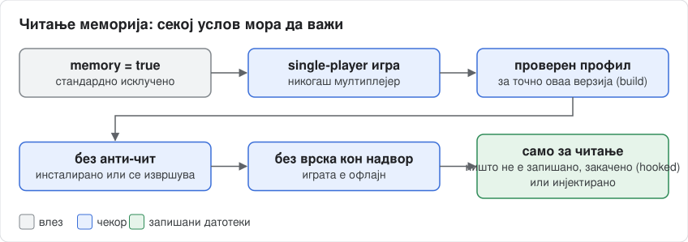

# Читање на меморијата {#reading-memory}

Некои игри за еден играч не кажуваат ништо на други програми. За нив watcher-от може - ако го вклучите и
сами напишете профил - да побара каде сте во меморијата на играта, само за читање.

За игри за еден играч што не објавуваат ништо, watcher-от може да чита позиции и вредности од
меморијата на играта, преку **профил** што го пишувате за вашата верзија на играта. Од сите извори ова
е единствениот што играта не го дала сама, па е оградено повеќе од другите:

- е **стандардно исклучено** (`python -m heat3d_watch config --set memory=true` го вклучува);
- чита, а нема начин да пишува;
- **со алатките не се испорачуваат профили.**

Профилите не се испорачуваат бидејќи офсетот е точен само за верзијата на која е најден. По закрпа,
профил што претходно бил точен чита ѓубре, а ѓубрето изгледа исто како броеви. Профилот мора да
се провери на верзијата што ја има играчот, од тој играч.

## Проверките, по ред {#the-checks-in-order}



Секоја проверка подолу мора да помине. Првите четири се прават **пред** играта да се отвори, бидејќи
отворањето на заштитена игра за читање е самото тоа што го забележува анти-читот, а одбивањето потоа би било
доцна.

1. **Поставката**: `memory` е точно. Инаку меморијските адаптери никогаш не се стартуваат.
2. **Профил за играта**, чиј `exe` го именува процесот што работи. Профилот кажува дали
   играта воопшто може да се игра онлајн (`"online"`); оној што го изостава ова се отфрла.
3. **Никаков анти-чит во близина**:
   - ниту една датотека на анти-чит во папката на играта или до три папки над неа (запирајќи кај
     папката `common` на библиотеката на Steam, или кај папка со `steamapps` во неа, бидејќи над
     тоа живеат други игри): `EasyAntiCheat`, `EasyAntiCheat_EOS_Setup.exe`, `start_protected_game.exe`, `BattlEye`,
     `BEClient_x64.dll`, `BEService_x64.exe`, `EAAntiCheat.GameServiceLauncher.exe`, `AntiCheatExpert`,
     `SGuard64.exe`, `GameGuard`, `GameMon.des`, `XIGNCODE`, `xhunter1.sys`, `Vanguard`, `FACEIT`
     (се споредуваат со мали букви, и како почеток на име). Ако папката на играта е непозната, играта
     се одбива;
   - никаков драјвер или сервис на анти-чит што работи на машината, како што се наведени со
     `sc query type= driver state= active` и `sc query type= service state= active`: EasyAntiCheat,
     EasyAntiCheat_EOS, BEService, BEDaisy, vgk, vgc, ACE-BASE, ACE-GAME, xhunter1, FACEIT,
     FACEITService, EAAntiCheatService, Denuvo Anti-Cheat, npggsvc, Ricochet. Анти-чит на ниво на јадро
     инсталиран за друга игра сепак го следи секој процес. Ако сервисите не можат да се наведат,
     играта се одбива.
4. **Не онлајн**: игра чиј профил кажува `"online": true` се чита само додека нема врска
   со ништо освен со оваа машина (која било далечинска адреса освен `127.x`, `::1`). Ако врските
   не можат да се прочитаат, се одбива.
5. Потоа, кога адаптерот стартува:
   - **точната верзија**: големината на извршната датотека, или нејзиниот SHA-256, мора да се совпадне со верзија што
     ја наведува профилот. Непозната верзија не се чита;
   - **модулите уште еднаш**: вчитаните модули на играта се наведуваат (Toolhelp снимка, која не бара
     свои права на пристап) и се проверуваат за клиент на анти-чит (`BEClient_x64.dll`,
     `BEClient.dll`, `EasyAntiCheat_x64.dll`, `EasyAntiCheat.dll`, `EOSAntiCheat...`). Заштитен
     процес ја одбива снимката, што исто така е одбивање;
   - дури потоа процесот се отвора, со `PROCESS_VM_READ | PROCESS_QUERY_LIMITED_INFORMATION` и
     ништо друго.

Проверките 1 до 4 се повторуваат при секое скенирање (на секои 2 s) додека играта работи. Ако една почне да паѓа (играта
се врзува на сервер, стартува сервис на анти-чит), адаптерот се запира при следното скенирање.
Одбивањето се запишува: `mem-<id>: not reading memory: <reason>`. Неуспех при стартувањето (непозната верзија,
модул на анти-чит, шаблон што не е најден) се запишува како `mem-<id>: could not start`, а адаптерот
не се обидува повторно додека играта не се стартува пак.

Нема пишување, нема алокација во другиот процес, нема нишка стартувана во него, нема библиотека вчитана во
него, нема привилегија за дебагирање и нема подигање на права. Тест (`test_memory_reading_cannot_write` во
`tests/test_core.py`) паѓа ако каде било во пакетот се појави повик што пишува во, алоцира во или извршува код во друг процес -
`WriteProcessMemory`, `VirtualAllocEx`, `CreateRemoteThread`, `PROCESS_VM_WRITE`, `SeDebugPrivilege`,
`LoadLibrary`, ...

Никогаш не се читаат, што и да каже профилот: игри што се играат онлајн и игри чиј режим за еден играч работи
под анти-чит, како GTA V, или Elden Ring стартуван преку неговиот лаунчер. Проверките погоре
ги одбиваат и така.

## Форматот на профилот {#the-profile-format}

Профилот е JSON датотека во `<data>\profiles\` (`<data>` е папката со податоци, видете
[Инсталирање и пуштање](installing-and-running.md#where-everything-is)), еден по игра, со кое било име на датотека
што завршува на `.json`. Синтетички пример:

```json
{
  "schema": "heat3d.memprofile/1",
  "id": "mygame",
  "game": "My Game",
  "exe": "MyGame.exe",
  "online": false,
  "versions": [ { "label": "1.06", "size": 123456789 } ],
  "anchors": {
    "World": { "aob": "48 8B 05 ?? ?? ?? ?? 48 85 C0", "rip": [3, 7] }
  },
  "values": {
    "pos": { "type": "vec3f", "base": "World", "chain": ["0x10", "0x68", "0x70"] },
    "hp":  { "type": "i32",   "base": "World", "chain": ["0x10", "0x138"] },
    "map": { "type": "u32",   "base": "World", "chain": ["0x10", "0x1C0"] }
  },
  "events": [
    { "event": "death", "value": "hp",  "when": "to_zero" },
    { "event": "zone",  "value": "map", "when": "change" }
  ],
  "axes": { "up": "y", "units": "metres" },
  "rate": 10,
  "provenance": [ { "source": "https://example.com/my-notes", "verified_on": "1.06" } ]
}
```

| Клуч | Задолжителен | Што е |
|---|---|---|
| `schema` | да | точно `heat3d.memprofile/1` |
| `id` | да | кус и стабилен; адаптерот се вика `mem-<id>` |
| `game` | да | името на играта, по која се именува папката на сесијата |
| `exe` | да | името на извршната датотека, кое кажува и дека играта работи |
| `online` | да | `true` ако играта воопшто може да се игра онлајн; тогаш се чита само додека е офлајн |
| `versions` | да | верзиите на кои е проверен профилот: секоја со `label`, и `size` (големината на извршната датотека во бајти) и/или `sha256`. Кога се дадени и двете, мора да се совпаднат и двете. Ставка со ниедна не совпаѓа со ништо. |
| `anchors` | да | именувани адреси во главниот модул. `aob`: шаблон од бајти, хекс бајти одделени со празно место, `?` или `??` за кој било бајт; мора да се појави **точно еднаш** во сликата на модулот (повеќе совпаѓања се бројат како неуспех, како и ниедно). `rip: [d, n]`: шаблонот покажува на инструкција со 32-битно поместување релативно на RIP на бајтот `d` и должина `n`; сидрото станува адресата на која упатува таа инструкција. `offset`: се додава потоа (хекс или децимален текст). Наместо `aob`, `module_offset` дава фиксно поместување од основата на модулот. |
| `values` | да | што се чита при секое прашање: `type` (`i32`, `u32`, `i64`, `u64`, `u8`, `f32`, `f64`, `vec3f`, `vec3d`), `base` (името на сидро), `chain` (офсети како хекс или децимален текст) |
| `events` | не | правила што ги претвораат промените во настани: `when` `change` (вредноста се разликува од последното прашање) или `to_zero` (број паѓа од над 0 на 0 или помалку) |
| `axes` | не | `up` (стандардно `y`), `units` (стандардно `game units`), `scale` (скалата на единици на прегледувачот, која ја множи секоја позиција; стандардно 1, сопствените единици на играта) |
| `rate` | не | прашања во секунда, од 1 до 60 (стандардно 10) |
| `provenance` | не | од каде доаѓаат офсетите и на која верзија сте ги провериле; се копира во `meta.json` на секоја сесија |

**Како се чита вредност.** Адресата на сидрото е почеток. Ако `chain` е празен, вредноста се чита
токму таму. Инаку најпрво се чита покажувачот зачуван на сидрото. Потоа, за секој офсет освен
последниот, се чита покажувачот на `address + offset`. Последниот офсет се додава за да ја даде адресата на вредноста.
Нулти покажувач на патот (играта е меѓу нивоа или во мени) ја остава вредноста празна за тоа
прашање.

**Што се снима.** Вредност по име `pos` (`vec3f` или `vec3d`) станува ред `position` на играчот
`me` при секое прашање. Секое правило за настан го пишува својот ред `event`, со новата вредност и, кога `pos` е
познат, позицијата, и додава 1 на статистика со исто име. Сликата на модулот се чита еднаш при стартот
за да се најдат сидрата, во блокови од 64 KiB; блоковите што не можат да се прочитаат се броат како нули. `meta.json`
на сесијата го именува профилот, ознаката на верзијата и потеклото.

Профил што не може да се користи (лош JSON, погрешен `schema`, недостасува задолжителен клуч) се прескокнува и
се запишува како `profile <file> not used: <reason>`. Профилите се вчитуваат кога watcher-от стартува, па рестартирајте го
`run` откако ќе додадете или промените некој.

## Пишување и проверка на профил {#writing-and-verifying-a-profile}

1. **Само за игра за еден играч без анти-чит.** Ако играта има анти-чит, или ја играте
   онлајн, запрете тука: watcher-от ќе ја одбие, и треба.
2. **Најдете ги вредностите на вашата верзија.** Работете офлајн. Користете ги вашите алатки за дебагирање, или објавени белешки
   за играта, за да ја најдете позицијата на играчот и вредностите до кои ви е грижа, и патека на покажувачи до
   секоја од статично место во извршната датотека. Претпочитајте шаблон од бајти (`aob`) пред фиксен
   `module_offset`: шаблонот сè уште го наоѓа своето место кога кодот малку се помести.
3. **Направете го шаблонот уникатен.** Мора да совпадне точно еднаш во модулот. Заменете ги со џокери бајтите што
   се менуваат (адреси, поместувања) и оставете доволно фиксни бајти околу нив.
4. **Прикачете ја верзијата.** Ставете ја точната големина на извршната датотека во `versions`; PowerShell
   `(Get-Item .\MyGame.exe).Length` ја дава, а `Get-FileHash .\MyGame.exe -Algorithm SHA256` го дава
   хешот. По закрпа, профилот едноставно престанува да се користи додека не го проверите повторно и не ја додадете
   новата верзија.
5. **Кажете дали играта оди онлајн** (`online`), искрено.
6. **Пробајте**: вклучете го читањето (`config --set memory=true`), ставете ја датотеката во `<data>\profiles\` и
   проверете дали `python -m heat3d_watch games` го наведува `mem-<id>`. Стартувајте ја играта и пуштете
   `python -m heat3d_watch run -v`. Во `watcher.log` барајте `mem-<id>: starting`, или причината
   поради која е одбиена или не можела да стартува.
7. **Проверете ги броевите со играта.** Одете до познато место и погледнете ги редовите `position` во
   `events.jsonl` на сесијата. Дали се движат како што се движите вие, за вистинската количина, по вистинските оски? Отворете
   `heat.parquet` во прегледувачот и проверете дали маршрутата одговара на тоа каде сте одеа. Предизвикајте го секој настан
   (изгубете го целото здравје, сменете зона) и проверете дали се појавува еднаш. Ѓубрето изгледа како броеви, а само
   оваа споредба ги разликува двете.
8. **Запишете што сте провериле** во `provenance`: изворот на офсетите и верзијата на која сте ги
   провериле.

Текстот `verified` на меморискиот адаптер, како што го печати `games`, е секогаш „by the profile's author, for the
builds it lists“. Watcher-от не може да знае повеќе од тоа.
