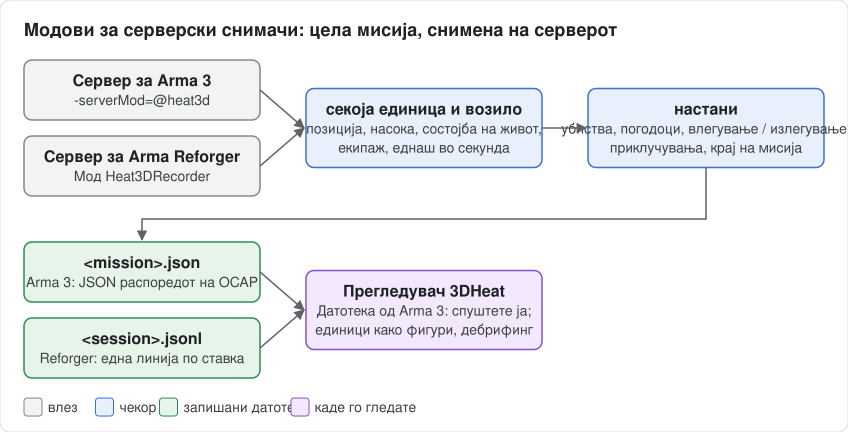

# Мододи за снимање на сервер (Arma 3, Arma Reforger) {#server-recorder-mods-arma-3-arma-reforger}

Повеќето игри watcher-от ги снима на сопствениот компјутер на играчот. Arma е
поинаква: серверот може да снима цела мисија - секоја единица и возило, не
само вашите - со мод што работи на серверот. Играчите не поставуваат ништо:
модот за Arma 3 е само за сервер, а Reforger сам им ги презема модовите на серверот на
играчите кога ќе влезат (модот не прави ништо на нивните компјутери). Складиштето содржи два такви мода, во
[`mods/arma3`](https://github.com/Holdi601/3DHeat-Watcher/tree/main/mods/arma3)
и [`mods/reforger`](https://github.com/Holdi601/3DHeat-Watcher/tree/main/mods/reforger).
Нивните README датотеки се целосната документација; оваа страница е прегледот.

**Статус: и двата се нетестирани во играта.** Екстензијата за Arma 3 е изградена и
пуштана онака како што Arma повикува екстензии, а нејзиниот излез го прочита 3DHeat; нејзините
SQF скрипти сè уште не се извршени во Arma 3. Модот за Reforger е напишан според
објавениот скриптен API на Bohemia и никогаш не е компајлиран. Не ставајте ниту еден
на јавен сервер додека не поминат чекорите за тестирање во неговиот README.

## Arma 3 {#arma-3}

1. Изградете ја екстензијата еднаш по платформа (`mods/arma3/extension`). Потребен е C компајлер: Visual
   Studio Build Tools на Windows, gcc на Linux; ако никогаш не сте компајлирале ништо, прашајте го вашиот сервер
   хост.
   - Windows, во „x64 Native Tools Command Prompt for VS“:
     `cl /nologo /O2 /LD heat3d.c /Fe:heat3d_x64.dll`
   - Linux: `gcc -O2 -shared -fPIC -o heat3d_x64.so heat3d.c -ldl`
2. Изградете го модот: `python mods/arma3/build.py` пишува `mods/arma3/@heat3d/`
   (не се потребни Arma 3 Tools).
3. Копирајте го `@heat3d` во папката на серверот и стартувајте го серверот со
   `-serverMod=@heat3d`.
4. Логот `.rpt` на серверот кажува `Heat3D recorder 0.1.0: recording <file> every 1 s`.

| Поставка | Стандардно | Што прави |
|---|---|---|
| `captureDelay` | 1 | секунди помеѓу фрејмовите |
| `recordHits` | 1 | 0 ги исклучува настаните на погодоци |
| `recordShots` | 1 | 0 го исклучува броењето истрели |
| `minPlayers` | 0 | снимај дури кога толку играчи се вклучени |

Мисијата ја менува една во својот `init.sqf` (`heat3d_captureDelay = 0.5;`).
Снимките одат во `recordings/` во `@heat3d`, или во `HEAT3D_DIR`.

**Излез:** една датотека по мисија во JSON распоредот на OCAP (форматот на
снимачот OCAP2), именувана `<date>__<time>_<mission>.json`. За време на мисијата тоа е
журнал (`.heat3d.part`), испразнет при секое пишување; журналот на мисија што паднала
се завршува кога следниот пат ќе почне мисија.

## Arma Reforger {#arma-reforger}

Модот (`Heat3DRecorder.gproj`) се отвора и гради во Workbench на Bohemia
(Arma Reforger Tools), се тестира на локален наменски сервер, се објавува од
Workbench (необјавен во списокот додека се тестира) и се додава во списокот `mods` на
`config.json` на серверот - чекор по чекор во неговиот README. Секоја секунда запишува ја позицијата, насоката,
состојбата на живот, возилото и id на играчот на секој лик, и позицијата, насоката,
состојбата и екипажот на секое возило; а исто така убиства (убиец, оружје, растојание), погодоци, влегување и
излегување, играчи што се приклучуваат и заминуваат, и крајот на мисијата.

**Излез:** еден JSON објект по линија, `$profile:heat3d/<UTC date>_<UTC time>_<world>.jsonl`:
линија `header` (формат `heat3d-reforger`, оски: x исток, y горе, z север), па
линии `entity`, `frame` и `event` како што се случуваат, и линија `end`. Редовите на единици
се `[id, x, y, z, dir, alive, vehicleId, playerId]`, редовите на возила
`[id, x, y, z, dir, alive, [crew ids]]`; настаните го следат распоредот на настани на OCAP2.

## Во прегледувачот {#in-the-viewer}

Пуштете снимка од Arma 3 на [прегледувачот 3DHeat](https://holdi601.github.io/3DHeat/):
една мисија е една сесија, единиците стануваат војници, возилата нивниот тип, а
убиствата и погодоците одат во списокот за дебрифинг. Веб-плеерот на OCAP2 ја пушта и него. Датотеката
од Reforger е сопствениот линиски формат на модот, со распоредот на настани на OCAP2.
