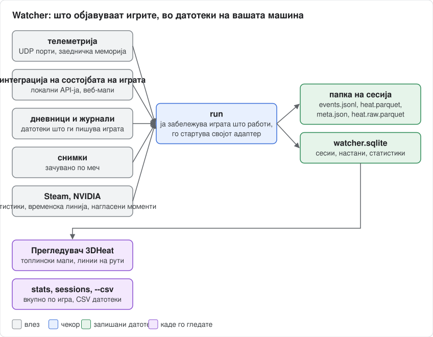

# Извори и правила {#sources-and-rules}

Watcher-от снима само она што игрите и платформите му го даваат на играчот. Оваа страница објаснува кои
извори тоа ги опфаќа, што watcher-от смее да прави со секој, и кои игри или делови од игри намерно
ги изоставува.

## Шесте вида извори {#the-six-kinds-of-source}

Секој адаптер има `kind` (вид), а видот одлучува што адаптерот смее да прави:

| Вид | Што е | Мултиплеер игри |
|---|---|---|
| `telemetry` | UDP-порта или споделена меморија што играта ја објавува за табли со инструменти, моторни платформи и волани (Forza Data Out, F1 UDP, споделената меморија на Kunos и iRacing, SimConnect, UDP-интерфејсот на X-Plane, додатокот SCS SDK) | да - тоа е сопствениот излез на играта |
| `gsi` | интеграција на состојбата на играта или локален веб-API што играта му го служи на сопствената машина на играчот (Valve GSI, Live Client Data API на League, Stats API на Rocket League, веб-мапата на War Thunder) | да, во рамките на она што API-то му го покажува на играчот |
| `log` | датотеки што играта ги пишува додека работи: дневници, логови, статистика, зачувувања (Elite Dangerous, Minecraft, Path of Exile, Hearthstone, Star Citizen, EVE Online) | да |
| `replay` | демоа и повторувања што играта ги зачувува за своите играчи, претворени по натпреварот (CS2, Dota 2, osu!, War Thunder, World of Tanks, World of Warships, Squad, League of Legends, VALORANT, IL-2 Tacview) | да, освен ако се шифрирани, и само деловите што се отворени |
| `platform` | она што го чуваат Steam и графичкиот драјвер: статистика, достигнувања, временски линии, клипови и highlights | да |
| `memory` | меморијата на играта, само за читање, со профил што сте го напишале | **никогаш** - само за игри за еден играч |

Само `memory` отвора друг процес, и тоа само за читање. Другите пет вида го читаат она што играта,
Steam или NVIDIA App веќе го запишале или го праќаат.

## Како се читаат изворите {#how-the-sources-are-read}

- **Ништо не се инјектира, не се закачува (hook) и не се менува во игра.** Не се вчитува код во игра, не се закачува прозорец или
  внес, не се крпи датотека на играта. Единствените датотеки што watcher-от ги пишува надвор од својата папка со податоци
  се оние што ги пишува [`setup --apply`](commands.md#setup) кога ќе го побарате: сопствената датотека со поставки
  на играта (со оригиналот чуван како `<file>.heat3d-backup`), cfg-датотека за game-state, скриптата-кука за DCS,
  протокол-модот за BeamNG.
- **Споделената меморија се отвора само за читање и никогаш не се создава.** Вообичаениот начин во Python да се отвори именувано
  мапирање создава такво кога сè уште не постои. Игра стартувана потоа би го нашла празното мапирање на watcher-от,
  само за читање, наместо да направи свое, и нејзината телеметрија би била мртва. Watcher-от
  отвора мапирања само со `OpenFileMappingW` (што наоѓа само постојно), ги мапира со
  `FILE_MAP_READ`, и пробува повторно подоцна ако играта сè уште не ги направила.
- **Портите се позајмуваат, никогаш не се преземаат.** UDP-порта на која веќе слуша друга програма
  (FH Companion, SimHub, апликација-табла) му се остава на таа програма. Ако друга програма почне
  да слуша на порта што ја држи watcher-от, watcher-от ја пушта за неколку секунди. Адаптерите за Forza
  чекаат 15 s откако ќе почне играта пред да ја земат портата 5300, и го препраќаат секој пакет непроменет
  до 127.0.0.1:5301, па втора апликација за Data Out сè уште може да снима.
- **Само локално.** Серверите за game-state што ги пушта watcher-от (CS2, Dota 2) слушаат на 127.0.0.1 и никаде
  другаде. Кога cfg-датотеката на играта содржи токен (оној што го пишува `setup` го содржи), секој пост мора да го носи;
  постовите без него се бројат како `bad_auth` и се отфрлаат. Без cfg-датотека со токен, секој
  локален пост се прифаќа, а логот го кажува тоа. Локалните API-а што ги прашува (League на порта 2999, War Thunder на
  8111, Rocket League на 49123, X-Plane на 49000) се на 127.0.0.1.
- **Лог-датотеките се споделуваат, никогаш не се заклучуваат.** Секое читање ја отвора датотеката со сите знамиња за споделување што ги има Windows
  и пак ја затвора, па играта може да продолжи да пишува, преименува или замени својот лог.
- **Две надворешни услуги, и само во овие случаи.** Проверката за издание го прашува GitHub
  (`api.github.com`) најмногу на секои шест часа и може да се исклучи (видете [Ажурирања](updates.md)). Адаптерот
  за повторувања на League го прашува Match-V5 API на Riot само кога сте внеле свој `riot_api_key`.
  Ништо друго не се праќа никаде.
- **Вклучувањето на извор е ваша одлука.** `setup` без `--apply` само кажува што би
  променил.

## Правила за мултиплеер {#multiplayer-rules}

- Игра играна онлајн се снима само преку она што го објавува: телеметрија, game-state API-а, логови,
  повторувања, датотеки на платформи. Во тие рамки, watcher-от го снима она што играта му го покажува на играчот, и
  ништо пресметано над тоа:
  - **CS2 game-state integration** го праќа играчот што се гледа (вие додека сте жив, соиграч
    по смртта). Позициите на другите играчи (`allplayers_*`) се праќаат само до гледачи и GOTV, па
    watcher-от не ги бара.
  - **Live Client Data API на League of Legends** нема позиции. Политиката на Riot им дозволува на алатките да прикажуваат
    што играчот би можел да знае од самата игра, и ништо пресметано над тоа (без тајмери на непријатели).
    Watcher-от ги снима каналот за убиства и табелата со резултати што ги гледа играчот, и сопствените броеви на играчот.
  - **Stats API на Rocket League** нема позиции на автомобили (состојбата на автомобилот се праќа само до гледачи). Она што има
    место е топката, каде била погодена, постигнат гол или погодена пречката.
  - **Веб-мапата на War Thunder** го покажува она што го покажува минимапата, без имиња или id-а.
  - **F1 23/24/25** ја ставаат позицијата на секој болид во својот пакет Motion, и онлајн. Играта тие
    ги дава сама, а задржува само податоци на играчи чија „Your Telemetry“ е ограничена.
  - **DCS World**: мултиплеер серверот може да го забрани извозот на податоците на сопственото летало; сесијата
    тогаш има настани но нема позиции, и го кажува тоа.
- **Меморијата никогаш не се чита во мултиплеер игра.** Адаптер за меморија за игра означена како играна онлајн
  се одбива, а профилот мора да наведе дали неговата игра воопшто може да се игра онлајн. Игра за еден играч
  што има и онлајн режим се чита само додека нема врска со ништо освен со оваа
  машина. Игри чиј режим за еден играч работи под анти-чит исто така никогаш не се читаат. Видете
  [Читање меморија](memory-reading.md).
- Знамето `multiplayer` на адаптерот (прикажано како „Online play“ од `games --markdown`) одлучува само за
  читање на меморија. Не ги спречува другите видови да снимаат онлајн игра.

## Што се одбива и зошто {#what-is-declined-and-why}

Некои игри, и некои делови од игри, не се снимаат: нивните податоци се заштитени, не се
објавени или воопшто ги нема на компјутерот на играчот:

| Игра | Што е изоставено | Зошто |
|---|---|---|
| VALORANT | позиции, имиња, резултати во повторувања; крајните точки од lockfile на клиентот | Струјата на играта во повторувањето е замаскирана со вредности земени од извршната датотека на секоја верзија. Играта работи под Vanguard. Крајните точки од lockfile на клиентот на Riot не се објавен API. **Се чита:** она што повторувањето го носи отворено - мапата, id на натпреварот, агентите, временската линија на убиства и рундови од серверот. |
| League of Legends | деловите од `.rofl` повторувањата по момент; крајните точки од lockfile на клиентот | Замаскирани против мамење, поинаку со секој патч, и не се декодираат. **Се чита:** табелата со резултати од крајот на играта што ја носи секое повторување како обичен JSON, Live Client Data API за време на натпревар, и - со ваш сопствен клуч за програмери - официјалната временска линија Match-V5 (позиции еднаш во минута, убиства таму каде што се случиле). |
| Fortnite | повторувања | Шифрирани. |
| World of Tanks, World of Warships | повторувања, во watcher-от | Шифрирани. Watcher-от не ги чита; одделни конвертори надвор од него ги читаат (`exporters/ext/wot-replay`, `exporters/ext/wows-replay`), секој засебен проект. **Се чита, со инсталиран конвертор:** позицијата на секое возило или брод додека клиентот што снимал знаел за него, и убиствата. |
| Gran Turismo 7 | телеметрија | Само конзола, а нејзината телеметрија е шифрирана со клуч вратен од играта. |
| Apex Legends | сè | Неговиот LiveAPI праќа целосни настани само во приватни и прилагодени лоби; инаку ништо не е достапно локално. |
| Overwatch 2, Call of Duty, Battlefield 6, Hunt: Showdown 1896 | податоци во живо | Нема локално повторување, лог или излез на game-state за читање. Нивната статистика доаѓа таму каде што ја чува Steam ([Steam статистика](game-steam-stats.md), [Steam Timeline](game-steam-timeline.md)), а клиповите како [NVIDIA highlights](nvidia-highlights.md). |
| Star Citizen | сè над `Game.log` | Работи со Easy Anti-Cheat; watcher-от ја чита само лог-датотеката што ја пишува играта и никогаш не се приближува до процесот на играта. |
| osu!lazer | повторувања | Чувани во сопствената меморија на играта; се читаат само `.osr` датотеки од osu! (stable). |
| Секоја мултиплеер игра | меморија | Никогаш. Игри за еден играч чиј режим работи под анти-чит (GTA V, Elden Ring преку својот launcher) исто така не се читаат. |

Шифрираните повторувања не се отвораат: читачот за VALORANT го проверува знамето за шифрирање на повторувањето и
ја одбива шифрираната датотека („this replay is encrypted; it is not read“).

Игрите истражени но сè уште неизградени (Deadlock повторувања, `.replay` датотеки на Rocket League,
StarCraft II, Team Fortress 2, Rainbow Six Siege, Beat Saber, Trackmania, неколку тркачки симулатори) се
наведени со своите извори во [Сите игри во една табела](watcher.md#researched-not-yet-built). На секоја
ѝ требаат примероци на датотеки за проверка пред да се испорача.
