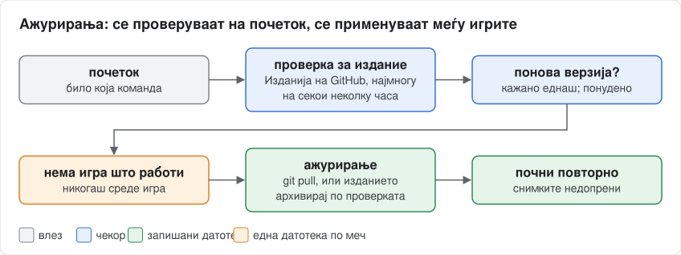

# Ажурирања {#updates}

Watcher-от сам се одржува ажуриран од изданијата на
[Holdi601/3DHeat-Watcher](https://github.com/Holdi601/3DHeat-Watcher/releases). Ажурирачот е
пакетот `heat3d_update` покрај `heat3d_watch` во складиштето.

## Проверката {#the-check}

- **Кога**: секоја команда освен `update` проверува кога ќе почне. `run` проверува и додека работи,
  највеќе еднаш на час и само додека не работи игра.
- **Како**: едно HTTPS барање до `https://api.github.com/repos/Holdi601/3DHeat-Watcher/releases/latest`,
  со ограничување на времето од 5 секунди. Одговорот се кешира шест часа во
  `%LOCALAPPDATA%\3DHeat\update-check-3DHeat-Watcher.json`, па повеќето стартувања не прашуваат ништо. „Сè уште
  нема издание“ (HTTP 404) се кешира како одговор. Офлајн, со надминат лимит на барања или зад прокси, проверката не успева
  тивко и командата продолжува со верзијата што ја има.
- **Верзии**: инсталираната верзија е датотеката `VERSION` во папката на складиштето.
  Ознаката на изданието (`v1.2.0` или `1.2.0`) се споредува како броеви, дел по дел; сѐ
  по `-` или `+` се игнорира.
- **Исклучено**: `HEAT3D_NO_UPDATE=1` (секоја вредност освен празна, `0`, `false` или `no`) ги исклучува и
  проверката и автоматското ажурирање. Секоја алатка на 3DHeat си има своја датотека на кеш, па одговорот на една алатка никогаш не
  заменува одговор на друга.

## Што се случува кога има ново издание {#what-happens-when-a-newer-release-is-out}

- **`run`** испишува известување кога ќе почне и продолжува да работи:
  `[heat3d_watch] 3DHeat Watcher 1.2.0 is out (this is 1.0.2). <release page>`. Додека работи,
  со `auto_update` вклучено (стандардно) и без игра што работи, тој потоа сам се ажурира: линијата во логот
  `3DHeat Watcher 1.2.0 is out (this is 1.0.2); updating`, известување на Windows „Updating to 1.2.0“,
  ажурирањето, запирање на секој адаптер и затворање на неговите сесии, и истата команда повторно стартувана
  врз новиот код. Watcher-от никогаш не се ажурира во средина на игра. Ако ажурирањето
  не може да се примени, известувањето го кажува тоа („1.2.0 is out; not updated: ...“) и watcher-от продолжува
  со старата верзија. Со `auto_update` исклучено има само известување.
- **Другите команди** прашуваат `Update now? [Y/n]` кога работат во терминал. Enter, `y`, `yes`, `j` или
  `ja` ажурира, па истата команда повторно се пушта на новата верзија. Без терминал (закажано
  извршување, pipe), тие испишуваат како да се ажурира и продолжуваат.
- **На барање**: `python -m heat3d_watch update` (или `python -m heat3d_update`) прашува GitHub без
  кешот и ажурира. `--check` само кажува дали има ново издание. Ова работи дури и кога
  `HEAT3D_NO_UPDATE` е поставено.

## Како се применува ажурирањето {#how-an-update-is-applied}

Зависи од тоа како е инсталиран примерокот:

- **Git клон** (папката има `.git` и `git` е на PATH): `git pull --ff-only`. Ова се одбива
  додека клонот има промени во следени датотеки (`git status --porcelain --untracked-files=no` не е
  празно): тие промени се нечија работа, а ажурирањето не одлучува што ќе стане со нив. Направете commit
  или stash, па повлечете.
- **Преземен примерок**: изворниот архив на изданието се презема и се распакува во привремена
  папка. Ставките што би завршиле надвор од неа се прескокнуваат. `VERSION` на архивот мора да биде верзијата
  што изданието ја тврди, инаку ништо не се копира. Потоа неговите датотеки се копираат врз папката на складиштето.
  Датотеките што не се дел од изданието - снимки, поставки, виртуелни околини, извози, сѐ
  што сте направиле - не се допираат. Python модул што го имало постаро издание, а новото го отфрлило,
  се отстранува од сопствените пакети на изданието (`heat3d_watch`, `heat3d_update`), па по ажурирањето
  не се вчитува застарен модул на адаптер; ништо надвор од тие пакети не се отстранува.

Снимките и поставките и онака нормално живеат надвор од папката на складиштето
(`%LOCALAPPDATA%\3DHeat\Watcher`), па ажурирањето никогаш не им се приближува.

По ажурирањето истата команда се стартува повторно. На Windows, watcher-от го стартува новиот процес,
го чека и го пренесува неговиот излезен код, па конзолата се однесува како првиот процес
да ја завршил работата.
