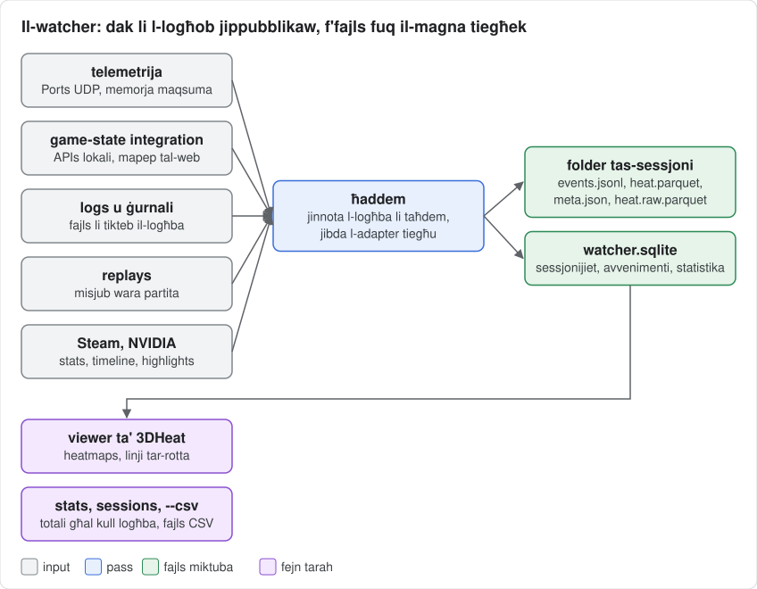

# 3DHeat Watcher {#dheat-watcher}

**X'inhi?** Tilgħab logħba. Dan il-programm bil-kwiet iniżżel fejn mort u x'ġara.
Aktar tard tista' tarah bħala mappa kkuluriti fil-viewer ta' 3DHeat.

**Għaliex nużaha?** Biex iżżomm rekord tiegħek stess ta' kull sessjoni - fejn saqt, ttirt jew ġġieldt,
it-totali tiegħek għal kull logħba - mingħajr ebda sit u mingħajr ma tibdel il-logħba.

**Eżempju:** tsuq lapp f'logħba tat-tlielaq bil-watcher jaħdem; wara fajl f'
`sessions\<game>\` iżomm il-linja li ħadt, u l-viewer ipinġiha.

B'aktar dettall: 3DHeat Watcher huwa programm fl-isfond li jirrekordja dak li l-logħob jippubblikaw dwar il-logħob tiegħek - fejn
mort, x'ġara fejn, u n-numri warajh - f'fajls fuq il-magna tiegħek stess. Il-fajls huma
għall-istatistika tiegħek stess u għall-heatmaps u l-linji tar-rotta tal-viewer ta' 3DHeat.

Jaħdem bil-kwiet, jinnota liema logħba bdejt, u jaqra l-outputs proprji ta' dik il-logħba: port tat-telemetrija
jew memorja maqsuma li l-logħba tippubblika għal dashboards, game-state integration, il-ġurnal jew il-log
li tikteb il-logħba, ir-replay li tsalva wara partita, l-istatistika li Steam iżomm, il-clips li l-NVIDIA App
isalva. Ir-reġistrazzjonijiet jibqgħu fuq il-magna tiegħek. Il-programm jikkuntattja żewġ servizzi esterni biss, u biss f'dawn
il-każijiet: GitHub, biex ifittex rilaxx aktar ġdid (ara [Aġġornamenti](../updates.md)), u l-API Match-V5 ta' Riot,
u biss jekk tidħol iċ-ċavetta API ta' Riot tiegħek stess (ara [Replays ta' League of Legends](../game-lol-replays.md)).



## X'jirrekordja {#what-it-records}

- **Pożizzjonijiet**: il-karozza, l-ajruplan, l-eroj jew il-plejer, diversi darbiet fis-sekonda fejn il-logħba tippubblikahom,
  bil-veloċità, id-direzzjoni u kull ħaġa oħra li l-logħba tibgħat magħhom.
- **Avvenimenti**: spawns, mwiet, qtil, laps, stages, rawnds, goals, jobs, takeoffs u landings, bidliet
  ta' żoni, achievements, highlights. Kull avveniment jinżamm bil-ħin tiegħu, u bil-post tiegħu meta l-
  logħba tagħti wieħed.
- **Statistika għal kull sessjoni**: qtil, mwiet, laps, l-aħjar lapp, distanza, veloċità massima, ħin tal-logħob,
  u l-istatistika proprja tal-logħba fejn iżżomm.

X'tagħti kull logħba, u minn fejn, hu fuq il-paġna tagħha taħt [Logħob](../games.md). Sors wieħed ma jistax
jirrekordja kollox: il-logħob multiplayer jiġu rrekordjati biss permezz ta' dak li jippubblikaw, u l-watcher
qatt ma jaqra l-memorja tagħhom (ara [Sorsi u regoli](../sources-and-rules.md)).

## Installa {#install}

Ġdid mal-linja tal-kmandi? Aqra [Qabel ma tibda](before-you-start.md) l-ewwel.

Il-watcher huwa programm ta' Python għal Windows (Python 3.10 jew aktar ġdid). Ħafna mis-sorsi tiegħu jeżistu biss fuq Windows: memorja
maqsuma, ir-registry, notifiki ta' Windows.

```bash
git clone https://github.com/Holdi601/3DHeat-Watcher.git
cd 3DHeat-Watcher
pip install -r requirements.txt
```

Arkivju ta' rilaxx imniżżel jaħdem bl-istess mod: ħollu, imbagħad ħaddem `pip install -r requirements.txt`
ġewwa l-folder. Id-dettalji, u l-extras li jeħtieġu xi logħob, huma f'
[Installazzjoni u tħaddim](../installing-and-running.md).

## Bidu veloċi {#quick-start}

```bash
python -m heat3d_watch games            # what each game gives, and from where
python -m heat3d_watch setup all        # what would have to be switched on (nothing is changed)
python -m heat3d_watch setup f1-25 --apply   # switch one game's output on (the original file is backed up)
python -m heat3d_watch run              # watch; leave it running while you play
python -m heat3d_watch stats            # totals per game
python -m heat3d_watch stats --csv out  # sessions, events and stats as CSV files
```

Għandek tara: wara `games`, tabella b'linja waħda għal kull logħba; `run` ikompli sakemm tagħfas
Ctrl+C jew tagħlaq it-tieqa.

Kollox jinkiteb f'`%LOCALAPPDATA%\3DHeat\Watcher`. Biex tuża folder ieħor, issettja l-
variabbli tal-ambjent `HEAT3D_WATCH_HOME` jew ħaddem `python -m heat3d_watch config --set data=D:\somewhere`.

- `sessions\<game>\<date>_<adapter>\` - folder wieħed għal kull sessjoni, li fih `events.jsonl` (kull avveniment
  hekk kif iseħħ), `heat.parquet` (ir-ringieli b'pożizzjoni, lesti għall-viewer ta' 3DHeat) u
  `meta.json` (logħba, sors, assi, għadd, statistika)
- `watcher.sqlite` - l-istatistika ta' kull sessjoni, fi tliet tabelli sempliċi
- `watcher.log` - dak li għamel il-watcher

Il-viewer jiftaħ il-`heat.parquet` ta' sessjoni direttament, mingħajr xejn x'issettja (l-assi u l-unitajiet tiegħu huma
fil-fajl). Replays ikkonvertiti jinkitbu bħala tabelli u dokumenti tal-partiti maġenbu; il-format tal-viewer ta'
fajl wieħed għal kull partita huwa deskritt fil-paġna tal-[container `.3dheat`](https://holdi601.github.io/3DHeat/container.html) tiegħu,
u l-kolonni ta' kull tabella f'[Id-dejta](../the-data.md).

## Id-dokumentazzjoni {#the-documentation}

| Paġna | X'tkopri |
|---|---|
| [Qabel ma tibda](before-you-start.md) | Python, terminal, placeholders, kif jidhru s-suċċess u l-iżbalji komuni |
| [Installazzjoni u tħaddim](../installing-and-running.md) | rekwiżiti, tħaddim fl-isfond, bidu ma' Windows, il-lock file, il-log, kull setting u variabbli tal-ambjent |
| [Logħob](../games.md) | paġna waħda għal kull logħba: x'jiġi rrekordjat, minn fejn, kif tixgħelha, kif taħdem, assi, statistika, x'ġie vverifikat |
| [Id-dejta](../the-data.md) | folders tas-sessjonijiet, `events.jsonl`, `heat.parquet` u l-footer tiegħu, `meta.json`, `watcher.sqlite`, irkupru wara crash, esportazzjoni CSV, ftuħ ta' sessjoni fil-viewer ta' 3DHeat |
| [Kmandi](../commands.md) | kull kmand u għażla ta' `python -m heat3d_watch` |
| [Sorsi u regoli](../sources-and-rules.md) | is-sitt tipi ta' sors, ir-regoli multiplayer, liema logħob jitħallew barra u għaliex |
| [NVIDIA Highlights](../nvidia-highlights.md) | x'jista' u x'ma jistax jagħti NVIDIA Highlights, u kif highlight jikseb pożizzjoni |
| [Mods tar-recorder tas-server](../server-mods.md) | il-mods tas-server ta' Arma 3 u Arma Reforger li jirrekordjaw missjonijiet sħaħ għall-viewer |
| [Qari tal-memorja](../memory-reading.md) | profili tal-memorja ta' single-player: il-format, il-kontrolli, kif tikteb u tivverifika waħda |
| [Aġġornamenti](../updates.md) | kif il-watcher ifittex rilaxxi ġodda u jaġġorna ruħu |
| [Żvilupp](../development.md) | kif tikteb adapter: l-API, testijiet, `verified` onest, riġenerazzjoni tal-paġni tal-logħob |
| [Il-logħob kollu f'tabella waħda](../watcher.md) | kull logħba f'tabella waħda, kif jistampaha `games --markdown`, flimkien mal-logħob riċerkat imma għadu mhux mibni |
| [Referenza tal-kmandi](../cli-reference.md) | il-`--help` ta' kull kmand, iġġenerat mill-kodiċi |
| [Manutenzjoni](../maintaining.md) | il-lista ta' kontroll tar-rilaxx għal dawn il-paġni |

## Parti minn 3DHeat {#part-of-3dheat}

3DHeat Watcher hija waħda mill-għodod b'xejn madwar il-viewer ta' 3DHeat (il-watcher juża 3DHeat CS2
biex jikkonverti demos ta' CS2). Kull waħda hija proġett tagħha, bir-rilaxxi u l-liċenzja tagħha:

| Għodda | X'tagħmel | Dokumenti |
| --- | --- | --- |
| [3DHeat](https://github.com/Holdi601/3DHeat) | il-viewer: heatmaps, analiżi tat-tlielaq u reviżjoni tal-partiti f'3D | [sit](https://holdi601.github.io/3DHeat/) |
| [GameFiles](https://github.com/Holdi601/3DHeat-GameFiles) | korsijiet u livelli mill-fajls li jipprovdu l-logħob, bħala mudelli 3D | [sit](https://holdi601.github.io/3DHeat-GameFiles/) |
| [GameCapture](https://github.com/Holdi601/3DHeat-GameCapture) | telemetrija tal-laps minn logħob tat-tlielaq; livelli mibnija mill-ġdid minn vidjo tal-logħba | [sit](https://holdi601.github.io/3DHeat-GameCapture/) |
| [Unreal Exporter](https://github.com/Holdi601/3DHeat-UnrealExporter) | plugin ta' Unreal Editor li jesporta livell bħala mudell 3D wieħed | [sit](https://holdi601.github.io/3DHeat-UnrealExporter/) |
| [CS2](https://github.com/Holdi601/3DHeat-CS2) | demos ta' Counter-Strike 2 f'tabelli u dokumenti tal-partiti; mapep f'mudelli 3D | [sit](https://holdi601.github.io/3DHeat-CS2/) |
| [Watcher](https://github.com/Holdi601/3DHeat-Watcher) | jirrekordja fl-isfond dak li l-logħob jippubblikaw dwar il-logħob tiegħek | [sit](https://holdi601.github.io/3DHeat-Watcher/) |
| [Ext-WarThunder](https://github.com/Holdi601/3DHeat-Ext-WarThunder) | replays ta' War Thunder f'tabelli u dokumenti tal-partiti | [sit](https://holdi601.github.io/3DHeat-Ext-WarThunder/) |
| [Ext-WoT](https://github.com/Holdi601/3DHeat-Ext-WoT) | replays ta' World of Tanks f'tabelli u dokumenti tal-partiti | [sit](https://holdi601.github.io/3DHeat-Ext-WoT/) |
| [Ext-WoWs](https://github.com/Holdi601/3DHeat-Ext-WoWs) | replays ta' World of Warships f'tabelli u dokumenti tal-partiti | [sit](https://holdi601.github.io/3DHeat-Ext-WoWs/) |
| [Ext-Squad](https://github.com/Holdi601/3DHeat-Ext-Squad) | demos tas-server ta' Squad f'tabelli u dokumenti tal-partiti | [sit](https://holdi601.github.io/3DHeat-Ext-Squad/) |
| [Ext-DCS](https://github.com/Holdi601/3DHeat-Ext-DCS) | mapep ta' DCS World f'mudelli 3D | [sit](https://holdi601.github.io/3DHeat-Ext-DCS/) |
| [Ext-IL2](https://github.com/Holdi601/3DHeat-Ext-IL2) | mapep ta' IL-2 Sturmovik f'mudelli 3D | [sit](https://holdi601.github.io/3DHeat-Ext-IL2/) |

Liċenzja: MIT ([LICENSE](https://github.com/Holdi601/3DHeat-Watcher/blob/main/LICENSE)). Il-liċenzji
tal-pakketti ta' terzi li juża, u dak li l-logħob li jaqra jeħtieġu, huma elenkati f'
[LICENSES.md](https://github.com/Holdi601/3DHeat-Watcher/blob/main/LICENSES.md).
