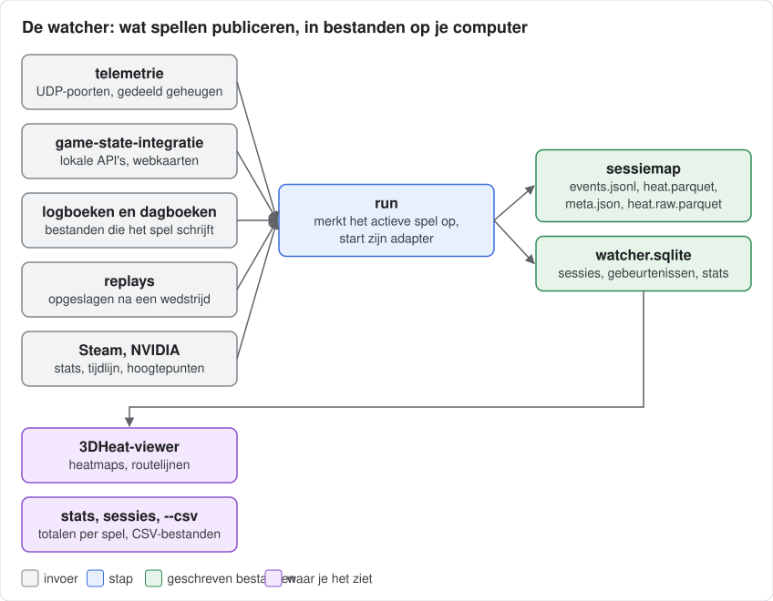
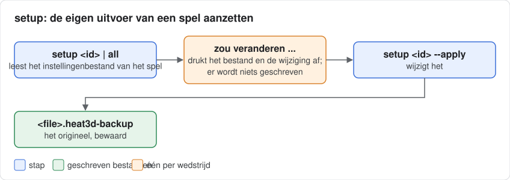
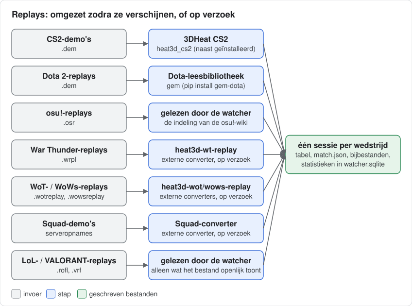
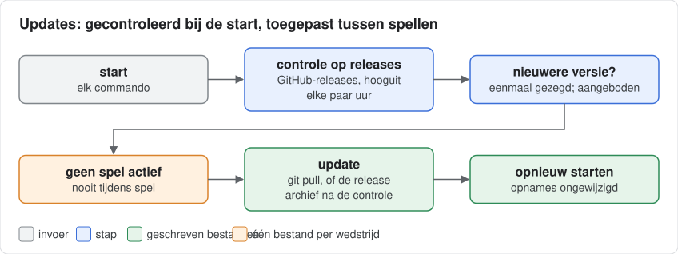

# Commando's {#commands}

Nieuw met de opdrachtregel? Lees eerst [Voordat je begint](before-you-start.md). Typ elk commando in een terminal die geopend is in de map waar je het uitgepakte of gekloonde bestand hebt gezet (in Verkenner typ je `powershell` in de adresbalk). Het ziet er zo uit:

```bash
python -m heat3d_watch <command> [options]
```


| Commando | Wat het doet |
|---|---|
| [`run`](#run) | kijkt op de achtergrond mee en legt elk spel dat draait vast |
| [`games`](#games) | wat elk spel levert en vandaan |
| [`setup`](#setup) | zet de eigen uitvoer van een spel aan |
| [`status`](#status) | welke spellen nu draaien, en welke adapters zouden starten |
| [`sessions`](#sessions) | de opnames tot nu toe |
| [`stats`](#stats) | totalen per spel, of de tabellen als CSV |
| [`table`](#table) | bouwt de `heat.parquet` van een sessie opnieuw op uit zijn `events.jsonl` |
| [`replays`](#replays) | zet de replays die al op schijf staan om |
| [`dota-replay`](#dota-replay) | downloadt de replay van een openbare Dota 2-wedstrijd op zijn id |
| [`dota-map`](#dota-map) | de Dota 2-kaart uit je installatie als 3D-level voor de viewer |
| [`update`](#update) | updatet naar de nieuwste release |
| [`config`](#config) | toont of wijzigt de instellingen |

Opties voor elk commando: `-h` / `--help` toont de hulp, en `python -m heat3d_watch --version`
toont de versie (het bestand `VERSION`).

De afbeeldingen op deze pagina zijn runs op synthetische voorbeeldsessies (`Example Racer`, `Example Arena`),
geen echte opnames.

Elk commando behalve `update` kijkt eerst of er een nieuwere release is (hooguit elke zes uur; overgeslagen met
`HEAT3D_NO_UPDATE=1`, zie [Updates](updates.md)). `run` toont alleen een melding. De andere commando's vragen
`Update now? [Y/n]` wanneer ze in een terminal draaien, en tonen hoe je moet updaten wanneer dat niet zo is. De uitvoer is UTF-8, dus spelnamen in elk schrift worden in elke console goed getoond.

## run {#run}

```bash
python -m heat3d_watch run [--once] [-v]
```



Wacht tot je stopt (Ctrl+C): elke `scan_seconds` leest hij de proceslijst en start een adapter voor elk spel dat hij vindt, plus de altijd-aan adapters. Voor de eerste controle sluit hij de sessies af die een eerdere run open liet. Zolang er geen spel draait, kan hij zichzelf bijwerken (met `auto_update` aan). De details staan in [Installeren en draaien](installing-and-running.md#running).

| Optie | Effect |
|---|---|
| `--once` | één keer kijken naar de draaiende spellen, dan stoppen. De adapters voor de spellen die nu draaien (en de altijd-aan adapters) worden gestart, elk peilt één keer (er wordt hooguit 10 seconden op gewacht), en daarna worden ze allemaal gestopt zoals bij het einde van een spel: hun sessies worden gesloten, weggeschreven en geteld. Om de detectie te controleren, niet om op te nemen. |
| `-v`, `--verbose` | debugregels in `watcher.log` en op de console |

`run` schrijft `<data>\watcher.lock` en weigert een tweede keer te starten voor dezelfde datamap (afsluitcode 1); zie [Het lock-bestand](installing-and-running.md#the-lock-file).

## games {#games}

```bash
python -m heat3d_watch games [--markdown]
```


Toont elke adapter, gesorteerd op spel: naam, id en soort, waar hij uit leest, wat hij opneemt, en hoe je hem aanzet. Een adapter die op deze computer niet kan draaien wordt gemarkeerd met `[unavailable: <why>]` - SimConnect.dll niet gevonden, geen Minecraft-map, 3DHeat CS2 niet geïnstalleerd, Steam of de NVIDIA App niet gevonden. Een adaptermodule die niet geïmporteerd kon worden wordt aan het eind genoemd, met de fout.

```text
EA SPORTS F1 25  (f1-25, telemetry)
    from: UDP telemetry 127.0.0.1:20777 (Documents\My Games\F1 25\hardwaresettings\hardware_settings_config.xml)
    - every car's position (world XYZ, m) at 10 Hz, by driver name, team, own car marked, ...
    switch on: In the game: Settings > Telemetry Settings > UDP Telemetry On, IP 127.0.0.1, port 20777 - ...
```

`--markdown` toont hetzelfde als één Markdown-tabel (spel, wat er wordt opgenomen, vandaan, hoe je het aanzet, online spelen, gecontroleerd). De tabel in [Alle spellen in één tabel](watcher.md) is die uitvoer. De cellen zijn geëscaped voor Markdown: tekst in backticks blijft een codefragment, en daarbuiten worden `<`, `>`, `&`, `*`, `|` en een backslash voor leesteken zo geschreven dat ze zoals getypt verschijnen (`<CS2>` zou anders als HTML-tag verdwijnen in kramdown). Het enige HTML-stukje is de `<br>` tussen de onderdelen van de kolom "What is recorded" (de kolomkoppen blijven in het Engels, zoals de code ze afdrukt).

## setup {#setup}

```bash
python -m heat3d_watch setup <adapter id | all> [--apply]
```




Zet de eigen uitvoer van een spel aan, waar het spel een bestand moet worden aangepast. Zonder `--apply` wordt niets veranderd: elke regel zegt wat er zou veranderen, en als er iets te veranderen is, zegt de laatste regel `Nothing was changed. Run again with --apply to make these changes.` Als er niets te veranderen is, staat er `<id>: nothing to change` (`Nothing to change.` bij `all`). Met `--apply` worden de wijzigingen gedaan. Voordat een bestand voor het eerst wordt aangepast, wordt het origineel bewaard als `<file>.heat3d-backup`. Een bestaande back-up wordt nooit overschreven, dus die bevat altijd het bestand zoals het was voordat de watcher er voor het eerst aan kwam.

```text
f1-25: would change: hardware_settings_config.xml <udp>: enabled="false" -> "true"
Nothing was changed. Run again with --apply to make these changes.
```

`all` voert de setup uit van elke adapter die er een heeft. Een adapter zonder setup, op zichzelf genoemd, toont `<id>: nothing for setup to change; ` gevolgd door hoe het spel wordt aangezet (de tekst `enable`, of dat er niets nodig is). Een onbekend id toont `no adapter '<id>'; games lists them` en eindigt met afsluitcode 2. De adapters die iets in te stellen hebben:

| Adapter | Wat `--apply` verandert |
|---|---|
| `beamng` | installeert de `heat3d`-protocolmod in de map `mods` van BeamNG (alleen als hij er niet staat); zet daarna in het spel Options > Other > Protocols > "others" aan |
| `cs2-gsi` | schrijft `<CS2>\game\csgo\cfg\gamestate_integration_heat3d.cfg`: stuurt de spelstatus naar `http://127.0.0.1:3311/` met een willekeurig token dat de watcher daarna verlangt (een token dat al in het bestand staat blijft behouden); CS2 leest het bij de start |
| `dota2-gsi` | hetzelfde voor Dota 2: `<Dota>\game\dota\cfg\gamestate_integration\gamestate_integration_heat3d.cfg`, poort 3312 |
| `dcs` | voegt `Scripts\Hooks\heat3d-watch.lua` toe aan elke map `%USERPROFILE%\Saved Games\DCS*`. Een eigen oudere kopie wordt bijgewerkt; een bestand met die naam dat de watcher niet schreef blijft met rust. Start DCS opnieuw. |
| `dirt-rally-2` | `hardware_settings_config.xml`: `<udp enabled="true" extradata="3" ip="127.0.0.1" port="20777">`; start het spel eerst één keer, zodat het bestand bestaat |
| `ea-wrc` | `Documents\My Games\WRC\telemetry\config.json`: het `session_update`-pakket van de `wrc`-structuur aan, naar deze computer |
| `f1-23`, `f1-24`, `f1-25` | `hardware_settings_config.xml`: `<udp enabled="true" ip="127.0.0.1" port="20777">`; het spel moet dicht zijn |
| `hearthstone` | voegt een `[Power]`-sectie toe (`LogLevel=1`, `FilePrinting=true`) aan `%LOCALAPPDATA%\Blizzard\Hearthstone\log.config`; start het spel opnieuw |
| `il2` | `<game>\data\startup.cfg`, `[KEY = telemetrydevice]`: één extra doel `addrN = "127.0.0.1:41995"` en `enable = true` (de sectie wordt, op 10 Hz, toegevoegd als er geen is); start IL-2 opnieuw |
| `il2-tacview` | `<game>\data\startup.cfg`, `[KEY = track_record]`: `tacviewrecord = 1` |
| `rocketleague-stats` | `TAStatsAPI.ini` (of `DefaultStatsAPI.ini` als die niet bestaat) in `<RL>\TAGame\Config`: `PacketSendRate=30` als de API uit staat, en `Port` als er geen is ingesteld; wordt gelezen bij de start van Rocket League |

`richard-burns-rally` heeft geen setup: zijn telemetrie komt van de RSF/NGP-plugin, die je met de hand aanzet in `RichardBurnsRally.ini` (zie [zijn pagina](game-richard-burns-rally.md)); `setup richard-burns-rally` zegt dat. Elk ander spel heeft ofwel niets nodig, ofwel wordt het in het spel aangezet; de pagina van elk spel zegt hoe.

## status {#status}

```bash
python -m heat3d_watch status
```

```text
3DHeat Watcher 1.0.2; data in C:\Users\...\AppData\Local\3DHeat\Watcher
Games running: EA SPORTS F1 25 (f1-25)
Always on: il2-tacview, steam-stats, steam-timeline, nvidia-highlights, cs2-demos, osu-replays, lol-replays, valorant-replays
```

Zegt welke adapters een `run` nu zou starten, volgens dezelfde regels: het proces van het spel draait, de adapter staat niet in `disabled`, er ontbreekt niets wat hij nodig heeft, replay-adapters alleen met `replays` aan, geheugen-adapters alleen met `memory` aan en elke geheugencontrole geslaagd. Er wordt niets gestart.

## sessions {#sessions}

```bash
python -m heat3d_watch sessions [--game NAME] [--limit N]
```


De nieuwste sessies uit `watcher.sqlite`, één regel per stuk: start (lokale tijd), spel, minuten, events, posities, map.

| Optie | Effect |
|---|---|
| `--game NAME` | alleen dit spel, op zijn exacte naam zoals in de lijst (`"EA SPORTS F1 25"`) |
| `--limit N` | hooguit N sessies (standaard 40) |

## stats {#stats}

```bash
python -m heat3d_watch stats [--game NAME] [--csv DIR]
```


Zonder opties: een tabel van elk spel (sessies, uren, events, posities, laatst gespeeld), meest gespeeld eerst, en daarna voor elk spel zijn 25 meest voorkomende events en elke numerieke statistiek, met het aantal sessies dat die heeft, het totaal, de beste waarde (`best`) en het gemiddelde. `best` weet welke kant beter is: de laagste waarde voor de tijden die als beste worden bewaard (`best_lap`, `best_stage` en elke andere sleutel die begint met `best_`) en voor plaatsen (`race_position`, `grid_position`, elke sleutel die eindigt op `_position`), de hoogste voor al de rest (kills, afstand, topsnelheid, de eigen tellers van een spel).

| Optie | Effect |
|---|---|
| `--game NAME` | alleen de events en statistieken van dit spel, zonder het overzicht |
| `--csv DIR` | schrijft `sessions.csv`, `events.csv` en `stats.csv` (elke rij van de drie tabellen) naar `DIR` in plaats daarvan; `--game` beperkt dit niet |

## table {#table}

```bash
python -m heat3d_watch table <session folder>
```


Bouwt `heat.parquet` opnieuw op in een sessiemap, uit zijn `events.jsonl`, met de assen uit zijn `meta.json`. Toont het pad van de tabel, of `no positions in this session`. Gebruik het voor een sessie die is opgenomen terwijl `pyarrow` ontbrak, of nadat je `events.jsonl` met de hand hebt bewerkt.

## replays {#replays}

```bash
python -m heat3d_watch replays <adapter id> [folder] [-v]
```



Zet de replays die al op schijf staan nu om, één voor één, elk in een sessie zoals `watch` dat in een map zou doen. De eerste keer dat de watcher een replaymap ziet, noteert hij alleen wat erin staat (zie [Installeren en draaien](installing-and-running.md#replays-already-on-disk)); zo worden die op verzoek omgezet. Zonder `folder` worden de eigen mappen van de adapter gelezen (die van het spel, plus `replay_folders`); met `folder` de replays in die map. Elke omgezette replay wordt als gezien genoteerd, zodat de draaiende watcher hem niet opnieuw omzet. Een replay die niet omgezet kan worden wordt gelogd en overgeslagen.

| Adapter | Replays |
|---|---|
| `cs2-demos` | Counter-Strike 2-demo's (`*.dem`), via 3DHeat CS2 |
| `lol-replays` | League of Legends-replays (`*.rofl`) |
| `osu-replays` | osu!-replays (`*.osr`) |
| `valorant-replays` | VALORANT-replays (`*.vrf`) |
| `warthunder-replays` | War Thunder-replays (`*.wrpl`), via de externe converter `heat3d-wt-replay` (exporters/ext/warthunder-replay) |
| `wot-replays` | World of Tanks-replays (`*.wotreplay`), via de externe converter `heat3d-wot-replay` (exporters/ext/wot-replay) |
| `wows-replays` | World of Warships-replays (`*.wowsreplay`), via de externe converter `heat3d-wows-replay` (exporters/ext/wows-replay) |
| `dota-replays` | Dota 2-replays (`*.dem`), via gem (`pip install gem-dota`) |

```text
osu-replays: converted 12 replay(s); `sessions --game` lists them
```

Een id dat niet één van deze is, toont `no replay adapter '<id>'` met de lijst en eindigt met afsluitcode 2; dat geldt ook voor een `folder` die niet bestaat. Een adapter die hier niet kan draaien (3DHeat CS2 niet geïnstalleerd) toont waarom en eindigt met afsluitcode 1. De Tacview-tracks van IL-2 staan niet in de lijst: die adapter zet zelf elke afgeronde track die hij vindt om.

## dota-replay {#dota-replay}

```bash
python -m heat3d_watch dota-replay <match id> [<match id> ...] [-o FOLDER] [--convert] [-v]
```

Downloadt de replay van een openbare Dota 2-wedstrijd van de replayservers van Valve. Daarvoor is internet nodig. Het wedstrijd-id is het getal op de pagina van de wedstrijd in de Dota-client (de wedstrijddetails) of op de website van OpenDota; Valve bewaart een replay een paar weken, daarna mislukt de download. De server en het salt van de replay komen uit OpenDota's registratie van de wedstrijd (`api.opendota.com/api/matches/<id>`, geen sleutel nodig), het bestand van `replay<cluster>.valve.net/570/<id>_<salt>.dem.bz2`. Het wordt uitgepakt terwijl het binnenkomt (Valve levert onder die naam zowel bzip2 als Zstandard) en opgeslagen als `<match id>.dem`. Zonder `-o` gaat het naar de replaymap van Dota zelf als Dota 2 is geïnstalleerd - waar een draaiende watcher het omzet - en anders naar `<data>/replays/dota`. Een bestand dat er al staat wordt behouden. `--convert` zet de gedownloade replays meteen om, zoals `replays dota-replays` zou doen, en noteert ze als gezien.

```text
match 9000000000: C:\Program Files (x86)\Steam\steamapps\common\dota 2 beta\game\dota\replays\9000000000.dem
```

Valve bewaart replays een paar weken; een oudere wedstrijd toont `Valve no longer has the replay of match <id>` en eindigt met afsluitcode 1. Een wedstrijd die OpenDota nog niet heeft gezien heeft geen salt: de melding vraagt om het bij OpenDota aan te vragen (`curl -X POST https://api.opendota.com/api/request/<id>`) en het een paar minuten later opnieuw te proberen. Privé-lobby's en wedstrijden met een verborgen profiel staan helemaal niet op de replayservers.

## dota-map {#dota-map}

```bash
python -m heat3d_watch dota-map [<map>] -o <file.glb> [--game FOLDER] [--source2viewer EXE] [--detail UNITS]
```

Schrijft de Dota 2-kaart - grond, kliffen, water, bomen en gebouwen - als `.glb`-level in hetzelfde coördinatenstelsel als de Dota-replaytabellen, uit je eigen Dota 2-installatie, gelezen door de opdrachtregel van Source2Viewer. Er wordt niets gedownload. `<map>` is standaard `dota`; `--game` is de installatiemap van Dota 2 als die niet in een Steam-bibliotheek staat; `--source2viewer` is het pad van de CLI als die niet in `HEAT3D_SOURCE2VIEWER` en niet op `PATH` staat; `--detail` is de cel voor vertex-clustering van gebouwen in spel-eenheden (standaard 8, 0 houdt elke driehoek). Eindigt met afsluitcode 1 en `dota-map: <why>` als Dota 2, de kaart of Source2Viewer niet gevonden wordt. Elke stap, de onderdelen van het bestand en hoe het gecontroleerd is: [Dota 2-kaart](dota-map.md).

## update {#update}

```bash
python -m heat3d_watch update [--check]
```



Vraagt GitHub om de nieuwste release, negeert het gecachte antwoord, en werkt deze kopie bij als die nieuwer is (zie [Updates](updates.md)). `--check` zegt alleen of er een nieuwere release is. Dit commando werkt ook als `HEAT3D_NO_UPDATE` is ingesteld: dat je het vraagt is de beslissing. `python -m heat3d_update [--check]` doet hetzelfde.

## config {#config}

```bash
python -m heat3d_watch config [--set KEY=VALUE ...]
```


Toont elke instelling als `key = value`. Met `--set` worden eerst de opgegeven instellingen gewijzigd en wordt `settings.json` opgeslagen (`saved <path>`). Waarden worden gelezen volgens het type van de instelling:

- ja/nee-instellingen: `1`, `true`, `yes`, `on` of `ja` is waar; `0`, `false`, `no`, `off`, `nein` of niets is onwaar;
- getallen: een decimaal getal (`scan_seconds=5`);
- lijsten: komma-gescheiden of een JSON-lijst (`disabled=steam-stats,steam-timeline`; een lege waarde maakt de lijst leeg);
- woordenboeken (`replay_folders`, `player_names`): het hele woordenboek als JSON, of één item als `KEY.ID=VALUE` - `replay_folders.cs2-demos=D:\Demos,E:\More Demos` zet de mappen van die adapter (komma-gescheiden), `player_names.warthunder-webmap=Name` de naam van die adapter; een lege waarde verwijdert het item;
- tekst: zoals gegeven (`data=D:\Heat`, `riot_id=Name#TAG`).

```bash
python -m heat3d_watch config --set memory=true scan_seconds=5
python -m heat3d_watch config --set riot_id=Name#TAG riot_platform=EUW1
python -m heat3d_watch config --set replay_folders.cs2-demos=D:\Demos player_names.rocketleague-stats=Name
```

Een onbekende sleutel toont `no setting '<key>'`, en een waarde die niet van het type van de instelling is (`memory=perhaps`, `scan_seconds=often`, een woordenboek dat geen JSON is) toont `not saved: ...`. Beide eindigen met afsluitcode 2 zonder iets op te slaan. Een met de hand bewerkt `settings.json` wordt op dezelfde manier gelezen: een waarde die als tekst is gegeven waar de instelling een getal, een ja/nee of een woordenboek is, wordt gelezen zoals getypt, en een waarde die niet te lezen is blijft op de standaard staan. Elke instelling staat beschreven in [Installeren en draaien](installing-and-running.md#settings).
