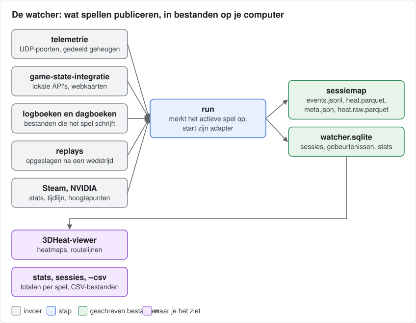

# 3DHeat Watcher {#dheat-watcher}

**Wat is het?** Je speelt een spel. Dit programma schrijft stilletjes op waar je naartoe ging en wat er gebeurde.
Later kun je het bekijken als een gekleurde kaart in de 3DHeat-viewer.

**Waarom zou ik het gebruiken?** Om je eigen logboek van elke sessie bij te houden - waar je reed, vloog of vocht,
je totalen per spel - zonder website en zonder het spel te veranderen.

**Voorbeeld:** je rijdt een ronde in een racespel terwijl de watcher draait; daarna bevat een bestand in
`sessions\<game>\` de lijn die je hebt gereden, en de viewer tekent die.

Meer in detail: 3DHeat Watcher is een programma op de achtergrond dat opschrijft wat spellen publiceren over je spel - waar je
bent geweest, wat er waar gebeurde, en de cijfers erachter - in bestanden op je eigen computer. De bestanden
zijn voor je eigen statistieken en voor de heatmaps en routelijnen van de 3DHeat-viewer.

Het draait rustig op de achtergrond, merkt welk spel je hebt gestart, en leest de eigen uitvoer van dat spel: een
telemetriepoort of gedeeld geheugen dat het spel publiceert voor dashboards, een game-state-integratie, het
dagboek of logboek dat het spel schrijft, de replay die het na een wedstrijd opslaat, de statistieken die Steam
bijhoudt, de clips die de NVIDIA App opslaat. Opnames blijven op je eigen computer. Het programma neemt alleen
contact op met twee externe diensten, en alleen in deze gevallen: GitHub, om te zoeken naar een nieuwere release (zie [Updates](updates.md)), en de
Match-V5 API van Riot, en alleen als je je eigen Riot-API-sleutel invult (zie [League of Legends-replays](game-lol-replays.md)).



## Wat het opneemt {#what-it-records}

- **Posities**: de auto, het vliegtuig, de held of de speler, meerdere keren per seconde waar het spel ze publiceert,
  met snelheid, koers en alles wat het spel er verder bij stuurt.
- **Gebeurtenissen**: spawns, doden, kills, ronden, etappes, rondes, doelpunten, opdrachten, opstijgen en
  landen, zonewisselingen, prestaties, hoogtepunten. Elke gebeurtenis wordt opgeslagen met haar tijd, en met haar
  plaats wanneer het spel die geeft.
- **Statistieken per sessie**: kills, doden, ronden, beste ronde, afstand, topsnelheid, speeltijd, en de
  eigen statistieken van het spel waar het die bijhoudt.

Wat elk spel geeft, en vanwaar, staat op de eigen pagina onder [Spellen](games.md). Eén bron kan niet alles
opnemen: multiplayerspellen worden alleen opgenomen via wat ze publiceren, en de watcher
leest hun geheugen nooit (zie [Bronnen en regels](sources-and-rules.md)).

## Installatie {#install}

Nog nooit met de opdrachtregel gewerkt? Lees eerst [Voordat je begint](before-you-start.md).

De watcher is een Python-programma voor Windows (Python 3.10 of later). Veel van zijn bronnen bestaan alleen op Windows: gedeeld
geheugen, het register, Windows-meldingen.

```bash
git clone https://github.com/Holdi601/3DHeat-Watcher.git
cd 3DHeat-Watcher
pip install -r requirements.txt
```

Een gedownload releasearchief werkt op dezelfde manier: pak het uit, en voer daarna `pip install -r requirements.txt`
uit in de map. De details, en de extra's die sommige spellen nodig hebben, staan in
[Installeren en uitvoeren](installing-and-running.md).

## Snelstart {#quick-start}

```bash
python -m heat3d_watch games            # wat elk spel geeft, en vanwaar
python -m heat3d_watch setup all        # wat er aangezet moet worden (er wordt niets veranderd)
python -m heat3d_watch setup f1-25 --apply   # één uitvoer van een spel aanzetten (het oorspronkelijke bestand wordt geback-upt)
python -m heat3d_watch run              # kijken; laat het draaien terwijl je speelt
python -m heat3d_watch stats            # totalen per spel
python -m heat3d_watch stats --csv out  # sessies, gebeurtenissen en statistieken als CSV-bestanden
```

Je ziet: na `games` een tabel met één regel per spel; `run` blijft doorgaan totdat je Ctrl+C
indrukt of het venster sluit.

Alles wordt geschreven naar `%LOCALAPPDATA%\3DHeat\Watcher`. Wil je een andere map gebruiken, stel dan de
omgevingsvariabele `HEAT3D_WATCH_HOME` in, of voer `python -m heat3d_watch config --set data=D:\somewhere` uit.

- `sessions\<game>\<date>_<adapter>\` - één map per sessie, met `events.jsonl` (elke gebeurtenis
  op het moment dat ze plaatsvindt), `heat.parquet` (de rijen met een positie, klaar voor de 3DHeat-viewer) en
  `meta.json` (spel, bron, assen, aantallen, statistieken)
- `watcher.sqlite` - de statistieken van elke sessie, in drie gewone tabellen
- `watcher.log` - wat de watcher heeft gedaan

De viewer opent de `heat.parquet` van een sessie rechtstreeks, zonder dat je iets instelt (de assen en eenheden
staan in het bestand). Omgezette replays worden als tabellen en wedstrijddocumenten ernaast geschreven; het
eigen één-bestand-per-wedstrijdformaat van de viewer staat beschreven op de pagina
[`.3dheat`-container](https://holdi601.github.io/3DHeat/container.html), en de kolommen van elke tabel op
[De gegevens](the-data.md).

## De documentatie {#the-documentation}

| Pagina | Wat die behandelt |
|---|---|
| [Voordat je begint](before-you-start.md) | Python, een terminal, plaatsaanduidingen, hoe succes en de veelvoorkomende fouten eruitzien |
| [Installeren en uitvoeren](installing-and-running.md) | vereisten, draaien op de achtergrond, starten met Windows, het vergrendelbestand, het logboek, elke instelling en omgevingsvariabele |
| [Spellen](games.md) | per spel een pagina: wat er wordt opgenomen, vanwaar, hoe het aan te zetten, hoe het werkt, assen, statistieken, wat is gecontroleerd |
| [De gegevens](the-data.md) | sessiemappen, `events.jsonl`, `heat.parquet` en zijn footer, `meta.json`, `watcher.sqlite`, herstel na een crash, CSV-export, een sessie openen in de 3DHeat-viewer |
| [Commando's](commands.md) | elk commando en elke optie van `python -m heat3d_watch` |
| [Bronnen en regels](sources-and-rules.md) | de zes soorten bronnen, de regels voor multiplayer, welke spellen zijn weggelaten en waarom |
| [NVIDIA Highlights](nvidia-highlights.md) | wat NVIDIA Highlights wel en niet kan leveren, en hoe een hoogtepunt een positie krijgt |
| [Servermods voor opnemen](server-mods.md) | de Arma 3- en Arma Reforger-servermods die hele missies opnemen voor de viewer |
| [Geheugen lezen](memory-reading.md) | singleplayer-geheugenprofielen: het formaat, de controles, hoe er een te schrijven en te verifiëren |
| [Updates](updates.md) | hoe de watcher naar nieuwe releases zoekt en zichzelf bijwerkt |
| [Ontwikkeling](development.md) | een adapter schrijven: de API, tests, een eerlijke `verified`, de spelpagina's opnieuw genereren |
| [Alle spellen in één tabel](watcher.md) | elk spel in één tabel, zoals `games --markdown` die afdrukt, plus de spellen die onderzocht maar nog niet gebouwd zijn |
| [Commandoreferentie](../cli-reference.md) | de `--help` van elk commando, gegenereerd uit de code |
| [Onderhoud](maintaining.md) | de checklist per release voor deze pagina's |

## Onderdeel van 3DHeat {#part-of-3dheat}

3DHeat Watcher is een van de gratis hulpmiddelen rond de 3DHeat-viewer (de watcher gebruikt 3DHeat CS2
om CS2-demo's om te zetten). Elk is een eigen project, met eigen releases en licentie:

| Tool | Wat die doet | Documentatie |
|---|---|---|
| [3DHeat](https://github.com/Holdi601/3DHeat) | de viewer: heatmaps, Race-analyse en wedstrijdanalyse in 3D | [site](https://holdi601.github.io/3DHeat/) |
| [GameFiles](https://github.com/Holdi601/3DHeat-GameFiles) | banen en levels uit de bestanden die spellen meeleveren, als 3D-modellen | [site](https://holdi601.github.io/3DHeat-GameFiles/) |
| [GameCapture](https://github.com/Holdi601/3DHeat-GameCapture) | rondetelemetrie uit racespellen; levels opnieuw opgebouwd uit gameplayvideo | [site](https://holdi601.github.io/3DHeat-GameCapture/) |
| [Unreal Exporter](https://github.com/Holdi601/3DHeat-UnrealExporter) | een plug-in voor de Unreal Editor die een level als één 3D-model exporteert | [site](https://holdi601.github.io/3DHeat-UnrealExporter/) |
| [CS2](https://github.com/Holdi601/3DHeat-CS2) | Counter-Strike 2-demo's naar tabellen en wedstrijddocumenten; kaarten naar 3D-modellen | [site](https://holdi601.github.io/3DHeat-CS2/) |
| [Watcher](https://github.com/Holdi601/3DHeat-Watcher) | legt vast wat spellen publiceren over je spel, op de achtergrond | [site](https://holdi601.github.io/3DHeat-Watcher/) |
| [Ext-WarThunder](https://github.com/Holdi601/3DHeat-Ext-WarThunder) | War Thunder-replays naar tabellen en wedstrijddocumenten | [site](https://holdi601.github.io/3DHeat-Ext-WarThunder/) |
| [Ext-WoT](https://github.com/Holdi601/3DHeat-Ext-WoT) | World of Tanks-replays naar tabellen en wedstrijddocumenten | [site](https://holdi601.github.io/3DHeat-Ext-WoT/) |
| [Ext-WoWs](https://github.com/Holdi601/3DHeat-Ext-WoWs) | World of Warships-replays naar tabellen en wedstrijddocumenten | [site](https://holdi601.github.io/3DHeat-Ext-WoWs/) |
| [Ext-Squad](https://github.com/Holdi601/3DHeat-Ext-Squad) | Squad-serverdemo's naar tabellen en wedstrijddocumenten | [site](https://holdi601.github.io/3DHeat-Ext-Squad/) |
| [Ext-DCS](https://github.com/Holdi601/3DHeat-Ext-DCS) | DCS World-kaarten naar 3D-modellen | [site](https://holdi601.github.io/3DHeat-Ext-DCS/) |
| [Ext-IL2](https://github.com/Holdi601/3DHeat-Ext-IL2) | IL-2 Sturmovik-kaarten naar 3D-modellen | [site](https://holdi601.github.io/3DHeat-Ext-IL2/) |

Elke spellezer is een eigen klein project met een eigen licentiebestand, eigen releases en een eigen
issuetracker, zodat hij los kan worden geïnstalleerd, bijgewerkt, onderhouden - of op verzoek van een
rechthebbende teruggetrokken - zonder dat de viewer of de andere tools daar iets van merken.

Licentie: MIT ([LICENSE](https://github.com/Holdi601/3DHeat-Watcher/blob/main/LICENSE)). De licenties
van de pakketten van derden die het gebruikt, en wat de spellen die het leest vereisen, staan in
[LICENSES.md](https://github.com/Holdi601/3DHeat-Watcher/blob/main/LICENSES.md).
