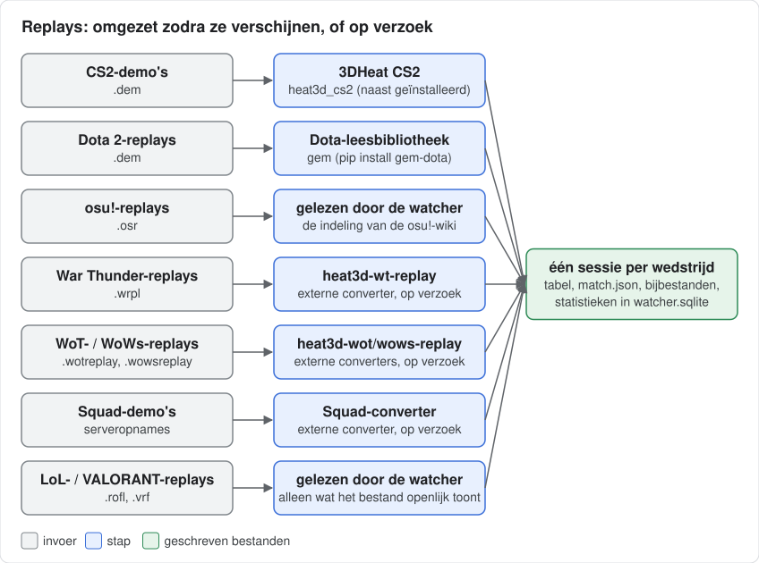

# Installeren en uitvoeren {#installing-and-running}

## Vereisten {#requirements}

- **Windows.** De watcher is voor Windows gemaakt, en de meeste van zijn bronnen bestaan alleen daar: gedeeld
  geheugen dat spellen aanmaken (`Local\...`-gebieden), het register (waar Steam staat), Windows-meldingen, de
  lijst met processen met hun uitvoerbare paden. Op een ander systeem start het programma, maar die bronnen vinden
  niets, meldingen worden alleen gelogd, en geheugenlezen weigert ("only implemented on Windows").
- **Python 3.10 of nieuwer**, van <https://www.python.org/downloads/>: vink **Add python.exe to PATH** aan in het
  installatieprogramma, en controleer met `python --version` in een nieuwe terminal. Nieuw hiermee? Lees eerst
  [Voordat je begint](before-you-start.md).
- **Pakketten** (`requirements.txt`): `psutil>=6.0` (welke spellen draaien, welk programma een poort vasthoudt, de
  verbindingen van een spel; een oudere psutil werkt ook, via de oudere naam voor de verbindingen van een proces),
  `pyarrow>=15` (het schrijven van `heat.parquet`), `numpy>=1.24`, en `pytest>=8.0` voor de tests.
  `requirements-optional.txt` noemt op dit moment geen pakketten.

Zonder `pyarrow` worden sessies nog steeds opgenomen: `events.jsonl` is dan het archief, en de tabel kan later
worden gebouwd met [`table`](commands.md#table).

### Extra's die sommige spellen nodig hebben {#extras-some-games-need}

| Spel | Wat het nodig heeft |
|---|---|
| Counter-Strike 2-demo's | [3DHeat CS2](https://github.com/Holdi601/3DHeat-CS2) en zijn vereisten (`demoparser2`). De watcher zoekt het in `HEAT3D_CS2`, daarna in een map `3DHeat-CS2` of `cs2` naast de eigen map van de watcher, en daarna waar Python `heat3d_cs2` kan importeren. Zonder dat staat de adapter in `games` als niet beschikbaar. |
| Microsoft Flight Simulator 2020 / 2024 | `SimConnect.dll` - wordt niet meegeleverd. MSFS 2020 heeft er een in zijn installatiemap; voor MSFS 2024 installeer je de MSFS 2024-SDK. `MSFS_SDK` / `MSFS2024_SDK` wijzen naar de SDK-map. |
| Euro Truck Simulator 2, American Truck Simulator | de RenCloud `scs-telemetry.dll`-plugin (revisie 12) in `<game>\bin\win_x64\plugins` |
| BeamNG.drive | de `heat3d`-protocolmod, geïnstalleerd met `python -m heat3d_watch setup beamng --apply` |
| League of Legends (live) | optioneel: het basiscertificaat van Riot als `<data>\riotgames.pem`, zodat de lokale verbinding wordt geverifieerd |
| Minecraft | een map `%APPDATA%\.minecraft` (Java Edition) |

Op elke spelpagina onder [Spellen](games.md) staat wat je in het spel zelf moet aanzetten.
`python -m heat3d_watch games` zet `[unavailable: ...]` bij een adapter als er op deze computer iets ontbreekt
wat hij nodig heeft.

## Installeren {#installing}

Nieuw met de opdrachtregel? Lees eerst [Voordat je begint](before-you-start.md). Als `pip` niet wordt gevonden,
gebruik dan `python -m pip install -r requirements.txt`.

Vanuit een kloon:

```bash
git clone https://github.com/Holdi601/3DHeat-Watcher.git
cd 3DHeat-Watcher
pip install -r requirements.txt
```

Vanuit een release: download het archief van de releases van de repository, pak het uit en voer daarna
`pip install -r requirements.txt` uit in de map. Beide soorten kopieën werken zichzelf bij (zie
[Updates](updates.md)).

Voer elk commando uit vanuit de map van de repository: `python -m heat3d_watch` importeert het pakket van daar, en
de updater (`heat3d_update`) staat ernaast.

## Uitvoeren {#running}

```bash
python -m heat3d_watch run        # watch until stopped
python -m heat3d_watch run -v     # the same, with debug lines in the log
python -m heat3d_watch run --once # one look at the games running now, then stop and exit
```

Bij het starten doet `run` het volgende:

1. schrijft het [lockbestand](#the-lock-file);
2. maakt sessies af die een eerdere run open heeft gelaten, bijvoorbeeld na een crash
   (zie [Herstel](the-data.md#recovery-after-a-crash));
3. leest elke `scan_seconds` (2 s) de lijst met processen (alleen namen en paden, er wordt geen proces geopend)
   en start voor elk gevonden spel een adapter, in een eigen thread. Wanneer het proces van een spel weg is, wordt
   zijn adapter gestopt en worden de sessies die hij open had gesloten, zodat hun tabel en hun regel in de
   statistieken worden geschreven. Adapters die niet op een spel wachten (Steam-statistieken, Steam Timeline,
   NVIDIA highlights, de replaymappen) draaien de hele tijd;
4. zolang geen spel draait, kijkt het hoogstens één keer per uur naar een nieuwere release (het antwoord zelf wordt
   zes uur bewaard) en, met `auto_update` aan, installeert het die en start het zichzelf opnieuw (zie
   [Updates](updates.md)).

Een adapter die faalt, wordt gelogd en stopt de andere niet. Als de peiling van een adapter 20 keer achter elkaar
mislukt, of zijn start mislukt, wordt de adapter gestopt en pas weer gestart wanneer het spel opnieuw start (een
nieuw proces-id).

Stop de watcher met Ctrl+C. De adapters sluiten hun sessies voordat hij afsluit. Als de watcher in plaats daarvan
wordt gedood (Taakbeheer, een crash, een stroomstoring), gaat er niets verloren wat al was geschreven: de
volgende `run` maakt die sessies af.

`--once` neemt één keer een kijkje: het start de adapters voor de spellen die op dat moment draaien (en de
altijd-aan adapters), laat elk één keer peilen - hoogstens 10 seconden wachten daarop - en stopt ze daarna zoals
bij het einde van een spel. Zo worden de sessies die ze hebben geopend gesloten, hun tabellen geschreven en hun
regels in de statistieken geteld, voordat het afsluit. Gebruik het om te controleren dat een spel wordt
herkend, niet om op te nemen.

### Replays die al op schijf staan {#replays-already-on-disk}



De eerste keer dat een replay-adapter een van zijn mappen ziet, noteert hij alleen de replays die er al in staan:
een speler met jaren aan demo's zou anders een dag lang een watcher hebben die bezig is met omzetten. Vanaf dan
wordt elke nieuwe replay één keer omgezet, zodra het spel klaar is met schrijven. De oude worden op verzoek
omgezet met [`replays`](commands.md#replays):

```bash
python -m heat3d_watch replays cs2-demos              # every demo in CS2's folders and replay_folders
python -m heat3d_watch replays osu-replays D:\Old     # the replays in one folder
```

### Op de achtergrond draaien {#running-in-the-background}

De watcher heeft geen eigen venster; het is een consoleprogramma dat draait tot het wordt gestopt. Het schrijft
alles naar `watcher.log`, dus het heeft geen zichtbare console nodig. Manieren om hem uit de weg te houden:

- start hem in een console en minimaliseer die console: `start "" /min python -m heat3d_watch run` vanuit `cmd`,
  in de map van de repository;
- start hem zonder console: `pythonw -m heat3d_watch run`. Consoleuitvoer gaat verloren, maar `watcher.log` wordt
  nog steeds geschreven. Om hem te stoppen, beëindig je het proces `pythonw.exe`; de volgende start maakt de
  sessies af die hij heeft achtergelaten. Het project heeft deze manier van draaien niet getest.

### Met Windows meestarten (een idee) {#starting-with-windows-an-idea}

De watcher installeert zichzelf niet om met Windows mee te starten. Om hem automatisch te laten starten:

- **Taakplanner**: maak een taak met de trigger *Bij aanmelden* en de actie *Een programma starten*,
  programma `pythonw.exe` (of `python.exe`), argumenten `-m heat3d_watch run`, *Starten in* ingesteld op de map
  van de repository;
- **Map Opstarten**: zet een snelkoppeling in `shell:startup` met hetzelfde programma, dezelfde argumenten en
  dezelfde map bij *Starten in*.

Geen van beide is onderdeel van de watcher of wordt door hem getest. Het [lockbestand](#the-lock-file) zorgt
ervoor dat een tweede exemplaar dat per vergissing wordt gestart meteen afsluit.

## Het lockbestand {#the-lock-file}

`<data>\watcher.lock` bevat het proces-id van de draaiende watcher. Wanneer `run` start en het lockbestand een
proces noemt dat nog bestaat en waarvan de naam `python` bevat, drukt het

```text
A watcher is already running (process 12345) for C:\Users\...\3DHeat\Watcher.
```

af en eindigt met afsluitcode 1. Twee watchers op één datamap zouden elk spel twee keer opnemen, en de tweede zou
de openstaande sessies van de eerste zien als resten van een crash. Een lockbestand waarvan het proces weg is, of
dat bij een ander programma hoort, wordt overschreven. Wanneer `run` eindigt, verwijdert het het lockbestand als
het daar nog zijn eigen proces in vindt.

## Het logboek {#the-log}

`<data>\watcher.log` wordt alleen door `run` geschreven; de andere commando's drukken af op de console. Elke regel
heeft de tijd, het niveau en een bericht:

```text
2026-05-01 20:15:01,123 INFO watching; data in C:\Users\...\AppData\Local\3DHeat\Watcher
2026-05-01 20:15:03,456 INFO f1-25: starting (EA SPORTS F1 25)
2026-05-01 21:02:11,789 INFO f1-25: stopping
```

Adapters loggen wat ze niet kunnen en waarom: "UDP 20777 is in use by ...; not taking it from that program",
"not reading memory: the game is played online", "could not start", "poll failed (3)" met de traceback. `run -v`
voegt debugregels toe. Het bestand wordt aangevuld en door de watcher nooit geroteerd of leeggemaakt; verwijder
het wanneer je wilt. Dezelfde regels gaan ook naar de console.

## Waar alles staat {#where-everything-is}

De thuismap is `%LOCALAPPDATA%\3DHeat\Watcher`, of `HEAT3D_WATCH_HOME` als die is ingesteld (zonder `LOCALAPPDATA`,
bijvoorbeeld op een ander systeem, `~/.local/share/3DHeat/Watcher`). `settings.json` staat altijd in de thuismap.
Al het andere gaat naar de datamap, die de thuismap is tenzij de instelling `data` een andere noemt:

| Pad | Wat het is |
|---|---|
| `<home>\settings.json` | de instellingen |
| `<data>\sessions\` | de opnames, één map per zitting ([De gegevens](the-data.md)) |
| `<data>\watcher.sqlite` | de statistiekendatabase |
| `<data>\watcher.log` | het logboek van `run` |
| `<data>\watcher.lock` | het lockbestand, zolang `run` draait |
| `<data>\state\` | wat de altijd-aan en replay-adapters al hebben gezien (`steam-stats.json`, `replays-cs2-demos.json`, ...), zodat een herstart niets dubbel opneemt |
| `<data>\profiles\*.json` | geheugenprofielen die je hebt geschreven ([Geheugen lezen](memory-reading.md)) |
| `<data>\riotgames.pem` | optioneel, het basiscertificaat van Riot voor de live-adapter van League of Legends |
| `%LOCALAPPDATA%\3DHeat\update-check-3DHeat-Watcher.json` | het gecachte antwoord van de laatste controle op releases |

De watcher verwijdert niets in deze mappen, behalve een sessiemap waarin niets is opgenomen (een spel dat in zijn
menu's bleef).

## Instellingen {#settings}


`python -m heat3d_watch config` toont de instellingen; `config --set sleutel=waarde ...` wijzigt ze en slaat
`settings.json` op (zie [config](commands.md#config)). Het bestand is gewone JSON en kan ook met de hand worden
bewerkt terwijl de watcher niet draait. Onbekende sleutels erin worden genegeerd. Instellingen worden gelezen
wanneer een commando start, dus start `run` opnieuw na een wijziging.

| Instelling | Standaard | Wat het doet |
|---|---|---|
| `data` | `""` | De datamap. Leeg: de thuismap. |
| `disabled` | `[]` | Adapter-id's die nooit draaien, bijvoorbeeld `config --set disabled=steam-stats,nvidia-highlights`. Elke andere adapter draait wanneer hij zijn spel vindt. |
| `auto_update` | `true` | Zolang geen spel draait, een nieuwere release installeren en opnieuw starten (zie [Updates](updates.md)). `false`: alleen een melding in het logboek. |
| `scan_seconds` | `2.0` | Seconden tussen de keren dat de lijst met processen wordt bekeken. |
| `memory` | `false` | Geheugenadapters (enkelspelerspellen met een profiel dat je zelf hebt geschreven) toestaan te draaien. Standaard uit; zie [Geheugen lezen](memory-reading.md). |
| `replays` | `true` | De `replay`-adapters draaien: allemaal (zie `python -m heat3d_watch replays` en [Spellen](games.md)) - CS2-demo's, Dota 2, osu!, War Thunder, World of Tanks, World of Warships, Squad, League of Legends- en VALORANT-replays, IL-2 Tacview-opnames. |
| `replay_folders` | `{}` | Extra mappen per adapter-id, bijvoorbeeld `{"cs2-demos": ["D:\\Demos"]}`. Replay-adapters bekijken ze naast de eigen mappen van het spel; `il2-tacview` accepteert ook installatiemappen (het kijkt dan in hun `data\Tracks`); voor `elite` vervangt de eerste map de journaalmap. Stel de mappen van één adapter in met `config --set replay_folders.cs2-demos=D:\Demos,E:\More`, of het hele woordenboek als JSON. |
| `riot_id` | `""` | Je Riot-ID (`Name#TAG`), zodat je eigen regel in een League of Legends-replay je statistieken wordt. Leeg: de regel van elke speler wordt bewaard, en niemand wordt als die van jou gemarkeerd. |
| `riot_api_key` | `""` | Je eigen Riot-ontwikkelaarssleutel voor de API, om het officiële verloop van elke afgespeelde League-wedstrijd op te halen (posities elke minuut, kills waar ze gebeurden). Leeg: er wordt niets opgehaald. |
| `riot_platform` | `"EUW1"` | De platform-id van je League-server (`EUW1`, `EUN1`, `NA1`, `KR`, ...), gebruikt om de regionale Match-V5-host te vinden. |
| `player_names` | `{}` | Je naam in spellen waarvan de interface elke speler bij naam noemt maar niet zegt wie jij bent, per adapter-id: `warthunder-webmap` (de regels over jou in de killfeed worden je kills en doden) en `rocketleague-stats` (je rijen worden `me`; zonder dit de speler die de camera van het spel volgt). Instellen met `config --set player_names.warthunder-webmap=Name`. |

Een `settings.json` met elke standaard:

```json
{
  "data": "",
  "disabled": [],
  "auto_update": true,
  "scan_seconds": 2.0,
  "memory": false,
  "replays": true,
  "replay_folders": {},
  "riot_id": "",
  "riot_api_key": "",
  "riot_platform": "EUW1",
  "player_names": {}
}
```

## Omgevingsvariabelen {#environment-variables}

| Variabele | Effect |
|---|---|
| `HEAT3D_WATCH_HOME` | de thuismap (instellingen, en de data tenzij `data` iets anders zegt) |
| `HEAT3D_NO_UPDATE` | elke waarde behalve leeg, `0`, `false` of `no` zet de controle op releases en de automatische update uit |
| `HEAT3D_NO_TOAST` | elke niet-lege waarde: geen Windows-meldingen, alleen logregels |
| `HEAT3D_CS2` | de map van 3DHeat CS2, voor CS2-demo's |
| `HEAT3D_CS2_GSI_PORT` | de poort voor de spelstatus van CS2 (standaard 3311); het cfg-bestand dat `setup` schrijft gebruikt die |
| `HEAT3D_DOTA_GSI_PORT` | de poort voor de spelstatus van Dota 2 (standaard 3312) |
| `MSFS_SDK`, `MSFS2024_SDK` | de mappen van de MSFS-SDK, waar `SimConnect SDK\lib\SimConnect.dll` wordt gezocht |

Windows-meldingen worden alleen voor updates gebruikt: "Updating to 1.2.0", of "1.2.0 is out; not updated: ..."
wanneer de update niet kon worden toegepast. Ze worden getoond via de eigen meldings-API van PowerShell, dus er
hoeft niets te worden geïnstalleerd. De titel en de tekst worden aan PowerShell doorgegeven als
omgevingsvariabelen, nooit als onderdeel van het script.
