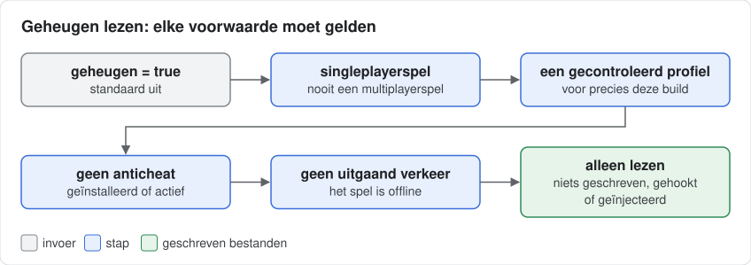

# Geheugen lezen {#reading-memory}

Sommige enkelspelerspellen vertellen niets aan andere programma's. Voor die kan de watcher - als je het aanzet en
zelf een profiel schrijft - opzoeken waar je in het geheugen van het spel staat, alleen lezend.

Voor enkelspelerspellen die niets publiceren, kan de watcher posities en waarden uit het geheugen van het spel
lezen, via een **profiel** dat je schrijft voor je eigen versie van het spel. Van alle bronnen is dit de enige die
het spel niet zelf heeft uitgegeven, dus het is zwaarder afgeschermd dan de andere:

- het staat **standaard uit** (`python -m heat3d_watch config --set memory=true` zet het aan);
- het leest, en heeft geen manier om te schrijven;
- **er worden geen profielen meegeleverd.**

Profielen worden niet meegeleverd omdat een offset alleen klopt voor de build waarop hij is gevonden. Na een patch
leest een profiel dat eerder klopte onzin, en onzin ziet eruit als getallen. Een profiel moet worden gecontroleerd
op de build die een speler heeft, door die speler.

## De controles, in volgorde {#the-checks-in-order}


Elke controle hieronder moet slagen. De eerste vier worden gedaan **voordat** het spel wordt geopend, omdat het
openen van een beschermd spel om te lezen zelf is wat een anti-cheat opmerkt, en weigeren achteraf te laat zou zijn.

1. **De instelling**: `memory` is waar. Anders worden geheugenadapters nooit gestart.
2. **Een profiel voor het spel**, waarvan `exe` de draaiende proces noemt. Een profiel zegt of het spel
   online kan worden gespeeld (`"online"`); een profiel dat dit weglaat, wordt geweigerd.
3. **Geen anti-cheat in de buurt**:
   - geen anti-cheatbestand in de map van het spel of tot drie mappen erboven (stoppend bij een `common`-map van een
     Steam-bibliotheek, of bij een map met `steamapps` erin, omdat andere spellen daarboven staan):
     `EasyAntiCheat`, `EasyAntiCheat_EOS_Setup.exe`, `start_protected_game.exe`, `BattlEye`,
     `BEClient_x64.dll`, `BEService_x64.exe`, `EAAntiCheat.GameServiceLauncher.exe`, `AntiCheatExpert`,
     `SGuard64.exe`, `GameGuard`, `GameMon.des`, `XIGNCODE`, `xhunter1.sys`, `Vanguard`, `FACEIT`
     (vergeleken in kleine letters, ook als begin van een naam). Als de map van het spel onbekend is, wordt het
     spel geweigerd;
   - geen anti-cheatstuurprogramma of -service die op de computer draait, zoals weergegeven door
     `sc query type= driver state= active` en `sc query type= service state= active`: EasyAntiCheat,
     EasyAntiCheat_EOS, BEService, BEDaisy, vgk, vgc, ACE-BASE, ACE-GAME, xhunter1, FACEIT, FACEITService,
     EAAntiCheatService, Denuvo Anti-Cheat, npggsvc, Ricochet. Een kernel-anti-cheat die voor een ander spel is
     geïnstalleerd, kijkt nog steeds naar elk proces. Als de services niet kunnen worden opgesomd, wordt het spel
     geweigerd;
4. **Niet online**: een spel waarvan het profiel `"online": true` zegt, wordt alleen gelezen zolang het geen
   verbinding heeft met iets anders dan deze computer (elk extern adres behalve `127.x`, `::1`). Als zijn
   verbindingen niet kunnen worden gelezen, wordt het geweigerd.
5. Daarna, wanneer de adapter start:
   - **de exacte build**: de bestandsgrootte van het executable, of zijn SHA-256, moet overeenkomen met een versie
     die het profiel noemt. Een onbekende build wordt niet gelezen;
   - **de modules nog eens**: de geladen modules van het spel worden opgesomd (een Toolhelp-snapshot, dat geen eigen
     toegangsrechten vraagt) en gecontroleerd op een anti-cheatclient (`BEClient_x64.dll`, `BEClient.dll`,
     `EasyAntiCheat_x64.dll`, `EasyAntiCheat.dll`, `EOSAntiCheat...`). Een beschermd proces weigert de snapshot, en
     dat is ook een weigering;
   - pas dan wordt het proces geopend, met `PROCESS_VM_READ | PROCESS_QUERY_LIMITED_INFORMATION` en niets anders.

Controles 1 tot 4 worden bij elke scan herhaald (elke 2 s) zolang het spel draait. Als er een begint te falen (het
spel verbindt met een server, een anti-cheatservice start), wordt de adapter bij de volgende scan gestopt. Een
weigering wordt gelogd: `mem-<id>: not reading memory: <reason>`. Een mislukking bij het starten (onbekende build,
een anti-cheatmodule, een patroon niet gevonden) wordt gelogd als `mem-<id>: could not start`, en de adapter wordt
niet opnieuw geprobeerd tot het spel opnieuw start.

Er is geen schrijven, geen toewijzing in het andere proces, geen thread die daarin wordt gestart, geen bibliotheek
die erin wordt geladen, geen debugrecht en geen verhoging van rechten. Een test (`test_memory_reading_cannot_write`
in `tests/test_core.py`) faalt als een aanroep die naar een ander proces schrijft, daarin toewijst of code erin
uitvoert - `WriteProcessMemory`, `VirtualAllocEx`, `CreateRemoteThread`, `PROCESS_VM_WRITE`, `SeDebugPrivilege`,
`LoadLibrary`, ... - ergens in het pakket voorkomt.

Nooit gelezen, wat een profiel ook zegt: spellen die online worden gespeeld, en spellen waarvan de enkelspelermodus
onder een anti-cheat draait, zoals GTA V, of Elden Ring die via de launcher start. De controles hierboven weigeren
ze toch.

## Het profielformaat {#the-profile-format}

Een profiel is een JSON-bestand in `<data>\profiles\` (`<data>` is de datamap, zie
[Installeren en uitvoeren](installing-and-running.md#where-everything-is)), één per spel, met elke bestandsnaam die
op `.json` eindigt. Een synthetisch voorbeeld:

```json
{
  "schema": "heat3d.memprofile/1",
  "id": "mygame",
  "game": "My Game",
  "exe": "MyGame.exe",
  "online": false,
  "versions": [ { "label": "1.06", "size": 123456789 } ],
  "anchors": {
    "World": { "aob": "48 8B 05 ?? ?? ?? ?? 48 85 C0", "rip": [3, 7] }
  },
  "values": {
    "pos": { "type": "vec3f", "base": "World", "chain": ["0x10", "0x68", "0x70"] },
    "hp":  { "type": "i32",   "base": "World", "chain": ["0x10", "0x138"] },
    "map": { "type": "u32",   "base": "World", "chain": ["0x10", "0x1C0"] }
  },
  "events": [
    { "event": "death", "value": "hp",  "when": "to_zero" },
    { "event": "zone",  "value": "map", "when": "change" }
  ],
  "axes": { "up": "y", "units": "metres" },
  "rate": 10,
  "provenance": [ { "source": "https://example.com/my-notes", "verified_on": "1.06" } ]
}
```

| Sleutel | Verplicht | Wat het is |
|---|---|---|
| `schema` | ja | precies `heat3d.memprofile/1` |
| `id` | ja | kort en stabiel; de adapter heet `mem-<id>` |
| `game` | ja | de naam van het spel, waarnaar de sessiemap wordt genoemd |
| `exe` | ja | de bestandsnaam van het executable, die ook zegt dat het spel draait |
| `online` | ja | `true` als het spel online kan worden gespeeld; het wordt dan alleen gelezen terwijl het offline is |
| `versions` | ja | de builds waarop het profiel is gecontroleerd: elk met een `label`, en een `size` (de grootte van het executable in bytes) en/of een `sha256`. Als beide zijn gegeven, moeten beide kloppen. Een item met geen van beide komt met niets overeen. |
| `anchors` | ja | benoemde adressen in de hoofdmodule. `aob`: een bytepatroon, hexadecimale bytes gescheiden door spaties, `?` of `??` voor elke byte; het moet **precies één keer** in het moduleimage voorkomen (meerdere treffers tellen als een mislukking, net als geen). `rip: [d, n]`: het patroon wijst naar een instructie met een 32-bit RIP-relatieve verplaatsing op byte `d` en lengte `n`; het anker wordt het adres waar die instructie naar verwijst. `offset`: wordt daarna opgeteld (hex of decimale tekst). In plaats van `aob` geeft `module_offset` een vaste offset vanaf het begin van de module. |
| `values` | ja | wat elke peiling wordt gelezen: `type` (`i32`, `u32`, `i64`, `u64`, `u8`, `f32`, `f64`, `vec3f`, `vec3d`), `base` (de naam van een anker), `chain` (offsets als hex of decimale tekst) |
| `events` | nee | regels die veranderingen in gebeurtenissen omzetten: `when` `change` (de waarde verschilt van de vorige peiling) of `to_zero` (een getal zakt van boven 0 naar 0 of lager) |
| `axes` | nee | `up` (standaard `y`), `units` (standaard `game units`), `scale` (de eenheidsschaal van de viewer, die elke positie vermenigvuldigt; standaard 1, de eigen eenheden van het spel) |
| `rate` | nee | peilingen per seconde, 1 tot 60 (standaard 10) |
| `provenance` | nee | waar de offsets vandaan komen en op welke build je ze hebt gecontroleerd; het wordt in de `meta.json` van elke sessie gekopieerd |

**Hoe een waarde wordt gelezen.** Het adres van het anker is het begin. Als `chain` leeg is, wordt de waarde daar
direct gelezen. Anders wordt eerst de aanwijzer gelezen die bij het anker is opgeslagen. Daarna wordt voor elke
offset behalve de laatste de aanwijzer op `adres + offset` gelezen. De laatste offset wordt opgeteld om het adres
van de waarde te krijgen. Een lege aanwijzer onderweg (het spel is tussen levels of in een menu) laat de waarde voor
die peiling leeg.

**Wat wordt opgenomen.** Een waarde met de naam `pos` (een `vec3f` of `vec3d`) wordt bij elke peiling een
`position`-rij van speler `me`. Elke gebeurtenisregel schrijft zijn `event`-rij, met de nieuwe waarde en, waar `pos`
bekend is, de positie, en telt 1 op bij een statistiek met dezelfde naam. Het moduleimage wordt bij het starten één
keer gelezen om de ankers te vinden, in blokken van 64 KiB; blokken die niet gelezen kunnen worden tellen als nullen.
De `meta.json` van de sessie noemt het profiel, het buildlabel en de provenance.

Een profiel dat niet kan worden gebruikt (ongeldige JSON, een verkeerd `schema`, een verplichte sleutel die ontbreekt)
wordt overgeslagen en gelogd als `profile <file> not used: <reason>`. Profielen worden geladen wanneer de watcher
start, dus start `run` opnieuw na het toevoegen of wijzigen van een profiel.

## Een profiel schrijven en controleren {#writing-and-verifying-a-profile}

1. **Alleen voor een enkelspelerspel zonder anti-cheat.** Heeft het spel een anti-cheat, of speel je het online, stop
   dan hier: de watcher weigert het, en dat hoort zo.
2. **Zoek de waarden op je eigen build.** Werk offline. Gebruik je eigen debugtools of gepubliceerde notities over het
   spel om de positie van de speler en de waarden die je interesseren te vinden, en een aanwijzerpad naar elk van
   die waarden vanaf een vaste plek in het executable. Geef een bytepatroon (`aob`) de voorkeur boven een vaste
   `module_offset`: een patroon vindt zijn plek nog als de code een beetje verschuift.
3. **Maak het patroon uniek.** Het moet precies één keer in de module voorkomen. Zet wildcards bij de bytes die
   veranderen (adressen, verplaatsingen) en houd genoeg vaste bytes eromheen.
4. **Leg de build vast.** Zet de exacte grootte van het executable in `versions`; PowerShell
   `(Get-Item .\MyGame.exe).Length` geeft die, en `Get-FileHash .\MyGame.exe -Algorithm SHA256` geeft de hash. Na
   een patch wordt het profiel gewoon niet meer gebruikt, tot je het opnieuw controleert en de nieuwe build toevoegt.
5. **Zeg of het spel online gaat** (`online`), eerlijk.
6. **Probeer het**: zet lezen aan (`config --set memory=true`), zet het bestand in `<data>\profiles\`, en controleer dat
   `python -m heat3d_watch games` `mem-<id>` toont. Start het spel en draai `python -m heat3d_watch run -v`. Zoek in
   `watcher.log` naar `mem-<id>: starting`, of naar de reden waarom het werd geweigerd of niet kon starten.
7. **Controleer de getallen tegen het spel.** Loop naar een bekende plek en kijk naar de `position`-rijen in
   `events.jsonl` van de sessie. Bewegen ze mee als jij beweegt, met de juiste afstand, langs de juiste assen? Open
   `heat.parquet` in de viewer en controleer dat de route overeenkomt met waar je bent geweest. Veroorzaak elke
   gebeurtenis (al je gezondheid verliezen, van zone wisselen) en controleer dat die één keer verschijnt. Onzin ziet
   eruit als getallen, en alleen deze vergelijking onderscheidt de twee.
8. **Schrijf op wat je hebt gecontroleerd** in `provenance`: de bron van de offsets en de build waarop je ze hebt
   gecontroleerd.

De tekst `verified` van een geheugenadapter, zoals `games` die toont, is altijd "by the profile's author, for the
builds it lists". De watcher kan niet meer weten dan dat.
