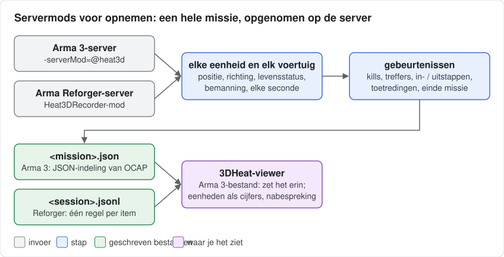

# Opnamemods voor servers (Arma 3, Arma Reforger) {#server-recorder-mods-arma-3-arma-reforger}

De meeste spellen worden door de watcher op de eigen computer van de speler opgenomen. Arma is
anders: een server kan een hele missie opnemen - elke eenheid en elk voertuig, niet alleen die van
jou - met een mod die op de server draait. Spelers doen niets: de Arma 3-mod draait alleen op de
server, en Reforger downloadt de mods van een server zelf wanneer spelers meedoen (de mod doet niets
op hun computers). De repository bevat twee zulke mods, in
[`mods/arma3`](https://github.com/Holdi601/3DHeat-Watcher/tree/main/mods/arma3)
en [`mods/reforger`](https://github.com/Holdi601/3DHeat-Watcher/tree/main/mods/reforger).
Hun README's zijn de volledige documentatie; deze pagina is het overzicht.

**Status: beide zijn nog niet in het spel getest.** De Arma 3-extensie is gebouwd en aangestuurd
zoals Arma extensies aanroept, en de uitvoer ervan is door 3DHeat gelezen; de SQF-scripts ervan
zijn nog niet in Arma 3 gedraaid. De Reforger-mod is geschreven op basis van de gepubliceerde
scriptAPI van Bohemia en is nog nooit gecompileerd. Zet geen van beide op een openbare server voordat
de teststappen in de README zijn doorlopen.

## Arma 3 {#arma-3}

1. Bouw de extensie één keer per platform (`mods/arma3/extension`). Daarvoor heb je een C-compiler
   nodig: Visual Studio Build Tools op Windows, gcc op Linux; als je nog nooit iets hebt gecompileerd,
   vraag het aan je serverhost.
   - Windows, in een "x64 Native Tools Command Prompt for VS":
     `cl /nologo /O2 /LD heat3d.c /Fe:heat3d_x64.dll`
   - Linux: `gcc -O2 -shared -fPIC -o heat3d_x64.so heat3d.c -ldl`
2. Bouw de mod: `python mods/arma3/build.py` schrijft `mods/arma3/@heat3d/`
   (je hebt de Arma 3 Tools hiervoor niet nodig).
3. Kopieer `@heat3d` naar de map van de server en start de server met
   `-serverMod=@heat3d`.
4. Het `.rpt`-logboek van de server meldt `Heat3D recorder 0.1.0: recording <file> every 1 s`.

| Instelling | Standaard | Wat het doet |
|---|---|---|
| `captureDelay` | 1 | seconden tussen frames |
| `recordHits` | 1 | 0 zet de treffergebeurtenissen uit |
| `recordShots` | 1 | 0 zet het tellen van schoten uit |
| `minPlayers` | 0 | alleen opnemen zodra dit aantal spelers online is |

Een missie overschrijft een instelling in zijn `init.sqf` (`heat3d_captureDelay = 0.5;`).
Opnames gaan naar `recordings/` in `@heat3d`, of naar `HEAT3D_DIR`.

**Uitvoer:** één bestand per missie in de JSON-indeling van OCAP (het formaat van de OCAP2-recorder),
genoemd `<datum>__<tijd>_<missie>.json`. Tijdens de missie is het een logboek (`.heat3d.part`),
bij elke schrijfactie leeggemaakt. Het logboek van een gecrashte missie wordt afgemaakt de volgende
keer dat een missie start.

## Arma Reforger {#arma-reforger}

De mod (`Heat3DRecorder.gproj`) wordt geopend en gebouwd in Bohemia's Workbench (Arma Reforger Tools),
getest op een lokale dedicated server, gepubliceerd vanuit Workbench (niet vermeld zolang er wordt
getest) en toegevoegd aan de lijst `mods` in `config.json` van de server - stap voor stap in de README.
Elke seconde schrijft hij de positie, richting, levensstatus, voertuig en speler-id van elk personage,
en de positie, richting, status en bemanning van elk voertuig; en kills (killer, wapen, afstand),
treffers, in- en uitstappen, spelers die binnenkomen en vertrekken, en het einde van de missie.

**Uitvoer:** één JSON-object per regel, `$profile:heat3d/<UTC-datum>_<UTC-tijd>_<wereld>.jsonl`:
een `header`-regel (indeling `heat3d-reforger`, assen x oost, y omhoog, z noord), dan `entity`-,
`frame`- en `event`-regels terwijl ze gebeuren, en een `end`-regel. Eenheidsrijen zijn
`[id, x, y, z, dir, alive, vehicleId, playerId]`, voertuigrijen `[id, x, y, z, dir, alive, [crew ids]]`;
gebeurtenissen volgen de gebeurtenisindeling van OCAP2.

## In de viewer {#in-the-viewer}

Zet een Arma 3-opname op de [3DHeat-viewer](https://holdi601.github.io/3DHeat/): één missie is één
sessie, eenheden worden soldaten, voertuigen krijgen hun type, en kills en treffers gaan in de lijst
met nabespreking. De webspeler van OCAP2 speelt hem ook af. Het Reforger-bestand is de eigen
regelindeling van de mod, met de gebeurtenisindeling van OCAP2.
