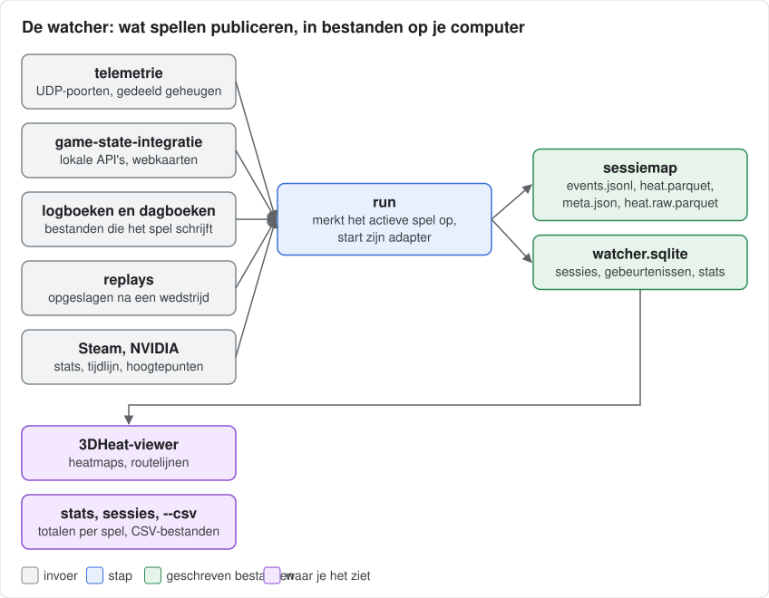

# Bronnen en regels {#sources-and-rules}

De watcher legt alleen vast wat spellen en platforms aan de speler uitgeven. Deze pagina legt uit welke bronnen dat zijn, wat de watcher met elke bron mag doen, en welke spellen of delen van spellen hij met opzet overslaat.

## De zes soorten bronnen {#the-six-kinds-of-source}

Elke adapter heeft een `kind`, en de soort bepaalt wat de adapter mag doen:

| Soort | Wat het is | Meerspelerspellen |
|---|---|---|
| `telemetry` | een UDP-poort of gedeeld geheugen dat het spel publiceert voor dashboards, bewegingsplatforms en stuurwielen (Forza Data Out, F1 UDP, het gedeelde geheugen van Kunos en iRacing, SimConnect, de UDP-interface van X-Plane, de SCS SDK-plugin) | ja - het is de eigen uitvoer van het spel |
| `gsi` | een game-state integration of lokale webAPI die het spel aan de eigen computer van de speler aanbiedt (Valve GSI, de Live Client Data API van League, de Stats API van Rocket League, de webmap van War Thunder) | ja, binnen wat de API de speler toont |
| `log` | bestanden die het spel schrijft terwijl het draait: journalen, logboeken, statistieken, opslagbestanden (Elite Dangerous, Minecraft, Path of Exile, Hearthstone, Star Citizen, EVE Online) | ja |
| `replay` | demo's en replays die het spel voor zijn spelers opslaat, na de wedstrijd omgezet (CS2, Dota 2, osu!, War Thunder, World of Tanks, World of Warships, Squad, League of Legends, VALORANT, IL-2 Tacview) | ja, tenzij versleuteld, en alleen de delen die open liggen |
| `platform` | wat Steam en de grafische driver bijhouden: statistieken, achievements, tijdlijnen, clips en highlights | ja |
| `memory` | het geheugen van het spel, alleen-lezen, door een profiel dat jij schreef | **nooit** - alleen enkelspelerspellen |

Alleen `memory` opent een ander proces, en alleen om te lezen. De andere vijf soorten lezen wat het spel, Steam of de NVIDIA-app al heeft weggeschreven of verstuurt.

## Hoe de bronnen gelezen worden {#how-the-sources-are-read}

- **Niets wordt in een spel geïnjecteerd, gehookt of veranderd.** Er wordt geen code in een spel geladen, geen venster of invoer gehookt, geen spelbestand gepatcht. De enige bestanden die de watcher buiten zijn datamap schrijft, zijn de bestanden die [`setup --apply`](commands.md#setup) schrijft als je erom vraagt: het instellingenbestand van een spel (met het origineel bewaard als `<file>.heat3d-backup`), een cfg-bestand voor game-state, het hookscript van DCS, de BeamNG-protocolmod.
- **Gedeeld geheugen wordt alleen-lezen geopend en nooit aangemaakt.** De gebruikelijke manier in Python om een benoemd geheugengebied te openen, maakt er een aan als die nog niet bestaat. Een spel dat daarna start, zou dan het lege, alleen-lezen geheugengebied van de watcher vinden in plaats van de eigen, en zijn telemetrie zou dood zijn. De watcher opent geheugengebieden alleen met `OpenFileMappingW` (dat alleen een bestaande vindt), koppelt ze met `FILE_MAP_READ`, en probeert het later nog eens als het spel ze nog niet heeft gemaakt.
- **Poorten worden geleend, nooit overgenomen.** Een UDP-telemetriepoort waar een ander programma al op luistert (FH Companion, SimHub, een dashboard-app), wordt aan dat programma overgelaten. Als een ander programma gaat luisteren op een poort die de watcher vasthoudt, laat de watcher die binnen een paar seconden los. Forza-adapters wachten 15 s nadat het spel start voordat ze poort 5300 nemen, en sturen elk pakket ongewijzigd door naar 127.0.0.1:5301, zodat een tweede Data Out-app nog steeds kan opnemen.
- **Alleen lokaal.** De game-state-servers die de watcher draait (CS2, Dota 2) luisteren op 127.0.0.1 en nergens anders. Als het cfg-bestand van het spel een token bevat (zoals het bestand dat `setup` schrijft), moet elk verzoek het meesturen; verzoeken zonder het worden geteld als `bad_auth` en weggegooid. Zonder cfg-bestand met token wordt elk lokaal verzoek geaccepteerd, en het logboek zegt dat. De lokale API's die de watcher aanroept (League op poort 2999, War Thunder op 8111, Rocket League op 49123, X-Plane op 49000) staan op 127.0.0.1.
- **Logbestanden worden gedeeld, nooit vergrendeld.** Elke lezing opent het bestand met alle deelvlaggen die Windows heeft en sluit het weer, zodat het spel kan blijven schrijven, hernoemen of vervangen.
- **Twee externe diensten, en alleen in deze gevallen.** De controle op nieuwe releases vraagt GitHub (`api.github.com`) hooguit elke zes uur en kan uitgezet worden (zie [Updates](updates.md)). De League-replayadapter vraagt de Match-V5 API van Riot alleen als je je eigen `riot_api_key` hebt ingevuld. Verder wordt niets ergens naartoe gestuurd.
- **Een bron aanzetten is jouw beslissing.** `setup` zonder `--apply` zegt alleen wat het zou veranderen.

## Regels voor meerspelers {#multiplayer-rules}

- Een online gespeeld spel wordt alleen vastgelegd via wat het publiceert: telemetrie, game-state-API's, logboeken, replays, platformbestanden. Binnen die bronnen legt de watcher vast wat het spel de speler toont, en niets wat daarboven berekend is:
  - **CS2 game-state integration** stuurt de speler die bekeken wordt (jezelf terwijl je leeft, een teamgenoot na je dood). Posities van andere spelers (`allplayers_*`) worden alleen naar toeschouwers en GOTV gestuurd, dus de watcher vraagt ze niet op.
  - **De Live Client Data API van League of Legends** heeft geen posities. Het beleid van Riot staat tools toe te tonen wat de speler uit het spel zelf kan weten, en niets daarboven berekend (geen timers van tegenstanders). De watcher legt de kill-feed en het scorebord vast die de speler ziet, en de eigen cijfers van de speler.
  - **De Stats API van Rocket League** heeft geen autoposities (de status van auto's wordt alleen naar toeschouwers gestuurd). Wat een plek heeft, is de bal: waar hij geraakt, gescoord of de lat geraakt werd.
  - **De webmap van War Thunder** toont wat de minimap toont, zonder namen of id's.
  - **F1 23/24/25** zetten de positie van elke auto in hun Motion-pakket, ook online. Het spel geeft die zelf uit, en houdt alleen de gegevens achter van spelers die "Your Telemetry" hebben beperkt.
  - **DCS World**: een multiplayerserver kan het exporteren van de gegevens van het eigen vliegtuig verbieden; de sessie heeft dan gebeurtenissen maar geen posities, en zegt dat.
- **Geheugen wordt nooit gelezen in een multiplayerspel.** Een geheugenadapter voor een spel dat als online gespeeld is gemarkeerd, wordt geweigerd, en een profiel moet zeggen of het spel überhaupt online gespeeld kan worden. Een enkelspelerspel dat ook een online modus heeft, wordt alleen gelezen zolang het geen verbinding heeft met iets anders dan deze computer. Spellen waarvan de enkelspelermodus onder een anti-cheat draait, worden ook nooit gelezen. Zie [Geheugen lezen](memory-reading.md).
- De vlag `multiplayer` op een adapter (in `games --markdown` als kolom "Online play" getoond) bepaalt alleen of geheugen gelezen mag worden. Hij houdt de andere soorten niet tegen om online spel vast te leggen.

## Wat wordt afgewezen, en waarom {#what-is-declined-and-why}

Sommige spellen, en sommige delen van spellen, worden niet vastgelegd omdat de enige manier om ze te krijgen een beveiliging zou breken of de voorwaarden van een spel zou schenden:

| Spel | Wat wordt overgeslagen | Waarom |
|---|---|---|
| VALORANT | posities, namen, scores in replays; de lockfile-eindpunten van de client | De spelstream in de replay is versleuteld met waarden uit het uitvoerbare bestand van elke build. Die terugvinden betekent het spel uit elkaar halen, wat de Terms of Service van Riot verbieden (secties 3.1 en 7.1), en het spel draait onder Vanguard. De lockfile-eindpunten van de Riot-client zijn geen gepubliceerde API. **Wel gelezen:** wat de replay open bevat - kaart, wedstrijd-id, agents, de tijdlijn van kills en rondes van de server. |
| League of Legends | het moment-tot-moment-deel van `.rofl`-replays; de lockfile-eindpunten van de client | Versleuteld tegen valsspelen, elke patch anders; het decoderen ervan betekent het spel uit elkaar halen, wat de voorwaarden van Riot verbieden. **Wel gelezen:** het eindscorebord dat elke replay als gewone JSON bevat, de Live Client Data API tijdens een wedstrijd, en - met je eigen ontwikkelaarssleutel - de officiële Match-V5-tijdlijn (posities eens per minuut, kills waar ze gebeurden). |
| Fortnite | replays | Versleuteld, en de voorwaarden van Epic verbieden het ze te reverse engineeren. |
| World of Tanks, World of Warships | replays, in de watcher | Versleuteld, met een sleutel die het spel bij zich draagt en die community-tools al jaren publiceren. De watcher leest ze niet; aparte converters buiten hem doen dat (`exporters/ext/wot-replay`, `exporters/ext/wows-replay`), zodat een probleem met de voorwaarden van Wargaming - de licentie verbiedt reverse engineering (5.3 b) en ongeautoriseerde software die met zijn producten werkt (12.1 k) - alleen die raakt. **Gelezen, met een geïnstalleerde converter:** de positie van elk voertuig of schip zolang de opnameclient het kende, en de kills. |
| Gran Turismo 7 | telemetrie | Alleen op console, en zijn telemetrie is versleuteld met een sleutel die uit het spel is gehaald. |
| Apex Legends | alles | Zijn LiveAPI stuurt volledige gebeurtenissen alleen in privé- en aangepaste lobby's; lokaal is er anders niets beschikbaar. |
| Overwatch 2, Call of Duty, Battlefield 6, Hunt: Showdown 1896 | live data | Geen lokale replay-, logboek- of game-state-uitvoer om te lezen. Hun statistieken komen binnen waar Steam ze bijhoudt ([Steam-statistieken](game-steam-stats.md), [Steam Timeline](game-steam-timeline.md)), en hun clips als [NVIDIA highlights](nvidia-highlights.md). |
| Star Citizen | alles behalve `Game.log` | Draait Easy Anti-Cheat; de watcher leest alleen het logbestand dat het spel schrijft en komt nooit bij het proces van het spel in de buurt. |
| osu!lazer | replays | Bewaard in de eigen opslag van het spel; alleen osu! (stable) `.osr`-bestanden worden gelezen. |
| Elke multiplayerspel | geheugen | Nooit. Enkelspelerspellen waarvan de modus onder een anti-cheat draait (GTA V, Elden Ring via zijn launcher) worden ook niet gelezen. |

Versleutelde replays worden niet geopend: de VALORANT-lezer controleert de versleutelingsvlag van de replay en weigert een versleuteld bestand ("this replay is encrypted; it is not read").

Spellen die onderzocht zijn maar nog niet gebouwd (Deadlock-replays, Rocket League `.replay`-bestanden, StarCraft II, Team Fortress 2, Rainbow Six Siege, Beat Saber, Trackmania, verschillende racesimulaties) staan met hun bronnen in [Alle spellen in één tabel](watcher.md#researched-not-yet-built). Elk ervan heeft voorbeeldbestanden nodig om tegen gecontroleerd te worden voordat het wordt uitgebracht.
