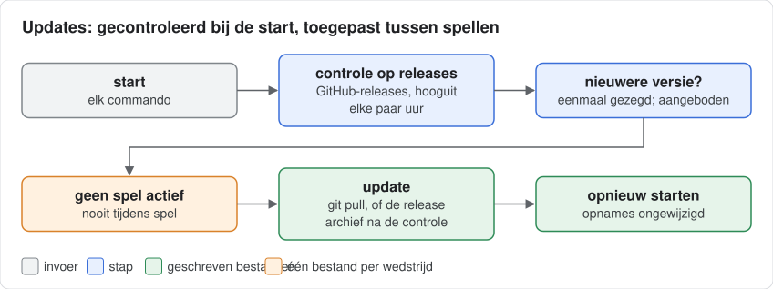

# Updates {#updates}

De watcher houdt zichzelf actueel met de releases van
[Holdi601/3DHeat-Watcher](https://github.com/Holdi601/3DHeat-Watcher/releases). De updater is het
pakket `heat3d_update`, naast `heat3d_watch` in de repository.

## De controle {#the-check}

- **Wanneer**: elke opdracht behalve `update` controleert bij het starten. `run` controleert ook terwijl
  hij draait, hoogstens één keer per uur en alleen zolang geen spel draait.
- **Hoe**: één HTTPS-verzoek naar `https://api.github.com/repos/Holdi601/3DHeat-Watcher/releases/latest`,
  met een time-out van 5 seconden. Het antwoord wordt zes uur bewaard in
  `%LOCALAPPDATA%\3DHeat\update-check-3DHeat-Watcher.json`, zodat de meeste starts niets vragen.
  "Nog geen release" (HTTP 404) wordt bewaard zoals elk ander antwoord. Offline, bij een limiet op
  het aantal verzoeken of achter een proxy mislukt de controle stilletjes en gaat de opdracht verder
  met de versie die er is.
- **Versies**: de geïnstalleerde versie is het bestand `VERSION` in de map van de repository.
  De tag van een release (`v1.2.0` of `1.2.0`) wordt deel voor deel als getallen vergeleken; alles
  na een `-` of `+` wordt genegeerd.
- **Uit**: `HEAT3D_NO_UPDATE=1` (elke waarde behalve leeg, `0`, `false` of `no`) zet zowel de controle
  als de automatische update uit. Elk 3DHeat-hulpmiddel houdt zijn eigen cachebestand bij, zodat het
  antwoord van het ene nooit voor een ander geldt.

## Wat er gebeurt als er een nieuwere release is {#what-happens-when-a-newer-release-is-out}

- **`run`** toont bij het starten een melding en blijft draaien:
  `[heat3d_watch] 3DHeat Watcher 1.2.0 is out (this is 1.0.2). <releasepagina>`. Zolang hij draait,
  met `auto_update` aan (de standaard) en geen spel dat draait, werkt hij zichzelf daarna bij: de
  logregel `3DHeat Watcher 1.2.0 is out (this is 1.0.2); updating`, een Windows-melding
  "Updating to 1.2.0", de update, elke adapter gestopt en zijn sessies gesloten, en dezelfde opdracht
  opnieuw gestart op de nieuwe code. De watcher werkt nooit bij midden in een spel. Als de update niet
  kan worden toegepast, zegt de melding dat ("1.2.0 is out; not updated: ..."), en blijft de watcher
  de oude versie draaien. Met `auto_update` uit is er alleen de melding.
- **Andere opdrachten** vragen `Update now? [Y/n]` wanneer ze in een terminal draaien. Enter, `y`,
  `yes`, `j` of `ja` werkt bij en draait daarna dezelfde opdracht opnieuw op de nieuwe versie. Zonder
  terminal (een geplande run, een pijp) tonen ze hoe je bijwerkt en gaan ze verder.
- **Op verzoek**: `python -m heat3d_watch update` (of `python -m heat3d_update`) vraagt GitHub zonder
  de cache en werkt bij. `--check` zegt alleen of er een nieuwere release is. Dit werkt ook als
  `HEAT3D_NO_UPDATE` is ingesteld.

## Hoe een update wordt toegepast {#how-an-update-is-applied}

Dat hangt af van hoe de kopie is geïnstalleerd:

- **Een git-kloon** (de map heeft `.git` en `git` staat op het PAD): `git pull --ff-only`. Dit wordt
  geweigerd zolang de kloon wijzigingen heeft in bijgehouden bestanden (`git status --porcelain --untracked-files=no`
  is niet leeg): dat zijn het werk van iemand, en een update beslist niet wat ermee gebeurt. Leg de
  wijzigingen vast of zet ze opzij, en trek daarna.
- **Een gedownloade kopie**: het bronarchief van de release wordt gedownload en uitgepakt in een
  tijdelijke map. Items die buiten die map zouden terechtkomen, worden overgeslagen. Het `VERSION` van
  het archief moet de versie zijn die de release opgeeft, anders wordt er niets gekopieerd. Daarna
  worden de bestanden over de map van de repository gekopieerd. Bestanden die geen deel van een
  release zijn - opnames, instellingen, virtuele omgevingen, exports, alles wat jij hebt gemaakt - worden
  niet aangeraakt. Een Python-module die een oudere release had en de nieuwe heeft laten vallen, wordt
  verwijderd uit de pakketten van de release zelf (`heat3d_watch`, `heat3d_update`), zodat na de update
  geen verouderde adaptermodule wordt geladen; buiten die pakketten wordt niets verwijderd.

Opnames en instellingen staan meestal toch buiten de map van de repository
(`%LOCALAPPDATA%\3DHeat\Watcher`), dus een update komt daar nooit bij in de buurt.

Na een update wordt dezelfde opdracht opnieuw gestart. Op Windows start de watcher het nieuwe proces,
wacht erop en geeft zijn afsluitcode door, zodat de console zich gedraagt alsof het eerste proces het
werk had gedaan.
