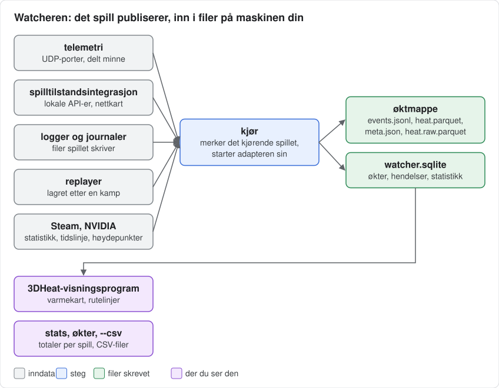
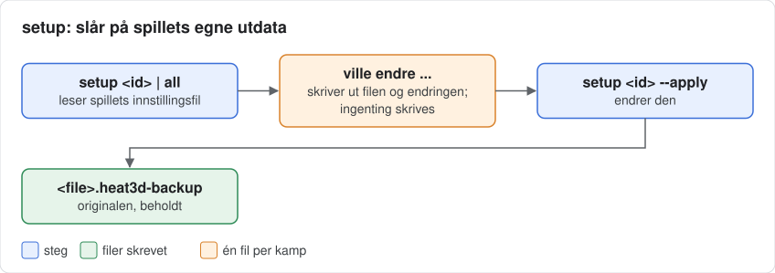
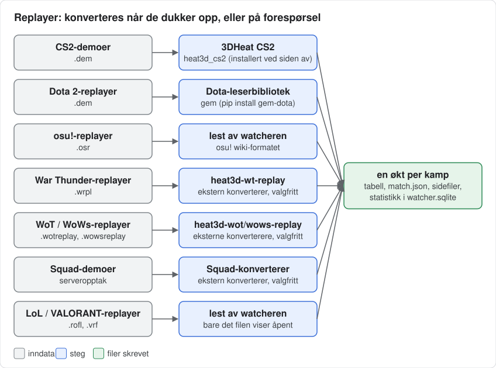
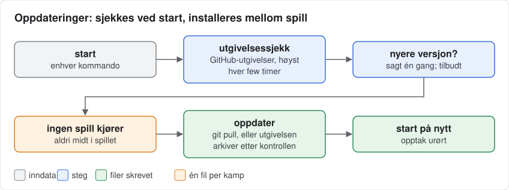

# Kommandoer {#commands}

Ny på kommandolinjen? Les [Før du begynner](before-you-start.md) først. Hver kommando skrives i en terminal som er åpnet i mappen du pakket ut eller klonet (i Filutforsker skriver du `powershell` i adressefeltet), slik:

```bash
python -m heat3d_watch <command> [options]
```


| Kommando | Hva den gjør |
|---|---|
| [`run`](#run) | overvåker i bakgrunnen og tar opp hvert spill som kjører |
| [`games`](#games) | hva hvert spill gir, og fra hvor |
| [`setup`](#setup) | slår på spillets egen utdata |
| [`status`](#status) | hvilke spill som kjører nå, og hvilke adaptere som ville kjørt |
| [`sessions`](#sessions) | opptakene så langt |
| [`stats`](#stats) | totaler per spill, eller tabellene som CSV |
| [`table`](#table) | bygger en økts `heat.parquet` på nytt fra dens `events.jsonl` |
| [`replays`](#replays) | konverterer replayene som allerede ligger på disken |
| [`dota-replay`](#dota-replay) | laster ned replayet til en offentlig Dota 2-kamp med dens id |
| [`dota-map`](#dota-map) | Dota 2-kartet fra din installasjon som et 3D-nivå, med det separate 3DHeat Dota-verktøyet |
| [`update`](#update) | oppdaterer til den nyeste utgivelsen |
| [`config`](#config) | viser eller endrer innstillingene |

Valg for alle kommandoer: `-h` / `--help` skriver ut hjelpeteksten, og `python -m heat3d_watch --version` skriver ut versjonen (filen `VERSION`).

Bildene på denne siden er kjøringer på syntetiske eksempeløkter (`Example Racer`, `Example Arena`), ikke ekte opptak.

Alle kommandoer unntatt `update` ser først etter en nyere utgivelse (høyst hver sjette time; hoppes over med `HEAT3D_NO_UPDATE=1`, se [Oppdateringer](updates.md)). `run` skriver bare et varsel. De andre kommandoene spør `Update now? [Y/n]` når de kjøres i en terminal, og skriver ut hvordan man oppdaterer når de ikke gjør det. Utdata er UTF-8, så spillnavn på alle språk vises riktig i alle konsoller.

## run {#run}

```bash
python -m heat3d_watch run [--once] [-v]
```



Overvåker til den stoppes (Ctrl+C): hver `scan_seconds` leser den prosesslisten og kjører en adapter for hvert spill den finner, pluss adapterne som alltid er på. Før første sjekk avslutter den øktene en tidligere kjøring lot stå åpne. Mens ingen spill kjører, kan den oppdatere seg selv (med `auto_update` på). Detaljene står i [Installere og kjøre](installing-and-running.md#running).

| Valg | Effekt |
|---|---|
| `--once` | ett blikk på de spillene som kjører, og så avslutter den. Adapterne for spillene som kjører nå (og de alltid-aktive) startes, hver spør én gang (det venter høyst 10 sekunder på det), og så stoppes alle på samme måte som når et spill avslutter: øktene deres lukkes, skrives og telles. Til å sjekke at et spill blir oppdaget, ikke til opptak. |
| `-v`, `--verbose` | feilsøkingslinjer i `watcher.log` og i konsollen |

`run` skriver `<data>\watcher.lock` og nekter å starte en gang til for samme datamappe (avslutningskode 1); se [Låsefilen](installing-and-running.md#the-lock-file).

## games {#games}

```bash
python -m heat3d_watch games [--markdown]
```


Lister hver adapter sortert etter spill: navn, id og type, hvor den leser fra, hva den tar opp, og hvordan den slås på. En adapter som ikke kan kjøre på denne maskinen merkes `[unavailable: <why>]` - SimConnect.dll ikke funnet, ingen Minecraft-mappe, 3DHeat CS2 ikke installert, Steam eller NVIDIA-appen ikke funnet. En adaptermodul som ikke kunne importeres, nevnes til slutt med feilen.

```text
EA SPORTS F1 25  (f1-25, telemetry)
    from: UDP telemetry 127.0.0.1:20777 (Documents\My Games\F1 25\hardwaresettings\hardware_settings_config.xml)
    - every car's position (world XYZ, m) at 10 Hz, by driver name, team, own car marked, ...
    switch on: In the game: Settings > Telemetry Settings > UDP Telemetry On, IP 127.0.0.1, port 20777 - ...
```

`--markdown` skriver ut det samme som én Markdown-tabell (spill, hva som tas opp, hvor det kommer fra, hvordan det slås på, nettspill, kontrollert). Tabellen i [Alle spill i én tabell](watcher.md) er den utskriften. Cellene er escapet for Markdown: tekst i backticks blir en kodesnutt, og utenfor dem skrives `<`, `>`, `&`, `*`, `|` og en omvendt skråstrek foran skilletegn slik at de vises som skrevet (`<CS2>` ville ellers forsvinne som HTML-tagg i kramdown). Den ene biten HTML er `<br>` mellom punktene i «Hva som tas opp».

## setup {#setup}

```bash
python -m heat3d_watch setup <adapter id | all> [--apply]
```




Slår på et spills egen utdata, der spillet trenger at en fil endres for det. Uten `--apply` endres ingenting: hver linje sier hva som ville endret seg, og når det er noe å endre, sier siste linje `Nothing was changed. Run again with --apply to make these changes.` Når det ikke er noe å endre, sier den `<id>: nothing to change` (`Nothing to change.` for `all`). Med `--apply` gjøres endringene, og før en fil endres for første gang lagres originalen som `<file>.heat3d-backup`. En sikkerhetskopi som allerede finnes, blir aldri overskrevet, så den inneholder alltid filen slik den var før watcheren første gang rørte den.

```text
f1-25: would change: hardware_settings_config.xml <udp>: enabled="false" -> "true"
Nothing was changed. Run again with --apply to make these changes.
```

`all` kjører oppsettet til hver adapter som har ett. En adapter uten ett, nevnt alene, skriver `<id>: nothing for setup to change; ` etterfulgt av hvordan spillet slås på (dens `enable`-tekst, eller at den ikke trenger noe). En ukjent id skriver `no adapter '<id>'; games lists them` og avslutter med kode 2. Adapterne som har noe å sette opp:

| Adapter | Hva `--apply` endrer |
|---|---|
| `beamng` | installerer `heat3d`-protokollmodden i BeamNGs brukermappe `mods` (bare når den ikke finnes der); slå deretter på Options > Other > Protocols > "others" i spillet |
| `cs2-gsi` | skriver `<CS2>\game\csgo\cfg\gamestate_integration_heat3d.cfg`: send spilltilstanden til `http://127.0.0.1:3311/` med et tilfeldig token som watcheren deretter krever (et token som allerede står i filen beholdes); CS2 leser den når det starter |
| `dota2-gsi` | det samme for Dota 2: `<Dota>\game\dota\cfg\gamestate_integration\gamestate_integration_heat3d.cfg`, port 3312 |
| `dcs` | legger `Scripts\Hooks\heat3d-watch.lua` i hver `%USERPROFILE%\Saved Games\DCS*`-mappe. Dens egen eldre kopi oppdateres; en fil med det navnet som watcheren ikke skrev, lar den være. Start DCS på nytt. |
| `dirt-rally-2` | `hardware_settings_config.xml`: `<udp enabled="true" extradata="3" ip="127.0.0.1" port="20777">`; start spillet én gang først, så filen finnes |
| `ea-wrc` | `Documents\My Games\WRC\telemetry\config.json`: `session_update`-pakken i strukturen `wrc` på, til denne maskinen |
| `f1-23`, `f1-24`, `f1-25` | `hardware_settings_config.xml`: `<udp enabled="true" ip="127.0.0.1" port="20777">`; spillet må være lukket |
| `hearthstone` | legger en `[Power]`-seksjon (`LogLevel=1`, `FilePrinting=true`) til i `%LOCALAPPDATA%\Blizzard\Hearthstone\log.config`; start spillet på nytt |
| `il2` | `<game>\data\startup.cfg`, `[KEY = telemetrydevice]`: ett mål til `addrN = "127.0.0.1:41995"` og `enable = true` (seksjonen legges til, med 10 Hz, når den mangler); start IL-2 på nytt |
| `il2-tacview` | `<game>\data\startup.cfg`, `[KEY = track_record]`: `tacviewrecord = 1` |
| `rocketleague-stats` | `TAStatsAPI.ini` (eller `DefaultStatsAPI.ini` når den ikke finnes) i `<RL>\TAGame\Config`: `PacketSendRate=30` når API-et er av, og `Port` når ingen er satt; leses når Rocket League starter |

`richard-burns-rally` har ingen oppsett: telemetrien kommer fra RSF/NGP-pluginen, som slås på for hånd i `RichardBurnsRally.ini` (se [dens side](game-richard-burns-rally.md)); `setup richard-burns-rally` sier det. Alle andre spill trenger enten ingenting eller slås på i spillet; hver spillside sier hvordan.

## status {#status}

```bash
python -m heat3d_watch status
```

```text
3DHeat Watcher 1.0.2; data in C:\Users\...\AppData\Local\3DHeat\Watcher
Games running: EA SPORTS F1 25 (f1-25)
Always on: il2-tacview, steam-stats, steam-timeline, nvidia-highlights, cs2-demos, lol-replays, valorant-replays
```

Sier hvilke adaptere en `run` ville startet nå, etter de samme reglene: spillets prosess kjører, adapteren er ikke i `disabled`, ingenting den trenger mangler, replay-adaptere bare med `replays` på, minneadaptere bare med `memory` på og hver minnesjekk bestått. Den starter ingenting.

## sessions {#sessions}

```bash
python -m heat3d_watch sessions [--game NAME] [--limit N]
```


De nyeste øktene fra `watcher.sqlite`, én linje hver: start (lokal tid), spill, minutter, hendelser, posisjoner, mappe.

| Valg | Effekt |
|---|---|
| `--game NAME` | bare dette spillet, med det nøyaktige navnet slik det står i listen (`"EA SPORTS F1 25"`) |
| `--limit N` | høyst N økter (standard 40) |

## stats {#stats}

```bash
python -m heat3d_watch stats [--game NAME] [--csv DIR]
```


Uten valg: en tabell over hvert spill (økter, timer, hendelser, posisjoner, sist spilt), mest spilt først, og så for hvert spill dets 25 hyppigste hendelser og hver numeriske statistikk med antall økter som har den, totalen, den beste verdien (`best`) og gjennomsnittet. `best` vet hvilken vei som er bedre: den laveste verdien for tider som holdes som beste (`best_lap`, `best_stage` og alle andre nøkler som begynner med `best_`) og for plasseringer (`race_position`, `grid_position` og alle nøkler som ender på `_position`), den høyeste for alt annet (drap, avstand, toppfart, et spills egne tellere).

| Valg | Effekt |
|---|---|
| `--game NAME` | bare dette spillets hendelser og statistikk, uten oversikten |
| `--csv DIR` | skriver `sessions.csv`, `events.csv` og `stats.csv` (hver rad i de tre tabellene) til `DIR` i stedet; `--game` begrenser ikke dette |

## table {#table}

```bash
python -m heat3d_watch table <session folder>
```


Bygger `heat.parquet` på nytt i en øktmappe fra dens `events.jsonl`, med aksene fra dens `meta.json`. Skriver tabellens sti, eller `no positions in this session`. Bruk den for en økt som ble tatt opp mens `pyarrow` manglet, eller etter at `events.jsonl` er redigert for hånd.

## replays {#replays}

```bash
python -m heat3d_watch replays <adapter id> [folder] [-v]
```



Konverterer replayene som allerede ligger på disken, nå, ett etter ett, hver til en økt slik en overvåking ville gjort det for en replaymappe. Første gang watcheren ser en replaymappe, noterer den bare hva som ligger der (se [Installere og kjøre](installing-and-running.md#replays-already-on-disk)); slik konverteres de på forespørsel. Uten `folder` leses adapterens egne mapper (spillets, pluss `replay_folders`); med den leses replayene i den mappen. Hvert konvertert replay noteres som sett, så den kjørende watcheren konverterer det ikke en gang til. Et replay som ikke kan konverteres, logges og hoppes over.

| Adapter | Replayer |
|---|---|
| `cs2-demos` | Counter-Strike 2-demoer (`*.dem`), gjennom 3DHeat CS2 |
| `lol-replays` | League of Legends-replayer (`*.rofl`), gjennom den eksterne leseren `heat3d-riot-replays` (3DHeat-Ext-Riot) |
| `valorant-replays` | VALORANT-replayer (`*.vrf`), gjennom den eksterne leseren `heat3d-riot-replays` (3DHeat-Ext-Riot) |
| `warthunder-replays` | War Thunder-replayer (`*.wrpl`), gjennom den eksterne konverteren `heat3d-wt-replay` (exporters/ext/warthunder-replay) |
| `wot-replays` | World of Tanks-replayer (`*.wotreplay`), gjennom den eksterne konverteren `heat3d-wot-replay` (exporters/ext/wot-replay) |
| `wows-replays` | World of Warships-replayer (`*.wowsreplay`), gjennom den eksterne konverteren `heat3d-wows-replay` (exporters/ext/wows-replay) |
| `dota-replays` | Dota 2-replayer (`*.dem`), gjennom den eksterne leseren `heat3d-dota-replay` (3DHeat-Ext-DotaReplay) |

```text
lol-replays: converted 12 replay(s); `sessions --game` lists them
```

En id som ikke er en av disse, skriver `no replay adapter '<id>'` med listen og avslutter med kode 2; det samme gjør en `folder` som ikke finnes. En adapter som ikke kan kjøre her (3DHeat CS2 eller spillets leser ikke installert) skriver hvorfor - hvor man får leseren og hvordan den installeres - og avslutter med kode 1. IL-2s Tacview-spor står ikke i listen: den adapteren konverterer selv hvert ferdige spor den finner.

## dota-replay {#dota-replay}

```bash
python -m heat3d_watch dota-replay <match id> [<match id> ...] [-o FOLDER] [--convert] [-v]
```

Laster ned replayet til en offentlig Dota 2-kamp fra Valves replay-servere. Det trenger internett. Kamp-id-en er tallet på kampens side i Dota-klienten (kampdetaljene) eller på OpenDotas nettside. Valve beholder et replay i noen uker; etter det mislykkes nedlastingen. Serveren og replayets salt hentes fra OpenDotas oversikt over kampen (`api.opendota.com/api/matches/<id>`, ingen nøkkel nødvendig), selve filen fra `replay<cluster>.valve.net/570/<id>_<salt>.dem.bz2`. Den pakkes ut mens den kommer (Valve serverer både bzip2 og Zstandard under det navnet) og lagres som `<match id>.dem`. Uten `-o` går den til Dotas egen replaymappe når Dota 2 er installert - der konverterer en kjørende watcher den - og ellers til `<data>/replays/dota`. En fil som allerede finnes, beholdes. `--convert` konverterer de nedlastede replayene med en gang, slik `replays dota-replays` ville gjort, og noterer dem som sett. Den trenger Dota 2-replayleseren ([3DHeat-Ext-DotaReplay](https://github.com/Holdi601/3DHeat-Ext-DotaReplay), `heat3d-dota-replay`), og uten den sier den hvor man får den og avslutter med kode 1 før den laster ned noe. Selve nedlastingen trenger bare watcheren.

```text
match 9000000000: C:\Program Files (x86)\Steam\steamapps\common\dota 2 beta\game\dota\replays\9000000000.dem
```

Valve beholder replayer i noen uker; en eldre kamp skriver `Valve no longer has the replay of match <id>` og avslutter med kode 1. En kamp OpenDota ikke har sett ennå, har ikke noe salt: meldingen sier at man skal be OpenDota om det (`curl -X POST https://api.opendota.com/api/request/<id>`) og prøve igjen noen minutter senere. Private lobbyer og kamper med skjult profil ligger ikke på replay-serverne i det hele tatt.

## dota-map {#dota-map}

```bash
python -m heat3d_watch dota-map [<map>] -o <file.glb> [--game FOLDER] [--source2viewer EXE] [--detail UNITS]
```

Skriver Dota 2-kartet - terreng, klipper, vann, trær og bygninger - som et `.glb`-nivå i det koordinatsystemet Dota-replaytabellene tegnes i, fra din egen Dota 2-installasjon. Watcheren leser ikke spillets filer selv: den kjører det separate verktøyet **3DHeat Dota** (`heat3d-dota-maps level`, [3DHeat-Ext-Dota](https://github.com/Holdi601/3DHeat-Ext-Dota)) med disse valgene, og sender utdataene og avslutningsstatusen videre. `<map>` er `dota` som standard; `--game` er Dota 2-mappen når den ikke ligger i et Steam-bibliotek; `--source2viewer` er stien til Source2Viewers CLI, som det verktøyet trenger; `--detail` er cellen for vertex-klustring for bygninger i spillenheter (standard 8, 0 beholder hver trekant). Når verktøyet ikke er installert, skriver den `dota-map: the Dota 2 map converter is not installed: ...` med hvor man får det, og avslutter med kode 2. Detaljer: [Dota 2-kartet](dota-map.md).

## update {#update}

```bash
python -m heat3d_watch update [--check]
```



Spør GitHub etter den nyeste utgivelsen og ser bort fra det lagrede svaret, og oppdaterer denne kopien når den er nyere (se [Oppdateringer](updates.md)). `--check` sier bare om en nyere utgivelse finnes. Denne kommandoen kjører selv med `HEAT3D_NO_UPDATE` satt: å be om den er avgjørelsen. `python -m heat3d_update [--check]` gjør det samme.

## config {#config}

```bash
python -m heat3d_watch config [--set KEY=VALUE ...]
```


Skriver ut hver innstilling som `key = value`. Med `--set` endres de gitte først, og `settings.json` lagres (`saved <path>`). Verdier leses etter innstillingens type:

- sann/usann-innstillinger: `1`, `true`, `yes`, `on` eller `ja` er sann; `0`, `false`, `no`, `off`, `nein` eller ingenting er usann;
- tall: et desimaltall (`scan_seconds=5`);
- lister: kommaseparert eller en JSON-liste (`disabled=steam-stats,steam-timeline`; en tom verdi tømmer listen);
- ordbøker (`replay_folders`, `player_names`): hele ordboken som JSON, eller én oppføring som `KEY.ID=VALUE` - `replay_folders.cs2-demos=D:\Demos,E:\More Demos` setter den adapterens mapper (kommaseparert), `player_names.warthunder-webmap=Name` setter adapterens navn; en tom verdi fjerner oppføringen;
- tekst: som gitt (`data=D:\Heat`, `riot_id=Name#TAG`).

```bash
python -m heat3d_watch config --set memory=true scan_seconds=5
python -m heat3d_watch config --set riot_id=Name#TAG riot_platform=EUW1
python -m heat3d_watch config --set replay_folders.cs2-demos=D:\Demos player_names.rocketleague-stats=Name
```

En ukjent nøkkel skriver `no setting '<key>'`, og en verdi som ikke er av innstillingens type (`memory=perhaps`, `scan_seconds=often`, en ordbok som ikke er JSON) skriver `not saved: ...`. Begge avslutter med kode 2 uten å lagre noe. En `settings.json` redigert for hånd leses på samme måte: en verdi gitt som tekst der innstillingen er et tall, en sann/usann eller en ordbok, leses slik den er skrevet, og en verdi som ikke kan leses, står på standardverdien. Hver innstilling beskrives i [Installere og kjøre](installing-and-running.md#settings).
