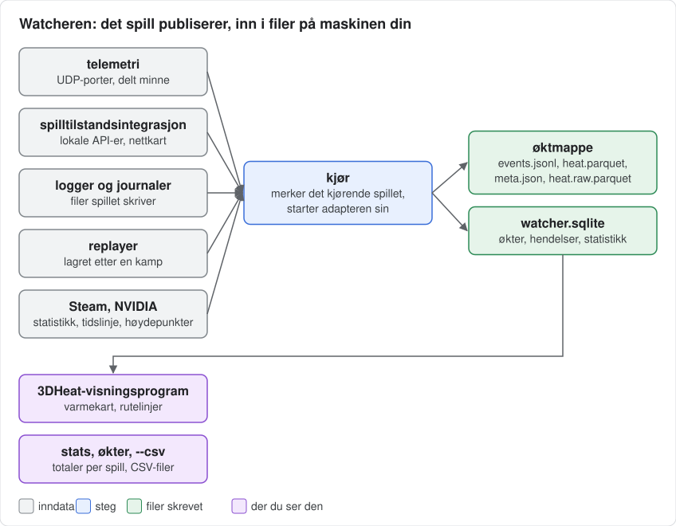

# 3DHeat Watcher {#dheat-watcher}

**Hva er det?** Du spiller et spill. Dette programmet skriver stille ned hvor du var og hva som skjedde.
Senere kan du se det som et fargelagt kart i 3DHeat-visningsprogrammet.

**Hvorfor skulle jeg bruke det?** For å ha din egen oversikt over hver økt - hvor du kjørte, fløy eller kjempet,
dine totaler per spill - uten noen nettside og uten å endre spillet.

**Eksempel:** du kjører en runde i et løpsspill med watcheren kjørende; etterpå holder en fil i
`sessions\<game>\` linjen du tok, og visningsprogrammet tegner den.

Mer i detalj: 3DHeat Watcher er et bakgrunnsprogram som tar opp det spill publiserer om spillingen din - hvor du
var, hva som skjedde hvor, og tallene bak det - til filer på din egen maskin. Filene er
til din egen statistikk, og til varmekartene og rutelinjene i 3DHeat-visningsprogrammet.

Det kjører stille, merker hvilket spill du startet, og leser det spillets egne utdata: en telemetriport
eller delt minne spillet publiserer for dashbord, en spilltilstandsintegrasjon, journalen eller loggen spillet
skriver, replayet det lagrer etter en kamp, statistikken Steam holder, klippene NVIDIA-appen
lagrer. Opptak blir på din egen maskin. Programmet kontakter bare to eksterne tjenester, og bare i disse
tilfellene: GitHub, for å se etter en nyere utgivelse (se [Oppdateringer](../updates.md)), og Riots Match-V5 API,
og bare hvis du oppgir din egen Riot API-nøkkel (se [League of Legends-replayer](../game-lol-replays.md)).



## Hva den tar opp {#what-it-records}

- **Posisjoner**: bilen, flyet, helten eller spilleren, flere ganger i sekundet der spillet publiserer
  dem, med fart, retning og det annet spillet sender sammen med dem.
- **Hendelser**: spawn, dødsfall, drap, runder, etapper, runder, mål, jobber, avganger og landinger, soneskift,
  prestasjoner, høydepunkter. Hver hendelse lagres med sitt tidspunkt, og med sitt sted når spillet gir ett.
- **Statistikk per økt**: drap, dødsfall, runder, beste runde, distanse, toppfart, spilletid, og spillets
  egen statistikk der det beholder den.

Hva hvert spill gir, og fra hvor, står på sin egen side under [Spill](../games.md). Én kilde kan ikke
ta opp alt: flerspillerspill tas bare opp gjennom det de publiserer, og watcheren
leser aldri deres minne (se [Kilder og regler](../sources-and-rules.md)).

## Installasjon {#install}

Ny til kommandolinjen? Les [Før du begynner](before-you-start.md) først.

Watcheren er et Python-program for Windows (Python 3.10 eller nyere). Mange av kildene finnes bare på Windows: delt
minne, registeret, Windows-varsler.

```bash
git clone https://github.com/Holdi601/3DHeat-Watcher.git
cd 3DHeat-Watcher
pip install -r requirements.txt
```

Et nedlastet utgivelsesarkiv fungerer på samme måte: pakk det ut, kjør deretter `pip install -r requirements.txt`
inne i mappen. Detaljene, og tilleggene noen spill trenger, står i
[Installere og kjøre](../installing-and-running.md).

## Hurtigstart {#quick-start}

```bash
python -m heat3d_watch games            # what each game gives, and from where
python -m heat3d_watch setup all        # what would have to be switched on (nothing is changed)
python -m heat3d_watch setup f1-25 --apply   # switch one game's output on (the original file is backed up)
python -m heat3d_watch run              # watch; leave it running while you play
python -m heat3d_watch stats            # totals per game
python -m heat3d_watch stats --csv out  # sessions, events and stats as CSV files
```

Du bør se: etter `games`, en tabell med én linje per spill; `run` fortsetter til du trykker
Ctrl+C eller lukker vinduet.

Alt skrives til `%LOCALAPPDATA%\3DHeat\Watcher`. For å bruke en annen mappe, sett
miljøvariabelen `HEAT3D_WATCH_HOME` eller kjør `python -m heat3d_watch config --set data=D:\somewhere`.

- `sessions\<game>\<date>_<adapter>\` - én mappe per økt, som holder `events.jsonl` (hver hendelse
  etter hvert som den skjer), `heat.parquet` (radene med en posisjon, klare for 3DHeat-visningsprogrammet) og
  `meta.json` (spill, kilde, akser, antall, statistikk)
- `watcher.sqlite` - statistikken for hver økt, i tre enkle tabeller
- `watcher.log` - det watcheren gjorde

Visningsprogrammet åpner en økts `heat.parquet` direkte, uten noe å sette opp (dens akser og enheter står i
filen). Konverterte replayer skrives som tabeller og kampdokumenter ved siden av den; visningsprogrammets
eget format med én fil per kamp er beskrevet på sin
[`.3dheat`-beholder](https://holdi601.github.io/3DHeat/container.html)-side, og hver tabells kolonner i [Dataene](../the-data.md).

## Dokumentasjonen {#the-documentation}

| Side | Hva den dekker |
|---|---|
| [Før du begynner](before-you-start.md) | Python, en terminal, plassholdere, hvordan suksess og de vanlige feilene ser ut |
| [Installere og kjøre](../installing-and-running.md) | krav, kjøring i bakgrunnen, start med Windows, låsefilen, loggen, hver innstilling og miljøvariabel |
| [Spill](../games.md) | én side per spill: hva som tas opp, hvorfra, hvordan det slås på, hvordan det virker, akser, statistikk, hva som er verifisert |
| [Dataene](../the-data.md) | økt-mapper, `events.jsonl`, `heat.parquet` og dens fotnote, `meta.json`, `watcher.sqlite`, gjenoppretting etter krasj, CSV-eksport, åpne en økt i 3DHeat-visningsprogrammet |
| [Kommandoer](../commands.md) | hver kommando og hvert alternativ i `python -m heat3d_watch` |
| [Kilder og regler](../sources-and-rules.md) | de seks typene kilder, flerspillerreglene, hvilke spill som er utelatt og hvorfor |
| [NVIDIA Highlights](../nvidia-highlights.md) | hva NVIDIA Highlights kan og ikke kan levere, og hvordan et høydepunkt får en posisjon |
| [Serveropptaksmoder](../server-mods.md) | Arma 3- og Arma Reforger-servermodene som tar opp hele oppdrag for visningsprogrammet |
| [Lese minne](../memory-reading.md) | enspiller-minneprofiler: formatet, kontrollene, hvordan man skriver og verifiserer en |
| [Oppdateringer](../updates.md) | hvordan watcheren ser etter nye utgivelser og oppdaterer seg selv |
| [Utvikling](../development.md) | å skrive en adapter: API-et, tester, en ærlig `verified`, regenerering av spillsidene |
| [Alle spill i én tabell](../watcher.md) | hvert spill i én tabell, slik `games --markdown` skriver den, pluss spillene undersøkt men ikke bygget ennå |
| [Kommandoreferanse](../cli-reference.md) | hver kommandos `--help`, generert fra koden |
| [Vedlikehold](../maintaining.md) | utgivelsessjekklisten for disse sidene |

## Del av 3DHeat {#part-of-3dheat}

3DHeat Watcher er ett av de gratis verktøyene rundt 3DHeat-visningsprogrammet (watcheren bruker 3DHeat CS2
til å konvertere CS2-demoer). Hver er sitt eget prosjekt, med egne utgivelser og lisens:

| Verktøy | Hva det gjør | Dokumentasjon |
|---|---|---|
| [3DHeat](https://github.com/Holdi601/3DHeat) | visningsprogrammet: varmekart, løpsanalyse og kampgjennomgang i 3D | [nettsted](https://holdi601.github.io/3DHeat/) |
| [GameFiles](https://github.com/Holdi601/3DHeat-GameFiles) | løyper og nivåer ut av filene spill leverer, som 3D-modeller | [nettsted](https://holdi601.github.io/3DHeat-GameFiles/) |
| [GameCapture](https://github.com/Holdi601/3DHeat-GameCapture) | rundetelemetri fra løpsspill; nivåer bygget opp fra spillvideo | [nettsted](https://holdi601.github.io/3DHeat-GameCapture/) |
| [Unreal Exporter](https://github.com/Holdi601/3DHeat-UnrealExporter) | en Unreal Editor-plugin som eksporterer et nivå som én 3D-modell | [nettsted](https://holdi601.github.io/3DHeat-UnrealExporter/) |
| [CS2](https://github.com/Holdi601/3DHeat-CS2) | Counter-Strike 2-demoer til tabeller og kampdokumenter; kart til 3D-modeller | [nettsted](https://holdi601.github.io/3DHeat-CS2/) |
| [Watcher](https://github.com/Holdi601/3DHeat-Watcher) | tar opp hva spill publiserer om spillingen din, i bakgrunnen | [nettsted](https://holdi601.github.io/3DHeat-Watcher/) |
| [Ext-WarThunder](https://github.com/Holdi601/3DHeat-Ext-WarThunder) | War Thunder-replayer til tabeller og kampdokumenter | [nettsted](https://holdi601.github.io/3DHeat-Ext-WarThunder/) |
| [Ext-WoT](https://github.com/Holdi601/3DHeat-Ext-WoT) | World of Tanks-replayer til tabeller og kampdokumenter | [nettsted](https://holdi601.github.io/3DHeat-Ext-WoT/) |
| [Ext-WoWs](https://github.com/Holdi601/3DHeat-Ext-WoWs) | World of Warships-replayer til tabeller og kampdokumenter | [nettsted](https://holdi601.github.io/3DHeat-Ext-WoWs/) |
| [Ext-Squad](https://github.com/Holdi601/3DHeat-Ext-Squad) | Squad-serverdemoer til tabeller og kampdokumenter | [nettsted](https://holdi601.github.io/3DHeat-Ext-Squad/) |
| [Ext-DCS](https://github.com/Holdi601/3DHeat-Ext-DCS) | DCS World-kart til 3D-modeller | [nettsted](https://holdi601.github.io/3DHeat-Ext-DCS/) |
| [Ext-IL2](https://github.com/Holdi601/3DHeat-Ext-IL2) | IL-2 Sturmovik-kart til 3D-modeller | [nettsted](https://holdi601.github.io/3DHeat-Ext-IL2/) |

Lisens: MIT ([LICENSE](https://github.com/Holdi601/3DHeat-Watcher/blob/main/LICENSE)). Lisensene
til tredjepartspakkene den bruker, og hva spillene den leser krever, står i
[LICENSES.md](https://github.com/Holdi601/3DHeat-Watcher/blob/main/LICENSES.md).
