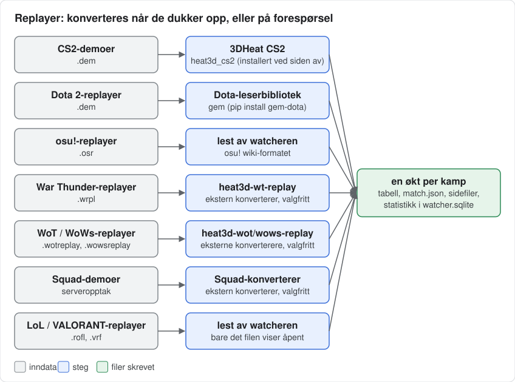
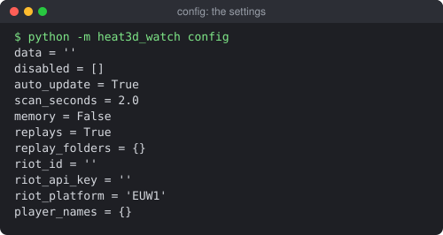

# Installere og kjøre {#installing-and-running}

## Krav {#requirements}

- **Windows.** Watcheren er laget for Windows, og de fleste kildene finnes bare der: delt minne som spill oppretter (`Local\...`-mappinger), registret (der Steam er), Windows-varsler, prosesslisten med stier til programfilene. På et annet system starter programmet, men disse kildene finner ingenting, varsler bare logges, og minnelesing nekter («only implemented on Windows»).
- **Python 3.10 eller nyere**, fra <https://www.python.org/downloads/>: kryss av for **Add python.exe to PATH** i installasjonsprogrammet, og sjekk med `python --version` i et nytt terminalvindu. Ny til dette? Les [Før du begynner](before-you-start.md) først.
- **Pakker** (`requirements.txt`): `psutil>=6.0` (hvilke spill som kjører, hvilket program som holder en port, et spills tilkoblinger; en eldre psutil fungerer fortsatt, gjennom dens eldre navn for en prosess' tilkoblinger), `pyarrow>=15` (skriver `heat.parquet`), `numpy>=1.24`, og `pytest>=8.0` for testene. `requirements-optional.txt` lister for øyeblikket ingen pakker.

Uten `pyarrow` tas økter fortsatt opp: `events.jsonl` er opptaket, og tabellen kan bygges senere med [`table`](commands.md#table).

### Tillegg enkelte spill trenger {#extras-some-games-need}

| Spill | Hva det trenger |
|---|---|
| Counter-Strike 2-demoer | [3DHeat CS2](https://github.com/Holdi601/3DHeat-CS2) og dets krav (`demoparser2`). Watcheren ser etter det i `HEAT3D_CS2`, deretter i en mappe `3DHeat-CS2` eller `cs2` ved siden av watcherens egen mappe, og deretter hvor som helst Python kan importere `heat3d_cs2` fra. Uten det viser `games` adapteren som ikke tilgjengelig. |
| Microsoft Flight Simulator 2020 / 2024 | `SimConnect.dll` - ikke med i pakken. MSFS 2020 har en i installasjonsmappen sin; for MSFS 2024 installerer du MSFS 2024-SDK-en. `MSFS_SDK` / `MSFS2024_SDK` peker på SDK-mappen. |
| Euro Truck Simulator 2, American Truck Simulator | RenCloud-pluginen `scs-telemetry.dll` (revisjon 12) i `<game>\bin\win_x64\plugins` |
| BeamNG.drive | `heat3d`-protokollmodden, installert med `python -m heat3d_watch setup beamng --apply` |
| League of Legends (live) | valgfritt: Riots rotsertifikat som `<data>\riotgames.pem`, slik at den lokale forbindelsen blir verifisert |
| Minecraft | en `%APPDATA%\.minecraft`-mappe (Java Edition) |

Hver spillside under [Spill](games.md) sier hva som må slås på i selve spillet. `python -m heat3d_watch games` merker en adapter `[unavailable: ...]` når noe den trenger mangler på denne maskinen.

## Installere {#installing}

Ny på kommandolinjen? Les [Før du begynner](before-you-start.md) først. Hvis `pip` ikke blir funnet, bruk `python -m pip install -r requirements.txt` i stedet.

Fra en klone:

```bash
git clone https://github.com/Holdi601/3DHeat-Watcher.git
cd 3DHeat-Watcher
pip install -r requirements.txt
```

Fra en utgivelse: last ned arkivet fra repositoryets utgivelser, pakk det ut, og kjør deretter `pip install -r requirements.txt` inne i mappen. Begge typer kopier oppdaterer seg selv (se [Oppdateringer](updates.md)).

Kjør hver kommando fra repositoryets mappe: `python -m heat3d_watch` importerer pakken derfra, og oppdateringsprogrammet (`heat3d_update`) ligger ved siden av den.

## Kjøre {#running}

```bash
python -m heat3d_watch run        # watch until stopped
python -m heat3d_watch run -v     # the same, with debug lines in the log
python -m heat3d_watch run --once # one look at the games running now, then stop and exit
```

Ved start gjør `run` dette:

1. skriver [låsefilen](#the-lock-file);
2. avslutter øktene en tidligere kjøring lot stå åpne, for eksempel etter en krasj (se [Gjenoppretting](the-data.md#recovery-after-a-crash));
3. leser prosesslisten (bare navn og stier, ingen prosess åpnes) hver `scan_seconds` (2 s), og starter en adapter, i en egen tråd, for hvert spill den finner. Når et spills prosess er borte, stoppes adapteren, og øktene den hadde åpne lukkes; det skriver deres tabell og deres linje i statistikken. Adaptere som ikke venter på et spill (Steam-statistikk, Steam Timeline, NVIDIA-høydepunkter, replaymappene) kjører hele tiden;
4. mens intet spill kjører, ser den etter en nyere utgivelse høyst én gang i timen (selve svaret er lagret i seks timer), og med `auto_update` på installerer den den og starter seg selv på nytt (se [Oppdateringer](updates.md)).

En adapter som feiler, logges, og stopper ikke de andre. Hvis en adapters avstemming feiler 20 ganger på rad, eller starten feiler, stoppes adapteren og startes ikke på nytt før spillet startes igjen (en ny prosess-id).

Stopp watcheren med Ctrl+C. Adapterne lukker øktene sine før den avslutter. Hvis watcheren blir drept i stedet (Oppgavebehandling, en krasj, et strømbrudd), går ingenting som allerede var skrevet, tapt: neste `run` avslutter disse øktene.

`--once` tar et enkelt blikk: den starter adapterne for spillene som kjører i det øyeblikket (og de alltid-aktive), lar hver avstemme én gang - og venter høyst 10 sekunder på det - og stopper dem deretter på samme måte som når et spill avsluttes. Øktene de åpnet lukkes, tabellene skrives og linjene telles i statistikken før den avslutter. Bruk den til å sjekke at et spill blir oppdaget, ikke til å ta opp.

### Replayer som allerede ligger på disken {#replays-already-on-disk}



Første gang en replayadapter ser en av mappene sine, noterer den bare replayene som allerede er der. Ellers ville en spiller med år med demoer finne watcheren opptatt med å konvertere i en dag. Fra da av konverteres hvert nytt replay en gang, når spillet er ferdig med å skrive det. De gamle konverteres på forespørsel med [`replays`](commands.md#replays):

```bash
python -m heat3d_watch replays cs2-demos              # every demo in CS2's folders and replay_folders
python -m heat3d_watch replays lol-replays D:\Old     # the replays in one folder
```

### Kjøre i bakgrunnen {#running-in-the-background}

Watcheren har ikke noe eget vindu; den er et konsollprogram som kjører til den stoppes. Den skriver alt til `watcher.log`, så den trenger ikke en synlig konsoll. Måter å holde den unna:

- start den i en konsoll og minimer konsollen: `start "" /min python -m heat3d_watch run` fra `cmd`, i repositoryets mappe;
- start den uten konsoll: `pythonw -m heat3d_watch run`. Konsollutdata går tapt, men `watcher.log` skrives fortsatt. For å stoppe den avslutter du `pythonw.exe`-prosessen; neste start avslutter da øktene den lot stå åpne. Prosjektet har ikke testet denne måten å kjøre på.

### Starte med Windows (en idé) {#starting-with-windows-an-idea}

Watcheren installerer seg ikke for å starte med Windows. For å starte den automatisk:

- **Oppgaveplanlegger**: lag en oppgave med utløseren *At log on* og handlingen *Start a program*, program `pythonw.exe` (eller `python.exe`), argumenter `-m heat3d_watch run`, og *Start in* satt til repositoryets mappe;
- **Oppstartsmappen**: legg en snarvei i `shell:startup` med samme program, argumenter og mappen *Start in*.

Ingen av delene er en del av watcheren, og den tester dem ikke. [Låsefilen](#the-lock-file) sørger for at en andre kopi som startes ved en feil, avslutter med en gang.

## Låsefilen {#the-lock-file}

`<data>\watcher.lock` holder prosess-id-en til den kjørende watcheren. Når `run` starter og låsefilen nevner en prosess som fortsatt finnes, og hvis navn inneholder `python`, skriver den

```text
A watcher is already running (process 12345) for C:\Users\...\3DHeat\Watcher.
```

og avslutter med kode 1. To watchere på samme datamappe ville tatt opp hvert spill to ganger, og den andre ville behandlet den første watcherens åpne økter som rester fra en krasj. En låsefil hvis prosess er borte, eller tilhører et annet program, overskrives. Når `run` avslutter, fjerner den låsefilen hvis den fortsatt nevner dens egen prosess.

## Loggen {#the-log}

`<data>\watcher.log` skrives av `run` alene; de andre kommandoene skriver til konsollen. Hver linje har tidspunkt, nivå og en melding:

```text
2026-05-01 20:15:01,123 INFO watching; data in C:\Users\...\AppData\Local\3DHeat\Watcher
2026-05-01 20:15:03,456 INFO f1-25: starting (EA SPORTS F1 25)
2026-05-01 21:02:11,789 INFO f1-25: stopping
```

Adapterne logger det de ikke kan gjøre, og hvorfor: «UDP 20777 is in use by ...; not taking it from that program», «not reading memory: the game is played online», «could not start», «poll failed (3)» med tilbakesporingen. `run -v` legger til feilsøkingslinjer. Filen skrives til på slutten og blir aldri rotert eller tømt av watcheren; slett den når du vil. De samme linjene går også til konsollen.

## Hvor alt ligger {#where-everything-is}

Hjemmemappen er `%LOCALAPPDATA%\3DHeat\Watcher`, eller `HEAT3D_WATCH_HOME` når den er satt (uten `LOCALAPPDATA`, for eksempel på et annet system, `~/.local/share/3DHeat/Watcher`). `settings.json` ligger alltid i hjemmemappen. Alt annet går til datamappen, som er hjemmemappen med mindre innstillingen `data` peker på en annen:

| Sti | Hva det er |
|---|---|
| `<home>\settings.json` | innstillingene |
| `<data>\sessions\` | opptakene, én mappe per sitting ([Dataene](the-data.md)) |
| `<data>\watcher.sqlite` | statistikkdatabasen |
| `<data>\watcher.log` | loggen til `run` |
| `<data>\watcher.lock` | låsefilen, mens `run` kjører |
| `<data>\state\` | hva de alltid-aktive og replayadapterne allerede har sett (`steam-stats.json`, `replays-cs2-demos.json`, ...), slik at en omstart ikke tar opp noe to ganger |
| `<data>\profiles\*.json` | minneprofiler du har skrevet ([Lese minne](memory-reading.md)) |
| `<data>\riotgames.pem` | valgfritt, Riots rotsertifikat for League of Legends-adapteren for live-data |
| `%LOCALAPPDATA%\3DHeat\update-check-3DHeat-Watcher.json` | det lagrede svaret fra den siste utgivelsessjekken |

Watcheren sletter ingenting i disse mappene, unntatt en øktmappe der ingenting ble tatt opp (et spill som sto i menyene).

## Innstillinger {#settings}



`python -m heat3d_watch config` viser innstillingene; `config --set key=value ...` endrer dem og lagrer `settings.json` (se [config](commands.md#config)). Filen er vanlig JSON og kan også redigeres for hånd når watcheren ikke kjører. Ukjente nøkler i den ignoreres. Innstillingene leses når en kommando starter, så start `run` på nytt etter å ha endret dem.

| Innstilling | Standard | Hva den gjør |
|---|---|---|
| `data` | `""` | Datamappen. Tom: hjemmemappen. |
| `disabled` | `[]` | Adapter-id-er som aldri kjører, for eksempel `config --set disabled=steam-stats,nvidia-highlights`. Alle andre adaptere kjører når de finner spillet sitt. |
| `auto_update` | `true` | Mens intet spill kjører, installer en nyere utgivelse og start på nytt (se [Oppdateringer](updates.md)). `false`: bare et varsel i loggen. |
| `scan_seconds` | `2.0` | Sekunder mellom hver titt på prosesslisten. |
| `memory` | `false` | Tillat at minneadaptere (enkeltspillerspill med en profil du har skrevet) kjører. Av som standard; se [Lese minne](memory-reading.md). |
| `replays` | `true` | Kjør `replay`-adapterne: alle sammen (se `python -m heat3d_watch replays` og [Spill](games.md)) - CS2-demoer, Dota 2, War Thunder, World of Tanks, World of Warships, Squad, League of Legends- og VALORANT-replayer, IL-2 Tacview-opptak. |
| `replay_folders` | `{}` | Ekstra mapper etter adapter-id, for eksempel `{"cs2-demos": ["D:\\Demos"]}`. Replayadaptere overvåker dem i tillegg til spillets egne mapper; `il2-tacview` godtar også installasjonsmapper (den ser da i deres `data\Tracks`); for `elite` erstatter den første mappen journalmappen. Sett én adapters mapper med `config --set replay_folders.cs2-demos=D:\Demos,E:\More`, eller hele ordboken som JSON. |
| `riot_id` | `""` | Din Riot-ID (`Name#TAG`), slik at din egen linje i en League of Legends-replay blir din statistikk. Tom: hver spillers linje beholdes, ingen merkes som din. |
| `riot_api_key` | `""` | Din egen Riot-utvikler-API-nøkkel, for å hente hver replayet League-kamps offisielle tidslinje (posisjoner hvert minutt, drap der de skjedde). Tom: ingenting hentes. |
| `riot_platform` | `"EUW1"` | Din League-servers plattform-id (`EUW1`, `EUN1`, `NA1`, `KR`, ...), brukt til å finne den regionale Match-V5-verten. |
| `player_names` | `{}` | Ditt navn i spill der grensesnittet navngir alle spillere, men ikke sier hvem som er deg, etter adapter-id: `warthunder-webmap` (linjene i drapsfeeden om deg blir dine drap og dødsfall) og `rocketleague-stats` (dine rader blir `me`; uten den, spilleren spillets kamera følger). Sett med `config --set player_names.warthunder-webmap=Name`. |

En `settings.json` med alle standardverdiene:

```json
{
  "data": "",
  "disabled": [],
  "auto_update": true,
  "scan_seconds": 2.0,
  "memory": false,
  "replays": true,
  "replay_folders": {},
  "riot_id": "",
  "riot_api_key": "",
  "riot_platform": "EUW1",
  "player_names": {}
}
```

## Miljøvariabler {#environment-variables}

| Variabel | Effekt |
|---|---|
| `HEAT3D_WATCH_HOME` | hjemmemappen (innstillingene, og dataene med mindre `data` sier noe annet) |
| `HEAT3D_NO_UPDATE` | en hvilken som helst verdi annet enn tom, `0`, `false` eller `no` slår av utgivelsessjekken og den automatiske oppdateringen |
| `HEAT3D_NO_TOAST` | en hvilken som helst ikke-tom verdi: ingen Windows-varsler, bare loggelinjer |
| `HEAT3D_CS2` | mappen til 3DHeat CS2, for CS2-demoer |
| `HEAT3D_CS2_GSI_PORT` | CS2s port for spilltilstand (standard 3311); cfg-filen `setup` skriver bruker den |
| `HEAT3D_DOTA_GSI_PORT` | Dota 2s port for spilltilstand (standard 3312) |
| `MSFS_SDK`, `MSFS2024_SDK` | MSFS SDK-mappene, der `SimConnect SDK\lib\SimConnect.dll` letes etter |

Windows-varsler brukes bare til oppdateringer: «Updating to 1.2.0», eller «1.2.0 is out; not updated: ...» når oppdateringen ikke kunne gjennomføres. De vises gjennom PowerShells egen varslingsløsning, så ingenting må installeres. Tittelen og teksten sendes til PowerShell som miljøvariabler, aldri som en del av skriptet.
