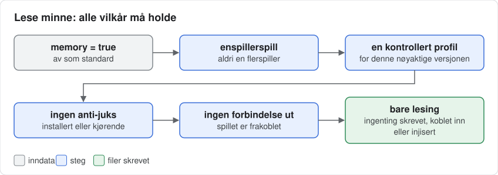

# Lese minne {#reading-memory}

Noen enkeltspillerspill forteller ingenting til andre programmer. For dem kan watcheren - hvis du slår det på og skriver en profil selv - slå opp hvor du er i spillets minne, bare lesing.

For enkeltspillerspill som ikke publiserer noe, kan watcheren lese posisjoner og verdier fra spillets minne, gjennom en **profil** du skriver for din egen versjon av spillet. Av alle kildene er dette den eneste spillet ikke delte ut, så den er sikret mer enn de andre:

- den er **av som standard** (`python -m heat3d_watch config --set memory=true` slår den på);
- den leser, og har ingen måte å skrive på;
- **ingen profiler følger med verktøyene.**

Profiler følger ikke med fordi et offset bare stemmer for bygget det ble funnet på. Etter en oppdatering leser en profil som var riktig før, søppel, og søppel ser nøyaktig ut som tall. En profil må sjekkes på bygget en spiller har, av den spilleren.

## Sjekkene, i rekkefølge {#the-checks-in-order}



Hver sjekk under må bestås. De fire første gjøres **før** spillet åpnes, fordi å åpne et beskyttet spill for lesing er nettopp det en anti-juks-løsning merker, og å nekte etterpå ville være for sent.

1. **Innstillingen**: `memory` er sann. Ellers startes minneadaptere aldri.
2. **En profil for spillet**, der `exe` navngir den kjørende prosessen. En profil sier om spillet kan spilles på nett i det hele tatt (`"online"`); en som utelater dette, avvises.
3. **Ingen anti-juks i nærheten**:
   - ingen anti-juks-fil i spillets mappe eller opptil tre mapper over den (stopper ved en Steam-bibliotekets `common`-mappe, eller ved en mappe med `steamapps` i seg, siden andre spill ligger over det): `EasyAntiCheat`, `EasyAntiCheat_EOS_Setup.exe`, `start_protected_game.exe`, `BattlEye`, `BEClient_x64.dll`, `BEService_x64.exe`, `EAAntiCheat.GameServiceLauncher.exe`, `AntiCheatExpert`, `SGuard64.exe`, `GameGuard`, `GameMon.des`, `XIGNCODE`, `xhunter1.sys`, `Vanguard`, `FACEIT` (sammenlignet med små bokstaver, også som begynnelsen av et navn). Er spillets mappe ukjent, nektes spillet;
   - ingen anti-juks-driver eller -tjeneste som kjører på maskinen i det hele tatt, slik `sc query type= driver state= active` og `sc query type= service state= active` lister dem: EasyAntiCheat, EasyAntiCheat_EOS, BEService, BEDaisy, vgk, vgc, ACE-BASE, ACE-GAME, xhunter1, FACEIT, FACEITService, EAAntiCheatService, Denuvo Anti-Cheat, npggsvc, Ricochet. En kjerne-anti-juks installert for et annet spill overvåker fortsatt hver prosess. Kan tjenestene ikke listes, nektes spillet;
4. **Ikke på nett**: et spill der profilen sier `"online": true` leses bare mens det ikke har forbindelse til noe annet enn denne maskinen (enhver fjern adresse utenom `127.x`, `::1`). Kan forbindelsene ikke leses, nektes det.
5. Deretter, når adapteren starter:
   - **det nøyaktige bygget**: programfilens filstørrelse, eller dens SHA-256, må stemme med en versjon profilen lister. Et ukjent bygg leses ikke;
   - **modulene en gang til**: spillets innlastede moduler listes (et Toolhelp-øyeblikksbilde, som ikke ber om egne tilgangsrettigheter) og sjekkes for en anti-juks-klient (`BEClient_x64.dll`, `BEClient.dll`, `EasyAntiCheat_x64.dll`, `EasyAntiCheat.dll`, `EOSAntiCheat...`). En beskyttet prosess nekter øyeblikksbildet, og det er også en nektelse;
   - først da åpnes prosessen, med `PROCESS_VM_READ | PROCESS_QUERY_LIMITED_INFORMATION` og ingenting annet.

Sjekkene 1 til 4 gjentas ved hver skanning (hvert 2. sekund) mens spillet kjører. Hvis en begynner å feile (spillet kobler seg til en server, en anti-juks-tjeneste starter), stoppes adapteren ved neste skanning. En nektelse logges: `mem-<id>: not reading memory: <reason>`. En feil under start (ukjent bygg, en anti-juks-modul, et mønster som ikke finnes) logges som `mem-<id>: could not start`, og adapteren prøves ikke igjen før spillet startes på nytt.

Det finnes ingen skriving, ingen allokering i den andre prosessen, ingen tråd startet i den, ingen bibliotek lastet inn i den, ingen feilsøkingsprivilegium og ingen opphøyelse. En test (`test_memory_reading_cannot_write` i `tests/test_core.py`) feiler hvis noe kall som skriver til, allokerer i eller kjører kode i en annen prosess - `WriteProcessMemory`, `VirtualAllocEx`, `CreateRemoteThread`, `PROCESS_VM_WRITE`, `SeDebugPrivilege`, `LoadLibrary`, ... - dukker opp noe sted i pakken.

Leses aldri, uansett hva en profil sier: spill spilt på nett, og spill der enkeltspillermodusen kjører under en anti-juks, slik som GTA V, eller Elden Ring startet gjennom sin launcher. Sjekkene over nekter dem uansett.

## Profilformatet {#the-profile-format}

En profil er en JSON-fil i `<data>\profiles\` (`<data>` er datamappen, se [Installere og kjøre](installing-and-running.md#where-everything-is)), én per spill, med et hvilket som helst filnavn som ender på `.json`. Et syntetisk eksempel:

```json
{
  "schema": "heat3d.memprofile/1",
  "id": "mygame",
  "game": "My Game",
  "exe": "MyGame.exe",
  "online": false,
  "versions": [ { "label": "1.06", "size": 123456789 } ],
  "anchors": {
    "World": { "aob": "48 8B 05 ?? ?? ?? ?? 48 85 C0", "rip": [3, 7] }
  },
  "values": {
    "pos": { "type": "vec3f", "base": "World", "chain": ["0x10", "0x68", "0x70"] },
    "hp":  { "type": "i32",   "base": "World", "chain": ["0x10", "0x138"] },
    "map": { "type": "u32",   "base": "World", "chain": ["0x10", "0x1C0"] }
  },
  "events": [
    { "event": "death", "value": "hp",  "when": "to_zero" },
    { "event": "zone",  "value": "map", "when": "change" }
  ],
  "axes": { "up": "y", "units": "metres" },
  "rate": 10,
  "provenance": [ { "source": "https://example.com/my-notes", "verified_on": "1.06" } ]
}
```

| Nøkkel | Påkrevd | Hva den er |
|---|---|---|
| `schema` | ja | nøyaktig `heat3d.memprofile/1` |
| `id` | ja | kort og stabil; adapteren kalles `mem-<id>` |
| `game` | ja | spillets navn, som øktmappen får navn etter |
| `exe` | ja | programfilens filnavn, som også sier at spillet kjører |
| `online` | ja | `true` hvis spillet kan spilles på nett i det hele tatt; det leses da bare mens det er frakoblet |
| `versions` | ja | byggene profilen er sjekket på: hver med en `label`, og en `size` (programfilens størrelse i byte) og/eller en `sha256`. Når begge er gitt, må begge stemme. En oppføring med ingen av dem stemmer med ingenting. |
| `anchors` | ja | navngitte adresser i hovedmodulen. `aob`: et bytemønster, heksbytes skilt med mellomrom, `?` eller `??` for en hvilken som helst byte; det må finnes **nøyaktig én gang** i modulens bilde (flere treff teller som en feil, som ingen). `rip: [d, n]`: mønsteret peker på en instruksjon med en 32-bit RIP-relativ forskyvning på byte `d` og lengde `n`; ankeret blir adressen den instruksjonen refererer til. `offset`: legges til etterpå (heksadesimal eller desimal tekst). I stedet for `aob` gir `module_offset` et fast offset fra modulens basisadresse. |
| `values` | ja | det som leses ved hver avstemming: `type` (`i32`, `u32`, `i64`, `u64`, `u8`, `f32`, `f64`, `vec3f`, `vec3d`), `base` (et ankers navn), `chain` (offsetene, som heksadesimal eller desimal tekst) |
| `events` | nei | regler som gjør endringer til hendelser: `when` `change` (verdien er forskjellig fra forrige avstemming) eller `to_zero` (et tall faller fra over 0 til 0 eller under) |
| `axes` | nei | `up` (standard `y`), `units` (standard `game units`), `scale` (visningens enhetsskala, som multipliserer hver posisjon; standard 1, spillets egne enheter) |
| `rate` | nei | avstemminger per sekund, 1 til 60 (standard 10) |
| `provenance` | nei | hvor offsetene kommer fra, og på hvilket bygg du har verifisert dem; den kopieres inn i hver økts `meta.json` |

**Hvordan en verdi leses.** Ankerets adresse er startpunktet. Er `chain` tom, leses verdien rett der. Ellers leses pekeren lagret ved ankeret først. Deretter, for hvert offset unntatt det siste, leses pekeren på `adresse + offset`. Det siste offsetet legges til for å gi verdiens adresse. En null-peker underveis (spillet er mellom nivåer eller i en meny) gjør at verdien er tom for den avstemmingen.

**Hva som tas opp.** En verdi kalt `pos` (en `vec3f` eller `vec3d`) blir en `position`-rad for spiller `me` ved hver avstemming. Hver hendelsesregel skriver sin `event`-rad, med den nye verdien og, der `pos` er kjent, posisjonen, og legger til 1 på en statistikk med samme navn. Modulbildet leses én gang ved start for å finne ankrene, i blokker på 64 KiB; blokker som ikke kan leses, telles som nuller. Øktens `meta.json` nevner profilen, bygg-etiketten og proveniensen.

En profil som ikke kan brukes (ugyldig JSON, feil `schema`, en påkrevd nøkkel mangler), hoppes over og logges som `profile <file> not used: <reason>`. Profilene lastes når watcheren starter, så start `run` på nytt etter å ha lagt til eller endret en.

## Skrive og verifisere en profil {#writing-and-verifying-a-profile}

1. **Bare for et enkeltspillerspill uten anti-juks.** Har spillet en anti-juks, eller spiller du det på nett, stopp her: watcheren vil nekte det, og det skal den.
2. **Finn verdiene på ditt eget bygg.** Arbeid offline. Bruk dine egne feilsøkingsverktøy, eller publiserte notater om spillet, til å finne spillerens posisjon og verdiene du bryr deg om, og en pekerkjede til hver fra et fast sted i programfilen. Foretrekk et bytemønster (`aob`) fremfor en fast `module_offset`: et mønster finner fortsatt sin plass når koden flytter seg litt.
3. **Gjør mønsteret unikt.** Det må treffe nøyaktig én gang i modulen. Sett jokertegn på bytene som endrer seg (adresser, forskyvninger), og behold nok faste byte rundt dem.
4. **Lås bygget.** Sett programfilens nøyaktige størrelse i `versions`; PowerShell-kommandoen `(Get-Item .\MyGame.exe).Length` gir den, og `Get-FileHash .\MyGame.exe -Algorithm SHA256` gir hashen. Etter en oppdatering slutter profilen bare å bli brukt til du har sjekket den på nytt og lagt til det nye bygget.
5. **Si om spillet går på nett** (`online`), ærlig.
6. **Prøv den**: slå på lesing (`config --set memory=true`), legg filen i `<data>\profiles\`, og sjekk at `python -m heat3d_watch games` lister `mem-<id>`. Start spillet og kjør `python -m heat3d_watch run -v`. I `watcher.log`, se etter `mem-<id>: starting`, eller etter grunnen til at den ble nektet eller ikke kunne starte.
7. **Sjekk tallene mot spillet.** Gå til et kjent sted og se på `position`-radene i øktens `events.jsonl`. Beveger de seg når du beveger deg, med riktig avstand, langs de riktige aksene? Åpne `heat.parquet` i visningen og sjekk at ruten stemmer med hvor du gikk. Utløs hver hendelse (miste all helse, bytte sone) og sjekk at den dukker opp én gang. Søppel ser ut som tall, og bare denne sammenligningen skiller dem.
8. **Skriv ned det du har verifisert** i `provenance`: kilden til offsetene, og bygget du sjekket dem på.

Et minneadapters `verified`-tekst, slik `games` skriver den ut, er alltid «by the profile's author, for the builds it lists». Watcheren kan ikke vite mer enn det.
