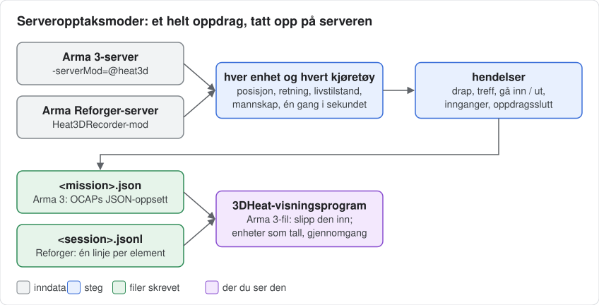

# Opptaksmods for servere (Arma 3, Arma Reforger) {#server-recorder-mods-arma-3-arma-reforger}

De fleste spill tas opp av watcheren på spillerens egen maskin. Arma er annerledes: en
server kan ta opp et helt oppdrag - hver enhet og hvert kjøretøy, ikke bare ditt - med en
mod som kjører på serveren. Spillerne setter ingenting opp: Arma 3-modden er bare for server,
og Reforger laster ned en servers mods til spillerne av seg selv når de blir med (modden gjør
ingenting på deres maskiner). Repoet inneholder to slike mods, i
[`mods/arma3`](https://github.com/Holdi601/3DHeat-Watcher/tree/main/mods/arma3)
og [`mods/reforger`](https://github.com/Holdi601/3DHeat-Watcher/tree/main/mods/reforger).
READMEene deres er den fullstendige dokumentasjonen; denne siden er oversikten.

**Status: ingen av dem er testet i spillet ennå.** Arma 3-utvidelsen er bygd og kjørt slik
Arma kaller utvidelser, og utdataene lest av 3DHeat; SQF-skriptene er ikke kjørt i Arma 3 ennå.
Reforger-modden er skrevet etter Bohemias publiserte skript-API og er aldri kompilert.
Ikke sett noen av dem på en offentlig server før testtrinnene i README-en er gjennomført.

## Arma 3 {#arma-3}

1. Bygg utvidelsen én gang per plattform (`mods/arma3/extension`). Dette krever en C-kompilator:
   Visual Studio Build Tools på Windows, gcc på Linux; har du aldri kompilert noe, spør
   serververten din.
   - Windows, i en "x64 Native Tools Command Prompt for VS":
     `cl /nologo /O2 /LD heat3d.c /Fe:heat3d_x64.dll`
   - Linux: `gcc -O2 -shared -fPIC -o heat3d_x64.so heat3d.c -ldl`
2. Bygg modden: `python mods/arma3/build.py` skriver `mods/arma3/@heat3d/`
   (ingen Arma 3 Tools trengs).
3. Kopier `@heat3d` inn i serverens mappe og start serveren med `-serverMod=@heat3d`.
4. Serverens `.rpt`-logg skal si: `Heat3D recorder 0.1.0: recording <file> every 1 s`

| Innstilling | Standard | Hva den gjør |
|---|---|---|
| `captureDelay` | 1 | sekunder mellom bilder |
| `recordHits` | 1 | 0 slår av treffhendelser |
| `recordShots` | 1 | 0 slår av telling av skudd |
| `minPlayers` | 0 | ta bare opp når så mange spillere er på |

Et oppdrag overstyrer en av dem i sin `init.sqf` (`heat3d_captureDelay = 0.5;`).
Opptakene går til `recordings/` inni `@heat3d`, eller til `HEAT3D_DIR`.

**Utdata:** én fil per oppdrag i OCAPs JSON-oppsett (OCAP2-opptakerens format), kalt
`<date>__<time>_<mission>.json`. Under oppdraget er den en journal (`.heat3d.part`), tømt
på hver skriving; et krasjet oppdrags journal blir fullført neste gang et oppdrag starter.

## Arma Reforger {#arma-reforger}

Modden (`Heat3DRecorder.gproj`) åpnes og bygges i Bohemias Workbench (Arma Reforger Tools),
testes på en lokal dedikert server, publiseres fra Workbench (uoffentlig mens den testes) og
legges til i serverens `config.json`-liste `mods` - trinn for trinn i README-en. Hvert sekund
skriver den hver figurs posisjon, retning, livstilstand, kjøretøy og spiller-id, og hvert
kjøretøys posisjon, retning, tilstand og mannskap; og drap (dreper, våpen, avstand), treff,
å stige inn og ut, spillere som kommer og går, og oppdragets slutt.

**Utdata:** ett JSON-objekt per linje, `$profile:heat3d/<UTC date>_<UTC time>_<world>.jsonl`:
en `header`-linje (format `heat3d-reforger`, akser x øst, y opp, z nord), deretter
`entity`-, `frame`- og `event`-linjer etter hvert som de skjer, og en `end`-linje. Enhetsrader er
`[id, x, y, z, dir, alive, vehicleId, playerId]`, kjøretøyrader `[id, x, y, z, dir, alive, [crew ids]]`;
hendelser følger OCAP2s hendelsesoppsett.

## I visningen {#in-the-viewer}

Dra et Arma 3-opptak inn i [3DHeat-visningen](https://holdi601.github.io/3DHeat/): ett oppdrag er
én sesjon, enheter blir soldater, kjøretøy blir sin type, og drap og treff går inn i
etterkampslisten. OCAP2s webspiller spiller det også. Reforger-filen er modens egne linjeformat,
med OCAP2s hendelsesoppsett.
