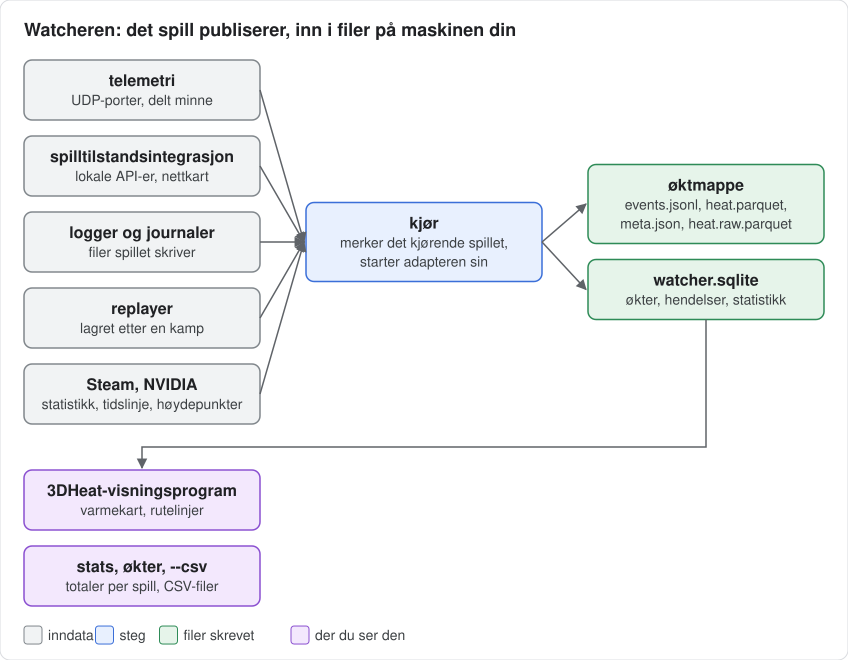

# Kilder og regler {#sources-and-rules}

Watcheren tar bare opp det spill og plattformer gir ut til spilleren. Denne siden forklarer hvilke kilder det dekker, hva watcheren får gjøre med hver av dem, og hvilke spill eller deler av spill den bevisst lar være.

## De seks typene kilder {#the-six-kinds-of-source}

Hver adapter har en `kind`, og typen avgjør hva adapteren får gjøre:

| Type | Hva det er | Flerspillerspill |
|---|---|---|
| `telemetry` | en UDP-port eller delt minne spillet publiserer for dashboards, bevegelsesriggs og rattsystemer (Forza Data Out, F1 UDP, Kunos og iRacing delt minne, SimConnect, X-Planes UDP-grensesnitt, SCS SDK-pluginen) | ja - det er spillets egen utdata |
| `gsi` | en game-state integration eller lokal webtjeneste spillet tilbyr spilleren på hans egen maskin (Valve GSI, League Live Client Data API, Rocket Leagues Stats API, War Thunders webkart) | ja, innenfor det API-et viser spilleren |
| `log` | filer spillet skriver mens det kjører: journaler, logger, statistikk, lagringer (Elite Dangerous, Minecraft, Path of Exile, Hearthstone, Star Citizen, EVE Online) | ja |
| `replay` | demoer og repriser spillet lagrer for sine spillere, konvertert etter kampen (CS2, Dota 2, War Thunder, World of Tanks, World of Warships, Squad, League of Legends, VALORANT, IL-2 Tacview) | ja, med mindre de er kryptert, og bare delene som ligger åpent |
| `platform` | det Steam og grafikkdriveren lagrer: statistikk, prestasjoner, tidslinjer, klipp og høydepunkter | ja |
| `memory` | spillets minne, bare lesing, av en profil du skrev | **aldri** - bare enkeltspiller |

Bare `memory` åpner en annen prosess, og bare for lesing. De fem andre typene leser det spillet, Steam eller NVIDIA-appen allerede har skrevet ut eller sender.

## Hvordan kildene leses {#how-the-sources-are-read}

- **Ingenting injiseres, kobles til eller endres i et spill.** Ingen kode lastes inn i et spill, ingen vindu eller input kobles til, ingen spillfil patches. De eneste filene watcheren skriver utenfor sin datamappe, er dem [`setup --apply`](commands.md#setup) skriver når du ber om det: en spills egen innstillingsfil (med originalen tatt vare på som `<file>.heat3d-backup`), en game-state cfg-fil, DCS-hook-skriptet, BeamNG-protokollmodden.
- **Delt minne åpnes skrivebeskyttet og opprettes aldri.** Den vanlige måten i Python å åpne et navngitt minneområde på oppretter ett når det ikke finnes. Et spill startet etter det ville finne watcherens tomme, skrivebeskyttede område i stedet for å lage sitt eget, og telemetrien ville vært død. Watcheren åpner minneområder bare med `OpenFileMappingW` (som bare finner et eksisterende), mapper dem med `FILE_MAP_READ`, og prøver igjen senere hvis spillet ennå ikke har laget dem.
- **Porter lånes, aldri tatt over.** En UDP-telemetriport som et annet program allerede lytter på (FH Companion, SimHub, en dashboard-app) overlates til det programmet. Hvis et annet program begynner å lytte på en port watcheren holder, slipper watcheren den innen noen få sekunder. Forza-adaptere venter 15 s etter at spillet starter før de tar port 5300, og sender hver pakke uendret videre til 127.0.0.1:5301, slik at en andre Data Out-app fortsatt kan ta opp.
- **Bare lokalt.** Spilltilstandstjenerne watcheren kjører (CS2, Dota 2) lytter på 127.0.0.1 og ingen andre steder. Når spillets cfg-fil har en token (den `setup` skriver har en), må hver post bære den; poster uten den telles som `bad_auth` og slettes. Uten en cfg-fil med token godtas enhver lokal post, og loggen sier det. De lokale API-ene den spør (League på port 2999, War Thunder på 8111, Rocket League på 49123, X-Plane på 49000) ligger på 127.0.0.1.
- **Loggfiler deles, låses aldri.** Hver lesing åpner filen med alle delingsflaggene Windows har, og lukker den igjen, slik at spillet kan fortsette å skrive, gi nytt navn eller erstatte loggen sin.
- **To eksterne tjenester, og bare i disse tilfellene.** Utgivelsessjekken spør GitHub (`api.github.com`) høyst hvert sjette time, og kan slås av (se [Oppdateringer](updates.md)). League-repriseadapteren spør Riots Match-V5-API bare når du har oppgitt din egen `riot_api_key`. Ingenting annet sendes noe sted.
- **Å slå på en kilde er din avgjørelse.** `setup` uten `--apply` sier bare hva den ville endret.

## Regler for flerspiller {#multiplayer-rules}

- Et spill som spilles på nett, tas bare opp gjennom det det publiserer: telemetri, game-state-API-er, logger, repriser, plattformfiler. Innenfor dem tar watcheren opp det spillet viser spilleren, og ingenting beregnet utover det:
  - **CS2 game-state integration** sender spilleren som blir fulgt (deg selv mens du lever, en lagkamerat etter at du er død). Andre spilleres posisjoner (`allplayers_*`) sendes bare til tilskuere og GOTV, så watcheren ber ikke om dem.
  - **League of Legends' Live Client Data API** har ingen posisjoner. Riots policy tillater verktøy å vise det spilleren kan vite fra selve spillet, og ikke noe beregnet utover det (ingen tidtakere for fienden). Watcheren tar opp kill-feeden og resultattavlen spilleren ser, og spillerens egne tall.
  - **Rocket Leagues Stats API** har ingen bilposisjoner (bilens tilstand sendes bare til tilskuere). Det som har et sted er ballen, der den ble truffet, scoret eller traff tverrliggeren.
  - **War Thunders webkart** viser det minikartet viser, uten navn eller id-er.
  - **F1 23/24/25** legger hver bils posisjon i sin Motion-pakke, også på nett. Spillet gir dem ut selv, og holder bare tilbake dataene til spillere med begrenset "Your Telemetry".
  - **DCS World**: en flerspillerserver kan forby eksport av eget flys data; økten har da hendelser men ingen posisjoner, og sier det.
- **Minne leses aldri i et flerspillerspill.** En minneadapter for et spill som er merket som spilt på nett, avvises, og en profil må si om spillet kan spilles på nett i det hele tatt. Et enkeltspillerspill som også har en nettmodus, leses bare mens det ikke har forbindelse til noe annet enn denne maskinen. Spill der enkeltspillermodusen kjører under juks-beskyttelse, leses heller aldri. Se [Lese minne](memory-reading.md).
- `multiplayer`-flagget på en adapter (vist som "Online play" av `games --markdown`) avgjør bare minnelesing. Det hindrer ikke de andre typene i å ta opp nettspill.

## Hva som er avvist, og hvorfor {#what-is-declined-and-why}

Noen spill, og noen deler av spill, tas ikke opp: dataene deres er beskyttet, ikke publisert eller ikke på spillerens maskin i det hele tatt:

| Spill | Hva som er utelatt | Hvorfor |
|---|---|---|
| VALORANT | posisjoner, navn, poengsum i repriser; klientens lockfile-endepunkter | Repriseens spillstrøm er tilslørt med verdier hentet fra hver builds kjørbare fil. Spillet kjører under Vanguard. Riot-klientens lockfile-endepunkter er ikke et publisert API. **Lest:** det reprisen bærer åpent - kart, kamp-id, agenter, serverens drap- og rundetidslinje. |
| League of Legends | den øyeblikk-for-øyeblikk-delen av `.rofl`-repriser; klientens lockfile-endepunkter | Tilslørt mot juks, forskjellig for hver patch, og ikke dekodet. **Lest:** poengtavlen etter kampen som hver reprise bærer som vanlig JSON, Live Client Data API under en kamp, og - med din egen utviklernøkkel - den offisielle Match-V5-tidslinjen (posisjoner en gang i minuttet, drap der de skjedde). |
| Fortnite | repriser | Kryptert. |
| World of Tanks, World of Warships | repriser, i watcheren | Chiffrert. Watcheren leser dem ikke; separate konverterere utenfor den gjør det (`exporters/ext/wot-replay`, `exporters/ext/wows-replay`), hver et eget prosjekt. **Lest, med en konverterer installert:** hvert kjøretøys eller skips posisjon mens opptaksklienten kjente til det, og drapene. |
| Gran Turismo 7 | telemetri | Bare konsoll, og telemetrien er kryptert med en nøkkel hentet ut av spillet. |
| Apex Legends | alt | LiveAPI-et sender fulle hendelser bare i private og egendefinerte lobbyer; ellers finnes ingenting lokalt. |
| Overwatch 2, Call of Duty, Battlefield 6, Hunt: Showdown 1896 | direkte data | Ingen lokal reprise, logg eller spilltilstandsutdata å lese. Deres statistikk kommer inn der Steam holder den ([Steam-statistikk](game-steam-stats.md), [Steam Timeline](game-steam-timeline.md)), og klippene deres som [NVIDIA-høydepunkter](nvidia-highlights.md). |
| Star Citizen | alt utover `Game.log` | Kjører Easy Anti-Cheat; watcheren leser bare loggfilen spillet skriver og kommer aldri i nærheten av spillets prosess. |
| osu! | repriser | Utenfor rammen: et 2D-spill, med ingenting å plassere på et kart. |
| Alle flerspillerspill | minne | Aldri. Enkeltspillerspill der modusen kjører under juks-beskyttelse (GTA V, Elden Ring via launcheren) leses heller ikke. |

Krypterte repriser åpnes ikke: VALORANT-leseren sjekker reprisens krypteringsflagg og avviser en kryptert fil ("this replay is encrypted; it is not read").

Spill som er undersøkt, men ennå ikke bygget (Deadlock-repriser, Rocket League `.replay`-filer, StarCraft II, Team Fortress 2, Rainbow Six Siege, Beat Saber, Trackmania, flere racingsimulatorer), er oppført med sine kilder i [Alle spill i én tabell](watcher.md#researched-not-yet-built). Hver av dem trenger eksempelfiler å sjekkes mot før den leveres.
