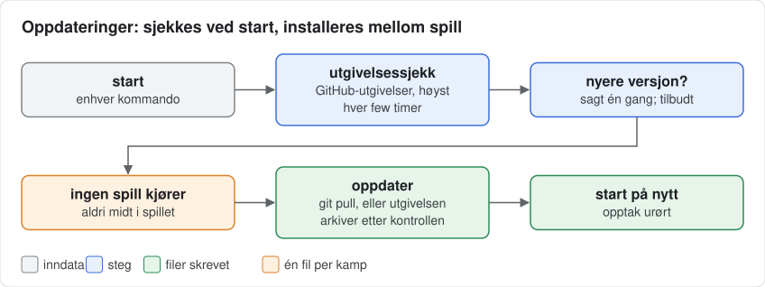

# Oppdateringer {#updates}

Watcheren holder seg oppdatert etter utgivelsene fra
[Holdi601/3DHeat-Watcher](https://github.com/Holdi601/3DHeat-Watcher/releases). Oppdateringsprogrammet er
pakken `heat3d_update`, ved siden av `heat3d_watch` i repoet.

## Sjekken {#the-check}

- **Når**: hver kommando unntatt `update` sjekker når den starter. `run` sjekker også mens den kjører,
  høyst én gang i timen og bare mens intet spill kjører.
- **Hvordan**: én HTTPS-forespørsel til `https://api.github.com/repos/Holdi601/3DHeat-Watcher/releases/latest`,
  med en tidsgrense på 5 sekunder. Svaret lagres i seks timer i
  `%LOCALAPPDATA%\3DHeat\update-check-3DHeat-Watcher.json`, så de fleste starter spør ingen ting. "Ingen
  utgivelse ennå" (HTTP 404) lagres som et svar. Frakoblet, begrenset av hastighet eller bak en proxy,
  feiler sjekken stille, og kommandoen fortsetter med versjonen den har.
- **Versjoner**: den installerte versjonen er filen `VERSION` i repomappen. En utgivelses tag
  (`v1.2.0` eller `1.2.0`) sammenlignes som tall, del for del; alt etter et `-` eller `+` ignoreres.
- **Av**: `HEAT3D_NO_UPDATE=1` (en hvilken som helst verdi unntatt tom, `0`, `false` eller `no`) slår av både
  sjekken og den automatiske oppdateringen. Hvert 3DHeat-verktøy har sin egen hurtigbuffer, så ett verktøys
  svar aldri står inne for et annets.

## Hva som skjer når en nyere utgivelse er ute {#what-happens-when-a-newer-release-is-out}

- **`run`** skriver et varsel når den starter, og fortsetter å kjøre:
  `[heat3d_watch] 3DHeat Watcher 1.2.0 is out (this is 1.0.2). <release page>`. Mens den kjører, med
  `auto_update` på (standard) og intet spill i gang, oppdaterer den seg selv: logglinjen
  `3DHeat Watcher 1.2.0 is out (this is 1.0.2); updating`, et Windows-varsel "Updating to 1.2.0",
  oppdateringen, hver adapter stoppet og sesjonene lukket, og samme kommando startet på nytt med den nye
  koden. Watcheren oppdaterer seg aldri midt i et spill. Kan ikke oppdateringen brukes, sier varselet det
  ("1.2.0 is out; not updated: ..."), og watcheren fortsetter å kjøre den gamle versjonen. Med
  `auto_update` av er det bare varselet.
- **Andre kommandoer** spør `Update now? [Y/n]` når de kjører i en terminal. Enter, `y`, `yes`, `j` eller
  `ja` oppdaterer, og kjører deretter samme kommando på nytt med den nye versjonen. Uten terminal (en
  planlagt kjøring, en pipe) skriver de hvordan man oppdaterer, og fortsetter.
- **På forespørsel**: `python -m heat3d_watch update` (eller `python -m heat3d_update`) spør GitHub uten
  hurtigbufferen og oppdaterer. `--check` sier bare om en nyere utgivelse er ute. Dette virker selv med
  `HEAT3D_NO_UPDATE` satt.

## Slik brukes en oppdatering {#how-an-update-is-applied}

Det avhenger av hvordan kopien ble installert:

- **En git-klone** (mappen har `.git`, og `git` er på PATH): `git pull --ff-only`. Dette nektes så lenge
  klonen har endringer i sporede filer (`git status --porcelain --untracked-files=no` er ikke tom): de
  endringene er noens arbeid, og en oppdatering bestemmer ikke hva som skjer med dem. Commit eller stash
  dem, og pull deretter.
- **En nedlastet kopi**: kildearkivet til utgivelsen lastes ned og pakkes ut i en midlertidig mappe.
  Oppføringer som ville havnet utenfor den, hoppes over. Arkivets `VERSION` må være versjonen utgivelsen
  sier den er, ellers kopieres ingenting. Deretter kopieres filene over repomappen. Filer som ikke er en del
  av en utgivelse - opptak, innstillinger, virtuelle miljøer, eksporter, alt du har laget - røres ikke. En
  Python-modul en eldre utgivelse hadde og den nye har droppet, fjernes fra utgivelsens egne pakker
  (`heat3d_watch`, `heat3d_update`), så ingen gammel adaptermodul lastes etter oppdateringen; ingenting utenfor
  disse pakkene fjernes.

Opptak og innstillinger ligger normalt utenfor repomappen uansett (`%LOCALAPPDATA%\3DHeat\Watcher`), så en
oppdatering kommer aldri nær dem.

Etter en oppdatering startes samme kommando på nytt. På Windows starter watcheren den nye prosessen,
venter på den og videresender exit-koden, så konsollen oppfører seg som om den første prosessen hadde gjort
jobben.
