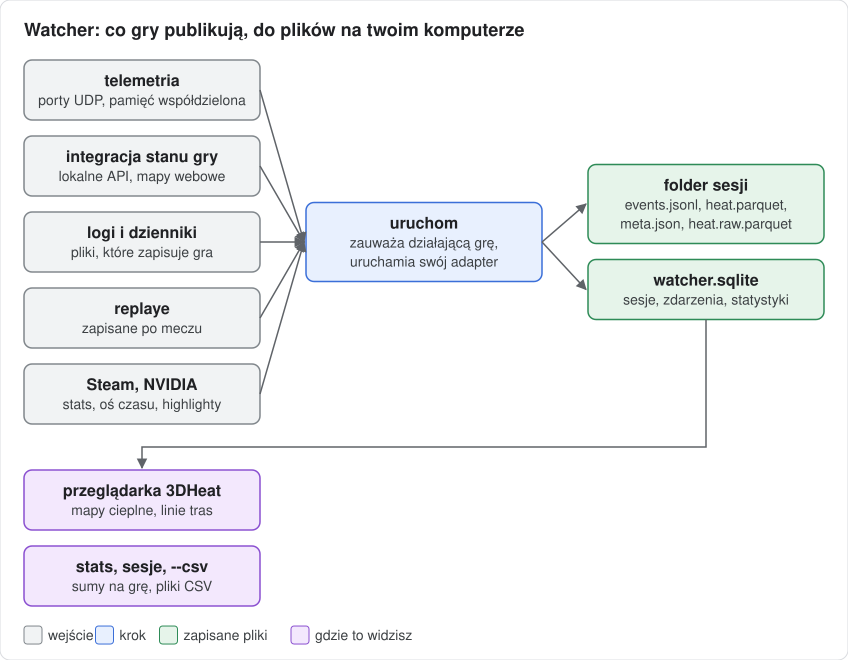
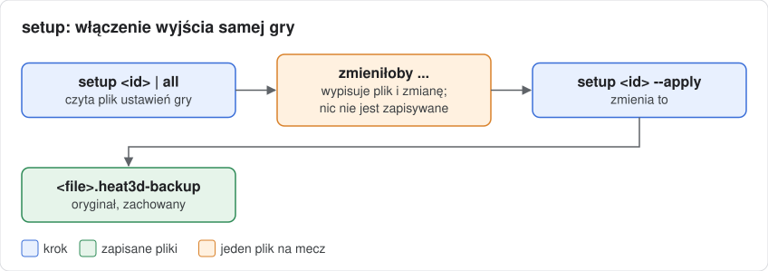
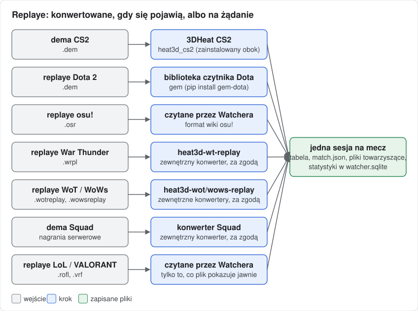
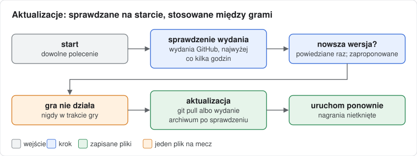

# Polecenia {#commands}

Nowy w wierszu poleceń? Najpierw przeczytaj [Zanim zaczniesz](before-you-start.md). Każde polecenie wpisujesz
w terminalu otwartym w folderze, do którego rozpakowałeś lub sklonowałeś program (w Eksploratorze plików wpisz
`powershell` w pasku adresu), tak:

```bash
python -m heat3d_watch <command> [options]
```


| Polecenie | Co robi |
|---|---|
| [`run`](#run) | obserwuje w tle i zapisuje każdą grę, która działa |
| [`games`](#games) | co daje każda gra i skąd |
| [`setup`](#setup) | włącza wyjście gry |
| [`status`](#status) | które gry działają teraz i które adaptery by ruszyły |
| [`sessions`](#sessions) | dotychczasowe nagrania |
| [`stats`](#stats) | sumy dla każdej gry albo tabele jako CSV |
| [`table`](#table) | odbudowuje `heat.parquet` sesji z jej `events.jsonl` |
| [`replays`](#replays) | konwertuje powtórki już zapisane na dysku |
| [`dota-replay`](#dota-replay) | pobiera powtórkę publicznego meczu Dota 2 po jego numerze |
| [`dota-map`](#dota-map) | mapa Dota 2 z twojej instalacji jako poziom 3D dla viewera |
| [`update`](#update) | aktualizuje do najnowszego wydania |
| [`config`](#config) | pokazuje lub zmienia ustawienia |

Opcje dla każdego polecenia: `-h` / `--help` wypisuje pomoc, a `python -m heat3d_watch --version`
wypisuje wersję (plik `VERSION`).

Zdjęcia na tej stronie to przebiegi na syntetycznych przykładowych sesjach (`Example Racer`, `Example Arena`),
a nie na prawdziwych nagraniach.

Każde polecenie oprócz `update` najpierw sprawdza, czy nie ma nowszego wydania (co najwyżej co sześć godzin;
pomijane przy `HEAT3D_NO_UPDATE=1`, zob. [Aktualizacje](updates.md)). `run` tylko wypisuje zawiadomienie.
Pozostałe polecenia pytają `Update now? [Y/n]`, gdy działają w terminalu, a gdy nie – wypisują, jak zaktualizować.
Wyjście jest w UTF-8, więc nazwy gier w dowolnym alfabecie wyświetlają się w każdej konsoli.

## run {#run}

```bash
python -m heat3d_watch run [--once] [-v]
```



Działa, aż je zatrzymasz (Ctrl+C): co `scan_seconds` sekund czyta listę procesów i uruchamia adapter dla każdej
znalezionej gry, a także adaptery działające zawsze. Przed pierwszym sprawdzeniem kończy sesje, które zostawił
poprzedni przebieg. Gdy żadna gra nie działa, może zaktualizować samego siebie (przy włączonym `auto_update`).
Szczegóły są w [Instalacja i uruchamianie](installing-and-running.md#running).

| Opcja | Efekt |
|---|---|
| `--once` | jedno spojrzenie na działające gry, potem wyjście. Adaptery dla gier działających teraz (i tych działających zawsze) są uruchamiane, każdy odpytuje raz (czeka się najwyżej 10 sekund), a potem wszystkie są zatrzymywane tak, jak zatrzymuje je zakończenie gry: ich sesje są zamykane, zapisywane i liczone. Do sprawdzenia wykrywania, a nie do nagrywania. |
| `-v`, `--verbose` | linie debugowania w `watcher.log` i na konsoli |

`run` zapisuje `<data>\watcher.lock` i nie uruchamia się drugi raz dla tego samego folderu danych (kod wyjścia 1);
zob. [Plik blokady](installing-and-running.md#the-lock-file).

## games {#games}

```bash
python -m heat3d_watch games [--markdown]
```


Wypisuje każdy adapter posortowany według gry: jego nazwę, id i rodzaj, skąd czyta, co zapisuje i jak go włączyć.
Adapter, którego nie da się uruchomić na tym komputerze, jest oznaczony `[unavailable: <why>]` – nie znaleziono
SimConnect.dll, brak folderu Minecrafta, nie zainstalowano 3DHeat CS2, nie znaleziono Steam ani NVIDIA App.
Moduł adaptera, który nie dał się zaimportować, jest wymieniony na końcu wraz z błędem.

```text
EA SPORTS F1 25  (f1-25, telemetry)
    from: UDP telemetry 127.0.0.1:20777 (Documents\My Games\F1 25\hardwaresettings\hardware_settings_config.xml)
    - every car's position (world XYZ, m) at 10 Hz, by driver name, team, own car marked, ...
    switch on: In the game: Settings > Telemetry Settings > UDP Telemetry On, IP 127.0.0.1, port 20777 - ...
```

`--markdown` wypisuje to samo jako jedną tabelę Markdown (gra, co jest zapisywane, skąd, jak włączyć, gra online,
sprawdzone). Tabela w [Wszystkie gry w jednej tabeli](watcher.md) to właśnie ten wynik. Komórki są zapisane pod
Markdown: tekst w backtickach zostaje fragmentem kodu, a poza nimi `<`, `>`, `&`, `*`, `|` i odwrotny ukośnik przed
znakiem interpunkcyjnym są zapisane tak, by wyświetliły się dokładnie tak, jak napisano (`<CS2>` inaczej zniknąłby
jako znacznik HTML w kramdown). Jedynym fragmentem HTML jest `<br>` między pozycjami w kolumnie „What is recorded”.

## setup {#setup}

```bash
python -m heat3d_watch setup <adapter id | all> [--apply]
```




Włącza wyjście gry tam, gdzie gra wymaga zmiany pliku. Bez `--apply` nic nie jest zmieniane: każdy wiersz mówi, co
by się zmieniło, a gdy jest coś do zmiany, ostatni wiersz brzmi `Nothing was changed. Run again with --apply to make these changes.`
Gdy nie ma nic do zmiany, wypisuje `<id>: nothing to change` (`Nothing to change.` dla `all`). Z `--apply` zmiany są
wykonywane, a przed pierwszą zmianą pliku jego oryginał jest zapisywany jako `<file>.heat3d-backup`. Istniejącej kopii
nigdy nie nadpisuje się, więc zawsze zawiera ona plik taki, jaki był, zanim watcher go po raz pierwszy ruszył.

```text
f1-25: would change: hardware_settings_config.xml <udp>: enabled="false" -> "true"
Nothing was changed. Run again with --apply to make these changes.
```

`all` uruchamia konfigurację każdego adaptera, który ją ma. Adapter bez konfiguracji, podany osobno, wypisuje
`<id>: nothing for setup to change; ` i dalej, jak gra się włącza (jej tekst `enable` albo że nic nie potrzebuje).
Nieznane id wypisuje `no adapter '<id>'; games lists them` i kończy się kodem 2. Adaptery, które mają co konfigurować:

| Adapter | Co zmienia `--apply` |
|---|---|
| `beamng` | instaluje moduł protokołu `heat3d` w folderze `mods` użytkownika BeamNG (tylko gdy go tam nie ma); potem włącz w grze Options > Other > Protocols > „others” |
| `cs2-gsi` | zapisuje `<CS2>\game\csgo\cfg\gamestate_integration_heat3d.cfg`: wysyłaj stan gry na `http://127.0.0.1:3311/` z losowym tokenem, którego watcher potem wymaga (token już obecny w pliku zostaje); CS2 czyta go przy starcie |
| `dota2-gsi` | to samo dla Dota 2: `<Dota>\game\dota\cfg\gamestate_integration\gamestate_integration_heat3d.cfg`, port 3312 |
| `dcs` | dodaje `Scripts\Hooks\heat3d-watch.lua` do każdego folderu `%USERPROFILE%\Saved Games\DCS*`. Jego starsza kopia jest aktualizowana; plik o tej nazwie, którego watcher nie zapisał, zostaje nietknięty. Uruchom DCS ponownie. |
| `dirt-rally-2` | `hardware_settings_config.xml`: `<udp enabled="true" extradata="3" ip="127.0.0.1" port="20777">`; najpierw uruchom grę raz, żeby plik istniał |
| `ea-wrc` | `Documents\My Games\WRC\telemetry\config.json`: pakiet `session_update` struktury `wrc` włączony, na ten komputer |
| `f1-23`, `f1-24`, `f1-25` | `hardware_settings_config.xml`: `<udp enabled="true" ip="127.0.0.1" port="20777">`; gra musi być zamknięta |
| `hearthstone` | dodaje sekcję `[Power]` (`LogLevel=1`, `FilePrinting=true`) do `%LOCALAPPDATA%\Blizzard\Hearthstone\log.config`; uruchom grę ponownie |
| `il2` | `<game>\data\startup.cfg`, `[KEY = telemetrydevice]`: jeden cel więcej `addrN = "127.0.0.1:41995"` i `enable = true` (sekcja jest dodawana, z częstotliwością 10 Hz, gdy jej nie ma); uruchom IL-2 ponownie |
| `il2-tacview` | `<game>\data\startup.cfg`, `[KEY = track_record]`: `tacviewrecord = 1` |
| `rocketleague-stats` | `TAStatsAPI.ini` (albo `DefaultStatsAPI.ini`, gdy tamtego nie ma) w `<RL>\TAGame\Config`: `PacketSendRate=30`, gdy API jest wyłączone, oraz `Port`, gdy żaden nie jest ustawiony; czytane przy starcie Rocket League |

`richard-burns-rally` nie ma konfiguracji: jego telemetria należy do wtyczki RSF/NGP i włącza się ręcznie w
`RichardBurnsRally.ini` (zob. [jego strona](game-richard-burns-rally.md)); `setup richard-burns-rally` tak właśnie
mówi. Każda inna gra albo niczego nie potrzebuje, albo włącza się w grze; strona każdej gry mówi jak.

## status {#status}

```bash
python -m heat3d_watch status
```

```text
3DHeat Watcher 1.0.2; data in C:\Users\...\AppData\Local\3DHeat\Watcher
Games running: EA SPORTS F1 25 (f1-25)
Always on: il2-tacview, steam-stats, steam-timeline, nvidia-highlights, cs2-demos, osu-replays, lol-replays, valorant-replays
```

Mówi, które adaptery `run` uruchomiłoby teraz, według tych samych zasad: proces gry działa, adapter nie jest na liście
`disabled`, nie brakuje niczego, czego potrzebuje; adaptery powtórek tylko przy włączonym `replays`, adaptery pamięci
tylko przy włączonym `memory` i gdy każde sprawdzenie pamięci przeszło. Niczego nie uruchamia.

## sessions {#sessions}

```bash
python -m heat3d_watch sessions [--game NAME] [--limit N]
```


Najnowsze sesje z `watcher.sqlite`, po jednej linii: start (czas lokalny), gra, minuty, zdarzenia, pozycje, folder.

| Opcja | Efekt |
|---|---|
| `--game NAME` | tylko ta gra, po dokładnej nazwie z listy (`"EA SPORTS F1 25"`) |
| `--limit N` | najwyżej N sesji (domyślnie 40) |

## stats {#stats}

```bash
python -m heat3d_watch stats [--game NAME] [--csv DIR]
```


Bez opcji: tabela każdej gry (sesje, godziny, zdarzenia, pozycje, ostatnio grane), od najczęściej granej; potem dla
każdej gry jej 25 najczęstszych zdarzeń i każda liczbowa statystyka z liczbą sesji, które ją mają, sumą, najlepszą
wartością (`best`) i średnią. `best` wie, w którą stronę jest lepiej: najniższa wartość dla czasów zapisywanych jako
najlepsze (`best_lap`, `best_stage` i każdy inny klucz zaczynający się od `best_`) oraz dla miejsc (`race_position`,
`grid_position`, każdy klucz kończący się na `_position`), a najwyższa dla wszystkiego innego (zabójstwa, dystans,
prędkość maksymalna, liczniki samej gry).

| Opcja | Efekt |
|---|---|
| `--game NAME` | tylko zdarzenia i statystyki tej gry, bez przeglądu |
| `--csv DIR` | zamiast tego zapisuje `sessions.csv`, `events.csv` i `stats.csv` (każdy wiersz trzech tabel) do `DIR`; `--game` tego nie zawęża |

## table {#table}

```bash
python -m heat3d_watch table <session folder>
```


Odbudowuje `heat.parquet` w folderze sesji z jej `events.jsonl`, z osiami z jej `meta.json`. Wypisuje ścieżkę tabeli
albo `no positions in this session`. Używaj tego dla sesji nagranej, gdy brakowało `pyarrow`, albo po ręcznej edycji
`events.jsonl`.

## replays {#replays}

```bash
python -m heat3d_watch replays <adapter id> [folder] [-v]
```



Konwertuje powtórki już zapisane na dysku, teraz, jedna po drugiej, każdą jako sesję, tak jak zrobiłby to watcher dla
folderu. Gdy watcher pierwszy raz widzi folder powtórek, tylko odnotowuje, co w nim jest (zob.
[Instalacja i uruchamianie](installing-and-running.md#replays-already-on-disk)); tak konwertuje się je na żądanie.
Bez `folder` czytane są foldery adaptera (gry plus `replay_folders`); z nim – powtórki z tego folderu. Każda
przekonwertowana powtórka jest odnotowywana jako widziana, więc działający watcher jej nie konwertuje ponownie.
Powtórka, której nie udało się przekonwertować, jest zapisywana w logu i pomijana.

| Adapter | Powtórki |
|---|---|
| `cs2-demos` | dema Counter-Strike 2 (`*.dem`), przez 3DHeat CS2 |
| `lol-replays` | powtórki League of Legends (`*.rofl`) |
| `osu-replays` | powtórki osu! (`*.osr`) |
| `valorant-replays` | powtórki VALORANT (`*.vrf`) |
| `warthunder-replays` | powtórki War Thunder (`*.wrpl`), przez zewnętrzny konwerter `heat3d-wt-replay` (exporters/ext/warthunder-replay) |
| `wot-replays` | powtórki World of Tanks (`*.wotreplay`), przez zewnętrzny konwerter `heat3d-wot-replay` (exporters/ext/wot-replay) |
| `wows-replays` | powtórki World of Warships (`*.wowsreplay`), przez zewnętrzny konwerter `heat3d-wows-replay` (exporters/ext/wows-replay) |
| `dota-replays` | powtórki Dota 2 (`*.dem`), przez gem (`pip install gem-dota`) |

```text
osu-replays: converted 12 replay(s); `sessions --game` lists them
```

Id, którego nie ma na tej liście, wypisuje `no replay adapter '<id>'` wraz z listą i kończy się kodem 2; tak samo
folder, który nie istnieje. Adapter, który tutaj nie może działać (nie zainstalowano 3DHeat CS2), wypisuje dlaczego
i kończy się kodem 1. Ślady Tacview z IL-2 nie są na tej liście: ten adapter sam konwertuje każdy skończony ślad,
jaki znajdzie.

## dota-replay {#dota-replay}

```bash
python -m heat3d_watch dota-replay <match id> [<match id> ...] [-o FOLDER] [--convert] [-v]
```

Pobiera powtórkę publicznego meczu Dota 2 z serwerów powtórek Valve. Potrzebny jest internet. Numer meczu to liczba
na stronie meczu w kliencie Dota (szczegóły meczu) albo na stronie OpenDota. Valve trzyma powtórkę przez kilka
tygodni, potem pobieranie się nie udaje. Serwer i sól powtórki pochodzą z zapisu meczu w OpenDota
(`api.opendota.com/api/matches/<id>`, klucz nie jest potrzebny), a plik z
`replay<cluster>.valve.net/570/<id>_<salt>.dem.bz2`; jest rozpakowywany w trakcie pobierania (Valve podaje pod tą
nazwą zarówno bzip2, jak i Zstandard) i zapisywany jako `<match id>.dem`. Bez `-o` trafia do folderu powtórek Dota 2,
gdy Dota 2 jest zainstalowana – tam działający watcher go konwertuje – a w przeciwnym razie do `<data>/replays/dota`.
Plik już tam istniejący zostaje. `--convert` konwertuje pobrane powtórki od razu, tak jak zrobiłoby to
`replays dota-replays`, i odnotowuje je jako widziane.

```text
match 9000000000: C:\Program Files (x86)\Steam\steamapps\common\dota 2 beta\game\dota\replays\9000000000.dem
```

Valve trzyma powtórki przez kilka tygodni; starszy mecz wypisuje `Valve no longer has the replay of match <id>`
i kończy się kodem 1. Mecz, którego OpenDota jeszcze nie widziała, nie ma soli: komunikat mówi, by poprosić OpenDota
o nią (`curl -X POST https://api.opendota.com/api/request/<id>`) i spróbować po kilku minutach. Prywatne lobby
i mecze z ukrytym profilem w ogóle nie są na serwerach powtórek.

## dota-map {#dota-map}

```bash
python -m heat3d_watch dota-map [<map>] -o <file.glb> [--game FOLDER] [--source2viewer EXE] [--detail UNITS]
```

Zapisuje mapę Dota 2 – grunt, klify, wodę, drzewa i budynki – jako plik poziomu `.glb` w układzie, w jakim rysowane są
tabele powtórek Dota, z twojej własnej instalacji Dota 2, odczytanej przez wiersz poleceń Source2Viewer. Nic nie jest
pobierane. `<map>` to domyślnie `dota`; `--game` to folder Dota 2, gdy nie leży w bibliotece Steam; `--source2viewer`
to ścieżka do CLI, gdy nie ma jej ani w `HEAT3D_SOURCE2VIEWER`, ani w `PATH`; `--detail` to komórka grupowania
wierzchołków dla budynków w jednostkach gry (domyślnie 8, 0 zachowuje każdy trójkąt). Kończy się kodem 1 i
`dota-map: <why>`, gdy nie znajdzie Dota 2, mapy albo Source2Viewer. Każdy krok, części pliku i sposób sprawdzenia:
[Mapa Dota 2](dota-map.md).

## update {#update}

```bash
python -m heat3d_watch update [--check]
```



Pyta GitHub o najnowsze wydanie, ignorując zapamiętaną odpowiedź, i aktualizuje tę kopię, jeśli jest nowsza (zob.
[Aktualizacje](updates.md)). `--check` tylko mówi, czy nowsze wydanie jest już dostępne. To polecenie działa nawet
przy ustawionym `HEAT3D_NO_UPDATE`: samo jego wywołanie jest decyzją. `python -m heat3d_update [--check]` robi to samo.

## config {#config}

```bash
python -m heat3d_watch config [--set KEY=VALUE ...]
```


Wypisuje każde ustawienie jako `key = value`. Z `--set` najpierw zmienia podane i zapisuje `settings.json`
(`saved <path>`). Wartości są czytane według typu ustawienia:

- ustawienia prawda/fałsz: `1`, `true`, `yes`, `on` albo `ja` to prawda; `0`, `false`, `no`, `off`, `nein` albo nic to fałsz;
- liczby: liczba dziesiętna (`scan_seconds=5`);
- listy: rozdzielone przecinkami albo lista JSON (`disabled=steam-stats,steam-timeline`; pusta wartość czyści listę);
- słowniki (`replay_folders`, `player_names`): cały słownik jako JSON albo jeden wpis jako `KEY.ID=VALUE` –
  `replay_folders.cs2-demos=D:\Demos,E:\More Demos` ustawia foldery tego adaptera (rozdzielone przecinkami),
  `player_names.warthunder-webmap=Name` nazwę tego adaptera; pusta wartość usuwa wpis;
- tekst: tak, jak podany (`data=D:\Heat`, `riot_id=Name#TAG`).

```bash
python -m heat3d_watch config --set memory=true scan_seconds=5
python -m heat3d_watch config --set riot_id=Name#TAG riot_platform=EUW1
python -m heat3d_watch config --set replay_folders.cs2-demos=D:\Demos player_names.rocketleague-stats=Name
```

Nieznany klucz wypisuje `no setting '<key>'`, a wartość, która nie pasuje do typu ustawienia (`memory=perhaps`,
`scan_seconds=often`, słownik, który nie jest JSON-em), wypisuje `not saved: ...`; oba kończą się kodem 2 bez zapisania
czegokolwiek. `settings.json` edytowany ręcznie jest czytany tak samo: wartość podana jako tekst tam, gdzie ustawienie
jest liczbą, prawdą/fałszem albo słownikiem, jest czytana tak, jak napisano, a taka, której nie da się odczytać,
zostaje na wartości domyślnej. Każde ustawienie jest opisane w
[Instalacja i uruchamianie](installing-and-running.md#settings).
