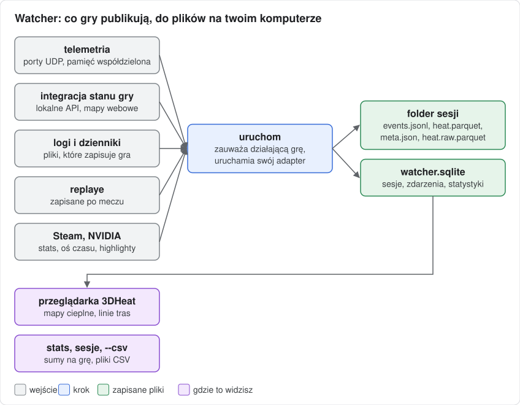

# 3DHeat Watcher {#dheat-watcher}

**Czym jest?** Podczas grania ten program po cichu zapisuje, gdzie była jazda i co się wydarzyło.
Później można to obejrzeć jako kolorową mapę w przeglądarce 3DHeat.

**Po co go używać?** Żeby prowadzić własny zapis każdej sesji - gdzie jeżdżono, latano albo walczono,
i sumy dla każdej gry - bez żadnej strony internetowej i bez zmieniania gry.

**Przykład:** przejazd okrążenia w grze wyścigowej, a Watcher działa w tle; potem plik w
`sessions\<game>\` zawiera linię przejazdu, a przeglądarka ją rysuje.

Szczegółowo: 3DHeat Watcher to program działający w tle, który zapisuje to, co gry publikują o grze - gdzie
była jazda, co się wydarzyło w którym miejscu i liczby, na których to się opiera - do plików na własnym komputerze.
Pliki służą do własnych statystyk oraz do map cieplnych i linii tras w przeglądarce 3DHeat.

Program działa cicho, zauważa, którą grę uruchomiono, i odczytuje wyniki tej gry: port telemetrii albo pamięć współdzieloną,
które gra publikuje dla paneli, integrację stanu gry, dziennik albo log, który gra zapisuje, replay zapisany po meczu,
statystyki, które trzyma Steam, klipy zapisywane przez aplikację NVIDIA. Nagrania zostają na komputerze. Program łączy się tylko z dwiema
zewnętrznymi usługami i tylko w tych przypadkach: GitHub, by szukać nowszego wydania (zob. [Aktualizacje](updates.md)),
oraz API Match-V5 Riot, i to tylko wtedy, gdy wpisano własny klucz API Riot (zob. [Replaye League of Legends](game-lol-replays.md)).



## Co nagrywa {#what-it-records}

- **Pozycje**: samochód, samolot, bohater albo gracz, kilka razy na sekundę tam, gdzie gra je publikuje,
  z prędkością, kierunkiem i wszystkim, co gra wysyła obok.
- **Zdarzenia**: pojawienia się, zgony, zabójstwa, okrążenia, odcinki, rundy, bramki, zlecenia, starty i lądowania,
  zmiany strefy, osiągnięcia, najciekawsze momenty. Każde zdarzenie jest zapisane z czasem i - gdy gra je podaje - miejscem.
- **Statystyki na sesję**: zabójstwa, zgony, okrążenia, najlepsze okrążenie, dystans, najwyższa prędkość,
  czas gry i statystyki gry, jeśli gra je prowadzi.

Co daje każda gra i skąd, opisano na jej własnej stronie w [Grach](games.md). Jedno źródło nie może
wszystkiego zapisać: gry wieloosobowe są nagrywane tylko przez to, co publikują, a Watcher nigdy nie czyta
ich pamięci (zob. [Źródła i zasady](sources-and-rules.md)).

## Instalacja {#install}

Nigdy nie korzystano z wiersza poleceń? Najpierw przeczytać [Zanim zaczniesz](before-you-start.md).

Watcher to program w Pythonie dla Windows (Python 3.10 lub nowszy). Wiele jego źródeł istnieje tylko na Windows: pamięć współdzielona,
rejestr, powiadomienia Windows.

```bash
git clone https://github.com/Holdi601/3DHeat-Watcher.git
cd 3DHeat-Watcher
pip install -r requirements.txt
```

Pobrane archiwum wydania działa tak samo: wystarczy je rozpakować, a potem uruchomić `pip install -r requirements.txt`
w tym folderze. Szczegóły i dodatki, których potrzebują niektóre gry, są w
[Instalacji i uruchamianiu](installing-and-running.md).

## Szybki start {#quick-start}

```bash
python -m heat3d_watch games            # co daje każda gra i skąd
python -m heat3d_watch setup all        # co trzeba by włączyć (nic nie jest zmieniane)
python -m heat3d_watch setup f1-25 --apply   # włącz wynik jednej gry (oryginalny plik zostaje zapasowany)
python -m heat3d_watch run              # nagrywaj; zostaw uruchomione, gdy grasz
python -m heat3d_watch stats            # sumy dla każdej gry
python -m heat3d_watch stats --csv out  # sesje, zdarzenia i statystyki jako pliki CSV
```

Powinna pojawić się tabela z jedną linią na grę po `games`; `run` działa dalej, aż zostanie
przerwane przez Ctrl+C albo zamknięte okno.

Wszystko zapisuje się w `%LOCALAPPDATA%\3DHeat\Watcher`. Aby użyć innego folderu, ustawić
zmienną środowiskową `HEAT3D_WATCH_HOME` albo uruchomić `python -m heat3d_watch config --set data=D:\somewhere`.

- `sessions\<game>\<date>_<adapter>\` - jeden folder na sesję, zawierający `events.jsonl` (każde zdarzenie
  w chwili, gdy się dzieje), `heat.parquet` (wiersze z pozycją, gotowe dla przeglądarki 3DHeat) oraz
  `meta.json` (gra, źródło, osie, liczby, statystyki)
- `watcher.sqlite` - statystyki każdej sesji w trzech prostych tabelach
- `watcher.log` - to, co zrobił Watcher

Przeglądarka otwiera `heat.parquet` sesji bezpośrednio, bez żadnych ustawień (jej osie i jednostki są w pliku).
Przekonwertowane replaye zapisują się obok jako tabele i dokumenty meczów; własny format przeglądarki na jeden
plik na mecz opisano na stronie [kontenera `.3dheat`](https://holdi601.github.io/3DHeat/container.html),
a kolumny każdej tabeli w [Danych](the-data.md).

## Dokumentacja {#the-documentation}

| Strona | Czego dotyczy |
|---|---|
| [Zanim zaczniesz](before-you-start.md) | Python, terminal, symbole zastępcze, jak wyglądają sukces i typowe błędy |
| [Instalacja i uruchamianie](installing-and-running.md) | wymagania, działanie w tle, start z Windows, plik blokady, log, każde ustawienie i zmienna środowiskowa |
| [Gry](games.md) | jedna strona na grę: co jest nagrywane, skąd, jak to włączyć, jak działa, osie, statystyki, co zostało sprawdzone |
| [Dane](the-data.md) | foldery sesji, `events.jsonl`, `heat.parquet` i jego stopka, `meta.json`, `watcher.sqlite`, odzyskiwanie po awarii, eksport CSV, otwieranie sesji w przeglądarce 3DHeat |
| [Polecenia](commands.md) | każde polecenie i opcja `python -m heat3d_watch` |
| [Źródła i zasady](sources-and-rules.md) | sześć rodzajów źródeł, zasady gier wieloosobowych, które gry są pominięte i dlaczego |
| [NVIDIA Highlights](nvidia-highlights.md) | co NVIDIA Highlights może, a czego nie może dostarczyć, i jak highlight dostaje pozycję |
| [Mody serwerowe](server-mods.md) | mody nagrywające na serwerach Arma 3 i Arma Reforger, które zapisują całe misje dla przeglądarki |
| [Czytanie pamięci](memory-reading.md) | profile pamięci dla gier jednoosobowych: format, sprawdzenia, jak napisać i zweryfikować taki profil |
| [Aktualizacje](updates.md) | jak Watcher szuka nowych wydań i aktualizuje się sam |
| [Rozwój](development.md) | pisanie adaptera: API, testy, uczciwe pole `verified`, ponowne generowanie stron gier |
| [Wszystkie gry w jednej tabeli](watcher.md) | każda gra w jednej tabeli, tak jak wypisuje ją `games --markdown`, plus gry zbadane, ale jeszcze nie zrobione |
| [Opis poleceń](../cli-reference.md) | `--help` każdego polecenia, generowane z kodu |
| [Utrzymanie](maintaining.md) | lista kontrolna wydania dla tych stron |

## Część 3DHeat {#part-of-3dheat}

3DHeat Watcher to jedno z darmowych narzędzi wokół przeglądarki 3DHeat (Watcher używa 3DHeat CS2
do konwersji dem CS2). Każde jest osobnym projektem, z własnymi wydaniami i licencją:

| Narzędzie | Co robi | Dokumentacja |
|---|---|---|
| [3DHeat](https://github.com/Holdi601/3DHeat) | przeglądarka: mapy cieplne, analiza wyścigów i przegląd meczów w 3D | [strona](https://holdi601.github.io/3DHeat/) |
| [GameFiles](https://github.com/Holdi601/3DHeat-GameFiles) | tory i poziomy z plików, które dostarcza gra, jako modele 3D | [strona](https://holdi601.github.io/3DHeat-GameFiles/) |
| [GameCapture](https://github.com/Holdi601/3DHeat-GameCapture) | telemetria okrążeń z gier wyścigowych; poziomy odtworzone z nagrań rozgrywki | [strona](https://holdi601.github.io/3DHeat-GameCapture/) |
| [Unreal Exporter](https://github.com/Holdi601/3DHeat-UnrealExporter) | wtyczka do edytora Unreal, która eksportuje poziom jako jeden model 3D | [strona](https://holdi601.github.io/3DHeat-UnrealExporter/) |
| [CS2](https://github.com/Holdi601/3DHeat-CS2) | dema Counter-Strike 2 jako tabele i dokumenty meczów; mapy jako modele 3D | [strona](https://holdi601.github.io/3DHeat-CS2/) |
| [Watcher](https://github.com/Holdi601/3DHeat-Watcher) | w tle zapisuje to, co gry publikują o grze użytkownika | [strona](https://holdi601.github.io/3DHeat-Watcher/) |
| [Ext-WarThunder](https://github.com/Holdi601/3DHeat-Ext-WarThunder) | replaye War Thunder jako tabele i dokumenty meczów | [strona](https://holdi601.github.io/3DHeat-Ext-WarThunder/) |
| [Ext-WoT](https://github.com/Holdi601/3DHeat-Ext-WoT) | replaye World of Tanks jako tabele i dokumenty meczów | [strona](https://holdi601.github.io/3DHeat-Ext-WoT/) |
| [Ext-WoWs](https://github.com/Holdi601/3DHeat-Ext-WoWs) | replaye World of Warships jako tabele i dokumenty meczów | [strona](https://holdi601.github.io/3DHeat-Ext-WoWs/) |
| [Ext-Squad](https://github.com/Holdi601/3DHeat-Ext-Squad) | dema serwerów Squad jako tabele i dokumenty meczów | [strona](https://holdi601.github.io/3DHeat-Ext-Squad/) |
| [Ext-DCS](https://github.com/Holdi601/3DHeat-Ext-DCS) | mapy DCS World jako modele 3D | [strona](https://holdi601.github.io/3DHeat-Ext-DCS/) |
| [Ext-IL2](https://github.com/Holdi601/3DHeat-Ext-IL2) | mapy IL-2 Sturmovik jako modele 3D | [strona](https://holdi601.github.io/3DHeat-Ext-IL2/) |

Licencja: MIT ([LICENSE](https://github.com/Holdi601/3DHeat-Watcher/blob/main/LICENSE)). Licencje
pakietów stron trzecich, których używa, oraz to, czego wymagają gry, które czyta, są wymienione w
[LICENSES.md](https://github.com/Holdi601/3DHeat-Watcher/blob/main/LICENSES.md).
