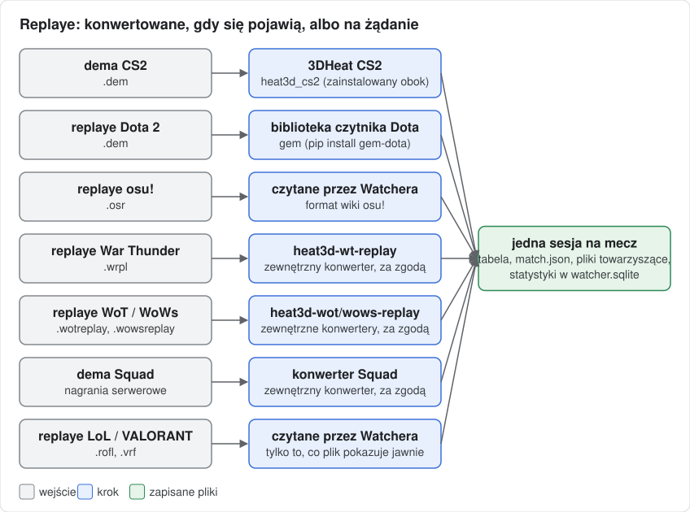

# Instalacja i uruchamianie {#installing-and-running}

## Wymagania {#requirements}

- **Windows.** Watcher jest pisany dla Windows i większość jego źródeł istnieje tylko tam: pamięć dzielona, którą tworzą gry (mapowania `Local\...`), rejestr (gdzie jest Steam), powiadomienia Windows, lista procesów ze ścieżkami plików wykonywalnych. Na innym systemie program się uruchomi, ale te źródła niczego nie znajdą, powiadomienia są tylko zapisywane w dzienniku, a odczyt pamięci odmawia („only implemented on Windows”).
- **Python 3.10 lub nowszy**, z <https://www.python.org/downloads/>: w instalatorze zaznacz **Add python.exe to PATH**, potem sprawdź `python --version` w nowym terminalu. Nowicjusz? Najpierw przeczytaj [Zanim zaczniesz](before-you-start.md).
- **Pakiety** (`requirements.txt`): `psutil>=6.0` (które gry działają, który program trzyma port, połączenia gry; starszy psutil też działa, przez starszą nazwę połączeń procesu), `pyarrow>=15` (zapis `heat.parquet`), `numpy>=1.24` i `pytest>=8.0` do testów. `requirements-optional.txt` nie wymienia obecnie żadnych pakietów.

Bez `pyarrow` sesje są nadal nagrywane: `events.jsonl` jest zapisem, a tabelę można zbudować później poleceniem [`table`](commands.md#table).

### Dodatki, których potrzebują niektóre gry {#extras-some-games-need}

| Gra | Czego potrzebuje |
|---|---|
| Counter-Strike 2 – dema | [3DHeat CS2](https://github.com/Holdi601/3DHeat-CS2) i jego wymagania (`demoparser2`). Watcher szuka go w `HEAT3D_CS2`, potem w folderze `3DHeat-CS2` albo `cs2` obok folderu watchera, a potem wszędzie, skąd Python potrafi zaimportować `heat3d_cs2`. Bez niego `games` wypisuje adapter jako niedostępny. |
| Microsoft Flight Simulator 2020 / 2024 | `SimConnect.dll` – nie jest dołączony. MSFS 2020 ma go w swoim folderze instalacji; dla MSFS 2024 zainstaluj SDK MSFS 2024. `MSFS_SDK` / `MSFS2024_SDK` wskazują folder SDK. |
| Euro Truck Simulator 2, American Truck Simulator | wtyczka RenCloud `scs-telemetry.dll` (wersja 12) w `<game>\bin\win_x64\plugins` |
| BeamNG.drive | mod protokołu `heat3d`, instalowany przez `python -m heat3d_watch setup beamng --apply` |
| League of Legends (na żywo) | opcjonalnie: główny certyfikat Riot jako `<data>\riotgames.pem`, żeby połączenie lokalne było weryfikowane |
| Minecraft | folder `%APPDATA%\.minecraft` (wydanie Java) |

Strona każdej gry w [Gry](games.md) mówi, co trzeba włączyć w samej grze. `python -m heat3d_watch games` oznacza adapter jako `[unavailable: ...]`, gdy na tym komputerze brakuje czegoś, czego potrzebuje.

## Instalacja {#installing}

Nowicjusz w wierszu poleceń? Najpierw przeczytaj [Zanim zaczniesz](before-you-start.md). Jeśli `pip` nie zostanie znalezione, użyj zamiast tego `python -m pip install -r requirements.txt`.

Z klonu:

```bash
git clone https://github.com/Holdi601/3DHeat-Watcher.git
cd 3DHeat-Watcher
pip install -r requirements.txt
```

Z wydania: pobierz archiwum z wydań repozytorium, rozpakuj je, a potem w tym folderze uruchom `pip install -r requirements.txt`. Obie wersje aktualizują się same (zob. [Aktualizacje](updates.md)).

Uruchamiaj każde polecenie z folderu repozytorium: `python -m heat3d_watch` importuje pakiet stamtąd, a aktualizator (`heat3d_update`) stoi obok.

## Uruchamianie {#running}

```bash
python -m heat3d_watch run        # watch until stopped
python -m heat3d_watch run -v     # the same, with debug lines in the log
python -m heat3d_watch run --once # one look at the games running now, then stop and exit
```

Po starcie `run`:

1. zapisuje [plik blokady](#the-lock-file);
2. kończy sesje, które zostawił wcześniejszy przebieg, na przykład po awarii (zob. [Odzyskiwanie](the-data.md#recovery-after-a-crash));
3. co `scan_seconds` (2 s) czyta listę procesów (tylko nazwy i ścieżki, żaden proces nie jest otwierany) i dla każdej znalezionej gry uruchamia adapter we własnym wątku. Gdy proces gry znika, jego adapter jest zatrzymywany, a sesje, które miał otwarte, są zamykane, co zapisuje ich tabelę i wiersz w statystykach. Adaptery, które nie czekają na grę (statystyki Steam, Steam Timeline, najlepsze momenty NVIDIA, foldery powtórek), działają cały czas;
4. gdy żadna gra nie działa, sprawdza najwyżej raz na godzinę, czy jest nowsze wydanie (sama odpowiedź jest zapamiętywana na sześć godzin), a przy włączonym `auto_update` instaluje je i uruchamia się ponownie (zob. [Aktualizacje](updates.md)).

Adapter, który zawiedzie, jest zapisywany w dzienniku i nie zatrzymuje pozostałych. Jeśli odpytanie adaptera zawiedzie 20 razy z rzędu albo jego start się nie uda, adapter jest zatrzymywany i nie uruchamia się ponownie, aż gra zostanie uruchomiona od nowa (nowe id procesu).

Zatrzymaj watchera Ctrl+C. Adaptery zamykają swoje sesje, zanim program się skończy. Jeśli watcher zostanie ubity zamiast tego (Menedżer zadań, awaria, zanik zasilania), nic, co już zostało zapisane, nie przepada: następny `run` kończy te sesje.

`--once` robi jedno sprawdzenie: uruchamia adaptery dla gier działających w tej chwili (i tych działających zawsze), pozwala każdemu odpytać raz – czekając na to najwyżej 10 sekund – a potem zatrzymuje je tak, jak zrobiłby koniec gry, więc sesje, które otworzyły, są zamykane, ich tabele zapisywane, a wiersze liczone w statystykach, zanim program się skończy. Służy do sprawdzenia, czy gra jest wykrywana, a nie do nagrywania.

### Powtórki już zapisane na dysku {#replays-already-on-disk}



Gdy adapter powtórek po raz pierwszy zobaczy jeden ze swoich folderów, tylko zauważa powtórki, które już w nim są: gracz z latami dem spędziłby dzień na konwersji. Od tej pory każda nowa powtórka jest konwertowana raz, gdy gra skończy ją zapisywać. Stare konwertuje się na żądanie poleceniem [`replays`](commands.md#replays):

```bash
python -m heat3d_watch replays cs2-demos              # every demo in CS2's folders and replay_folders
python -m heat3d_watch replays osu-replays D:\Old     # the replays in one folder
```

### Działanie w tle {#running-in-the-background}

Watcher nie ma własnego okna; to program konsolowy, który działa, dopóki się go nie zatrzyma. Wszystko zapisuje do `watcher.log`, więc nie potrzebuje widocznej konsoli. Sposoby, by nie przeszkadzał:

- uruchom go w konsoli i zminimalizuj ją: `start "" /min python -m heat3d_watch run` z `cmd`, w folderze repozytorium;
- uruchom go bez konsoli: `pythonw -m heat3d_watch run`. Wyjście konsoli przepada, ale `watcher.log` nadal jest zapisywany. Aby go zatrzymać, zakończ proces `pythonw.exe`; kolejny start zakończy sesje, które zostawił. Projekt nie testował tego sposobu uruchamiania.

### Start razem z Windows (pomysł) {#starting-with-windows-an-idea}

Watcher nie instaluje się sam do startu z Windows. Aby uruchamiał się automatycznie:

- **Harmonogram zadań**: utwórz zadanie z wyzwalaczem *Przy logowaniu* i akcją *Uruchom program*, program `pythonw.exe` (albo `python.exe`), argumenty `-m heat3d_watch run`, *Rozpocznij w* ustawione na folder repozytorium;
- **Folder Autostart**: umieść skrót w `shell:startup` z tym samym programem, argumentami i folderem *Rozpocznij w*.

Żadna z tych metod nie jest częścią watchera ani przez niego nie testowana. [Plik blokady](#the-lock-file) pilnuje, by druga kopia uruchomiona przez pomyłkę od razu się zakończyła.

## Plik blokady {#the-lock-file}

`<data>\watcher.lock` przechowuje id procesu działającego watchera. Gdy `run` startuje, a plik blokady wskazuje proces, który nadal istnieje i którego nazwa zawiera `python`, wypisuje

```text
A watcher is already running (process 12345) for C:\Users\...\3DHeat\Watcher.
```

i kończy się kodem 1. Dwa watchery na jednym folderze danych nagrywałyby każdą grę dwa razy, a drugi uznałby otwarte sesje pierwszego za pozostałości po awarii. Plik blokady, którego proces już nie istnieje albo należy do innego programu, jest nadpisywany. Gdy `run` się kończy, usuwa plik blokady, jeśli wciąż wskazuje na jego własny proces.

## Dziennik {#the-log}

`<data>\watcher.log` zapisuje tylko `run`; pozostałe polecenia wypisują na konsolę. Każda linia ma czas, poziom i komunikat:

```text
2026-05-01 20:15:01,123 INFO watching; data in C:\Users\...\AppData\Local\3DHeat\Watcher
2026-05-01 20:15:03,456 INFO f1-25: starting (EA SPORTS F1 25)
2026-05-01 21:02:11,789 INFO f1-25: stopping
```

Adaptery zapisują, czego nie mogą zrobić i dlaczego: „UDP 20777 is in use by ...; not taking it from that program”, „not reading memory: the game is played online”, „could not start”, „poll failed (3)” z pełnym śladem. `run -v` dodaje linie debugowania. Plik jest dopisywany i watcher nigdy go nie rotuje ani nie czyści; usuń go, kiedy chcesz. Te same linie trafiają też na konsolę.

## Gdzie co jest {#where-everything-is}

Folder domowy to `%LOCALAPPDATA%\3DHeat\Watcher`, albo `HEAT3D_WATCH_HOME`, gdy jest ustawione (bez `LOCALAPPDATA`, na przykład na innym systemie, `~/.local/share/3DHeat/Watcher`). `settings.json` zawsze jest w folderze domowym. Wszystko inne trafia do folderu danych, czyli do folderu domowego, chyba że ustawienie `data` wskazuje inny:

| Ścieżka | Co to jest |
|---|---|
| `<home>\settings.json` | ustawienia |
| `<data>\sessions\` | nagrania, po jednym folderze na sesję ([Dane](the-data.md)) |
| `<data>\watcher.sqlite` | baza statystyk |
| `<data>\watcher.log` | dziennik `run` |
| `<data>\watcher.lock` | plik blokady, podczas działania `run` |
| `<data>\state\` | to, co adaptery działające zawsze i adaptery powtórek już widziały (`steam-stats.json`, `replays-cs2-demos.json`, ...), dzięki czemu ponowny start niczego nie nagrywa dwa razy |
| `<data>\profiles\*.json` | profile pamięci, które napisałeś ([Odczyt pamięci](memory-reading.md)) |
| `<data>\riotgames.pem` | opcjonalnie: główny certyfikat Riot dla adaptera League of Legends na żywo |
| `%LOCALAPPDATA%\3DHeat\update-check-3DHeat-Watcher.json` | zapamiętana odpowiedź ostatniego sprawdzenia wydania |

Watcher niczego nie usuwa w tych folderach, poza folderem sesji, w którym nic nie zostało nagrane (gra stała w menu).

## Ustawienia {#settings}


`python -m heat3d_watch config` pokazuje ustawienia; `config --set key=value ...` zmienia je i zapisuje `settings.json` (zob. [config](commands.md#config)). Plik to zwykły JSON i można go też edytować ręcznie, gdy watcher nie działa. Nieznane klucze w nim są ignorowane. Ustawienia są czytane przy starcie polecenia, więc po zmianie uruchom `run` ponownie.

| Ustawienie | Domyślnie | Co robi |
|---|---|---|
| `data` | `""` | Folder danych. Pusto: folder domowy. |
| `disabled` | `[]` | Id adapterów, które nigdy nie działają, na przykład `config --set disabled=steam-stats,nvidia-highlights`. Każdy inny adapter działa, gdy znajdzie swoją grę. |
| `auto_update` | `true` | Gdy żadna gra nie działa, instaluje nowsze wydanie i uruchamia się ponownie (zob. [Aktualizacje](updates.md)). `false`: tylko komunikat w dzienniku. |
| `scan_seconds` | `2.0` | Sekundy między sprawdzeniami listy procesów. |
| `memory` | `false` | Zezwala na działanie adapterów pamięci (gry jednoosobowe z profilem, który napisałeś). Domyślnie wyłączone; zob. [Odczyt pamięci](memory-reading.md). |
| `replays` | `true` | Uruchamia adaptery `replay`: wszystkie (zob. `python -m heat3d_watch replays` i [Gry](games.md)) – dema CS2, Dota 2, osu!, War Thunder, World of Tanks, World of Warships, Squad, powtórki League of Legends i VALORANT, nagrania Tacview IL-2. |
| `replay_folders` | `{}` | Dodatkowe foldery według id adaptera, na przykład `{"cs2-demos": ["D:\\Demos"]}`. Adaptery powtórek obserwują je oprócz folderów gry; `il2-tacview` przyjmuje też foldery instalacji (wtedy szuka w ich `data\Tracks`); dla `elite` pierwszy folder zastępuje folder dziennika. Ustaw foldery jednego adaptera poleceniem `config --set replay_folders.cs2-demos=D:\Demos,E:\More` albo cały słownik jako JSON. |
| `riot_id` | `""` | Twój Riot ID (`Name#TAG`), żeby twoja linia w powtórce League of Legends stała się twoją statystyką. Pusto: linia każdego gracza jest zachowywana, żadna nie jest oznaczona jako twoja. |
| `riot_api_key` | `""` | Twój własny klucz programisty Riot, by pobrać oficjalną oś czasu każdego odtworzonego meczu League (pozycje co minutę, zabójstwa tam, gdzie się wydarzyły). Pusto: nic nie jest pobierane. |
| `riot_platform` | `"EUW1"` | Identyfikator platformy twojego serwera League (`EUW1`, `EUN1`, `NA1`, `KR`, ...), używany do znalezienia regionalnego hosta Match-V5. |
| `player_names` | `{}` | Twoja nazwa w grach, których interfejs nazywa każdego gracza, ale nie mówi, który jesteś ty, według id adaptera: `warthunder-webmap` (linie kill feedu o tobie stają się twoimi zabójstwami i śmierciami) oraz `rocketleague-stats` (twoje wiersze stają się `me`; bez tego – gracz, którego śledzi kamera gry). Ustaw poleceniem `config --set player_names.warthunder-webmap=Name`. |

`settings.json` ze wszystkimi wartościami domyślnymi:

```json
{
  "data": "",
  "disabled": [],
  "auto_update": true,
  "scan_seconds": 2.0,
  "memory": false,
  "replays": true,
  "replay_folders": {},
  "riot_id": "",
  "riot_api_key": "",
  "riot_platform": "EUW1",
  "player_names": {}
}
```

## Zmienne środowiskowe {#environment-variables}

| Zmienna | Działanie |
|---|---|
| `HEAT3D_WATCH_HOME` | folder domowy (ustawienia i dane, chyba że `data` mówi inaczej) |
| `HEAT3D_NO_UPDATE` | każda wartość inna niż pusta, `0`, `false` lub `no` wyłącza sprawdzanie wydań i automatyczną aktualizację |
| `HEAT3D_NO_TOAST` | każda niepusta wartość: bez powiadomień Windows, tylko wiersze dziennika |
| `HEAT3D_CS2` | folder 3DHeat CS2, dla dem CS2 |
| `HEAT3D_CS2_GSI_PORT` | port stanu gry CS2 (domyślnie 3311); z niego korzysta plik cfg zapisywany przez `setup` |
| `HEAT3D_DOTA_GSI_PORT` | port stanu gry Dota 2 (domyślnie 3312) |
| `MSFS_SDK`, `MSFS2024_SDK` | foldery SDK MSFS, w których szuka się `SimConnect SDK\lib\SimConnect.dll` |

Powiadomienia Windows służą tylko do aktualizacji: „Updating to 1.2.0” albo „1.2.0 is out; not updated: ...” gdy aktualizacji nie dało się zastosować. Są wyświetlane przez własne API powiadomień PowerShell, więc nic nie trzeba instalować. Tytuł i tekst są przekazywane do PowerShell jako zmienne środowiskowe, nigdy jako część skryptu.
