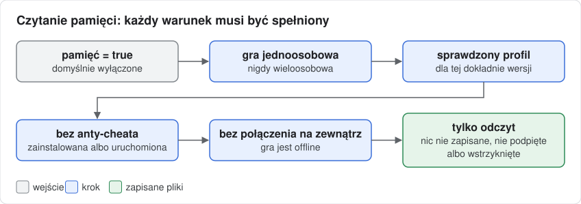

# Odczyt pamięci {#reading-memory}

Niektóre gry jednoosobowe nie mówią nic innym programom. Dla nich watcher może – jeśli to włączysz i sam napiszesz profil – sprawdzić, gdzie jesteś w pamięci gry, tylko do odczytu.

W grach jednoosobowych, które niczego nie publikują, watcher może odczytywać pozycje i wartości z pamięci gry, przez **profil**, który piszesz dla własnej wersji gry. Spośród wszystkich źródeł to jedyne, którego gra nie udostępniła sama, dlatego jest ono ogrodzone bardziej niż pozostałe:

- jest **domyślnie wyłączone** (`python -m heat3d_watch config --set memory=true` je włącza);
- czyta i nie ma żadnej możliwości zapisu;
- **żadne profile nie są dołączone do narzędzi.**

Profile nie są dołączane, bo offset jest prawidłowy tylko dla wersji gry, na której go znaleziono. Po łatce profil, który był dobry wcześniej, czyta śmieci, a śmieci wyglądają dokładnie jak liczby. Profil trzeba sprawdzić na wersji, którą ma gracz, przez tego gracza.

## Sprawdzenia, po kolei {#the-checks-in-order}



Każde poniższe sprawdzenie musi przejść. Pierwsze cztery są wykonywane **przed** otwarciem gry, ponieważ otwarcie chronionej gry do odczytu to dokładnie to, co wykrywa anty-cheat, a odmowa po fakcie byłaby za późno.

1. **Ustawienie**: `memory` ma wartość true. Inaczej adaptery pamięci nigdy nie startują.
2. **Profil dla gry**, którego `exe` nazywa działający proces. Profil mówi, czy gra da się w ogóle grać online (`"online"`); profil, który tego nie podaje, zostaje odrzucony.
3. **Brak anty-cheatu w pobliżu**:
   - brak pliku anty-cheatu w folderze gry lub do trzech folderów wyżej (zatrzymując się przy folderze `common` biblioteki Steam albo przy folderze zawierającym `steamapps`, bo wyżej są inne gry): `EasyAntiCheat`, `EasyAntiCheat_EOS_Setup.exe`, `start_protected_game.exe`, `BattlEye`, `BEClient_x64.dll`, `BEService_x64.exe`, `EAAntiCheat.GameServiceLauncher.exe`, `AntiCheatExpert`, `SGuard64.exe`, `GameGuard`, `GameMon.des`, `XIGNCODE`, `xhunter1.sys`, `Vanguard`, `FACEIT` (porównywane małymi literami, także jako początek nazwy). Jeśli folder gry jest nieznany, gra jest odrzucana;
   - brak sterownika albo usługi anty-cheatu działającej na komputerze w ogóle, według `sc query type= driver state= active` i `sc query type= service state= active`: EasyAntiCheat, EasyAntiCheat_EOS, BEService, BEDaisy, vgk, vgc, ACE-BASE, ACE-GAME, xhunter1, FACEIT, FACEITService, EAAntiCheatService, Denuvo Anti-Cheat, npggsvc, Ricochet. Anty-cheat jądra zainstalowany dla innej gry nadal obserwuje każdy proces. Jeśli nie da się wylistować usług, gra jest odrzucana.
4. **Nie online**: gra, której profil mówi `"online": true`, jest czytana tylko wtedy, gdy nie ma połączenia z niczym poza tym komputerem (żaden zdalny adres inny niż `127.x`, `::1`). Jeśli jej połączeń nie da się odczytać, gra jest odrzucana.
5. Potem, w miarę startu adaptera:
   - **dokładna wersja**: rozmiar pliku wykonywalnego albo jego SHA-256 musi zgadzać się z wersją, którą wymienia profil. Nieznana wersja nie jest czytana;
   - **moduły jeszcze raz**: załadowane moduły gry są wylistowane (migawka Toolhelp, która nie wymaga żadnych własnych praw dostępu) i sprawdzane pod kątem klienta anty-cheatu (`BEClient_x64.dll`, `BEClient.dll`, `EasyAntiCheat_x64.dll`, `EasyAntiCheat.dll`, `EOSAntiCheat...`). Chroniony proces odmawia migawki, co też jest odmową;
   - dopiero wtedy proces jest otwierany, z `PROCESS_VM_READ | PROCESS_QUERY_LIMITED_INFORMATION` i niczym więcej.

Sprawdzenia 1 do 4 są powtarzane przy każdym skanowaniu (co 2 s), gdy gra działa. Jeśli któreś zacznie zawodzić (gra łączy się z serwerem, startuje usługa anty-cheatu), adapter jest zatrzymywany przy następnym skanowaniu. Odmowa jest zapisywana w dzienniku: `mem-<id>: not reading memory: <reason>`. Błąd podczas startu (nieznana wersja, moduł anty-cheatu, nie znaleziono wzorca) jest zapisywany jako `mem-<id>: could not start`, a adapter nie jest próbowany ponownie, aż gra zostanie uruchomiona od nowa.

Nie ma zapisu, alokacji w drugim procesie, wątku uruchomionego w nim, biblioteki załadowanej do niego, uprawnienia debugowania ani podniesienia uprawnień. Test (`test_memory_reading_cannot_write` w `tests/test_core.py`) nie przechodzi, jeśli gdziekolwiek w pakiecie pojawi się wywołanie, które zapisuje do innego procesu, alokuje w nim albo uruchamia w nim kod – `WriteProcessMemory`, `VirtualAllocEx`, `CreateRemoteThread`, `PROCESS_VM_WRITE`, `SeDebugPrivilege`, `LoadLibrary`, ...

Nigdy nie czytaj, cokolwiek mówi profil: gier granych online oraz gier, których tryb jednoosobowy działa pod anty-cheatem, na przykład GTA V albo Elden Ring uruchamianego przez launcher. Sprawdzenia powyżej odrzucają je tak czy inaczej.

## Format profilu {#the-profile-format}

Profil to plik JSON w `<data>\profiles\` (`<data>` to folder danych, zob. [Instalacja i uruchamianie](installing-and-running.md#where-everything-is)), jeden na grę, o dowolnej nazwie kończącej się na `.json`. Przykład syntetyczny:

```json
{
  "schema": "heat3d.memprofile/1",
  "id": "mygame",
  "game": "My Game",
  "exe": "MyGame.exe",
  "online": false,
  "versions": [ { "label": "1.06", "size": 123456789 } ],
  "anchors": {
    "World": { "aob": "48 8B 05 ?? ?? ?? ?? 48 85 C0", "rip": [3, 7] }
  },
  "values": {
    "pos": { "type": "vec3f", "base": "World", "chain": ["0x10", "0x68", "0x70"] },
    "hp":  { "type": "i32",   "base": "World", "chain": ["0x10", "0x138"] },
    "map": { "type": "u32",   "base": "World", "chain": ["0x10", "0x1C0"] }
  },
  "events": [
    { "event": "death", "value": "hp",  "when": "to_zero" },
    { "event": "zone",  "value": "map", "when": "change" }
  ],
  "axes": { "up": "y", "units": "metres" },
  "rate": 10,
  "provenance": [ { "source": "https://example.com/my-notes", "verified_on": "1.06" } ]
}
```

| Klucz | Wymagany | Co to jest |
|---|---|---|
| `schema` | tak | dokładnie `heat3d.memprofile/1` |
| `id` | tak | krótkie i stałe; adapter nazywa się `mem-<id>` |
| `game` | tak | nazwa gry, od której nazwany jest folder sesji |
| `exe` | tak | nazwa pliku wykonywalnego, która też mówi, że gra działa |
| `online` | tak | `true`, jeśli gra da się w ogóle grać online; wtedy jest czytana tylko offline |
| `versions` | tak | wersje, na których sprawdzono profil: każda z `label`, i `size` (rozmiar pliku wykonywalnego w bajtach) i/lub `sha256`. Gdy podano oba, muszą się zgadzać. Wpis bez żadnego z nich nie pasuje do niczego. |
| `anchors` | tak | nazwane adresy w module głównym. `aob`: wzorzec bajtów, bajty szesnastkowe oddzielone spacjami, `?` albo `??` oznacza dowolny bajt; musi wystąpić **dokładnie raz** w obrazie modułu (kilka trafień liczy się jako błąd, tak samo jak brak). `rip: [d, n]`: wzorzec wskazuje na instrukcję z 32-bitowym przesunięciem względnym RIP na bajcie `d` o długości `n`; kotwica staje się adresem, do którego ta instrukcja się odwołuje. `offset`: dodawany potem (tekst szesnastkowy albo dziesiętny). Zamiast `aob` można podać `module_offset` – stały offset od bazy modułu. |
| `values` | tak | co jest czytane przy każdym odpytaniu: `type` (`i32`, `u32`, `i64`, `u64`, `u8`, `f32`, `f64`, `vec3f`, `vec3d`), `base` (nazwa kotwicy), `chain` (offsety jako tekst szesnastkowy albo dziesiętny) |
| `events` | nie | reguły, które zamieniają zmiany w zdarzenia: `when` `change` (wartość różni się od ostatniego odpytania) albo `to_zero` (liczba spada z wartości powyżej 0 do 0 lub niżej) |
| `axes` | nie | `up` (domyślnie `y`), `units` (domyślnie `game units`), `scale` (skala jednostek przeglądarki, mnożąca każdą pozycję; domyślnie 1, czyli jednostki gry) |
| `rate` | nie | odpytania na sekundę, od 1 do 60 (domyślnie 10) |
| `provenance` | nie | skąd pochodzą offsety i na jakiej wersji je sprawdzono; jest kopiowane do `meta.json` każdej sesji |

**Jak czyta się wartość.** Adres kotwicy jest punktem startu. Jeśli `chain` jest pusty, wartość czyta się od razu w tym miejscu. Inaczej najpierw czyta się wskaźnik zapisany pod kotwicą. Potem, dla każdego offsetu oprócz ostatniego, czyta się wskaźnik pod `adres + offset`. Ostatni offset jest dodawany, by otrzymać adres wartości. Pusty wskaźnik po drodze (gra jest między poziomami albo w menu) zostawia wartość pustą w tym odpytaniu.

**Co się zapisuje.** Wartość o nazwie `pos` (`vec3f` albo `vec3d`) staje się wierszem `position` gracza `me` przy każdym odpytaniu. Każda reguła zdarzenia zapisuje swój wiersz `event` z nową wartością i, gdy znana jest `pos`, pozycją, oraz dodaje 1 do statystyki o tej samej nazwie. Obraz modułu jest czytany raz, przy starcie, w poszukiwaniu kotwic, w blokach po 64 KiB; bloki, których nie da się odczytać, liczą się jako zera. `meta.json` sesji podaje nazwę profilu, etykietę wersji i `provenance`.

Profil, którego nie da się użyć (zły JSON, zły `schema`, brak wymaganego klucza), jest pomijany i zapisywany jako `profile <file> not used: <reason>`. Profile są wczytywane przy starcie watchera, więc po dodaniu albo zmianie jednego uruchom `run` ponownie.

## Pisanie i sprawdzanie profilu {#writing-and-verifying-a-profile}

1. **Tylko dla gry jednoosobowej bez anty-cheatu.** Jeśli gra ma anty-cheat albo grasz w nią online, zatrzymaj się tutaj: watcher ją odrzuci i powinien.
2. **Znajdź wartości na własnej wersji.** Pracuj offline. Użyj własnych narzędzi debugowania albo opublikowanych notatek o grze, by znaleźć pozycję gracza i wartości, które cię interesują, oraz ścieżkę wskaźników do każdej z nich od stałego miejsca w pliku wykonywalnym. Wolej wzorzec bajtów (`aob`) niż stały `module_offset`: wzorzec wciąż znajdzie swoje miejsce, gdy kod trochę się przesunie.
3. **Spraw, by wzorzec był jednoznaczny.** Musi pasować dokładnie raz w module. Zamaskuj bajty, które się zmieniają (adresy, przesunięcia), i zostaw dość stałych bajtów wokół nich.
4. **Przypnij wersję.** Wpisz dokładny rozmiar pliku wykonywalnego do `versions`; `(Get-Item .\MyGame.exe).Length` w PowerShell go podaje, a `Get-FileHash .\MyGame.exe -Algorithm SHA256` – skrót. Po łatce profil po prostu przestaje być używany, aż sprawdzisz go ponownie i dopiszesz nową wersję.
5. **Podaj, czy gra idzie online** (`online`), uczciwie.
6. **Wypróbuj**: włącz odczyt (`config --set memory=true`), umieść plik w `<data>\profiles\` i sprawdź, czy `python -m heat3d_watch games` wymienia `mem-<id>`. Uruchom grę i `python -m heat3d_watch run -v`. W `watcher.log` szukaj `mem-<id>: starting` albo powodu odmowy lub nieudanego startu.
7. **Porównaj liczby z grą.** Idź w znane miejsce i spójrz na wiersze `position` w `events.jsonl` sesji. Czy poruszają się, gdy ty się poruszasz, o właściwą wartość, we właściwych osiach? Otwórz `heat.parquet` w przeglądarce i sprawdź, czy trasa zgadza się z tym, dokąd szedłeś. Wywołaj każde zdarzenie (stracić całe zdrowie, zmienić strefę) i sprawdź, czy pojawia się raz. Śmieci wyglądają jak liczby i tylko to porównanie pozwala je odróżnić.
8. **Zapisz, co sprawdziłeś** w `provenance`: źródło offsetów i wersję, na której je sprawdzono.

Tekst `verified` adaptera pamięci, tak jak wypisuje go `games`, zawsze brzmi „by the profile's author, for the builds it lists”. Watcher nie może wiedzieć nic więcej.
