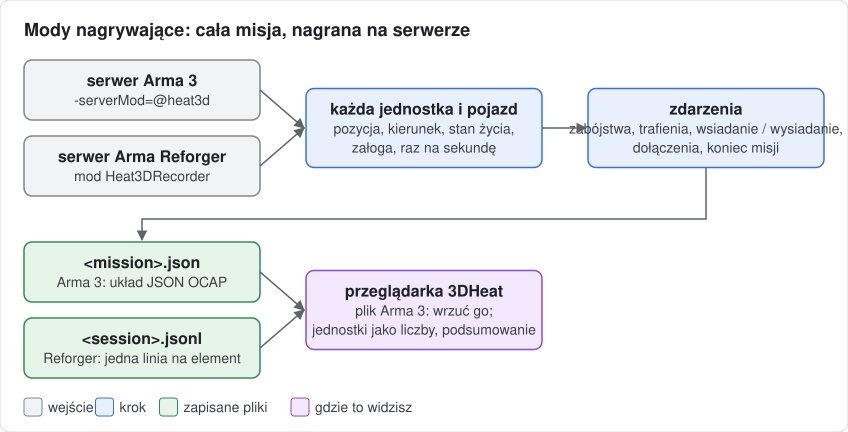

# Mody rejestratora na serwerze (Arma 3, Arma Reforger) {#server-recorder-mods-arma-3-arma-reforger}

Większość gier nagrywa watcher na komputerze gracza. Arma jest inna: serwer może nagrać całą misję – każdą jednostkę i pojazd, nie tylko twój – dzięki modowi działającemu na serwerze. Gracze nic nie konfigurują: mod Arma 3 działa tylko na serwerze, a Reforger sam pobiera mody serwera graczom, gdy do niego dołączają (mod na ich komputerach nic nie robi). Repozytorium zawiera dwa takie mody, w [`mods/arma3`](https://github.com/Holdi601/3DHeat-Watcher/tree/main/mods/arma3) i [`mods/reforger`](https://github.com/Holdi601/3DHeat-Watcher/tree/main/mods/reforger). Ich README to pełna dokumentacja; ta strona to przegląd.

**Status: oba są jeszcze nieprzetestowane w grze.** Rozszerzenie Arma 3 zostało zbudowane i uruchomione tak, jak Arma wywołuje rozszerzenia, a jego wynik odczytał 3DHeat; jego skrypty SQF nie działały jeszcze w Arma 3. Mod Reforger został napisany na podstawie opublikowanego przez Bohemię API skryptów i nigdy nie został skompilowany. Nie wystawiaj żadnego z nich na publicznym serwerze przed krokami testowymi z ich README.

## Arma 3 {#arma-3}

1. Zbuduj rozszerzenie raz na platformę (`mods/arma3/extension`). Potrzebny jest kompilator C: Visual Studio Build Tools w Windows, gcc w Linuksie; jeśli nigdy nic nie kompilowałeś, zapytaj hosta serwera.
   - Windows, w „x64 Native Tools Command Prompt for VS”:
     `cl /nologo /O2 /LD heat3d.c /Fe:heat3d_x64.dll`
   - Linux: `gcc -O2 -shared -fPIC -o heat3d_x64.so heat3d.c -ldl`
2. Zbuduj mod: `python mods/arma3/build.py` zapisuje `mods/arma3/@heat3d/` (bez Arma 3 Tools).
3. Skopiuj `@heat3d` do folderu serwera i uruchom serwer z `-serverMod=@heat3d`.
4. Log serwera `.rpt` pokazuje: `Heat3D recorder 0.1.0: recording <file> every 1 s`.

| Ustawienie | Domyślnie | Co robi |
|---|---|---|
| `captureDelay` | 1 | sekundy między klatkami |
| `recordHits` | 1 | 0 wyłącza zdarzenia trafień |
| `recordShots` | 1 | 0 wyłącza liczenie strzałów |
| `minPlayers` | 0 | nagrywa dopiero, gdy na serwerze jest tylu graczy |

Misja może nadpisać jedno z nich w swoim `init.sqf` (`heat3d_captureDelay = 0.5;`). Nagrania trafiają do `recordings/` w `@heat3d` albo do `HEAT3D_DIR`.

**Wynik:** jeden plik na misję w układzie JSON OCAP (formacie rejestratora OCAP2), nazwany `<date>__<time>_<mission>.json`. Podczas misji to dziennik (`.heat3d.part`), zapisywany przy każdym zapisie; dziennik misji, która się urwała, zostaje dokończony przy starcie następnej misji.

## Arma Reforger {#arma-reforger}

Mod (`Heat3DRecorder.gproj`) jest otwierany i budowany w Bohemia's Workbench (Arma Reforger Tools), testowany na lokalnym serwerze dedykowanym, publikowany z Workbencha (jako niepubliczny na czas testów) i dodawany do listy `mods` w `config.json` serwera – krok po kroku w jego README. Co sekundę zapisuje pozycję, kierunek, stan życia, pojazd i id gracza każdej postaci oraz pozycję, kierunek, stan i załogę każdego pojazdu; a także zabójstwa (zabójca, broń, odległość), trafienia, wsiadanie i wysiadanie, dołączanie i opuszczanie graczy oraz koniec misji.

**Wynik:** jeden obiekt JSON na linię, `$profile:heat3d/<data UTC>_<godzina UTC>_<świat>.jsonl`: linia `header` (format `heat3d-reforger`, osie x na wschód, y w górę, z na północ), potem linie `entity`, `frame` i `event` w miarę ich powstawania, i linia `end`. Wiersze jednostek to `[id, x, y, z, dir, alive, vehicleId, playerId]`, wiersze pojazdów `[id, x, y, z, dir, alive, [crew ids]]`; zdarzenia mają układ zdarzeń OCAP2.

## W przeglądarce {#in-the-viewer}

Upuść nagranie Arma 3 na [przeglądarkę 3DHeat](https://holdi601.github.io/3DHeat/): jedna misja to jedna sesja, jednostki stają się żołnierzami, pojazdy – swoim typem, a zabójstwa i trafienia trafiają na listę podsumowania. Odtwarzacz webowy OCAP2 też je odtworzy. Plik Reforgera to własny format linii moda z układem zdarzeń OCAP2.
