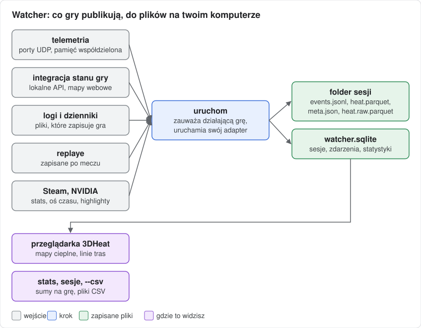

# Źródła i zasady {#sources-and-rules}

Watcher zapisuje tylko to, co gry i platformy przekazują graczowi. Ta strona wyjaśnia, jakie źródła to obejmuje, co watcher może robić z każdym z nich, i które gry albo części gier celowo pomija.

## Sześć rodzajów źródeł {#the-six-kinds-of-source}

Każdy adapter ma `kind` (rodzaj), a rodzaj decyduje, co adapter może robić:

| Rodzaj | Co to jest | Gry wieloosobowe |
|---|---|---|
| `telemetry` | port UDP albo pamięć współdzielona, które gra publikuje dla pulpitów, platform ruchu i kierownic (Forza Data Out, UDP F1, pamięć współdzielona Kunos i iRacing, SimConnect, interfejs UDP X-Plane, wtyczka SCS SDK) | tak - to własne wyjście gry |
| `gsi` | interfejs stanu gry albo lokalne API WWW, które gra udostępnia na komputerze gracza (Valve GSI, Live Client Data API League, Stats API Rocket League, mapa webowa War Thunder) | tak, w zakresie tego, co API pokazuje graczowi |
| `log` | pliki, które gra zapisuje w trakcie działania: dzienniki podróży, logi, statystyki, zapisy (Elite Dangerous, Minecraft, Path of Exile, Hearthstone, Star Citizen, EVE Online) | tak |
| `replay` | dema i powtórki, które gra zapisuje dla graczy, konwertowane po meczu (CS2, Dota 2, osu!, War Thunder, World of Tanks, World of Warships, Squad, League of Legends, VALORANT, IL-2 Tacview) | tak, chyba że zaszyfrowane, i tylko części jawne |
| `platform` | to, co przechowują Steam i sterownik karty graficznej: statystyki, osiągnięcia, osie czasu, klipy i highlighty | tak |
| `memory` | pamięć gry, tylko do odczytu, przez profil, który napisałeś | **nigdy** - tylko gry jednoosobowe |

Tylko `memory` otwiera inny proces, i tylko do odczytu. Pozostałe pięć rodzajów czyta to, co gra, Steam albo aplikacja NVIDIA App już zapisały albo wysyłają.

## Jak czytane są źródła {#how-the-sources-are-read}

- **Nic nie jest wstrzykiwane, podczepiane ani zmieniane w grze.** Do gry nie ładuje się żaden kod, nie podpina się żadnego okna ani wejścia, żaden plik gry nie jest łatany. Jedyne pliki, które watcher zapisuje poza swoim folderem danych, to te, które [`setup --apply`](commands.md#setup) zapisuje, gdy o to poprosisz: plik ustawień gry (z oryginałem zachowanym jako `<plik>.heat3d-backup`), plik cfg interfejsu stanu gry, skrypt haka DCS, mod protokołu BeamNG.
- **Pamięć współdzielona jest otwierana tylko do odczytu i nigdy nie jest tworzona.** Zwykły sposób otwierania nazwanego mapowania w Pythonie tworzy je, gdy nie istnieje. Gra uruchomiona później znalazłaby pusty, tylko do odczytu mapowanie watchera zamiast tworzyć własne, i jej telemetria byłaby martwa. Watcher otwiera mapowania tylko przez `OpenFileMappingW` (który znajduje tylko istniejące), mapuje je z `FILE_MAP_READ` i próbuje ponownie później, jeśli gra jeszcze ich nie utworzyła.
- **Porty są pożyczane, nigdy nie przejmowane.** Port UDP telemetrii, na którym już nasłuchuje inny program (FH Companion, SimHub, aplikacja pulpitu), zostaje przy tym programie. Jeśli inny program zacznie nasłuchiwać na porcie, który trzyma watcher, watcher go puszcza w ciągu kilku sekund. Adaptery Forzy czekają 15 s po starcie gry, zanim zajmą port 5300, i każdy pakiet przekazują bez zmian na 127.0.0.1:5301, więc druga aplikacja Data Out wciąż może nagrywać.
- **Tylko lokalnie.** Serwery interfejsu stanu gry, które uruchamia watcher (CS2, Dota 2), nasłuchują tylko na 127.0.0.1. Gdy plik cfg gry zawiera token (taki, jaki zapisuje `setup`), każdy post musi go mieć; posty bez niego są liczone jako `bad_auth` i odrzucane. Bez pliku cfg z tokenem każdy lokalny post jest przyjmowany, a dziennik to mówi. Lokalne API, z których korzysta watcher (League na porcie 2999, War Thunder na 8111, Rocket League na 49123, X-Plane na 49000), są na 127.0.0.1.
- **Pliki dziennika są współdzielone, nigdy nie blokowane.** Każdy odczyt otwiera plik z każdą flagą udostępniania, jaką ma Windows, i zamyka go ponownie, więc gra może dalej pisać, zmieniać nazwę albo podmieniać swój log.
- **Dwie zewnętrzne usługi, tylko w tych przypadkach.** Sprawdzanie wydań pyta GitHub (`api.github.com`) co najwyżej co sześć godzin i można je wyłączyć (zobacz [Aktualizacje](updates.md)). Adapter powtórek League pyta API Match-V5 Riot tylko wtedy, gdy wpisałeś własny `riot_api_key`. Nic innego nigdzie nie jest wysyłane.
- **Włączenie źródła to twoja decyzja.** `setup` bez `--apply` tylko mówi, co by zmienił.

## Zasady gry wieloosobowej {#multiplayer-rules}

- Gra grana online jest zapisywana tylko przez to, co publikuje: telemetrię, interfejsy stanu gry, logi, powtórki, pliki platformy. W ich ramach watcher zapisuje to, co gra pokazuje graczowi, i nic obliczonego ponad to:
  - **Interfejs stanu gry CS2** wysyła obserwowanego gracza (ciebie, gdy żyjesz, kolegę z drużyny po śmierci). Pozycje innych graczy (`allplayers_*`) są wysyłane tylko widzom i GOTV, więc watcher ich nie prosi.
  - **Live Client Data API League of Legends** nie ma pozycji. Polityka Riot pozwala narzędziom pokazywać to, co gracz może wiedzieć z samej gry, i nic obliczonego ponad to (bez timerów przeciwników). Watcher zapisuje kanał zabójstw i tablicę wyników, które widzi gracz, oraz jego własne liczby.
  - **Stats API Rocket League** nie ma pozycji samochodów (stan samochodu jest wysyłany tylko widzom). Miejsce mają piłka, miejsce jej uderzenia, zdobycia bramki lub trafienia w poprzeczkę.
  - **Mapa webowa War Thunder** pokazuje to, co pokazuje minimapa, bez nazw i id.
  - **F1 23/24/25** umieszczają pozycję każdego samochodu w pakiecie Motion, także online. Gra sama je wysyła i wstrzymuje tylko dane graczy, których „Your Telemetry” jest ograniczona.
  - **DCS World**: serwer wieloosobowy może zabronić eksportu danych własnego samolotu; sesja ma wtedy zdarzenia, ale bez pozycji, i to mówi.
- **Pamięć nigdy nie jest czytana w grze wieloosobowej.** Adapter `memory` dla gry oznaczonej jako grana online jest odrzucany, a profil musi mówić, czy jego gra może być w ogóle grana online. Gra jednoosobowa, która ma też tryb online, jest czytana tylko wtedy, gdy nie ma połączenia z niczym poza tym komputerem. Gry, których tryb jednoosobowy działa pod anty-cheatem, także nigdy nie są czytane. Zobacz [Czytanie pamięci](memory-reading.md).
- Flaga `multiplayer` adaptera (pokazywana jako „Gra online” przez `games --markdown`) decyduje tylko o czytaniu pamięci. Nie zatrzymuje innych rodzajów przed zapisywaniem gry online.

## Co jest odrzucane i dlaczego {#what-is-declined-and-why}

Niektóre gry i niektóre części gier nie są zapisywane: ich dane są chronione, nieopublikowane albo w ogóle nie ma ich na komputerze gracza:

| Gra | Co zostaje pominięte | Dlaczego |
|---|---|---|
| VALORANT | pozycje, nazwy, wyniki w powtórkach; punkty końcowe lockfile klienta | Strumień gry w powtórce jest zaciemniony wartościami wziętymi z pliku wykonywalnego każdej wersji. Gra działa pod Vanguard. Punkty końcowe lockfile klienta Riot nie są publicznym API. **Odczytywane:** to, co powtórka zawiera jawnie - mapa, id meczu, agenci, oś czasu zabójstw i rund podana przez serwer. |
| League of Legends | część `.rofl` dotycząca przebiegu meczu w czasie rzeczywistym; punkty końcowe lockfile klienta | Zaciemnione przeciwko oszustwom, inaczej przy każdej łatce, i niedekodowane. **Odczytywane:** tabela wyników z końca meczu, którą każda powtórka ma jako zwykły JSON, Live Client Data API podczas meczu, a - z własnym kluczem dewelopera - oficjalna oś czasu Match-V5 (pozycje raz na minutę, zabójstwa tam, gdzie się zdarzyły). |
| Fortnite | powtórki | Zaszyfrowane. |
| World of Tanks, World of Warships | powtórki, w watcherze | Zaszyfrowane. Watcher ich nie czyta; czytają je osobne konwertery poza nim (`exporters/ext/wot-replay`, `exporters/ext/wows-replay`), każdy jako osobny projekt. **Odczytywane, gdy zainstalowany jest konwerter:** pozycja każdego pojazdu albo okrętu, gdy klient nagrywający o nim wiedział, i zabójstwa. |
| Gran Turismo 7 | telemetria | Tylko konsole, a jej telemetria jest zaszyfrowana kluczem odzyskanym z gry. |
| Apex Legends | wszystko | Jego LiveAPI wysyła pełne zdarzenia tylko w prywatnych i niestandardowych lobby; poza tym nic nie jest dostępne lokalnie. |
| Overwatch 2, Call of Duty, Battlefield 6, Hunt: Showdown 1896 | dane na żywo | Brak lokalnej powtórki, logu ani wyjścia interfejsu stanu gry do odczytu. Ich statystyki trafiają tam, gdzie trzyma je Steam ([Statystyki Steam](game-steam-stats.md), [Oś czasu Steam](game-steam-timeline.md)), a klipy jako [NVIDIA highlights](nvidia-highlights.md). |
| Star Citizen | wszystko poza `Game.log` | Działa z Easy Anti-Cheat; watcher czyta tylko plik dziennika, który zapisuje gra, i nigdy nie zbliża się do procesu gry. |
| osu!lazer | powtórki | Przechowywane w osobnym magazynie gry; czytane są tylko pliki `.osr` osu! (wersja stabilna). |
| Każda gra wieloosobowa | pamięć | Nigdy. Gry jednoosobowe, których tryb działa pod anty-cheatem (GTA V, Elden Ring przez launcher), też nie są czytane. |

Zaszyfrowane powtórki nie są otwierane: czytnik VALORANT sprawdza flagę szyfrowania powtórki i odrzuca zaszyfrowany plik („this replay is encrypted; it is not read”).

Gry zbadane, ale jeszcze nie zrobione (Deadlock, pliki `.replay` Rocket League, StarCraft II, Team Fortress 2, Rainbow Six Siege, Beat Saber, Trackmania, kilka symulatorów wyścigów) są wymienione wraz z ich źródłami w [Wszystkie gry w jednej tabeli](watcher.md#researched-not-yet-built). Każda z nich potrzebuje przykładowych plików, na których można ją sprawdzić, zanim zostanie wydana.
