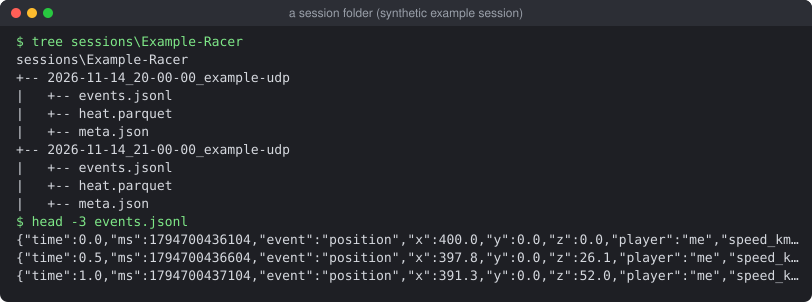

# Dane {#the-data}

Wszystkie nagrania to zwykłe pliki w folderze danych (`%LOCALAPPDATA%\3DHeat\Watcher`, chyba że to zmieniono, zob. [Instalacja i uruchamianie](installing-and-running.md#where-everything-is)). Możesz je czytać, kopiować albo usuwać bez watchera. Plik `.jsonl` to zwykły tekst, jedno zdarzenie w wierszu (otworzy go Notatnik); plik `.parquet` to tabela, którą otwiera przeglądarka 3DHeat (Excel tego nie otworzy – `stats --csv` zapisuje pliki CSV dla arkuszy kalkulacyjnych).

## Foldery sesji {#session-folders}



**Sesja** to jedno posiedzenie z jednym źródłem: od chwili, gdy gra po raz pierwszy coś powie, do chwili, gdy się zatrzyma (gra się zamknie, mecz się skończy, przejazd albo lot zostanie zresetowany – strona każdego adaptera mówi, co zaczyna i kończy jego sesje). Każda sesja dostaje folder:

```text
<data>\sessions\<game>\<YYYY-MM-DD_HH-MM-SS>_<adapter id>\
    events.jsonl
    heat.parquet
    meta.json
```

- `<game>` to nazwa gry, w której każdy znak inny niż litery, cyfry, `.`, `_` i `-` jest zamieniony na `-` (najwyżej 60 znaków): `EA-SPORTS-F1-25`, `Counter-Strike-2`. Adaptery obejmujące wiele gier (statystyki Steam, Steam Timeline, najlepsze momenty NVIDIA) zapisują każdą sesję pod grą, do której należy.
- Czas to początek sesji w czasie lokalnym. Sesje opisujące przeszłość (powtórka skonwertowana po meczu, plik statystyk Steam) używają czasu podanego przez grę albo plik. Dwie sesje zaczynające się w tej samej sekundzie dostają dopisek `_2`, `_3`, ...
- Id sesji w bazie statystyk to `<game folder>/<session folder>`.

Sesja, w której nic w ogóle nie zostało nagrane (gra stała w menu albo się wysypała przy starcie), jest usuwana po zamknięciu, żeby każdy start nie zostawiał pustego folderu.

Niektóre sesje mają więcej plików. Sesja dema Counter-Strike 2 zawiera własną tabelę i podsumowanie konwertera (`<map>/<match>.parquet`, `<match>.match.json`). Sesja iRacing wymienia pliki `.ibt`, które symulator zapisał podczas posiedzenia, jako zdarzenia `telemetry_file`.

## events.jsonl {#eventsjsonl}

`events.jsonl` ma jeden obiekt JSON w wierszu, jeden wiersz na zdarzenie, zapisywany w chwili, gdy zdarzenie się dzieje. Plik jest buforowany po wierszach, więc awaria, zanik zasilania albo zabity proces nie tracą niczego, co już zapisano; wiersz urwany przez awarię jest pomijany przy czytaniu pliku, a każdy wiersz przed nim zostaje.

Każdy wiersz ma te same kolumny podstawowe:

| Kolumna | Typ | Co to jest |
|---|---|---|
| `time` | liczba | sekundy od początku sesji (4 miejsca po przecinku) albo zegar gry, jeśli adapter go przekazuje |
| `ms` | liczba całkowita | czas zegarowy, milisekundy Unix |
| `event` | tekst | co się stało: `position`, `spawn`, `death`, `kill`, `lap`, `teleport`, `session_start`, ... |
| `x`, `y`, `z` | liczba | gdzie, w jednostkach i osiach gry (zob. `axes` w `meta.json`); obecne tylko wtedy, gdy wszystkie trzy są znane i skończone |
| `player` | tekst | kto: nazwa, id albo `me` dla osoby grającej (zob. [Wiersze gracza](#the-players-own-rows)) |
| `team` | tekst | jego strona, gdy gra to podaje |
| `session` | tekst | mecz, runda, etap, życie albo lot, do którego należy wiersz, gdy gra to podaje |

Każde inne pole zgłoszone przez grę idzie pod własną nazwą (`speed_kmh`, `gear`, `lap_time`, `weapon`, `victim`, `hero`, ...). Pola bez wartości są pomijane, tak samo liczby, które nie są skończone. Dwie linie syntetyczne:

```json
{"time":12.3456,"ms":1777660501123,"event":"position","x":-412.5,"y":12.1,"z":233.0,"player":"me","session":"1","speed_kmh":187.4,"gear":5}
{"time":15.0,"ms":1777660503667,"event":"lap","x":-380.2,"y":12.0,"z":250.9,"player":"me","session":"1","lap_time":92.418,"lap":3}
```

Wiersze bez pozycji (linia z kill feedu, awans, zmiana statystyki) zostają w `events.jsonl` i liczą się w statystykach. Do tabeli trafiają tylko wiersze z pozycją.

### Wiersze gracza {#the-players-own-rows}

To, które wiersze należą do osoby grającej, mówi źródło – nigdy się tego nie zgaduje. Wiersz jest wierszem gracza, gdy

- jego `player` to `me`: większość adapterów, których źródłem jest własna gra gracza (telemetria własnego samochodu lub samolotu, integracja stanu gry, dziennik);
- ma `own_car` równe 1: gry wyścigowe, które nagrywają każdy samochód pod nazwiskiem kierowcy (EA SPORTS F1 po indeksie samochodu gracza w grze, RaceRoom po własnym slocie, Automobilista 2 i Project CARS 2 po obserwowanym uczestniku), oznaczają w ten sposób samochód gracza i zachowują nazwę kierowcy w `player`;
- jego `player` to `player` sesji z `meta.json`: nazwa, którą źródło podaje dla gracza – dowódca z Elite Dangerous (dziennik zawsze należy do gracza) albo wiersz powtórki League of Legends z Riot ID z ustawień.

War Thunder i Rocket League nazywają każdego gracza i nie mówią, który jesteś ty; gdy wpiszesz swoją nazwę w ustawieniu `player_names` (zob. [Ustawienia](installing-and-running.md#settings)), twoje wiersze stają się `me`. [Najlepsze momenty NVIDIA](nvidia-highlights.md) szukają chwili właśnie w tych wierszach.

## heat.parquet {#heatparquet}

Gdy sesja się zamyka, wiersze `events.jsonl`, które mają `x`, `y` i `z`, zapisują się do `heat.parquet`. To tabela, którą otwiera przeglądarka 3DHeat. Jeśli sesja nie ma pozycji, tabela nie jest zapisywana.

- Kolumny to `time`, `ms`, `event`, `x`, `y`, `z`, `player`, `team`, `session`, a potem każde inne pole w kolejności, w jakiej pierwszy raz się pojawiło.
- `x`, `y`, `z` i `time` to liczby zmiennoprzecinkowe 64-bitowe, a `ms` to liczba całkowita 64-bitowa. Dalsza kolumna, której wszystkie wartości są liczbami, jest zmiennoprzecinkowa 64-bitowa; każda inna kolumna to tekst z kodowaniem słownikowym (brakujące wartości są pustym tekstem, a listy lub obiekty są zapisywane jako tekst JSON).
- Metadane pliku mają klucz `heat3d` z instrukcją czytania, dzięki czemu przeglądarka sama mapuje kolumny i osie (przykład, z listą `extra` skróconą):

```json
{
  "version": 1,
  "kind": "heat3d-watch",
  "game": "EA SPORTS F1 25",
  "axes": {"up": "y", "flipX": false, "flipY": false, "flipZ": false, "scale": 1.0},
  "columns": {
    "x": "x", "y": "y", "z": "z",
    "time": "time", "timeUnit": "seconds",
    "personId": "player", "teamId": "team", "sessionId": "session",
    "extra": ["event", "speed_kmh", "gear", "lap_time", "lap"]
  }
}
```

`up` to pionowa oś gry, `flipX`/`flipY`/`flipZ` odbijają oś, tak by świat leworęczny nie był rysowany lustrzanie, a `scale` to skala jednostek przeglądarki: przeglądarka mnoży każdą pozycję przez nią przy wczytywaniu tabeli (0.01 zamieniłoby centymetry w metry). Każdy adapter zapisuje 1 i zachowuje jednostki gry – metry dla większości, jednostki Source (cale) dla Counter-Strike 2, jednostki Unreal (centymetry) dla Rocket League – bo poziom wyeksportowany z gry jest w tych samych jednostkach, więc wiersze trafiają na niego. `units` w `meta.json` mówi, czym jest jedna jednostka. Każda strona gry wymienia swoje wartości w sekcji „Positions and axes”.

Symulatory lotu (DCS World, Microsoft Flight Simulator, X-Plane, nagrania Tacview IL-2) umieszczają swoje wiersze na Ziemi, a ich stopka mówi gdzie, dzięki czemu przeglądarka może położyć pod nimi prawdziwy świat:

```json
"geo": {"lat0": 42.0, "lon0": 42.0, "projection": "tangent-plane", "east": "x", "north": "z", "up": "y"}
```

`lat0`/`lon0` (stopnie) to początek mapy płaskiej, w której są wiersze; `east`, `north` i `up` nazywają kolumny z metrami na wschód i północ od niego oraz wysokością nad poziomem morza. Początkiem jest pierwszy namiar dla X-Plane i MSFS, punkt odniesienia nagrania dla IL-2 i stały początek teatru dla DCS (pierwszy namiar zaokrąglony do pełnych stopni na teatrze, którego watcher nie zna). Tabela bez miejsca na Ziemi nie ma klucza `geo`, a reszta stopki jest taka sama w obu przypadkach.

`heat.parquet` zawsze można odbudować z `events.jsonl` poleceniem `python -m heat3d_watch table <session folder>` (zob. [Polecenia](commands.md#table)). To przydatne, gdy `pyarrow` brakowało podczas nagrywania sesji.

## meta.json {#metajson}

`meta.json` podsumowuje sesję. Jest zapisywany, gdy sesja się otwiera, co najwyżej co 30 sekund, gdy napływają zdarzenia albo statystyki, i gdy sesja się zamyka. Statystyki są między tymi zapisami trzymane tylko w pamięci, więc awaria może stracić co najwyżej ostatnie pół minuty.

```json
{
  "format": "heat3d-watch-session",
  "version": 1,
  "watcher": "1.0.2",
  "game": "EA SPORTS F1 25",
  "adapter": "f1-25",
  "source": "UDP telemetry 127.0.0.1:20777 (...)",
  "multiplayer": true,
  "started": "2026-05-01T20:15:03",
  "ended": "2026-05-01T21:02:11",
  "seconds": 2828.0,
  "axes": {"up": "y", "flip_x": false, "flip_y": false, "flip_z": false, "scale": 1.0, "units": "metres"},
  "events": {"position": 52110, "lap": 412, "teleport": 3},
  "positions": 52530,
  "stats": {"laps": 20, "best_lap": 91.874, "distance_km": 106.3, "race_position": 4},
  "track": "..."
}
```

Sesja, której źródło wskazuje gracza (zob. [Wiersze gracza](#the-players-own-rows)), ma też `"player"`: nazwę, jaką noszą wiersze gracza. Sesja na Ziemi (symulatory lotu) ma też `"geo": {"lat0": .., "lon0": ..}`, który powtarza początek z `geo` w stopce.

- `started` / `ended`: czas lokalny co do sekundy; `ended` to `null`, dopóki sesja trwa.
- `events`: ile razy wystąpiło każde zdarzenie, od najczęstszego. `positions` to liczba wierszy z pozycją.
- `stats`: liczby sesji. Adapter ustawia każdą, dodaje do niej albo zachowuje największą lub najmniejszą wartość.
- Wszystko inne, co adapter wie o posiedzeniu, idzie na najwyższym poziomie: trasa, mapa, misja, id meczu, id aplikacji Steam, plik powtórki, profil pamięci i jego wersja. Sesja zakończona przez odzyskiwanie ma `"recovered": true`.

## watcher.sqlite {#watchersqlite}

`watcher.sqlite` to baza statystyk. Wiersz jest dodawany dla każdej sesji, gdy się zamyka. Trzy tabele są zwykłe, więc każde narzędzie SQL, notatnik albo arkusz może je czytać bez watchera:

```sql
CREATE TABLE sessions (
  id TEXT PRIMARY KEY,          -- <game folder>/<session folder>
  game TEXT NOT NULL,
  adapter TEXT NOT NULL,
  started REAL NOT NULL,        -- Unix seconds
  ended REAL,                   -- Unix seconds
  seconds REAL,
  folder TEXT NOT NULL,         -- the session folder's full path
  events INTEGER NOT NULL DEFAULT 0,
  positions INTEGER NOT NULL DEFAULT 0,
  multiplayer INTEGER NOT NULL DEFAULT 0,
  source TEXT
);
CREATE TABLE events (           -- per session, how many times each event happened
  session TEXT NOT NULL REFERENCES sessions(id) ON DELETE CASCADE,
  event TEXT NOT NULL,
  count INTEGER NOT NULL,
  PRIMARY KEY (session, event)
);
CREATE TABLE stats (            -- per session, every number the game reported or the watcher counted
  session TEXT NOT NULL REFERENCES sessions(id) ON DELETE CASCADE,
  key TEXT NOT NULL,
  value REAL,                   -- numbers
  text TEXT,                    -- everything else (a map name, a result, a hero)
  PRIMARY KEY (session, key)
);
```

Ponowne nagranie sesji (odzyskiwanie, ponowna konwersja powtórki) zastępuje jej wiersze. `multiplayer` to flaga adaptera (niektóre adaptery ustawiają ją dla każdej sesji, na przykład DCS na podstawie misji), a nie sprawdzenie, czy byłeś online. Wartość prawda/fałsz w `stats` jest zapisana jako tekst.

Przykładowe zapytanie, najlepsze okrążenie każdej gry we wszystkich sesjach (niższe jest lepsze):

```sql
SELECT s.game, MIN(t.value) AS best_lap
FROM stats t JOIN sessions s ON s.id = t.session
WHERE t.key = 'best_lap'
GROUP BY s.game;
```

`python -m heat3d_watch stats` wypisuje sumy z tych tabel (zob. [Polecenia](commands.md#stats)); jego kolumna `best` to najmniejsza wartość dla czasów zapisywanych jako najlepsze i dla miejsc, a największa dla reszty.

## Odzyskiwanie po awarii {#recovery-after-a-crash}

Gdy `run` startuje, szuka sesji, które zostawił otwarte wcześniejszy watcher: `meta.json` bez `ended` i `events.jsonl` z co najmniej jednym wierszem. Kończy każdą z nich:

- liczniki zdarzeń i liczba pozycji są liczone od nowa z `events.jsonl`, z pominięciem wiersza urwanego;
- koniec to czas zegarowy ostatniego wiersza (`ms`);
- statystyki są z ostatniego zapisu `meta.json` (najwyżej 30 sekund starych);
- dopisywane jest `"recovered": true`, zapisywany jest `heat.parquet`, a sesja trafia do `watcher.sqlite`.

Dziennik pisze „finished N session(s) left open by an earlier run”. Plik blokady nie pozwala drugiemu watcherowi „odzyskiwać” sesji działającego właśnie watchera.

## Eksport CSV {#csv-export}

```bash
python -m heat3d_watch stats --csv out
```

zapisuje `out\sessions.csv`, `out\events.csv` i `out\stats.csv`. Każdy plik to jedna tabela `watcher.sqlite`, kompletna, z wierszem nagłówka, w UTF-8. Czasy to sekundy Unix, jak w bazie. `--game` nie zawęża eksportu; zapisywane są wszystkie sesje.

## Otwieranie sesji w przeglądarce 3DHeat {#opening-a-session-in-the-3dheat-viewer}

Przeglądarka: [github.com/Holdi601/3DHeat](https://github.com/Holdi601/3DHeat), dokumentacja [holdi601.github.io/3DHeat](https://holdi601.github.io/3DHeat/) – jej strona [kontenera `.3dheat`](https://holdi601.github.io/3DHeat/container.html) opisuje format jednego pliku na mecz, który mogą zapisywać konwertery powtórek.

Otwórz `heat.parquet` sesji w przeglądarce 3DHeat. Stopka mówi przeglądarce, która kolumna to pozycja, czas, gracz, strona i sesja oraz w którą stronę jest góra, więc nic nie trzeba mapować ręcznie. Pozycje są we własnych współrzędnych świata gry. Narysowane na poziomie wyeksportowanym innymi narzędziami 3DHeat (na przykład z [3DHeat GameFiles](https://github.com/Holdi601/3DHeat-GameFiles)) lądują tam, gdzie się wydarzyły.

- **Mapy cieplne** używają każdego wiersza z pozycją, filtrowanego po `event`, `player`, `team` lub `session` jak każda inna kolumna.
- **Linia ciepła** rysuje linię od każdego wiersza gracza do jego następnego, a w odtwarzaniu każdy gracz to punkt poruszający się po trasie, z ogonem za sobą. Panel Trasy przeglądarki wybiera, na podstawie kolumny `event`, które zdarzenia **zaczynają**, a które **kończą** trasę. Watcher zapisuje zdarzenia graniczne jako wiersze z pozycją, więc można je tam wybrać:
  - początki: `spawn`, `respawn`, `session_start`. Początek zamyka trasę, która była otwarta, bez rysowania linii do nowego miejsca.
  - końce: `death`, `finish`, `session_end` i `teleport`. Linia biegnie do samego wiersza końca, czyli miejsca, w którym gracz zginął, zatrzymał się albo został zabrany.

  Skok – miejsce osiągnięte bez dojechania tam – to dwa wiersze: `teleport` w miejscu **opuszczonym** i początek w miejscu **osiągniętym**, tuż po nim. Adaptery wyścigowe zapisują go zawsze, gdy samochód przemieścił się dalej, niż mógł przejechać (cofnięcie albo flashback, reset na drogę, powrót do boksu, szybka podróż), z `spawn` w miejscu przyjazdu (`respawn` dla resetu w BeamNG); wiersz `teleport` niesie przyjazd jako `to_x`, `to_y`, `to_z`, a dystans jako `metres`, a wiersz początku `after: "teleport"`. Adaptery ciężarówek robią to samo dla promu, pociągu albo wczytanego zapisu, a adaptery lotnicze – dla skoku, którego żaden samolot nie mógłby wykonać. Więc przy `teleport` wśród końców i `spawn` wśród początków – co przeglądarka sama proponuje – trasa kończy się tam, gdzie skok opuścił, a następna zaczyna się tam, gdzie dotarł, i żadna linia nie przecina mapy. Trasa nigdy nie biegnie przez zmianę kolumny `session`. Wiersz pozycji zapisywany jest kilka razy na sekundę (10 Hz dla większości telemetrii), co daje gładką linię.
- Kolumna `session` dzieli posiedzenie na rundy, etapy, życia albo ciała (Elite Dangerous trzyma w ten sposób osobno wiersze galaktyki i wiersze powierzchni każdej planety). Wybierz jedną w przeglądarce, by obejrzeć tylko tę część.

Co przeglądarka robi z wierszami – filtry, kolory, odtwarzanie – opisuje jej własna dokumentacja. Sesje dema Counter-Strike 2 otwiera się przez `<map>/<match>.parquet` i `<match>.match.json` konwertera, w zakładkach „Mapa cieplna” i „Mecz” przeglądarki. Pozycje iRacing pochodzą z plików `.ibt` wymienionych w sesji, które przeglądarka czyta sama.
