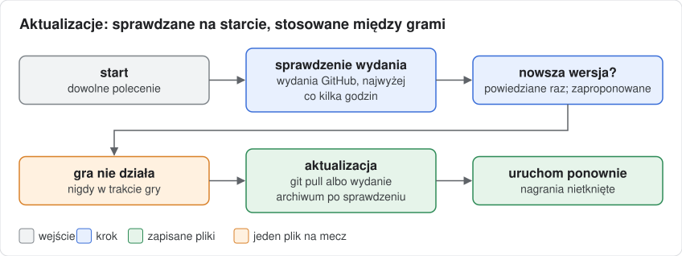

# Aktualizacje {#updates}

Watcher utrzymuje się w bieżącej wersji dzięki wydaniom z [Holdi601/3DHeat-Watcher](https://github.com/Holdi601/3DHeat-Watcher/releases). Aktualizator to pakiet `heat3d_update` obok `heat3d_watch` w repozytorium.

## Sprawdzanie {#the-check}

- **Kiedy**: każde polecenie poza `update` sprawdza przy starcie. `run` sprawdza też w trakcie działania, najwyżej raz na godzinę i tylko wtedy, gdy nie działa żadna gra.
- **Jak**: jedno żądanie HTTPS do `https://api.github.com/repos/Holdi601/3DHeat-Watcher/releases/latest` z limitem czasu 5 sekund. Odpowiedź jest zapamiętywana przez 6 godzin w `%LOCALAPPDATA%\3DHeat\update-check-3DHeat-Watcher.json`, więc większość startów o nic nie pyta. Odpowiedź „brak wydania” (HTTP 404) jest zapamiętywana jak każda inna. Bez sieci, przy limicie zapytań albo za proxy sprawdzenie cicho zawodzi, a polecenie działa dalej z wersją, którą ma.
- **Wersje**: zainstalowana wersja to plik `VERSION` w folderze repozytorium. Tag wydania (`v1.2.0` albo `1.2.0`) porównuje się jako liczby, część po części; wszystko po `-` lub `+` jest ignorowane.
- **Wyłączenie**: `HEAT3D_NO_UPDATE=1` (dowolna wartość inna niż pusta, `0`, `false` albo `no`) wyłącza zarówno sprawdzanie, jak i automatyczną aktualizację. Każde narzędzie 3DHeat ma własny plik pamięci podręcznej, więc odpowiedź jednego nigdy nie zastępuje odpowiedzi innego.

## Co się dzieje, gdy wyszło nowsze wydanie {#what-happens-when-a-newer-release-is-out}

- **`run`** wypisuje przy starcie ostrzeżenie i działa dalej: `[heat3d_watch] 3DHeat Watcher 1.2.0 is out (this is 1.0.2). <release page>` (czyli: wyszła wersja 1.2.0, a masz 1.0.2). Gdy działa, z włączonym `auto_update` (domyślnie) i bez żadnej gry, aktualizuje się sam: linia w logu `3DHeat Watcher 1.2.0 is out (this is 1.0.2); updating`, powiadomienie Windows „Updating to 1.2.0”, sama aktualizacja, zatrzymanie każdego adaptera i zamknięcie jego sesji, a potem ponowne uruchomienie tego samego polecenia na nowym kodzie. Watcher nigdy nie aktualizuje się w trakcie gry. Gdy aktualizacji nie da się zastosować, powiadomienie to mówi (`1.2.0 is out; not updated: ...`, czyli „1.2.0 wyszła; nie zaktualizowano: ...”), a watcher działa dalej na starej wersji. Przy wyłączonym `auto_update` jest tylko ostrzeżenie.
- **Inne polecenia** w terminalu pytają `Update now? [Y/n]` (czyli: zaktualizować teraz?). Enter, `y`, `yes`, `j` albo `ja` aktualizuje, a potem uruchamia to samo polecenie ponownie na nowej wersji. Bez terminala (zaplanowane uruchomienie, potok) wypisują, jak zaktualizować, i jadą dalej.
- **Na żądanie**: `python -m heat3d_watch update` (albo `python -m heat3d_update`) pyta GitHub bez pamięci podręcznej i aktualizuje. `--check` mówi tylko, czy wyszło nowsze wydanie. To działa nawet przy ustawionym `HEAT3D_NO_UPDATE`.

## Jak stosuje się aktualizację {#how-an-update-is-applied}

Zależy to od tego, jak kopia została zainstalowana:

- **Klon git** (folder ma `.git`, a `git` jest w PATH): `git pull --ff-only`. Jest to odrzucane, dopóki klon ma zmiany w śledzonych plikach (`git status --porcelain --untracked-files=no` nie jest pusty): to czyjaś praca, a aktualizacja nie decyduje, co się z nią stanie. Zapisz zmiany (commit) albo odłóż je (stash), a potem zrób pull.
- **Pobrana kopia**: archiwum źródłowe wydania jest pobierane i rozpakowywane do folderu tymczasowego. Wpisy wychodzące poza ten folder są pomijane. `VERSION` w archiwum musi być wersją, jaką deklaruje wydanie, inaczej nic nie jest kopiowane. Potem jego pliki są nadpisywane w folderze repozytorium. Pliki, które nie należą do wydania – nagrania, ustawienia, środowiska wirtualne, eksporty, wszystko, co sam zrobiłeś – nie są ruszane. Moduł Pythona, który miało starsze wydanie, a nowe już nie ma, jest usuwany z pakietów wydania (`heat3d_watch`, `heat3d_update`), więc żaden nieaktualny moduł adaptera nie wczyta się po aktualizacji; poza tymi pakietami nic nie jest usuwane.

Nagrania i ustawienia zwykle i tak leżą poza folderem repozytorium (`%LOCALAPPDATA%\3DHeat\Watcher`), więc aktualizacja nigdy się do nich nie zbliża.

Po aktualizacji to samo polecenie jest uruchamiane ponownie. W Windows watcher uruchamia nowy proces, czeka na niego i przekazuje dalej jego kod wyjścia, więc konsola zachowuje się tak, jakby pierwszy proces sam wykonał pracę.
