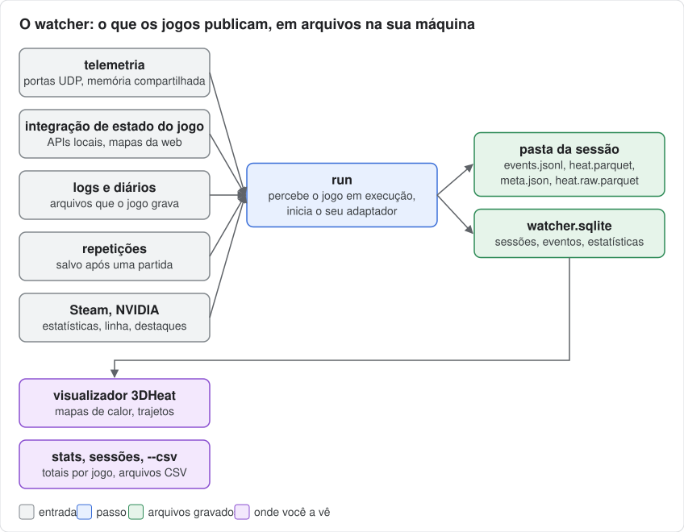
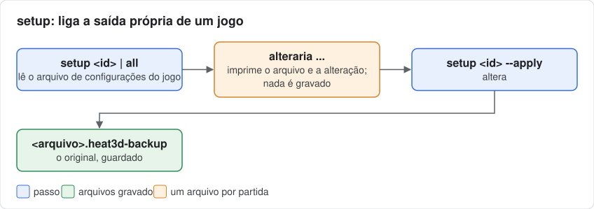
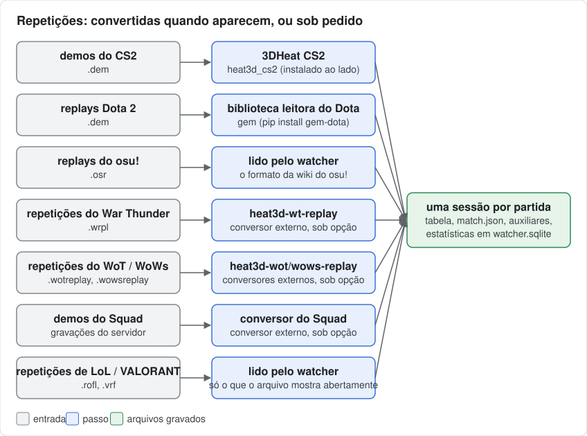
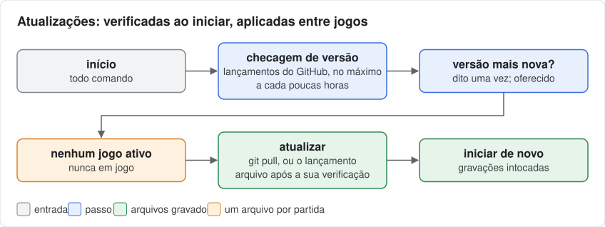

# Comandos {#commands}

A linha de comando é novidade? Leia primeiro [Antes de começar](before-you-start.md). Cada comando escreve-se
num terminal aberto na pasta onde se extraiu ou clonou o projeto (no Explorador de Ficheiros, escreva `powershell` na
barra de endereços), assim:

```bash
python -m heat3d_watch <comando> [opções]
```


| Comando | O que faz |
|---|---|
| [`run`](#run) | corre em segundo plano e regista cada jogo que for iniciado |
| [`games`](#games) | o que cada jogo fornece e de onde |
| [`setup`](#setup) | liga a saída de um jogo |
| [`status`](#status) | quais jogos estão a correr agora e quais adaptadores seriam executados |
| [`sessions`](#sessions) | as gravações até agora |
| [`stats`](#stats) | totais por jogo, ou as tabelas em CSV |
| [`table`](#table) | recria o `heat.parquet` de uma sessão a partir do `events.jsonl` da sessão |
| [`replays`](#replays) | converte os replays que já estão no disco |
| [`dota-replay`](#dota-replay) | transfere o replay de uma partida pública de Dota 2 pelo seu id |
| [`dota-map`](#dota-map) | o mapa do Dota 2 da instalação como nível 3D para o visualizador |
| [`update`](#update) | atualiza para a versão mais recente |
| [`config`](#config) | mostra ou altera as configurações |

Opções para todos os comandos: `-h` / `--help` mostra a ajuda, e `python -m heat3d_watch --version`
mostra a versão (o ficheiro `VERSION`).

As imagens desta página são execuções em sessões de exemplo sintéticas (`Example Racer`, `Example Arena`),
não gravações reais.

Todos os comandos, exceto `update`, procuram antes uma versão mais nova (no máximo a cada seis horas; isso é ignorado com
`HEAT3D_NO_UPDATE=1`, veja [Atualizações](updates.md)). O `run` só mostra um aviso. Os outros comandos perguntam
`Update now? [Y/n]` quando correm num terminal, e mostram como atualizar quando não correm. A saída é em UTF-8, por isso os nomes
de jogos em qualquer idioma aparecem corretamente em qualquer consola.

## run {#run}

```bash
python -m heat3d_watch run [--once] [-v]
```



Corre até ser parado (Ctrl+C): a cada `scan_seconds` lê a lista de processos e inicia um adaptador para
cada jogo que encontrar, além dos adaptadores que ficam sempre ligados. Antes da primeira verificação, termina as sessões
que uma execução anterior deixou abertas. Enquanto nenhum jogo está a correr, pode atualizar-se sozinho (com `auto_update`
ligado). Os detalhes estão em [Instalar e executar](installing-and-running.md#running).

| Opção | Efeito |
|---|---|
| `--once` | uma verificação dos jogos em execução, depois sai. Os adaptadores dos jogos que estão a correr agora (e os que ficam sempre ligados) são iniciados, cada um consulta uma vez (espera no máximo 10 segundos por isso), e depois todos são parados da mesma forma que quando um jogo termina: as sessões deles são fechadas, gravadas e contadas. Serve para verificar a deteção, não para gravar. |
| `-v`, `--verbose` | linhas de depuração no `watcher.log` e na consola |

O `run` grava `<dados>\watcher.lock` e recusa iniciar uma segunda vez para a mesma pasta de dados (código de saída
1); veja [O ficheiro de bloqueio](installing-and-running.md#the-lock-file).

## games {#games}

```bash
python -m heat3d_watch games [--markdown]
```


Lista todos os adaptadores ordenados por jogo: nome, id e tipo, de onde leem, o que registam e
como ligar. Um adaptador que não pode correr neste computador é marcado
`[unavailable: <motivo>]` - SimConnect.dll não encontrado, nenhuma pasta do Minecraft, 3DHeat CS2 não instalado,
Steam ou a aplicação da NVIDIA não encontrada. Um módulo de adaptador que falhou ao importar é indicado no fim, com o
erro.

```text
EA SPORTS F1 25  (f1-25, telemetry)
    from: UDP telemetry 127.0.0.1:20777 (Documents\My Games\F1 25\hardwaresettings\hardware_settings_config.xml)
    - every car's position (world XYZ, m) at 10 Hz, by driver name, team, own car marked, ...
    switch on: In the game: Settings > Telemetry Settings > UDP Telemetry On, IP 127.0.0.1, port 20777 - ...
```

`--markdown` mostra o mesmo como uma tabela Markdown (jogo, o que é registado, de onde, como ligar,
jogo online, verificado). A tabela em [Todos os jogos numa tabela](watcher.md) é essa saída. As células
são escapadas para Markdown: texto entre crases continua a ser um trecho de código, e fora delas `<`, `>`, `&`, `*`, `|`
e uma barra invertida antes de pontuação são escritos para aparecerem como escritos (`<CS2>` desapareceria como
etiqueta HTML no kramdown). O único trecho de HTML é o `<br>` entre os itens de "What is recorded".

## setup {#setup}

```bash
python -m heat3d_watch setup <id do adaptador | all> [--apply]
```




Liga a saída de um jogo, quando o jogo precisa que um ficheiro seja alterado para isso. Sem `--apply`
nada é alterado: cada linha diz o que mudaria, e quando há algo a mudar a última
linha diz `Nothing was changed. Run again with --apply to make these changes.` Quando não há nada a mudar,
mostra `<id>: nothing to change` (`Nothing to change.` para `all`). Com `--apply` as alterações são
feitas, e antes de um ficheiro ser alterado pela primeira vez, o original é guardado como
`<ficheiro>.heat3d-backup`. Uma cópia de segurança que já existe nunca é substituída, por isso guarda sempre o
ficheiro como estava antes de o watcher lhe tocar pela primeira vez.

```text
f1-25: would change: hardware_settings_config.xml <udp>: enabled="false" -> "true"
Nothing was changed. Run again with --apply to make these changes.
```

`all` aplica a configuração de todos os adaptadores que têm uma. Um adaptador sem configuração, indicado sozinho,
mostra `<id>: nothing for setup to change; ` seguido de como o jogo é ligado (o texto `enable` dele, ou
que não precisa de nada). Um id desconhecido mostra `no adapter '<id>'; games lists them` e sai com código 2.
Os adaptadores que têm algo para configurar:

| Adaptador | O que `--apply` altera |
|---|---|
| `beamng` | instala o mod de protocolo `heat3d` na pasta `mods` do utilizador do BeamNG (só se ainda não estiver lá); depois ligue em Options > Other > Protocols > "others" dentro do jogo |
| `cs2-gsi` | grava `<CS2>\game\csgo\cfg\gamestate_integration_heat3d.cfg`: envia o estado do jogo para `http://127.0.0.1:3311/` com um token aleatório que o watcher exige depois (um token que já esteja no ficheiro é mantido); o CS2 lê isso quando é iniciado |
| `dota2-gsi` | o mesmo para o Dota 2: `<Dota>\game\dota\cfg\gamestate_integration\gamestate_integration_heat3d.cfg`, porta 3312 |
| `dcs` | adiciona `Scripts\Hooks\heat3d-watch.lua` a cada pasta `%USERPROFILE%\Saved Games\DCS*`. A cópia antiga dele é atualizada; um ficheiro com esse nome que o watcher não escreveu fica de lado. Reinicie o DCS. |
| `dirt-rally-2` | `hardware_settings_config.xml`: `<udp enabled="true" extradata="3" ip="127.0.0.1" port="20777">`; inicie o jogo uma vez antes para que o ficheiro exista |
| `ea-wrc` | `Documents\My Games\WRC\telemetry\config.json`: liga o pacote `session_update` da estrutura `wrc`, para este computador |
| `f1-23`, `f1-24`, `f1-25` | `hardware_settings_config.xml`: `<udp enabled="true" ip="127.0.0.1" port="20777">`; o jogo precisa de estar fechado |
| `hearthstone` | adiciona uma secção `[Power]` (`LogLevel=1`, `FilePrinting=true`) a `%LOCALAPPDATA%\Blizzard\Hearthstone\log.config`; reinicie o jogo |
| `il2` | `<jogo>\data\startup.cfg`, `[KEY = telemetrydevice]`: mais um destino `addrN = "127.0.0.1:41995"` e `enable = true` (a secção é adicionada, a 10 Hz, quando não existe); reinicie o IL-2 |
| `il2-tacview` | `<jogo>\data\startup.cfg`, `[KEY = track_record]`: `tacviewrecord = 1` |
| `rocketleague-stats` | `TAStatsAPI.ini` (ou `DefaultStatsAPI.ini` quando aquele não existe) em `<RL>\TAGame\Config`: `PacketSendRate=30` quando a API está desligada, e `Port` quando nenhuma está definida; lido quando o Rocket League arranca |

`richard-burns-rally` não tem configuração: a telemetria dele é do plugin RSF/NGP, ligado à mão em
`RichardBurnsRally.ini` (veja [a página dele](game-richard-burns-rally.md)); `setup richard-burns-rally` diz
isso. Todos os outros jogos ou não precisam de nada ou são ligados dentro do próprio jogo; a página de cada jogo diz como.

## status {#status}

```bash
python -m heat3d_watch status
```

```text
3DHeat Watcher 1.0.2; data in C:\Users\...\AppData\Local\3DHeat\Watcher
Games running: EA SPORTS F1 25 (f1-25)
Always on: il2-tacview, steam-stats, steam-timeline, nvidia-highlights, cs2-demos, osu-replays, lol-replays, valorant-replays
```

Diz quais adaptadores um `run` iniciaria agora, pelas mesmas regras: o processo do jogo está a correr, o
adaptador não está em `disabled`, nada do que ele precisa está em falta, adaptadores de replay só com `replays` ligado, adaptadores
de memória só com `memory` ligado e todas as verificações de memória aprovadas. Não inicia nada.

## sessions {#sessions}

```bash
python -m heat3d_watch sessions [--game NOME] [--limit N]
```


As sessões mais recentes de `watcher.sqlite`, uma linha cada: início (hora local), jogo, minutos, eventos,
posições, pasta.

| Opção | Efeito |
|---|---|
| `--game NOME` | só este jogo, pelo nome exato como na lista (`"EA SPORTS F1 25"`) |
| `--limit N` | no máximo N sessões (predefinição 40) |

## stats {#stats}

```bash
python -m heat3d_watch stats [--game NOME] [--csv PASTA]
```


Sem opções: uma tabela de todos os jogos (sessões, horas, eventos, posições, última vez que foi jogado), do mais jogado
para o menos, e depois, para cada jogo, os 25 eventos mais frequentes e todas as estatísticas numéricas com o número de
sessões que têm cada uma, o total, o melhor valor (`best`) e a média. O `best` sabe qual é o melhor
sentido: o menor valor para os tempos guardados como melhor (`best_lap`, `best_stage` e qualquer outra chave que
comece com `best_`) e para as classificações (`race_position`, `grid_position`, qualquer chave que termine em `_position`),
o maior para todo o resto (abates, distância, velocidade máxima, os contadores próprios de um jogo).

| Opção | Efeito |
|---|---|
| `--game NOME` | só os eventos e estatísticas deste jogo, sem o resumo geral |
| `--csv PASTA` | grava `sessions.csv`, `events.csv` e `stats.csv` (todas as linhas das três tabelas) em `PASTA`; `--game` não restringe isso |

## table {#table}

```bash
python -m heat3d_watch table <pasta da sessão>
```


Recria o `heat.parquet` numa pasta de sessão a partir do `events.jsonl` dela, com os eixos do `meta.json` dela.
Mostra o caminho da tabela, ou `no positions in this session`. Use para uma sessão gravada
enquanto o `pyarrow` estava em falta, ou depois de editar o `events.jsonl` à mão.

## replays {#replays}

```bash
python -m heat3d_watch replays <id do adaptador> [pasta] [-v]
```



Converte os replays que já estão no disco, agora, um depois do outro, cada um numa sessão como a pasta
seria observada. Na primeira vez que o watcher vê uma pasta de replays, ele só regista o que há nela (veja
[Instalar e executar](installing-and-running.md#replays-already-on-disk)); é assim que estes são convertidos a pedido. Sem `pasta`
são lidas as pastas próprias do adaptador (a do jogo, mais `replay_folders`); com ela, os replays dessa pasta. Cada um
convertido fica registado como visto, então o watcher em execução não o converte de novo. Um replay que falha ao converter é
registado no log e saltado.

| Adaptador | Replays |
|---|---|
| `cs2-demos` | demos do Counter-Strike 2 (`*.dem`), pelo 3DHeat CS2 |
| `lol-replays` | replays do League of Legends (`*.rofl`) |
| `osu-replays` | replays do osu! (`*.osr`) |
| `valorant-replays` | replays do VALORANT (`*.vrf`) |
| `warthunder-replays` | replays do War Thunder (`*.wrpl`), pelo conversor externo `heat3d-wt-replay` (exporters/ext/warthunder-replay) |
| `wot-replays` | replays do World of Tanks (`*.wotreplay`), pelo conversor externo `heat3d-wot-replay` (exporters/ext/wot-replay) |
| `wows-replays` | replays do World of Warships (`*.wowsreplay`), pelo conversor externo `heat3d-wows-replay` (exporters/ext/wows-replay) |
| `dota-replays` | replays do Dota 2 (`*.dem`), pelo gem (`pip install gem-dota`) |

```text
osu-replays: converted 12 replay(s); `sessions --game` lists them
```

Um id que não está nesta lista mostra `no replay adapter '<id>'` com a lista e sai com código 2;
o mesmo acontece com uma `pasta` que não existe. Um adaptador que não pode correr aqui (3DHeat CS2 não
instalado) mostra o motivo e sai com código 1. As trilhas Tacview do IL-2 não estão na lista: esse adaptador converte
sozinho toda a trilha terminada que encontrar.

## dota-replay {#dota-replay}

```bash
python -m heat3d_watch dota-replay <id da partida> [<id da partida> ...] [-o PASTA] [--convert] [-v]
```

Transfere o replay de uma partida pública de Dota 2 dos servidores de replay da Valve. Precisa de internet. O
id da partida é o número na página da partida no cliente do Dota (os detalhes da partida) ou no site do OpenDota; a Valve
guarda um replay durante algumas semanas, depois disso a transferência falha. O servidor e o salt do replay vêm do
registo da partida no OpenDota (`api.opendota.com/api/matches/<id>`, sem chave), e o ficheiro está em
`replay<cluster>.valve.net/570/<id>_<salt>.dem.bz2`; é descomprimido enquanto chega (a Valve
serve bzip2 e Zstandard sob esse nome) e guardado como `<id da partida>.dem`. Sem `-o` vai para a
pasta de replays do próprio Dota 2, quando o Dota 2 está instalado - onde um watcher em execução o converte -
e, caso contrário, para `<dados>/replays/dota`. Um ficheiro que já existe ali é mantido. `--convert` converte
os replays transferidos de imediato, como faria `replays dota-replays`, e regista-os como vistos.

```text
match 9000000000: C:\Program Files (x86)\Steam\steamapps\common\dota 2 beta\game\dota\replays\9000000000.dem
```

A Valve guarda os replays durante algumas semanas; uma partida mais antiga mostra `Valve no longer has the replay of match
<id>` e sai com código 1. Uma partida que o OpenDota ainda não viu não tem salt: a mensagem pede que se peça ao OpenDota
(`curl -X POST https://api.opendota.com/api/request/<id>`) e que se tente de novo alguns
minutos depois. Partidas privadas e partidas com perfil oculto não estão nos servidores de replay.

## dota-map {#dota-map}

```bash
python -m heat3d_watch dota-map [<mapa>] -o <ficheiro.glb> [--game PASTA] [--source2viewer EXE] [--detail UNIDADES]
```

Escreve o mapa do Dota 2 - chão, falésias, água, árvores e edifícios - como um nível `.glb` no referencial em que as tabelas de replay do Dota são desenhadas, a partir da instalação própria do Dota 2, lida pela linha de comando do Source2Viewer. Nada é transferido. `<mapa>` é `dota` por predefinição; `--game` é a pasta do Dota 2 quando ela não está numa biblioteca da Steam; `--source2viewer` é o caminho da CLI quando não está nem em `HEAT3D_SOURCE2VIEWER` nem no `PATH`; `--detail` é a célula de agrupamento de vértices dos edifícios, em unidades do jogo (predefinição 8, 0 mantém cada triângulo). Sai com código 1 e `dota-map: <motivo>` quando o Dota 2, o mapa ou o Source2Viewer não são encontrados. Cada passo, as partes do ficheiro e como foi verificado: [O mapa do Dota 2 como nível](dota-map.md).

## update {#update}

```bash
python -m heat3d_watch update [--check]
```



Pergunta ao GitHub pela versão mais recente, a ignorar a resposta guardada, e atualiza esta cópia quando ela é
mais nova (veja [Atualizações](updates.md)). `--check` só diz se há uma versão mais nova. Este comando corre
mesmo com `HEAT3D_NO_UPDATE` definido: pedir este comando já é a decisão. `python -m heat3d_update [--check]` faz
o mesmo.

## config {#config}

```bash
python -m heat3d_watch config [--set CHAVE=VALOR ...]
```


Mostra cada configuração como `chave = valor`. Com `--set`, altera antes as indicadas e guarda
`settings.json` (`saved <caminho>`). Os valores são lidos pelo tipo da configuração:

- configurações verdadeiro/falso: `1`, `true`, `yes`, `on` ou `ja` é verdadeiro; `0`, `false`, `no`, `off`, `nein` ou
  nada é falso;
- números: um número decimal (`scan_seconds=5`);
- listas: separadas por vírgula ou uma lista JSON (`disabled=steam-stats,steam-timeline`; um valor vazio limpa
  a lista);
- dicionários (`replay_folders`, `player_names`): o dicionário inteiro como JSON, ou uma entrada como
  `CHAVE.ID=VALOR` - `replay_folders.cs2-demos=D:\Demos,E:\More Demos` define as pastas desse adaptador
  (separadas por vírgula), `player_names.warthunder-webmap=Nome` o nome desse adaptador; um valor vazio remove
  a entrada;
- texto: como está escrito (`data=D:\Heat`, `riot_id=Name#TAG`).

```bash
python -m heat3d_watch config --set memory=true scan_seconds=5
python -m heat3d_watch config --set riot_id=Name#TAG riot_platform=EUW1
python -m heat3d_watch config --set replay_folders.cs2-demos=D:\Demos player_names.rocketleague-stats=Name
```

Uma chave desconhecida mostra `no setting '<chave>'`, e um valor que não é do tipo da configuração (`memory=perhaps`,
`scan_seconds=often`, um dicionário que não é JSON) mostra `not saved: ...`; ambos saem com código 2
sem guardar nada. Um `settings.json` editado à mão é lido da mesma forma: um valor dado como texto
onde a configuração é um número, um verdadeiro/falso ou um dicionário é lido como está escrito, e um que não pode ser
lido fica no predefinido. Cada configuração é descrita em
[Instalar e executar](installing-and-running.md#settings).
