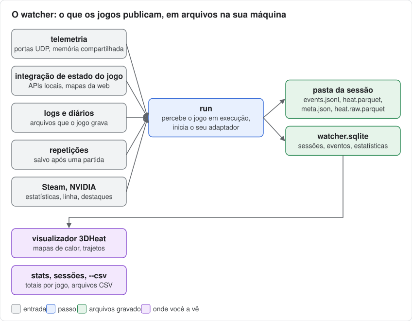

# 3DHeat Watcher {#dheat-watcher}

**O que é?** Joga-se um jogo. Este programa regista discretamente por onde se andou e o que aconteceu.
Depois pode ver-se isso como um mapa colorido no visualizador 3DHeat.

**Para que serve?** Para manter um registo próprio de cada sessão - por onde se conduziu, voou ou lutou,
os totais por jogo - sem nenhum site e sem alterar o jogo.

**Exemplo:** dá-se uma volta num jogo de corrida com o watcher a correr; depois, um ficheiro em
`sessions\<jogo>\` guarda a linha feita, e o visualizador desenha-a.

Com mais detalhes: o 3DHeat Watcher é um programa de segundo plano que regista o que os jogos publicam sobre
o que se joga - por onde se andou, o que aconteceu em cada lugar, e os números por trás disso - em ficheiros no
próprio computador. Os ficheiros servem para as estatísticas e para os mapas de calor e as linhas de
trajeto do visualizador 3DHeat.

Corre discretamente, percebe qual jogo foi iniciado, e lê as saídas desse jogo: uma porta de telemetria
ou memória partilhada que o jogo publica para painéis, uma integração de estado de jogo, o diário ou o registo que
o jogo grava, a repetição que ele guarda depois de uma partida, as estatísticas que a Steam mantém, os
clipes que o NVIDIA App guarda. As gravações ficam no próprio computador. O programa contacta apenas dois
serviços externos, e só nestes casos: o GitHub, para procurar uma versão mais nova (veja
[Atualizações](updates.md)), e a API Match-V5 da Riot, e só se for indicada a própria
chave de API da Riot (veja [Repetições de League of Legends](game-lol-replays.md)).



## O que ele regista {#what-it-records}

- **Posições**: o carro, a aeronave, o herói ou o jogador, várias vezes por segundo onde o jogo as publica,
  com velocidade, rumo e o que mais o jogo enviar junto.
- **Eventos**: surgimentos, mortes, abates, voltas, trechos, rounds, golos, missões, descolagens e aterragens,
  mudanças de zona, conquistas, destaques. Cada evento fica guardado com a hora e, quando o jogo o indica, com o seu lugar.
- **Estatísticas por sessão**: abates, mortes, voltas, melhor volta, distância, velocidade máxima,
  tempo de jogo, e as estatísticas do próprio jogo onde ele as mantém.

O que cada jogo dá, e de onde, está na página própria de cada jogo em [Jogos](games.md). Uma única fonte não pode
registar tudo: os jogos multijogador são registados apenas pelo que publicam, e o watcher
nunca lê a memória deles (veja [Fontes e regras](sources-and-rules.md)).

## Instalação {#install}

Para quem nunca usou a linha de comando, leia primeiro [Antes de começar](before-you-start.md).

O watcher é um programa Python para Windows (Python 3.10 ou mais recente). Muitas das fontes existem apenas no Windows: memória
partilhada, o registo, as notificações do Windows.

```bash
git clone https://github.com/Holdi601/3DHeat-Watcher.git
cd 3DHeat-Watcher
pip install -r requirements.txt
```

Um ficheiro de lançamento transferido funciona da mesma forma: extraia-o e depois execute `pip install -r requirements.txt`
dentro da pasta. Os detalhes, e os extras de que alguns jogos precisam, estão em
[Instalação e execução](installing-and-running.md).

## Início rápido {#quick-start}

```bash
python -m heat3d_watch games            # o que cada jogo dá, e de onde
python -m heat3d_watch setup all        # o que precisaria ser ligado (nada é alterado)
python -m heat3d_watch setup f1-25 --apply   # liga a saída de um jogo (o ficheiro original fica guardado em cópia de segurança)
python -m heat3d_watch run              # observa; deixe-o a correr enquanto joga
python -m heat3d_watch stats            # totais por jogo
python -m heat3d_watch stats --csv out  # sessões, eventos e estatísticas como ficheiros CSV
```

Deve aparecer: depois de `games`, uma tabela com uma linha por jogo; `run` continua até premir
Ctrl+C ou fechar a janela.

Tudo fica guardado em `%LOCALAPPDATA%\3DHeat\Watcher`. Para usar outra pasta, defina a
variável de ambiente `HEAT3D_WATCH_HOME` ou execute `python -m heat3d_watch config --set data=D:\algum\lugar`.

- `sessions\<jogo>\<data>_<adaptador>\` - uma pasta por sessão, com `events.jsonl` (cada evento
  à medida que acontece), `heat.parquet` (as linhas com posição, prontas para o visualizador 3DHeat) e
  `meta.json` (jogo, fonte, eixos, contagens, estatísticas)
- `watcher.sqlite` - as estatísticas de cada sessão, em três tabelas simples
- `watcher.log` - o que o watcher fez

O visualizador abre o `heat.parquet` de uma sessão diretamente, sem nenhuma configuração (os eixos e as unidades
estão no ficheiro). As repetições convertidas são guardadas como tabelas e documentos de partida ao lado dele; o
formato de um ficheiro por partida do visualizador está descrito na página do seu
[contentor `.3dheat`](https://holdi601.github.io/3DHeat/container.html), e as colunas de cada tabela em
[Os dados](the-data.md).

## A documentação {#the-documentation}

| Página | O que cobre |
|---|---|
| [Antes de começar](before-you-start.md) | Python, um terminal, marcadores, o que indica sucesso e os erros comuns |
| [Instalação e execução](installing-and-running.md) | requisitos, execução em segundo plano, início com o Windows, o ficheiro de bloqueio, o registo, cada configuração e variável de ambiente |
| [Jogos](games.md) | uma página por jogo: o que é registado, de onde, como ligar, como funciona, eixos, estatísticas, o que foi verificado |
| [Os dados](the-data.md) | pastas de sessão, `events.jsonl`, `heat.parquet` e o rodapé, `meta.json`, `watcher.sqlite`, recuperação após uma queda, exportação CSV, abrir uma sessão no visualizador 3DHeat |
| [Comandos](commands.md) | cada comando e opção de `python -m heat3d_watch` |
| [Fontes e regras](sources-and-rules.md) | os seis tipos de fonte, as regras para multijogador, quais jogos ficam de fora e por quê |
| [NVIDIA Highlights](nvidia-highlights.md) | o que o NVIDIA Highlights pode e não pode entregar, e como um destaque ganha uma posição |
| [Mods de servidor que gravam](server-mods.md) | os mods de servidor do Arma 3 e do Arma Reforger que gravam missões inteiras para o visualizador |
| [Leitura de memória](memory-reading.md) | perfis de memória para um jogador: o formato, as verificações, como escrever e verificar um |
| [Atualizações](updates.md) | como o watcher procura novas versões e se atualiza sozinho |
| [Desenvolvimento](development.md) | escrever um adaptador: a API, os testes, um `verified` honesto, regenerar as páginas dos jogos |
| [Todos os jogos numa tabela](watcher.md) | cada jogo numa tabela, como `games --markdown` a imprime, mais os jogos pesquisados mas ainda não construídos |
| [Referência de comandos](../cli-reference.md) | o `--help` de cada comando, gerado a partir do código |
| [Manutenção](maintaining.md) | a lista de verificação de lançamento destas páginas |

## Parte do 3DHeat {#part-of-3dheat}

O 3DHeat Watcher é uma das ferramentas gratuitas em torno do visualizador 3DHeat (o watcher usa o 3DHeat CS2
para converter demos do CS2). Cada uma é um projeto próprio, com lançamentos e licença próprios:

| Ferramenta | O que faz | Documentação |
|---|---|---|
| [3DHeat](https://github.com/Holdi601/3DHeat) | o visualizador: mapas de calor, análise de corrida e revisão de partidas em 3D | [site](https://holdi601.github.io/3DHeat/) |
| [GameFiles](https://github.com/Holdi601/3DHeat-GameFiles) | percursos e níveis a partir dos ficheiros que os jogos trazem, como modelos 3D | [site](https://holdi601.github.io/3DHeat-GameFiles/) |
| [GameCapture](https://github.com/Holdi601/3DHeat-GameCapture) | telemetria de voltas de jogos de corrida; níveis reconstruídos a partir de vídeo de jogo | [site](https://holdi601.github.io/3DHeat-GameCapture/) |
| [Unreal Exporter](https://github.com/Holdi601/3DHeat-UnrealExporter) | um plugin do Unreal Editor que exporta um nível como um modelo 3D | [site](https://holdi601.github.io/3DHeat-UnrealExporter/) |
| [CS2](https://github.com/Holdi601/3DHeat-CS2) | demos do Counter-Strike 2 em tabelas e documentos de partida; mapas em modelos 3D | [site](https://holdi601.github.io/3DHeat-CS2/) |
| [Watcher](https://github.com/Holdi601/3DHeat-Watcher) | regista, em segundo plano, o que os jogos publicam sobre o que se joga | [site](https://holdi601.github.io/3DHeat-Watcher/) |
| [Ext-WarThunder](https://github.com/Holdi601/3DHeat-Ext-WarThunder) | repetições do War Thunder em tabelas e documentos de partida | [site](https://holdi601.github.io/3DHeat-Ext-WarThunder/) |
| [Ext-WoT](https://github.com/Holdi601/3DHeat-Ext-WoT) | repetições do World of Tanks em tabelas e documentos de partida | [site](https://holdi601.github.io/3DHeat-Ext-WoT/) |
| [Ext-WoWs](https://github.com/Holdi601/3DHeat-Ext-WoWs) | repetições do World of Warships em tabelas e documentos de partida | [site](https://holdi601.github.io/3DHeat-Ext-WoWs/) |
| [Ext-Squad](https://github.com/Holdi601/3DHeat-Ext-Squad) | demos de servidores do Squad em tabelas e documentos de partida | [site](https://holdi601.github.io/3DHeat-Ext-Squad/) |
| [Ext-DCS](https://github.com/Holdi601/3DHeat-Ext-DCS) | mapas do DCS World em modelos 3D | [site](https://holdi601.github.io/3DHeat-Ext-DCS/) |
| [Ext-IL2](https://github.com/Holdi601/3DHeat-Ext-IL2) | mapas do IL-2 Sturmovik em modelos 3D | [site](https://holdi601.github.io/3DHeat-Ext-IL2/) |

Cada leitor de jogo é um pequeno projeto próprio, com o seu ficheiro de licença, as suas versões e o seu
registo de problemas, por isso pode ser instalado, atualizado, mantido - ou retirado a pedido de um
titular de direitos - por si só, sem afetar o visualizador nem as outras ferramentas.

Licença: MIT ([LICENSE](https://github.com/Holdi601/3DHeat-Watcher/blob/main/LICENSE)). As licenças
dos pacotes de terceiros que ele usa, e o que os jogos que ele lê exigem, estão listadas em
[LICENSES.md](https://github.com/Holdi601/3DHeat-Watcher/blob/main/LICENSES.md).
