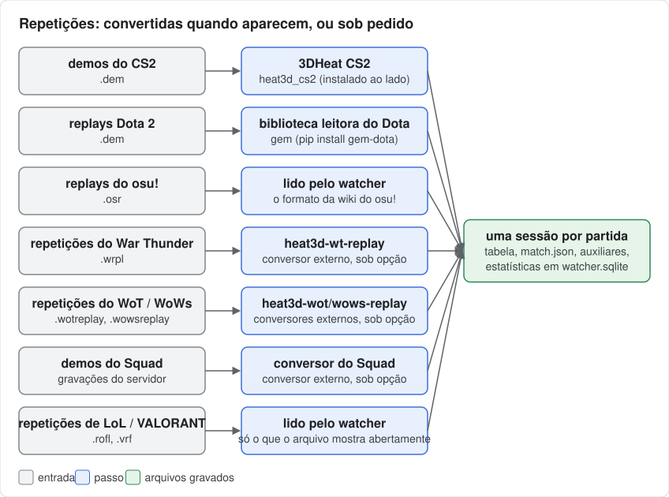

# Instalar e executar {#installing-and-running}

## Requisitos {#requirements}

- **Windows.** O watcher foi escrito para Windows, e a maioria das fontes existe só ali: memória
  partilhada que os jogos criam (mapeamentos `Local\...`), o registo (onde fica a Steam), notificações do
  Windows, a lista de processos com os caminhos dos executáveis. Noutro sistema o programa inicia, mas essas
  fontes não encontram nada, as notificações são só registadas no log, e a leitura de memória recusa-se ("only
  implemented on Windows").
- **Python 3.10 ou mais recente**, em <https://www.python.org/downloads/>: marque **Add python.exe to PATH**
  no instalador, depois verifique com `python --version` num terminal novo. Se for novidade, leia primeiro
  [Antes de começar](before-you-start.md).
- **Pacotes** (`requirements.txt`): `psutil>=6.0` (quais jogos estão a correr, qual programa segura uma
  porta, as ligações de um jogo; um psutil mais antigo continua a funcionar, pelo nome antigo das ligações de um processo),
  `pyarrow>=15` (escrever `heat.parquet`), `numpy>=1.24`, e `pytest>=8.0` para os testes.
  `requirements-optional.txt` não lista pacotes de momento.

Sem `pyarrow`, as sessões continuam a ser gravadas: o `events.jsonl` é o registo, e a tabela pode ser
criada depois com [`table`](commands.md#table).

### Extras de que alguns jogos precisam {#extras-some-games-need}

| Jogo | O que precisa |
|---|---|
| Demos do Counter-Strike 2 | [3DHeat CS2](https://github.com/Holdi601/3DHeat-CS2) e os requisitos dele (`demoparser2`). O watcher procura em `HEAT3D_CS2`, depois numa pasta `3DHeat-CS2` ou `cs2` ao lado da pasta do próprio watcher, depois em qualquer lugar onde o Python consiga importar `heat3d_cs2`. Sem ele, `games` lista o adaptador como indisponível. |
| Microsoft Flight Simulator 2020 / 2024 | `SimConnect.dll` - não incluído. O MSFS 2020 tem um na pasta de instalação; para o MSFS 2024, instale o SDK do MSFS 2024. `MSFS_SDK` / `MSFS2024_SDK` apontam para a pasta do SDK. |
| Euro Truck Simulator 2, American Truck Simulator | o plugin RenCloud `scs-telemetry.dll` (revisão 12) em `<jogo>\bin\win_x64\plugins` |
| BeamNG.drive | o mod de protocolo `heat3d`, instalado por `python -m heat3d_watch setup beamng --apply` |
| League of Legends (ao vivo) | opcional: o certificado raiz da Riot como `<dados>\riotgames.pem`, para que a ligação local seja verificada |
| Minecraft | uma pasta `%APPDATA%\.minecraft` (Java Edition) |

Cada página de jogo em [Jogos](games.md) diz o que precisa de ser ligado no próprio jogo.
`python -m heat3d_watch games` marca um adaptador como `[unavailable: ...]` quando falta algo de que ele precisa
neste computador.

## Instalação {#installing}

Se for novidade, leia primeiro [Antes de começar](before-you-start.md). Se o `pip` não for
encontrado, use `python -m pip install -r requirements.txt`.

A partir de um clone:

```bash
git clone https://github.com/Holdi601/3DHeat-Watcher.git
cd 3DHeat-Watcher
pip install -r requirements.txt
```

A partir de uma versão: transfira o ficheiro das releases do repositório, extraia-o e execute
`pip install -r requirements.txt` dentro da pasta. As duas cópias atualizam-se sozinhas
(veja [Atualizações](updates.md)).

Execute cada comando a partir da pasta do repositório: `python -m heat3d_watch` importa o pacote de lá,
e o atualizador (`heat3d_update`) fica ao lado dele.

## Execução {#running}

```bash
python -m heat3d_watch run        # observa até ser parado
python -m heat3d_watch run -v     # o mesmo, com linhas de depuração no log
python -m heat3d_watch run --once # uma verificação dos jogos em execução agora, depois para e sai
```

Ao iniciar, o `run`:

1. escreve o [ficheiro de bloqueio](#the-lock-file);
2. termina quaisquer sessões que uma execução anterior deixou abertas, por exemplo depois de uma queda
   (veja [Recuperação](the-data.md#recovery-after-a-crash));
3. a cada `scan_seconds` (2 s), lê a lista de processos (só nomes e caminhos, nenhum processo é aberto)
   e inicia um adaptador, numa thread própria, para cada jogo que encontra. Quando o processo de um jogo
   desaparece, o adaptador dele é parado e as sessões que ele tinha abertas são fechadas, o que grava a tabela delas e
   a linha delas nas estatísticas. Os adaptadores que não esperam por um jogo (estatísticas da Steam, Steam
   Timeline, destaques da NVIDIA, as pastas de replays) correm o tempo todo;
4. enquanto nenhum jogo está a correr, procura uma versão mais nova no máximo uma vez por hora (a própria resposta fica
   guardada seis horas) e, com `auto_update` ligado, instala-a e reinicia-se sozinho (veja [Atualizações](updates.md)).

Um adaptador que falha é registado no log e não para os outros. Se a consulta de um adaptador falhar 20 vezes
seguidas, ou o início dele falhar, o adaptador é parado e não volta a ser iniciado até o jogo ser iniciado de novo (um
novo id de processo).

Pare o watcher com Ctrl+C. Os adaptadores fecham as sessões antes de ele sair. Se o watcher for
morto em vez disso (Gestor de Tarefas, uma queda, um corte de energia), nada do que já foi gravado se perde: o
próximo `run` termina essas sessões.

`--once` faz uma única verificação: inicia os adaptadores dos jogos que estão a correr naquele momento (e os que ficam
sempre ligados), deixa cada um consultar uma vez - a esperar no máximo 10 segundos por isso - e depois os para do
mesmo modo que um jogo que termina, de forma que as sessões que eles abriram são fechadas, as tabelas gravadas e
as linhas contadas nas estatísticas antes de sair. Use para verificar que um jogo é detetado, não para gravar.

### Replays que já estão no disco {#replays-already-on-disk}



Na primeira vez que um adaptador de replay vê uma das pastas dele, ele só regista os replays que já estão nela:
um jogador com anos de demos faria o watcher ficar ocupado a converter durante um dia inteiro. Daí em diante
cada replay novo é convertido assim que o jogo acaba de o gravar. Os antigos são convertidos a pedido com
[`replays`](commands.md#replays):

```bash
python -m heat3d_watch replays cs2-demos              # cada demo nas pastas do CS2 e em replay_folders
python -m heat3d_watch replays osu-replays D:\Old     # os replays de uma pasta
```

### Execução em segundo plano {#running-in-the-background}

O watcher não tem janela própria; é um programa de consola que corre até ser parado. Ele
grava tudo em `watcher.log`, por isso não precisa de uma consola visível. Formas de o deixar fora do caminho:

- inicie-o numa consola e minimize a consola: `start "" /min python -m heat3d_watch run` no
  `cmd`, dentro da pasta do repositório;
- inicie-o sem consola: `pythonw -m heat3d_watch run`. A saída da consola perde-se, mas o `watcher.log`
  continua a ser gravado. Para o parar, termine o processo `pythonw.exe`; o próximo início então termina as
  sessões que ele deixou abertas. O projeto não testou este modo de execução.

### Iniciar com o Windows (uma ideia) {#starting-with-windows-an-idea}

O watcher não se instala para iniciar com o Windows. Para o iniciar automaticamente:

- **Agendador de Tarefas**: crie uma tarefa com o disparador *Ao iniciar sessão* e a ação *Iniciar um programa*,
  programa `pythonw.exe` (ou `python.exe`), argumentos `-m heat3d_watch run`, *Iniciar em* definido como a
  pasta do repositório;
- **Pasta de arranque**: coloque um atalho em `shell:startup` com o mesmo programa, argumentos e pasta
  *Iniciar em*.

Nenhum dos dois faz parte do watcher nem é testado por ele. O [ficheiro de bloqueio](#the-lock-file) garante que uma
segunda cópia iniciada por engano saia logo.

## O ficheiro de bloqueio {#the-lock-file}

`<dados>\watcher.lock` guarda o id do processo do watcher em execução. Quando o `run` inicia e o ficheiro de
bloqueio cita um processo que ainda existe e cujo nome contém `python`, ele mostra

```text
A watcher is already running (process 12345) for C:\Users\...\3DHeat\Watcher.
```

e sai com código 1. Dois watchers na mesma pasta de dados gravariam cada jogo duas vezes, e o segundo
trataria as sessões abertas do primeiro como restos de uma queda. Um ficheiro de bloqueio cujo processo
já não existe, ou pertence a outro programa, é substituído. Quando o `run` termina, remove o ficheiro de
bloqueio se o ficheiro ainda citar o próprio processo.

## O log {#the-log}

`<dados>\watcher.log` é escrito só pelo `run`; os outros comandos mostram tudo na consola. Cada linha tem a
hora, o nível e uma mensagem:

```text
2026-05-01 20:15:01,123 INFO watching; data in C:\Users\...\AppData\Local\3DHeat\Watcher
2026-05-01 20:15:03,456 INFO f1-25: starting (EA SPORTS F1 25)
2026-05-01 21:02:11,789 INFO f1-25: stopping
```

Os adaptadores registam o que não conseguem fazer e porquê: "UDP 20777 is in use by ...; not taking it from that program",
"not reading memory: the game is played online", "could not start", "poll failed (3)" com o
traceback. `run -v` acrescenta linhas de depuração. O ficheiro só recebe acrescentos e nunca é rodado nem
esvaziado pelo watcher; apague-o quando quiser. As mesmas linhas também vão para a consola.

## Onde fica tudo {#where-everything-is}

A pasta inicial é `%LOCALAPPDATA%\3DHeat\Watcher`, ou `HEAT3D_WATCH_HOME` quando isso está definido (sem
`LOCALAPPDATA`, por exemplo noutro sistema, `~/.local/share/3DHeat/Watcher`). O `settings.json` fica
sempre na pasta inicial. Tudo o resto vai para a pasta de dados, que é a pasta inicial a menos que a
configuração `data` aponte para outra:

| Caminho | O que é |
|---|---|
| `<inicial>\settings.json` | as configurações |
| `<dados>\sessions\` | as gravações, uma pasta por sessão de uso ([Os dados](the-data.md)) |
| `<dados>\watcher.sqlite` | a base de dados das estatísticas |
| `<dados>\watcher.log` | o log do `run` |
| `<dados>\watcher.lock` | o ficheiro de bloqueio, enquanto o `run` está a correr |
| `<dados>\state\` | o que os adaptadores sempre ligados e de replay já trataram (`steam-stats.json`, `replays-cs2-demos.json`, ...), para que um reinício não grave nada duas vezes |
| `<dados>\profiles\*.json` | perfis de memória escritos por si ([Ler a memória](memory-reading.md)) |
| `<dados>\riotgames.pem` | opcional, certificado raiz da Riot para o adaptador ao vivo do League of Legends |
| `%LOCALAPPDATA%\3DHeat\update-check-3DHeat-Watcher.json` | a resposta guardada da última verificação de versão |

O watcher não apaga nada dessas pastas, exceto uma pasta de sessão na qual nada foi gravado
(um jogo parado nos menus).

## Configurações {#settings}


`python -m heat3d_watch config` mostra as configurações; `config --set chave=valor ...` altera-as e guarda o
`settings.json` (veja [config](commands.md#config)). O ficheiro é JSON simples e também pode ser editado à mão
enquanto o watcher não está a correr. As chaves desconhecidas nele são ignoradas. As configurações são lidas quando um
comando inicia, por isso reinicie o `run` depois de as alterar.

| Configuração | Predefinido | O que faz |
|---|---|---|
| `data` | `""` | A pasta de dados. Vazio: a pasta inicial. |
| `disabled` | `[]` | Ids de adaptadores que nunca correm, por exemplo `config --set disabled=steam-stats,nvidia-highlights`. Todos os outros adaptadores correm quando encontram o jogo deles. |
| `auto_update` | `true` | Enquanto nenhum jogo está a correr, instala uma versão mais nova e reinicia (veja [Atualizações](updates.md)). `false`: só um aviso no log. |
| `scan_seconds` | `2.0` | Segundos entre as verificações da lista de processos. |
| `memory` | `false` | Permite que adaptadores de memória (jogos para um jogador com um perfil que escreveu) corram. Desligado por predefinição; veja [Ler a memória](memory-reading.md). |
| `replays` | `true` | Corre os adaptadores `replay`: todos eles (veja `python -m heat3d_watch replays` e [Jogos](games.md)) - demos do CS2, Dota 2, osu!, War Thunder, World of Tanks, World of Warships, Squad, replays do League of Legends e do VALORANT, gravações Tacview do IL-2. |
| `replay_folders` | `{}` | Pastas extra por id de adaptador, por exemplo `{"cs2-demos": ["D:\\Demos"]}`. Os adaptadores de replay observam estas pastas além das pastas próprias do jogo; `il2-tacview` também aceita pastas de instalação (aí procura em `data\Tracks`); para `elite`, a primeira pasta substitui a pasta do diário. Defina as pastas de um adaptador com `config --set replay_folders.cs2-demos=D:\Demos,E:\More`, ou o dicionário inteiro como JSON. |
| `riot_id` | `""` | O Riot ID (`Nome#TAG`), para que a linha própria num replay do League of Legends passe a contar nas estatísticas. Vazio: a linha de cada jogador é guardada, e nenhuma é marcada como sua. |
| `riot_api_key` | `""` | A chave de programador da Riot, para buscar a cronologia oficial de cada partida de League repetida (posições a cada minuto, abates onde aconteceram). Vazio: nada é buscado. |
| `riot_platform` | `"EUW1"` | O id da plataforma do servidor de League (`EUW1`, `EUN1`, `NA1`, `KR`, ...), usado para encontrar o host regional da Match-V5. |
| `player_names` | `{}` | O nome do jogador em jogos cuja interface nomeia todos os jogadores, mas não diz qual é o do jogador, por id de adaptador: `warthunder-webmap` (as linhas do feed de abates sobre o jogador passam a contar como abates e mortes dele) e `rocketleague-stats` (as linhas dele passam a `me`; sem isso, o jogador que a câmara do jogo segue). Defina com `config --set player_names.warthunder-webmap=Name`. |

Um `settings.json` com todas as predefinições:

```json
{
  "data": "",
  "disabled": [],
  "auto_update": true,
  "scan_seconds": 2.0,
  "memory": false,
  "replays": true,
  "replay_folders": {},
  "riot_id": "",
  "riot_api_key": "",
  "riot_platform": "EUW1",
  "player_names": {}
}
```

## Variáveis de ambiente {#environment-variables}

| Variável | Efeito |
|---|---|
| `HEAT3D_WATCH_HOME` | a pasta inicial (configurações, e os dados a menos que `data` diga outra coisa) |
| `HEAT3D_NO_UPDATE` | qualquer valor diferente de vazio, `0`, `false` ou `no` desliga a verificação de versão e a atualização automática |
| `HEAT3D_NO_TOAST` | qualquer valor não vazio: sem notificações do Windows, só linhas no log |
| `HEAT3D_CS2` | a pasta do 3DHeat CS2, para demos do CS2 |
| `HEAT3D_CS2_GSI_PORT` | a porta de estado do jogo do CS2 (predefinição 3311); o ficheiro cfg que o `setup` escreve usa-a |
| `HEAT3D_DOTA_GSI_PORT` | a porta de estado do jogo do Dota 2 (predefinição 3312) |
| `MSFS_SDK`, `MSFS2024_SDK` | as pastas do SDK do MSFS, onde se procura `SimConnect SDK\lib\SimConnect.dll` |

As notificações do Windows são usadas só para atualizações: "Updating to 1.2.0", ou "1.2.0 is out; not updated:
..." quando a atualização não pôde ser aplicada. São mostradas pela própria API de notificação do PowerShell,
por isso não é preciso instalar nada. O título e o texto são passados ao PowerShell como variáveis de ambiente,
nunca como parte do script.
