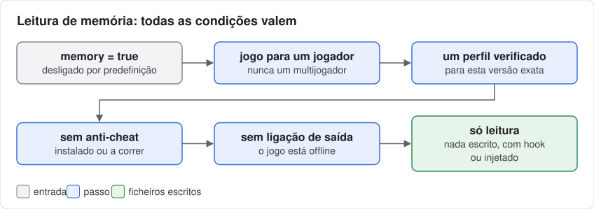

# Ler a memória {#reading-memory}

Alguns jogos para um jogador não dizem nada a outros programas. Para esses, o watcher pode - se a opção estiver ligada e se escrever um perfil - procurar onde está o jogador na memória do jogo, só para leitura.

Para jogos para um jogador que não publicam nada, o watcher pode ler posições e valores da
memória do jogo, por meio de um **perfil** escrito para a versão do jogo que se tem. De todas as fontes, esta é
a única que o jogo não entregou, por isso ela é bem mais cercada que as outras:

- ela fica **desligada por predefinição** (`python -m heat3d_watch config --set memory=true` liga-a);
- só lê, e não escreve;
- **nenhum perfil vem com as ferramentas.**

Os perfis não vêm incluídos porque um deslocamento só está certo para a versão em que foi encontrado. Depois de um patch,
um perfil que estava certo antes lê lixo, e lixo parece exatamente com números. Um perfil tem de ser
verificado na versão que o jogador tem, pelo próprio jogador.

## As verificações, em ordem {#the-checks-in-order}



Cada verificação abaixo tem de passar. As quatro primeiras fazem-se **antes** de o jogo ser aberto, porque abrir
um jogo protegido para leitura é justamente o que um anti-cheat deteta, e recusar depois seria tarde demais.

1. **A configuração**: `memory` é verdadeiro. Caso contrário, os adaptadores de memória nunca são iniciados.
2. **Um perfil para o jogo**, cujo `exe` corresponde ao processo em execução. Um perfil diz se o jogo pode ser
   jogado online (`"online"`); um que deixe isso de fora é rejeitado.
3. **Nenhum anti-cheat por perto**:
   - nenhum ficheiro de anti-cheat na pasta do jogo ou até três pastas acima dela (a parar na pasta `common` de uma
     biblioteca da Steam, ou numa pasta com `steamapps` dentro, já que outros jogos ficam acima disso):
     `EasyAntiCheat`, `EasyAntiCheat_EOS_Setup.exe`, `start_protected_game.exe`, `BattlEye`,
     `BEClient_x64.dll`, `BEService_x64.exe`, `EAAntiCheat.GameServiceLauncher.exe`, `AntiCheatExpert`,
     `SGuard64.exe`, `GameGuard`, `GameMon.des`, `XIGNCODE`, `xhunter1.sys`, `Vanguard`, `FACEIT`
     (comparados em minúsculas, também como início de um nome). Se a pasta do jogo for desconhecida, o jogo é recusado;
   - nenhum driver ou serviço de anti-cheat a correr no computador, como listado por
     `sc query type= driver state= active` e `sc query type= service state= active`: EasyAntiCheat,
     EasyAntiCheat_EOS, BEService, BEDaisy, vgk, vgc, ACE-BASE, ACE-GAME, xhunter1, FACEIT,
     FACEITService, EAAntiCheatService, Denuvo Anti-Cheat, npggsvc, Ricochet. Um anti-cheat de kernel
     instalado para outro jogo ainda vigia cada processo. Se os serviços não puderem ser listados, o
     jogo é recusado.
4. **Não online**: um jogo cujo perfil diz `"online": true` só é lido enquanto não tem ligação a nada além deste
   computador (qualquer endereço remoto diferente de `127.x`, `::1`). Se as ligações dele não
   puderem ser lidas, ele é recusado.
5. Depois, conforme o adaptador inicia:
   - **a versão exata**: o tamanho do ficheiro do executável, ou o SHA-256 dele, tem de coincidir com uma versão que o
     perfil lista. Uma versão desconhecida não é lida;
   - **os módulos mais uma vez**: os módulos carregados do jogo são listados (um snapshot do Toolhelp, que não pede
     direitos de acesso próprios) e verificados por um cliente de anti-cheat (`BEClient_x64.dll`,
     `BEClient.dll`, `EasyAntiCheat_x64.dll`, `EasyAntiCheat.dll`, `EOSAntiCheat...`). Um processo protegido recusa
     o snapshot, o que também conta como recusa;
   - só então o processo é aberto, com `PROCESS_VM_READ | PROCESS_QUERY_LIMITED_INFORMATION` e
     nada além disso.

As verificações 1 a 4 são repetidas a cada análise (a cada 2 s) enquanto o jogo corre. Se uma começa a
falhar (o jogo se liga a um servidor, um serviço de anti-cheat arranca), o adaptador é parado na próxima
análise. Uma recusa é registada no log: `mem-<id>: not reading memory: <motivo>`. Uma falha ao arrancar (versão
desconhecida, um módulo de anti-cheat, um padrão não encontrado) é registada como `mem-<id>: could not start`, e o
adaptador não é tentado de novo até o jogo voltar a ser iniciado.

Não há escrita, nenhuma alocação no outro processo, nenhuma thread iniciada nele, nenhuma biblioteca carregada
nele, nenhum privilégio de depuração e nenhuma elevação. Um teste (`test_memory_reading_cannot_write` em
`tests/test_core.py`) falha se qualquer chamada que escreve noutro processo, aloca nele ou executa código nele -
`WriteProcessMemory`, `VirtualAllocEx`, `CreateRemoteThread`, `PROCESS_VM_WRITE`, `SeDebugPrivilege`,
`LoadLibrary`, ... - aparecer em qualquer lugar do pacote.

Nunca são lidos, seja o que for que um perfil diga: jogos jogados online, e jogos cujo modo para um jogador corre
sob um anti-cheat, como o GTA V, ou o Elden Ring iniciado pelo lançador dele. As verificações acima recusam
esses de qualquer forma.

## O formato do perfil {#the-profile-format}

Um perfil é um ficheiro JSON em `<dados>\profiles\` (`<dados>` é a pasta de dados, veja
[Instalar e executar](installing-and-running.md#where-everything-is)), um por jogo, com qualquer nome de ficheiro
que termine em `.json`. Um exemplo sintético:

```json
{
  "schema": "heat3d.memprofile/1",
  "id": "mygame",
  "game": "My Game",
  "exe": "MyGame.exe",
  "online": false,
  "versions": [ { "label": "1.06", "size": 123456789 } ],
  "anchors": {
    "World": { "aob": "48 8B 05 ?? ?? ?? ?? 48 85 C0", "rip": [3, 7] }
  },
  "values": {
    "pos": { "type": "vec3f", "base": "World", "chain": ["0x10", "0x68", "0x70"] },
    "hp":  { "type": "i32",   "base": "World", "chain": ["0x10", "0x138"] },
    "map": { "type": "u32",   "base": "World", "chain": ["0x10", "0x1C0"] }
  },
  "events": [
    { "event": "death", "value": "hp",  "when": "to_zero" },
    { "event": "zone",  "value": "map", "when": "change" }
  ],
  "axes": { "up": "y", "units": "metres" },
  "rate": 10,
  "provenance": [ { "source": "https://example.com/my-notes", "verified_on": "1.06" } ]
}
```

| Chave | Obrigatória | O que é |
|---|---|---|
| `schema` | sim | exatamente `heat3d.memprofile/1` |
| `id` | sim | curto e estável; o adaptador chama-se `mem-<id>` |
| `game` | sim | o nome do jogo, em que assenta o nome da pasta de sessão |
| `exe` | sim | o nome do ficheiro do executável, que também diz que o jogo está a correr |
| `online` | sim | `true` se o jogo pode ser jogado online; então só é lido offline |
| `versions` | sim | as versões em que o perfil foi verificado: cada uma com um `label`, e um `size` (o tamanho do executável em bytes) e/ou um `sha256`. Quando os dois são dados, os dois têm de coincidir. Uma entrada sem nenhum dos dois não coincide com nada. |
| `anchors` | sim | endereços com nome no módulo principal. `aob`: um padrão de bytes, bytes hexadecimais separados por espaços, `?` ou `??` para qualquer byte; ele tem de aparecer **exatamente uma vez** na imagem do módulo (várias ocorrências contam como falha, tal como nenhuma). `rip: [d, n]`: o padrão aponta para uma instrução com um deslocamento RIP-relativo de 32 bits no byte `d` e de tamanho `n`; a âncora passa a ser o endereço a que essa instrução se refere. `offset`: somado depois (texto hexadecimal ou decimal). Em vez de `aob`, `module_offset` dá um deslocamento fixo a partir da base do módulo. |
| `values` | sim | o que é lido a cada consulta: `type` (`i32`, `u32`, `i64`, `u64`, `u8`, `f32`, `f64`, `vec3f`, `vec3d`), `base` (o nome de uma âncora), `chain` (deslocamentos em hexadecimal ou decimal como texto) |
| `events` | não | regras que transformam alterações em eventos: `when` `change` (o valor difere da última consulta) ou `to_zero` (um número cai de acima de 0 para 0 ou abaixo) |
| `axes` | não | `up` (predefinição `y`), `units` (predefinição `game units`), `scale` (a escala de unidade do visualizador, que multiplica cada posição; predefinição 1, as unidades próprias do jogo) |
| `rate` | não | consultas por segundo, de 1 a 60 (predefinição 10) |
| `provenance` | não | de onde vêm os deslocamentos e em que versão foram verificados; é copiado para o `meta.json` de cada sessão |

**Como um valor é lido.** O endereço da âncora é o ponto de partida. Se `chain` está vazio, o valor é lido ali mesmo.
Caso contrário, primeiro é lido o ponteiro guardado na âncora. Depois, para cada deslocamento menos o último, é lido o
ponteiro em `endereço + deslocamento`. O último deslocamento é somado para dar o endereço do valor. Um ponteiro nulo
no caminho (o jogo está entre fases ou num menu) deixa o valor vazio naquela consulta.

**O que é registado.** Um valor chamado `pos` (um `vec3f` ou `vec3d`) passa a ser uma linha `position` do jogador
`me` a cada consulta. Cada regra de evento grava a respetiva linha `event`, com o novo valor e, quando `pos` é
conhecido, a posição, e soma 1 a uma estatística com o mesmo nome. A imagem do módulo é lida uma vez no início para
encontrar as âncoras, em blocos de 64 KiB; blocos que não podem ser lidos contam como zeros. O `meta.json` da sessão
cita o perfil, o rótulo da versão e a proveniência.

Um perfil que não pode ser usado (JSON inválido, `schema` errado, uma chave obrigatória em falta) é saltado e
registado como `profile <ficheiro> not used: <motivo>`. Os perfis são carregados quando o watcher inicia, por isso
reinicie o `run` depois de adicionar ou alterar um.

## Escrever e verificar um perfil {#writing-and-verifying-a-profile}

1. **Só para um jogo para um jogador sem anti-cheat.** Se o jogo tem anti-cheat, ou se joga online, pare aqui: o
   watcher vai recusá-lo, e deve recusar.
2. **Encontre os valores na própria versão.** Trabalhe offline. Use ferramentas de depuração próprias, ou notas
   publicadas sobre o jogo, para encontrar a posição do jogador e os valores que se querem, e um caminho de ponteiros até
   cada um a partir de um ponto fixo no executável. Prefira um padrão de bytes (`aob`) a um `module_offset`
   fixo: um padrão ainda encontra o lugar quando o código se move um pouco.
3. **Torne o padrão único.** Ele tem de coincidir exatamente uma vez no módulo. Use curingas nos bytes que
   mudam (endereços, deslocamentos) e mantenha bytes fixos suficientes à volta deles.
4. **Fixe a versão.** Coloque o tamanho exato do executável em `versions`; `(Get-Item .\MyGame.exe).Length` no
   PowerShell dá isso, e `Get-FileHash .\MyGame.exe -Algorithm SHA256` dá o hash. Depois de um patch, o perfil
   simplesmente deixa de ser usado até que se verifique de novo e se adicione a nova versão.
5. **Indique se o jogo tem modo online** (`online`), com honestidade.
6. **Teste**: ative a leitura (`config --set memory=true`), coloque o ficheiro em `<dados>\profiles\`, e
   verifique se `python -m heat3d_watch games` lista `mem-<id>`. Inicie o jogo e corra
   `python -m heat3d_watch run -v`. No `watcher.log`, procure `mem-<id>: starting`, ou o motivo pelo qual
   foi recusado ou não pôde iniciar.
7. **Verifique os números com o jogo.** Ande até um lugar conhecido e veja as linhas `position` no
   `events.jsonl` da sessão. Movem-se quando o jogador se move, na distância certa, nos eixos certos? Abra o
   `heat.parquet` no visualizador e verifique se a rota coincide com o percurso feito. Dispare cada evento (perca toda
   a vida, mude de zona) e verifique que aparece uma vez. Lixo parece número, e só esta comparação
   separa os dois.
8. **Registe o que foi verificado** em `provenance`: a fonte dos deslocamentos e a versão em que foram verificados.

O texto `verified` de um adaptador de memória, como `games` o mostra, é sempre "by the profile's author, for the
builds it lists". O watcher não pode saber mais do que isso.
