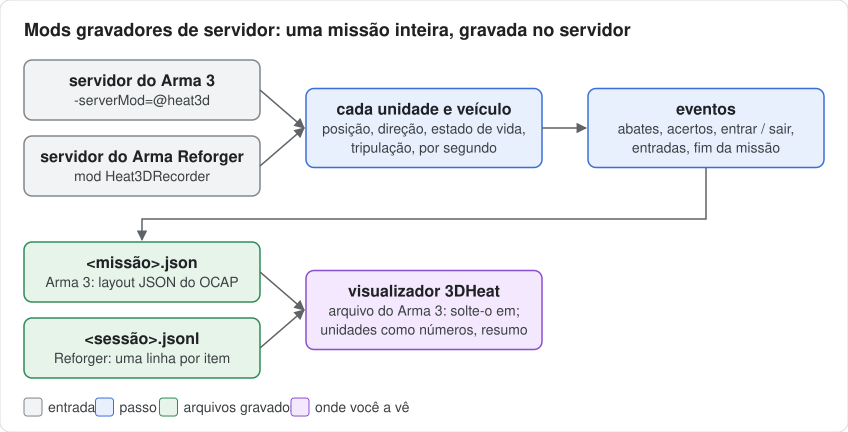

# Mods de gravação em servidor (Arma 3, Arma Reforger) {#server-recorder-mods-arma-3-arma-reforger}

A maioria dos jogos é gravada pelo watcher no próprio computador do jogador. O Arma é diferente:
um servidor pode gravar uma missão inteira - cada unidade e veículo, e não só o do jogador - com um
mod que corre no servidor. Os jogadores não precisam de configurar nada: o mod do Arma 3 é só para o
servidor, e o Reforger transfere sozinho os mods de um servidor para os jogadores quando eles entram
(o mod não faz nada nos computadores deles). O repositório traz dois desses mods, em
[`mods/arma3`](https://github.com/Holdi601/3DHeat-Watcher/tree/main/mods/arma3)
e [`mods/reforger`](https://github.com/Holdi601/3DHeat-Watcher/tree/main/mods/reforger).
Os READMEs deles são a documentação completa; esta página é a visão geral.

**Situação: nenhum dos dois foi testado no jogo ainda.** A extensão do Arma 3 foi compilada e
usada da forma como o Arma as chama, e a saída dela foi lida pelo 3DHeat; os scripts SQF
ainda não correram no Arma 3. O mod do Reforger foi escrito a partir da API de scripts publicada
pela Bohemia e nunca foi compilado. Não coloque nenhum dos dois num servidor público antes de
passar pelos passos de teste do README dele.

## Arma 3 {#arma-3}

1. Compile a extensão uma vez por plataforma (`mods/arma3/extension`). Isto precisa de um
   compilador C: Visual Studio Build Tools no Windows, gcc no Linux; se nunca compilou nada,
   peça ajuda ao fornecedor do servidor.
   - Windows, num "x64 Native Tools Command Prompt for VS":
     `cl /nologo /O2 /LD heat3d.c /Fe:heat3d_x64.dll`
   - Linux: `gcc -O2 -shared -fPIC -o heat3d_x64.so heat3d.c -ldl`
2. Compile o mod: `python mods/arma3/build.py` grava `mods/arma3/@heat3d/`
   (não precisa do Arma 3 Tools).
3. Copie `@heat3d` para a pasta do servidor e inicie o servidor com
   `-serverMod=@heat3d`.
4. O log `.rpt` do servidor mostra `Heat3D recorder 0.1.0: recording <file> every 1 s`.

| Opção | Predefinição | O que faz |
|---|---|---|
| `captureDelay` | 1 | segundos entre quadros |
| `recordHits` | 1 | 0 desliga os eventos de acerto |
| `recordShots` | 1 | 0 desliga a contagem de tiros |
| `minPlayers` | 0 | grava só quando este número de jogadores estiver ligado |

Uma missão substitui uma destas opções no próprio `init.sqf` (`heat3d_captureDelay = 0.5;`).
As gravações vão para `recordings/` dentro de `@heat3d`, ou para `HEAT3D_DIR`.

**Saída:** um ficheiro por missão, no formato JSON do OCAP (o formato do gravador OCAP2), com o
nome `<data>__<hora>_<missão>.json`. Durante a missão, é um diário (`.heat3d.part`), gravado
a cada escrita; o diário de uma missão que bloqueou fica concluído na próxima vez que uma missão começar.

## Arma Reforger {#arma-reforger}

O mod (`Heat3DRecorder.gproj`) é aberto e compilado no Workbench da Bohemia (Arma Reforger Tools),
testado num servidor dedicado local, publicado pelo Workbench (sem listagem enquanto estiver em
teste) e adicionado à lista `mods` do `config.json` do servidor - passo a passo no README dele.
A cada segundo grava a posição, a direção, o estado de vida, o veículo e o id do jogador de
cada personagem, e a posição, a direção, o estado e a tripulação de cada veículo; e os abates
(quem matou, arma, distância), os acertos, entrar e sair de veículos, jogadores a entrar e a sair,
e o fim da missão.

**Saída:** um objeto JSON por linha, em `$profile:heat3d/<data UTC>_<hora UTC>_<mundo>.jsonl`:
uma linha `header` (formato `heat3d-reforger`, eixos x leste, y para cima, z norte), depois linhas
`entity`, `frame` e `event` à medida que acontecem, e uma linha `end`. As linhas de unidades são
`[id, x, y, z, dir, alive, vehicleId, playerId]`, as de veículos
`[id, x, y, z, dir, alive, [ids da tripulação]]`; os eventos seguem o layout de eventos do OCAP2.

## No visualizador {#in-the-viewer}

Arraste uma gravação do Arma 3 para o [visualizador do 3DHeat](https://holdi601.github.io/3DHeat/):
uma missão é uma sessão, as unidades viram soldados, os veículos ficam com o tipo próprio, e os abates e
acertos vão para a lista de resumo (debrief). O leitor web do OCAP2 também a reproduz. O ficheiro
do Reforger é o formato de linhas próprio do mod, com o layout de eventos do OCAP2.
