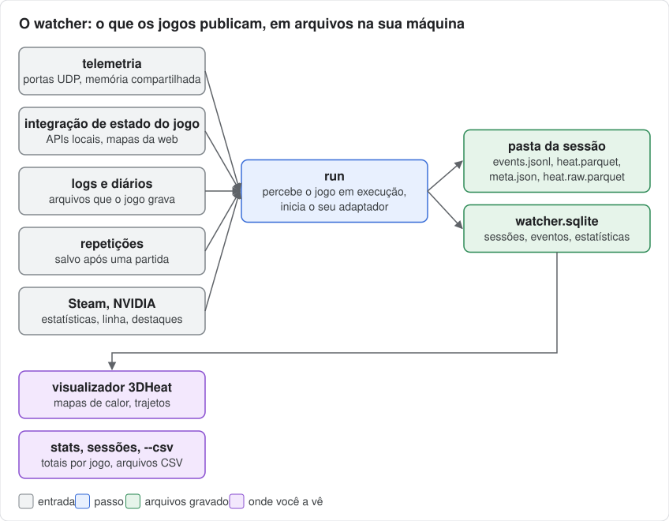

# Fontes e regras {#sources-and-rules}

O watcher grava apenas o que jogos e plataformas entregam ao jogador. Esta página explica quais fontes isso
cobre, o que o watcher pode fazer com cada uma, e quais jogos ou partes de jogos ele deixa de fora de propósito.

## Os seis tipos de fonte {#the-six-kinds-of-source}

Cada adaptador tem um `kind`, e o tipo decide o que o adaptador pode fazer:

| Tipo | O que é | Jogos multijogador |
|---|---|---|
| `telemetry` | uma porta UDP ou memória partilhada que o jogo publica para painéis, plataformas de movimento e volantes (Forza Data Out, UDP da F1, memória partilhada da Kunos e do iRacing, SimConnect, a interface UDP do X-Plane, o plugin SCS SDK) | sim - é a saída do próprio jogo |
| `gsi` | uma integração de estado ou API web local que o jogo serve ao computador do próprio jogador (Valve GSI, a Live Client Data API do League, a Stats API do Rocket League, o mapa web do War Thunder) | sim, dentro do que a API mostra ao jogador |
| `log` | ficheiros que o jogo escreve enquanto corre: diários, registos, estatísticas, gravações de jogo (Elite Dangerous, Minecraft, Path of Exile, Hearthstone, Star Citizen, EVE Online) | sim |
| `replay` | demos e replays que o jogo guarda para os jogadores, convertidos depois da partida (CS2, Dota 2, osu!, War Thunder, World of Tanks, World of Warships, Squad, League of Legends, VALORANT, IL-2 Tacview) | sim, a menos que estejam cifrados, e só as partes abertas |
| `platform` | o que a Steam e o driver gráfico guardam: estatísticas, conquistas, linhas do tempo, clipes e destaques | sim |
| `memory` | a memória do jogo, só leitura, por um perfil escrito pelo jogador | **nunca** - só para um jogador |

Só `memory` abre outro processo, e só para leitura. Os outros cinco tipos leem apenas o que o jogo, a Steam
ou o NVIDIA App já escreveram ou enviam.

## Como as fontes são lidas {#how-the-sources-are-read}

- **Nada é injetado, interceptado ou alterado num jogo.** Nenhum código é carregado num jogo, nenhuma janela
  ou entrada é interceptada, nenhum ficheiro do jogo é modificado. Os únicos ficheiros que o watcher escreve fora
  da pasta de dados são os que [`setup --apply`](commands.md#setup) escreve quando é pedido: o ficheiro de
  configurações de um jogo (com o original guardado como `<ficheiro>.heat3d-backup`), um ficheiro cfg de
  integração de estado, o script de hook do DCS, o mod de protocolo do BeamNG.
- **A memória partilhada é aberta só para leitura e nunca é criada.** A forma comum de abrir um mapeamento
  com nome em Python cria um quando ele ainda não existe. Um jogo iniciado depois encontraria o mapeamento que o
  watcher criou, vazio e só de leitura, em vez de criar o seu, e a telemetria dele ficaria inutilizada. O watcher abre mapeamentos
  só com `OpenFileMappingW` (que só encontra um existente), mapeia com `FILE_MAP_READ`, e tenta de novo mais tarde
  se o jogo ainda não os criou.
- **As portas são emprestadas, nunca tomadas.** Uma porta UDP de telemetria que outro programa já escuta (FH
  Companion, SimHub, uma aplicação de painel) fica com esse programa. Se outro programa começar a escutar uma porta
  que o watcher usa, o watcher a larga em poucos segundos. Os adaptadores Forza esperam 15 s depois de o jogo
  iniciar antes de apanhar na porta 5300, e reencaminham cada pacote sem alterações para 127.0.0.1:5301, para que uma
  segunda aplicação Data Out ainda possa gravar.
- **Só local.** Os servidores de integração de estado que o watcher corre (CS2, Dota 2) escutam em 127.0.0.1 e em
  nenhum outro lugar. Quando o ficheiro cfg do jogo tem um token (o que o `setup` escreve), todo o envio tem de
  o trazer; envios sem ele são contados como `bad_auth` e descartados. Sem um ficheiro cfg com token, qualquer envio
  local é aceite, e o log diz isso. As APIs locais que ele consulta (League na porta 2999, War Thunder na 8111,
  Rocket League na 49123, X-Plane na 49000) ficam em 127.0.0.1.
- **Ficheiros de log são partilhados, nunca bloqueados.** Cada leitura abre o ficheiro com todas as flags de
  partilha que o Windows tem e fecha-o de novo, para que o jogo possa continuar a escrever, mudar o nome ou
  substituir o registo dele.
- **Dois serviços externos, e só nestes casos.** A verificação de versão consulta o GitHub
  (`api.github.com`) no máximo a cada seis horas, e pode ser desligada (veja [Atualizações](updates.md)). O
  adaptador de replays do League consulta a Match-V5 API da Riot só quando foi indicada a própria
  `riot_api_key`. Nada além disso é enviado para lado nenhum.
- **Ligar uma fonte é uma decisão do utilizador.** `setup` sem `--apply` apenas diz o que mudaria.

## Regras para multijogador {#multiplayer-rules}

- Um jogo jogado online só é gravado pelo que ele publica: telemetria, APIs de estado de jogo, logs, replays,
  ficheiros da plataforma. Dentro disso, o watcher grava o que o jogo mostra ao jogador, e nada calculado além
  disso:
  - **A integração de estado do CS2** envia o jogador observado (o próprio jogador enquanto está vivo, um colega depois da
    morte). As posições dos outros jogadores (`allplayers_*`) são enviadas só para espectadores e GOTV, então o
    watcher não as pede.
  - **A Live Client Data API do League of Legends** não tem posições. A política da Riot permite que ferramentas
    mostrem o que o jogador poderia saber pelo próprio jogo, e nada calculado além disso (sem cronómetros de
    inimigos). O watcher grava o feed de abates e o placar que o jogador vê, e os números do próprio jogador.
  - **A Stats API do Rocket League** não tem posições de carros (o estado do carro é enviado só para espectadores).
    O que existe é a bola, onde foi tocada, marcada ou onde bateu na trave.
  - **O mapa web do War Thunder** mostra o que o minimapa mostra, sem nomes nem ids.
  - **F1 23/24/25** colocam a posição de cada carro no pacote Motion, também online. O próprio jogo entrega
    esses dados, e retém apenas os dados dos jogadores cujo "Your Telemetry" está restrito.
  - **DCS World**: um servidor multijogador pode proibir a exportação dos dados da própria aeronave; a sessão fica então
    com eventos mas sem posições, e o log diz isso.
- **A memória nunca é lida num jogo multijogador.** Um adaptador de memória para um jogo marcado como jogado
  online é recusado, e um perfil tem de declarar se o jogo pode ser jogado online. Um jogo para um jogador que
  também tem um modo online só é lido enquanto não tem ligação a nada além deste computador. Jogos cujo modo para
  um jogador corre sob um anti-cheat também nunca são lidos. Veja [Ler a memória](memory-reading.md).
- A marcação `multiplayer` de um adaptador (mostrada como "Online play" por `games --markdown`) só decide a
  leitura de memória. Ela não impede que os outros tipos gravem partidas online.

## O que é recusado, e porquê {#what-is-declined-and-why}

Alguns jogos, e algumas partes de jogos, não são gravados: os dados deles são protegidos, não publicados ou
nem sequer estão no computador do jogador:

| Jogo | O que fica de fora | Porquê |
|---|---|---|
| VALORANT | posições, nomes, placares em replays; os endpoints do lockfile do cliente | O fluxo de jogo do replay é ofuscado com valores tirados do executável de cada build. O jogo corre sob o Vanguard. Os endpoints do lockfile do cliente da Riot não são uma API publicada. **Lido:** o que o replay traz às claras - mapa, id da partida, agentes, a linha do tempo de rondas e abates do servidor. |
| League of Legends | a parte momento a momento dos replays `.rofl`; os endpoints do lockfile do cliente | Ofuscada contra batotas, de forma diferente em cada patch, e não decodificada. **Lido:** o placar final que todo replay traz como JSON simples, a Live Client Data API durante uma partida e, com a chave de programador própria, a linha do tempo oficial Match-V5 (posições uma vez por minuto, abates onde aconteceram). |
| Fortnite | replays | Cifrados. |
| World of Tanks, World of Warships | replays, dentro do watcher | Cifrados. O watcher não os lê; conversores separados, fora dele, os leem (`exporters/ext/wot-replay`, `exporters/ext/wows-replay`), cada um um projeto próprio. **Lido, com um conversor instalado:** a posição de cada veículo ou navio enquanto o cliente que gravou o replay a conhecia, e os abates. |
| Gran Turismo 7 | telemetria | Só consola, e a telemetria dele é cifrada com uma chave recuperada do jogo. |
| Apex Legends | tudo | A LiveAPI dele envia eventos completos só em lobbies privados e personalizados; fora deles, nada fica disponível localmente. |
| Overwatch 2, Call of Duty, Battlefield 6, Hunt: Showdown 1896 | dados ao vivo | Nenhum replay local, log ou saída de integração de estado para ler. As estatísticas delas entram onde a Steam as guarda ([Estatísticas da Steam](game-steam-stats.md), [Linha do tempo da Steam](game-steam-timeline.md)), e os clipes como [NVIDIA highlights](nvidia-highlights.md). |
| Star Citizen | qualquer coisa além do `Game.log` | Corre com o Easy Anti-Cheat; o watcher lê apenas o ficheiro de log que o jogo escreve e nunca se aproxima do processo do jogo. |
| osu!lazer | replays | Guardados no próprio armazenamento do jogo; só os ficheiros `.osr` do osu! (versão estável) são lidos. |
| Qualquer jogo multijogador | memória | Nunca. Jogos para um jogador cujo modo corre sob um anti-cheat (GTA V, Elden Ring pelo lançador) também não são lidos. |

Replays cifrados não são abertos: o leitor do VALORANT verifica a flag de cifragem do replay e recusa
um ficheiro cifrado ("this replay is encrypted; it is not read").

Jogos pesquisados mas ainda não construídos (replays do Deadlock, ficheiros `.replay` do Rocket League, StarCraft
II, Team Fortress 2, Rainbow Six Siege, Beat Saber, Trackmania, vários simuladores de corrida) estão listados,
com as fontes deles, em [Todos os jogos numa tabela](watcher.md#researched-not-yet-built). Cada um precisa de
ficheiros de amostra para ser verificado antes de ser publicado.
