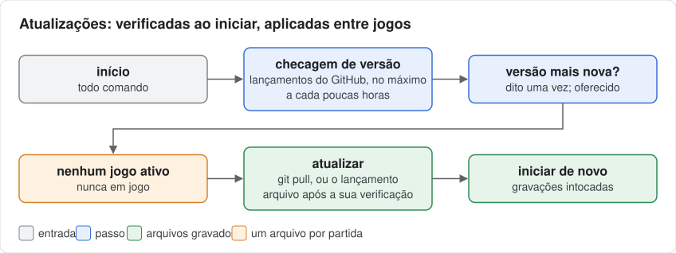

# Atualizações {#updates}

O watcher mantém-se atualizado a partir das versões (releases) de
[Holdi601/3DHeat-Watcher](https://github.com/Holdi601/3DHeat-Watcher/releases). O atualizador é o
pacote `heat3d_update`, ao lado de `heat3d_watch` no repositório.

## A verificação {#the-check}

- **Quando**: todos os comandos, exceto `update`, verificam ao arrancar. `run` também verifica enquanto
  corre, no máximo uma vez por hora e só enquanto nenhum jogo estiver a correr.
- **Como**: um pedido HTTPS para `https://api.github.com/repos/Holdi601/3DHeat-Watcher/releases/latest`,
  com tempo limite de 5 segundos. A resposta fica em cache durante seis horas em
  `%LOCALAPPDATA%\3DHeat\update-check-3DHeat-Watcher.json`, por isso a maioria dos arranques não
  pergunta nada. "Nenhuma versão ainda" (HTTP 404) é guardado em cache como uma resposta. Sem
  internet, com limite de pedidos ou atrás de um proxy, a verificação falha em silêncio e o
  comando continua com a versão que tem.
- **Versões**: a versão instalada é o ficheiro `VERSION` na pasta do repositório. A etiqueta de uma
  versão (`v1.2.0` ou `1.2.0`) é comparada como números, parte por parte; tudo o que vem depois de
  `-` ou `+` é ignorado.
- **Desligada**: `HEAT3D_NO_UPDATE=1` (qualquer valor que não seja vazio, `0`, `false` ou `no`)
  desliga a verificação e a atualização automática. Cada ferramenta do 3DHeat guarda o próprio
  ficheiro de cache, por isso a resposta de uma nunca vale para outra.

## O que acontece quando sai uma versão nova {#what-happens-when-a-newer-release-is-out}

- **`run`** mostra um aviso ao arrancar e continua a correr:
  `[heat3d_watch] 3DHeat Watcher 1.2.0 is out (this is 1.0.2). <release page>`. Enquanto corre, com
  `auto_update` ligado (o predefinido) e nenhum jogo a correr, atualiza-se então sozinho: a linha de
  log `3DHeat Watcher 1.2.0 is out (this is 1.0.2); updating`, uma notificação do Windows
  "Updating to 1.2.0", a atualização, todos os adaptadores parados e as sessões fechadas, e o
  mesmo comando iniciado de novo no código novo. O watcher nunca se atualiza no meio de um jogo.
  Se a atualização não puder ser aplicada, a notificação diz isso ("1.2.0 is out; not updated: ...")
  e o watcher continua a correr a versão antiga. Com `auto_update` desligado, há só o aviso.
- **Outros comandos** perguntam `Update now? [Y/n]` quando correm num terminal. Enter, `y`, `yes`,
  `j` ou `ja` atualiza e depois corre o mesmo comando de novo na versão nova. Sem terminal (uma
  execução agendada, um pipe), mostram como atualizar e seguem em frente.
- **Sob pedido**: `python -m heat3d_watch update` (ou `python -m heat3d_update`) pergunta ao
  GitHub sem o cache e atualiza. `--check` diz apenas se há uma versão nova. Isto funciona mesmo
  com `HEAT3D_NO_UPDATE` definido.

## Como uma atualização é aplicada {#how-an-update-is-applied}

Depende de como a cópia foi instalada:

- **Um clone do git** (a pasta tem `.git` e `git` está no PATH): `git pull --ff-only`. Isto é
  recusado enquanto o clone tiver alterações em ficheiros controlados pelo git (`git status --porcelain
  --untracked-files=no` não está vazio): essas alterações são trabalho de alguém, e uma atualização
  não decide o que acontece com elas. Faça commit ou stash delas, depois faça pull.
- **Uma cópia transferida**: o ficheiro de código-fonte da versão é transferido e extraído numa pasta
  temporária. As entradas que sairiam para fora dela são ignoradas. O `VERSION` do ficheiro tem de ser
  a versão que a release declara, senão nada é copiado. Depois, os ficheiros são copiados por cima
  da pasta do repositório. Os ficheiros que não fazem parte de uma versão - gravações, configurações,
  ambientes virtuais, exportações, tudo o que criou - não são tocados. Um módulo Python
  que uma versão antiga tinha e a nova deixou de ter é removido dos pacotes da própria versão
  (`heat3d_watch`, `heat3d_update`), para que nenhum módulo de adaptador antigo seja carregado
  depois da atualização; nada fora desses pacotes é removido.

As gravações e configurações normalmente ficam fora da pasta do repositório de qualquer forma
(`%LOCALAPPDATA%\3DHeat\Watcher`), por isso uma atualização nunca chega perto delas.

Depois de uma atualização, o mesmo comando é iniciado de novo. No Windows, o watcher inicia o novo
processo, espera por ele e reencaminha o código de saída dele, por isso a consola comporta-se como se o
primeiro processo tivesse feito o trabalho.
