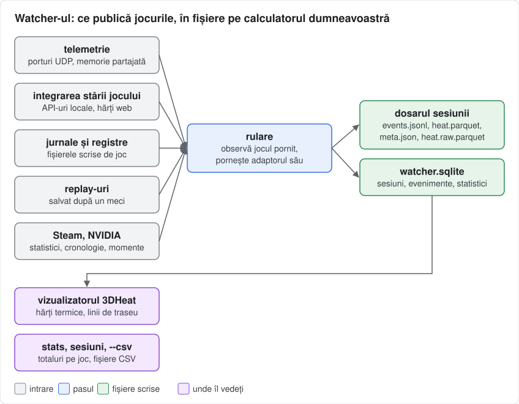
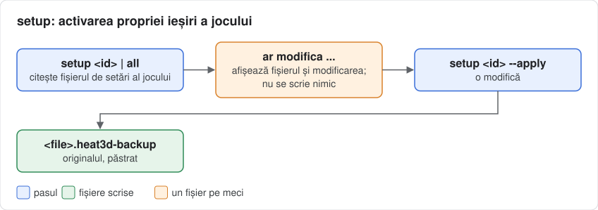
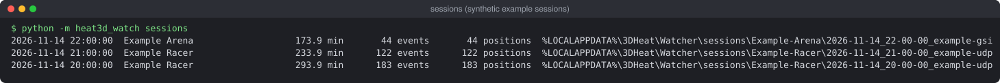
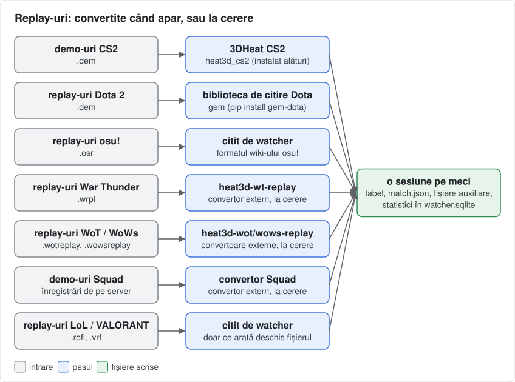
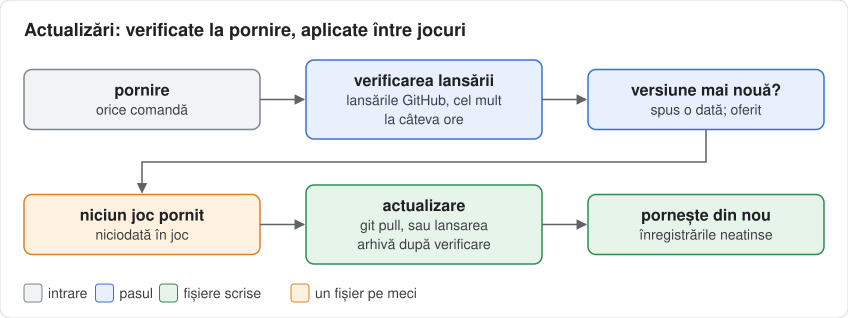

# Comenzi {#commands}

Sunteți nou în linia de comandă? Citiți mai întâi [Înainte de a începe](before-you-start.md). Fiecare comandă se scrie
într-un terminal deschis în dosarul în care ați dezarhivat sau clonat programul (în File Explorer, scrieți
`powershell` în bara de adrese), astfel:

```bash
python -m heat3d_watch <command> [options]
```


| Comandă | Ce face |
|---|---|
| [`run`](#run) | urmărește în fundal și înregistrează fiecare joc care rulează |
| [`games`](#games) | ce oferă fiecare joc și de unde |
| [`setup`](#setup) | pornește ieșirea proprie a unui joc |
| [`status`](#status) | ce jocuri rulează acum și ce adaptoare ar porni |
| [`sessions`](#sessions) | înregistrările de până acum |
| [`stats`](#stats) | totaluri pe joc, sau tabelele ca CSV |
| [`table`](#table) | reconstruiește `heat.parquet` al unei sesiuni din `events.jsonl` |
| [`replays`](#replays) | convertește replay-urile deja existente pe disc |
| [`dota-replay`](#dota-replay) | descarcă replay-ul unui meci public Dota 2 după id |
| [`dota-map`](#dota-map) | harta Dota 2 din instalarea dumneavoastră, ca nivel 3D pentru vizualizator |
| [`update`](#update) | actualizează la cea mai nouă versiune |
| [`config`](#config) | afișează sau schimbă setările |

Opțiuni pentru fiecare comandă: `-h` / `--help` afișează ajutorul, iar `python -m heat3d_watch --version`
afișează versiunea (fișierul `VERSION`).

Imaginile din această pagină sunt rulări pe sesiuni exemplu, inventate (`Example Racer`, `Example Arena`),
nu înregistrări reale.

Fiecare comandă, în afară de `update`, verifică mai întâi dacă există o versiune mai nouă (cel mult la fiecare
șase ore; se sare peste cu `HEAT3D_NO_UPDATE=1`, vezi [Actualizări](updates.md)). `run` doar afișează o
notificare. Celelalte comenzi întreabă `Update now? [Y/n]` când rulează într-un terminal, și afișează cum se
actualizează când nu rulează. Ieșirea este UTF-8, deci numele jocurilor în orice alfabet se afișează în orice
consolă.

## run {#run}

```bash
python -m heat3d_watch run [--once] [-v]
```



Rulează până este oprită (Ctrl+C): la fiecare `scan_seconds` citește lista proceselor și pornește câte un
adaptor pentru fiecare joc găsit, plus adaptoarele care rulează permanent. Înainte de prima verificare
termină sesiunile pe care le-a lăsat deschise o rulare anterioară. Cât timp niciun joc nu rulează, se poate
actualiza singur (dacă `auto_update` este pornit). Detaliile sunt în
[Instalare și rulare](installing-and-running.md#running).

| Opțiune | Efect |
|---|---|
| `--once` | o singură verificare a jocurilor care rulează, apoi ieșire. Adaptoarele pentru jocurile care rulează acum (și cele permanente) sunt pornite, fiecare citește o dată (se așteaptă cel mult 10 secunde pentru asta), apoi toate sunt oprite așa cum se oprește un joc care se termină: sesiunile lor sunt închise, scrise și numărate. Pentru verificarea detectării, nu pentru înregistrare. |
| `-v`, `--verbose` | linii de depanare în `watcher.log` și în consolă |

`run` scrie `<data>\watcher.lock` și refuză să pornească a doua oară pentru același dosar de date (cod de
ieșire 1); vezi [Fișierul de blocare](installing-and-running.md#the-lock-file).

## games {#games}

```bash
python -m heat3d_watch games [--markdown]
```


Afișează fiecare adaptor, sortat pe joc: numele, id-ul și tipul lui, de unde citește, ce înregistrează și cum
se pornește. Un adaptor care nu poate rula pe acest calculator este marcat `[unavailable: <why>]` - SimConnect.dll
nu a fost găsit, nu există dosarul Minecraft, 3DHeat CS2 nu este instalat, Steam sau NVIDIA App nu au fost
găsite. Un modul de adaptor care nu a putut fi importat este numit la sfârșit, împreună cu eroarea.

```text
EA SPORTS F1 25  (f1-25, telemetry)
    from: UDP telemetry 127.0.0.1:20777 (Documents\My Games\F1 25\hardwaresettings\hardware_settings_config.xml)
    - every car's position (world XYZ, m) at 10 Hz, by driver name, team, own car marked, ...
    switch on: In the game: Settings > Telemetry Settings > UDP Telemetry On, IP 127.0.0.1, port 20777 - ...
```

`--markdown` afișează același lucru ca un singur tabel Markdown (joc, ce se înregistrează, de unde, cum se
pornește, joc online, verificat). Tabelul din [Toate jocurile într-un tabel](watcher.md) este rezultatul acestei
comenzi. Celulele sunt scăpate pentru Markdown: textul între apostrofe inverse rămâne bloc de cod, iar în afara
lor `<`, `>`, `&`, `*`, `|` și o bară inversă înaintea unui semn de punctuație sunt scrise astfel încât să
apară cum au fost tastate (`<CS2>` ar dispărea altfel ca etichetă HTML în kramdown). Singura bucată de HTML
este `<br>` dintre elementele din "What is recorded".

## setup {#setup}

```bash
python -m heat3d_watch setup <adapter id | all> [--apply]
```




Pornește ieșirea proprie a unui joc, acolo unde jocul are nevoie ca un fișier să fie schimbat pentru asta. Fără
`--apply` nu se schimbă nimic: fiecare rând spune ce s-ar schimba, iar dacă există ceva de schimbat, ultimul rând
spune `Nothing was changed. Run again with --apply to make these changes.` Când nu este nimic de schimbat,
afișează `<id>: nothing to change` (`Nothing to change.` pentru `all`). Cu `--apply` schimbările se fac, iar
înainte ca un fișier să fie schimbat prima dată, originalul său este salvat ca `<file>.heat3d-backup`. O copie
de rezervă care există deja nu este niciodată suprascrisă, deci conține întotdeauna fișierul așa cum era înainte
ca watcher-ul să-l atingă prima dată.

```text
f1-25: would change: hardware_settings_config.xml <udp>: enabled="false" -> "true"
Nothing was changed. Run again with --apply to make these changes.
```

`all` rulează configurarea fiecărui adaptor care are una. Un adaptor fără configurare, numit separat, afișează
`<id>: nothing for setup to change; ` urmat de cum se pornește jocul (textul său `enable`, sau faptul că nu are
nevoie de nimic). Un id necunoscut afișează `no adapter '<id>'; games lists them` și iese cu codul 2.
Adaptoarele care au ceva de configurat:

| Adaptor | Ce schimbă `--apply` |
|---|---|
| `beamng` | instalează modificarea de protocol `heat3d` în dosarul `mods` al utilizatorului BeamNG (doar dacă nu este acolo); apoi pornește în joc Options > Other > Protocols > "others" |
| `cs2-gsi` | scrie `<CS2>\game\csgo\cfg\gamestate_integration_heat3d.cfg`: trimite starea jocului către `http://127.0.0.1:3311/` cu un token aleator, pe care watcher-ul îl cere apoi (un token deja existent în fișier se păstrează); CS2 îl citește când pornește |
| `dota2-gsi` | la fel pentru Dota 2: `<Dota>\game\dota\cfg\gamestate_integration\gamestate_integration_heat3d.cfg`, portul 3312 |
| `dcs` | adaugă `Scripts\Hooks\heat3d-watch.lua` în fiecare dosar `%USERPROFILE%\Saved Games\DCS*`. Propria sa copie mai veche este actualizată; un fișier cu acest nume, pe care watcher-ul nu l-a scris, este lăsat neatins. Reporniți DCS. |
| `dirt-rally-2` | `hardware_settings_config.xml`: `<udp enabled="true" extradata="3" ip="127.0.0.1" port="20777">`; porniți jocul o dată înainte, ca fișierul să existe |
| `ea-wrc` | `Documents\My Games\WRC\telemetry\config.json`: pachetul `session_update` al structurii `wrc` pornit, către acest calculator |
| `f1-23`, `f1-24`, `f1-25` | `hardware_settings_config.xml`: `<udp enabled="true" ip="127.0.0.1" port="20777">`; jocul trebuie să fie închis |
| `hearthstone` | adaugă o secțiune `[Power]` (`LogLevel=1`, `FilePrinting=true`) în `%LOCALAPPDATA%\Blizzard\Hearthstone\log.config`; reporniți jocul |
| `il2` | `<game>\data\startup.cfg`, `[KEY = telemetrydevice]`: încă o țintă `addrN = "127.0.0.1:41995"` și `enable = true` (secțiunea se adaugă, la 10 Hz, când nu există); reporniți IL-2 |
| `il2-tacview` | `<game>\data\startup.cfg`, `[KEY = track_record]`: `tacviewrecord = 1` |
| `rocketleague-stats` | `TAStatsAPI.ini` (sau `DefaultStatsAPI.ini`, când acesta nu există) din `<RL>\TAGame\Config`: `PacketSendRate=30` când API-ul este oprit, și `Port` când nu este setat niciun port; citit când pornește Rocket League |

`richard-burns-rally` nu are configurare: telemetria sa este a modulului RSF/NGP, pornit manual în
`RichardBurnsRally.ini` (vezi [pagina sa](game-richard-burns-rally.md)); `setup richard-burns-rally` spune asta.
Fiecare alt joc fie nu are nevoie de nimic, fie se pornește în joc; pagina fiecărui joc spune cum.

## status {#status}

```bash
python -m heat3d_watch status
```

```text
3DHeat Watcher 1.0.2; data in C:\Users\...\AppData\Local\3DHeat\Watcher
Games running: EA SPORTS F1 25 (f1-25)
Always on: il2-tacview, steam-stats, steam-timeline, nvidia-highlights, cs2-demos, osu-replays, lol-replays, valorant-replays
```

Spune ce adaptoare ar porni acum o `run`, după aceleași reguli: procesul jocului rulează, adaptorul nu este în
`disabled`, nu lipsește nimic de care are nevoie, adaptoarele de replay doar cu `replays` pornit, adaptoarele de
memorie doar cu `memory` pornit și toate verificările de memorie trecute. Nu pornește nimic.

## sessions {#sessions}

```bash
python -m heat3d_watch sessions [--game NAME] [--limit N]
```



Cele mai noi sesiuni din `watcher.sqlite`, câte un rând fiecare: începutul (ora locală), jocul, minutele,
evenimentele, pozițiile, dosarul.

| Opțiune | Efect |
|---|---|
| `--game NAME` | doar acest joc, după numele exact din listă (`"EA SPORTS F1 25"`) |
| `--limit N` | cel mult N sesiuni (implicit 40) |

## stats {#stats}

```bash
python -m heat3d_watch stats [--game NAME] [--csv DIR]
```


Fără opțiuni: un tabel cu fiecare joc (sesiuni, ore, evenimente, poziții, ultima dată jucat), cel mai jucat primul,
apoi, pentru fiecare joc, cele 25 de evenimente cele mai frecvente și fiecare statistică numerică, cu numărul de
sesiuni care o au, totalul, cea mai bună valoare (`best`) și media. `best` știe în ce sens este mai bine: cea mai
mică valoare pentru timpii păstrați ca cel mai bun (`best_lap`, `best_stage` și orice altă cheie care începe cu
`best_`) și pentru locuri (`race_position`, `grid_position`, orice cheie care se termină în `_position`), cea mai
mare pentru tot restul (eliminări, distanță, viteza maximă, contoarele proprii ale unui joc).

| Opțiune | Efect |
|---|---|
| `--game NAME` | doar evenimentele și statisticile acestui joc, fără prezentarea generală |
| `--csv DIR` | scrie `sessions.csv`, `events.csv` și `stats.csv` (fiecare rând din cele trei tabele) în `DIR`, în schimb; `--game` nu le restrânge |

## table {#table}

```bash
python -m heat3d_watch table <session folder>
```


Reconstruiește `heat.parquet` dintr-un dosar de sesiune, din `events.jsonl`, cu axele din `meta.json`. Afișează
calea tabelului sau `no positions in this session`. Folosiți-o pentru o sesiune înregistrată când lipsea
`pyarrow`, sau după ce ați editat `events.jsonl` de mână.

## replays {#replays}

```bash
python -m heat3d_watch replays <adapter id> [folder] [-v]
```



Convertește acum, unul după altul, replay-urile deja existente pe disc, fiecare într-o sesiune, așa cum ar face
urmărirea dosarului. Prima dată când watcher-ul vede un dosar de replay-uri, doar notează ce se află în el (vezi
[Instalare și rulare](installing-and-running.md#replays-already-on-disk)); așa se convertesc acestea la cerere.
Fără `folder` se citesc dosarele proprii ale adaptorului (ale jocului, plus `replay_folders`); cu el, replay-urile
din acel dosar. Fiecare replay convertit este notat ca văzut, ca watcher-ul care rulează să nu-l convertească din
nou. Un replay a cărui conversie eșuează este înregistrat în jurnal și sărit.

| Adaptor | Replay-uri |
|---|---|
| `cs2-demos` | demo-uri Counter-Strike 2 (`*.dem`), prin 3DHeat CS2 |
| `lol-replays` | replay-uri League of Legends (`*.rofl`) |
| `osu-replays` | replay-uri osu! (`*.osr`) |
| `valorant-replays` | replay-uri VALORANT (`*.vrf`) |
| `warthunder-replays` | replay-uri War Thunder (`*.wrpl`), prin convertorul extern `heat3d-wt-replay` (exporters/ext/warthunder-replay) |
| `wot-replays` | replay-uri World of Tanks (`*.wotreplay`), prin convertorul extern `heat3d-wot-replay` (exporters/ext/wot-replay) |
| `wows-replays` | replay-uri World of Warships (`*.wowsreplay`), prin convertorul extern `heat3d-wows-replay` (exporters/ext/wows-replay) |
| `dota-replays` | replay-uri Dota 2 (`*.dem`), prin gem (`pip install gem-dota`) |

```text
osu-replays: converted 12 replay(s); `sessions --game` lists them
```

Un id care nu este unul dintre acestea afișează `no replay adapter '<id>'` cu lista și iese cu codul 2; la fel
și un `folder` care nu există. Un adaptor care nu poate rula aici (3DHeat CS2 nu este instalat) afișează motivul
și iese cu codul 1. Urmele Tacview ale IL-2 nu sunt în listă: acest adaptor convertește singur fiecare urmă
terminată pe care o găsește.

## dota-replay {#dota-replay}

```bash
python -m heat3d_watch dota-replay <match id> [<match id> ...] [-o FOLDER] [--convert] [-v]
```

Descarcă replay-ul unui meci public Dota 2 de pe serverele de replay ale Valve. Are nevoie de internet. Id-ul
meciului este numărul de pe pagina meciului din clientul Dota (detaliile meciului) sau de pe site-ul OpenDota;
Valve păstrează un replay câteva săptămâni, după care descărcarea eșuează. Serverul și salt-ul replay-ului vin
din înregistrarea meciului la OpenDota (`api.opendota.com/api/matches/<id>`, fără cheie), fișierul din
`replay<cluster>.valve.net/570/<id>_<salt>.dem.bz2`; se dezarhivează pe măsură ce sosește (Valve trimite sub
acest nume atât bzip2, cât și Zstandard) și se salvează ca `<match id>.dem`. Fără `-o` merge în dosarul propriu de
replay-uri al Dota, când Dota 2 este instalat - unde îl convertește un watcher care rulează - iar altfel în
`<data>/replays/dota`. Un fișier care există deja acolo este păstrat. `--convert` convertește imediat replay-urile
descărcate, ca `replays dota-replays`, și le notează ca văzute.

```text
match 9000000000: C:\Program Files (x86)\Steam\steamapps\common\dota 2 beta\game\dota\replays\9000000000.dem
```

Valve păstrează replay-urile câteva săptămâni; un meci mai vechi afișează `Valve no longer has the replay of match
<id>` și iese cu codul 1. Un meci pe care OpenDota nu l-a văzut încă nu are salt: mesajul spune să cereți OpenDota
(`curl -X POST https://api.opendota.com/api/request/<id>`) și să încercați din nou peste câteva minute. Lobby-urile
private și meciurile cu profil ascuns nu se află deloc pe serverele de replay.

## dota-map {#dota-map}

```bash
python -m heat3d_watch dota-map [<map>] -o <file.glb> [--game FOLDER] [--source2viewer EXE] [--detail UNITS]
```

Scrie harta Dota 2 - terenul, stâncile, apa, copacii și clădirile - ca nivel `.glb`, în sistemul de referință în
care sunt desenate tabelele de replay Dota, din instalarea dumneavoastră de Dota 2, citită de linia de comandă a
Source2Viewer. Nu se descarcă nimic. `<map>` este implicit `dota`; `--game` este dosarul Dota 2 când nu se află
într-o bibliotecă Steam; `--source2viewer` este calea CLI-ului, când nu este nici în `HEAT3D_SOURCE2VIEWER`, nici
în `PATH`; `--detail` este celula de grupare a vârfurilor pentru clădiri, în unități de joc (implicit 8, 0
păstrează fiecare triunghi). Iese cu codul 1 și `dota-map: <why>` când nu se găsește Dota 2, harta sau
Source2Viewer. Fiecare pas, părțile fișierului și cum a fost verificat: [Harta Dota 2](dota-map.md).

## update {#update}

```bash
python -m heat3d_watch update [--check]
```



Cere de la GitHub cea mai nouă versiune, ignorând răspunsul din cache, și actualizează această copie dacă este mai
nouă (vezi [Actualizări](updates.md)). `--check` spune doar dacă a apărut o versiune mai nouă. Această comandă
rulează chiar și cu `HEAT3D_NO_UPDATE` setat: a o cere este decizia. `python -m heat3d_update [--check]` face același
lucru.

## config {#config}

```bash
python -m heat3d_watch config [--set KEY=VALUE ...]
```


Afișează fiecare setare ca `key = value`. Cu `--set`, schimbă mai întâi cele date și salvează `settings.json`
(`saved <path>`). Valorile se citesc după tipul setării:

- setările adevărat/fals: `1`, `true`, `yes`, `on` sau `ja` înseamnă adevărat; `0`, `false`, `no`, `off`, `nein`
  sau nimic înseamnă fals;
- numere: un număr zecimal (`scan_seconds=5`);
- liste: separate prin virgulă sau o listă JSON (`disabled=steam-stats,steam-timeline`; o valoare goală golește
  lista);
- dicționare (`replay_folders`, `player_names`): dicționarul întreg ca JSON, sau o intrare ca `CHEIE.ID=VALOARE` -
  `replay_folders.cs2-demos=D:\Demos,E:\More Demos` setează dosarele acelui adaptor (separate prin virgulă),
  `player_names.warthunder-webmap=Name` numele acelui adaptor; o valoare goală șterge intrarea;
- text: așa cum este dat (`data=D:\Heat`, `riot_id=Name#TAG`).

```bash
python -m heat3d_watch config --set memory=true scan_seconds=5
python -m heat3d_watch config --set riot_id=Name#TAG riot_platform=EUW1
python -m heat3d_watch config --set replay_folders.cs2-demos=D:\Demos player_names.rocketleague-stats=Name
```

O cheie necunoscută afișează `no setting '<key>'`, iar o valoare care nu are tipul setării (`memory=perhaps`,
`scan_seconds=often`, un dicționar care nu este JSON) afișează `not saved: ...`; ambele ies cu codul 2 fără să
salveze nimic. Un `settings.json` editat de mână se citește la fel: o valoare dată ca text acolo unde setarea este
un număr, un adevărat/fals sau un dicționar este citită ca atare, iar una care nu poate fi citită rămâne la
valoarea implicită. Fiecare setare este descrisă în [Instalare și rulare](installing-and-running.md#settings).
