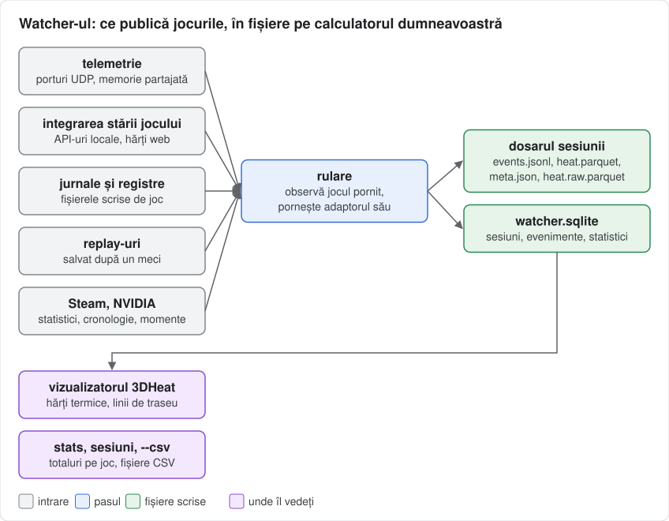

# 3DHeat Watcher {#dheat-watcher}

**Ce este?** Jucați un joc. Acest program notează discret unde ați mers și ce s-a întâmplat.
Mai târziu puteți vedea totul ca o hartă colorată în vizualizatorul 3DHeat.

**De ce l-aș folosi?** Ca să țineți propria evidență a fiecărei sesiuni - unde ați condus, zburat sau
luptat, totalurile dumneavoastră pe fiecare joc - fără niciun site web și fără a modifica jocul.

**Exemplu:** conduceți un tur într-un joc de curse cu watcher-ul pornit; după aceea, un fișier din
`sessions\<game>\` păstrează traseul pe care l-ați parcurs, iar vizualizatorul îl desenează.

Mai în detaliu: 3DHeat Watcher este un program care rulează în fundal și înregistrează ce publică jocurile despre
jocul dumneavoastră - unde ați mers, ce s-a întâmplat unde și cifrele din spatele lor - în fișiere de pe propriul
calculator. Fișierele sunt pentru propriile statistici și pentru hărțile termice și liniile de traseu ale
vizualizatorului 3DHeat.

Rulează discret, observă ce joc ați pornit și citește rezultatele proprii ale acelui joc: un port de telemetrie
sau memorie partajată pe care jocul le publică pentru panouri, o integrare a stării jocului, jurnalul sau
logul pe care îl scrie jocul, replay-ul salvat după un meci, statisticile pe care le ține Steam, clipurile pe
care le salvează NVIDIA App. Înregistrările rămân pe calculatorul dumneavoastră. Programul contactează doar
două servicii externe, și doar în aceste cazuri: GitHub, ca să caute o lansare mai nouă (vezi [Actualizări](../updates.md)),
și API-ul Match-V5 al Riot, și doar dacă introduceți propria cheie API Riot (vezi [Replay-urile League of Legends](../game-lol-replays.md)).



## Ce înregistrează {#what-it-records}

- **Poziții**: mașina, aeronava, eroul sau jucătorul, de mai multe ori pe secundă, acolo unde jocul le publică,
  cu viteza, direcția și orice altceva trimite jocul alături.
- **Evenimente**: apariții, morți, eliminări, ture, etape, runde, goluri, misiuni, decolări și aterizări, schimbări
  de zonă, realizări, momente remarcabile. Fiecare eveniment este păstrat cu momentul său și, când jocul îl dă,
  cu locul său.
- **Statistici pe sesiune**: eliminări, morți, ture, cea mai bună tură, distanță, viteza maximă, timpul de joc și
  statisticile proprii ale jocului, acolo unde le ține.

Ce dă fiecare joc și de unde, este pe pagina sa proprie din [Jocuri](../games.md). Nicio sursă nu poate înregistra
totul: jocurile multiplayer sunt înregistrate doar prin ce publică, iar watcher-ul nu citește niciodată memoria
lor (vezi [Surse și reguli](../sources-and-rules.md)).

## Instalare {#install}

Nu ați mai lucrat în linia de comandă? Citiți mai întâi [Înainte de a începe](before-you-start.md).

Watcher-ul este un program Python pentru Windows (Python 3.10 sau mai nou). Multe dintre sursele sale există
doar pe Windows: memoria partajată, registrul, notificările Windows.

```bash
git clone https://github.com/Holdi601/3DHeat-Watcher.git
cd 3DHeat-Watcher
pip install -r requirements.txt
```

O arhivă de lansare descărcată funcționează la fel: o dezarhivați, apoi rulați `pip install -r requirements.txt`
în dosar. Detaliile, și extrasele de care au nevoie unele jocuri, sunt în
[Instalarea și rularea](../installing-and-running.md).

## Pornire rapidă {#quick-start}

```bash
python -m heat3d_watch games            # what each game gives, and from where
python -m heat3d_watch setup all        # what would have to be switched on (nothing is changed)
python -m heat3d_watch setup f1-25 --apply   # switch one game's output on (the original file is backed up)
python -m heat3d_watch run              # watch; leave it running while you play
python -m heat3d_watch stats            # totals per game
python -m heat3d_watch stats --csv out  # sessions, events and stats as CSV files
```

Ar trebui să vedeți: după `games`, un tabel cu câte o linie pentru fiecare joc; `run` continuă până
apăsați Ctrl+C sau închideți fereastra.

Totul se scrie în `%LOCALAPPDATA%\3DHeat\Watcher`. Ca să folosiți alt dosar, setați variabila de mediu
`HEAT3D_WATCH_HOME` sau rulați `python -m heat3d_watch config --set data=D:\somewhere`.

- `sessions\<game>\<date>_<adapter>\` - câte un dosar pentru fiecare sesiune, care conține `events.jsonl` (fiecare
  eveniment pe măsură ce apare), `heat.parquet` (rândurile cu o poziție, gata pentru vizualizatorul 3DHeat) și
  `meta.json` (jocul, sursa, axele, numărătorile, statisticile)
- `watcher.sqlite` - statisticile fiecărei sesiuni, în trei tabele simple
- `watcher.log` - ce a făcut watcher-ul

Vizualizatorul deschide direct `heat.parquet` al unei sesiuni, fără nicio setare (axele și unitățile sunt în
fișier). Replay-urile convertite sunt scrise alături, ca tabele și documente de meci; formatul vizualizatorului
pentru un fișier pe meci este descris pe pagina sa [containerul `.3dheat`](https://holdi601.github.io/3DHeat/container.html),
iar coloanele fiecărui tabel în [Datele](../the-data.md).

## Documentația {#the-documentation}

| Pagina | Ce acoperă |
|---|---|
| [Înainte de a începe](before-you-start.md) | Python, un terminal, locurile rezervate, cum arată succesul și erorile frecvente |
| [Instalarea și rularea](../installing-and-running.md) | cerințe, rularea în fundal, pornirea odată cu Windows, fișierul de blocare, jurnalul, fiecare setare și variabilă de mediu |
| [Jocuri](../games.md) | o pagină pentru fiecare joc: ce se înregistrează, de unde, cum se activează, cum funcționează, axele, statisticile, ce s-a verificat |
| [Datele](../the-data.md) | dosarele sesiunilor, `events.jsonl`, `heat.parquet` și subsolul său, `meta.json`, `watcher.sqlite`, recuperarea după o prăbușire, exportul CSV, deschiderea unei sesiuni în vizualizatorul 3DHeat |
| [Comenzi](../commands.md) | fiecare comandă și opțiune a `python -m heat3d_watch` |
| [Surse și reguli](../sources-and-rules.md) | cele șase feluri de surse, regulile jocurilor multiplayer, ce jocuri sunt lăsate deoparte și de ce |
| [Momentele remarcabile NVIDIA](../nvidia-highlights.md) | ce pot și ce nu pot livra Momentele remarcabile NVIDIA, și cum primește un moment o poziție |
| [Modurile de server pentru înregistrare](../server-mods.md) | modurile de server Arma 3 și Arma Reforger care înregistrează misiuni întregi pentru vizualizator |
| [Citirea memoriei](../memory-reading.md) | profiluri de memorie pentru jocuri pentru un singur jucător: formatul, verificările, cum se scrie și se verifică unul |
| [Actualizări](../updates.md) | cum caută watcher-ul lansări noi și cum se actualizează singur |
| [Dezvoltare](../development.md) | scrierea unui adaptor: API-ul, testele, un `verified` onest, regenerarea paginilor de jocuri |
| [Toate jocurile într-un tabel](../watcher.md) | fiecare joc într-un singur tabel, așa cum îl afișează `games --markdown`, plus jocurile cercetate, dar încă nerealizate |
| [Referința comenzilor](../cli-reference.md) | `--help` al fiecărei comenzi, generat din cod |
| [Întreținerea](../maintaining.md) | lista de verificare pentru lansarea acestor pagini |

## Parte din 3DHeat {#part-of-3dheat}

3DHeat Watcher este unul dintre instrumentele gratuite din jurul vizualizatorului 3DHeat (watcher-ul folosește
3DHeat CS2 ca să convertească demo-urile CS2). Fiecare este un proiect propriu, cu propriile lansări și propria licență:

| Instrument | Ce face | Documentație |
|---|---|---|
| [3DHeat](https://github.com/Holdi601/3DHeat) | vizualizatorul: hărți termice, analiza cursei și revizuirea meciului în 3D | [site](https://holdi601.github.io/3DHeat/) |
| [GameFiles](https://github.com/Holdi601/3DHeat-GameFiles) | circuite și nivele din fișierele livrate de jocuri, ca modele 3D | [site](https://holdi601.github.io/3DHeat-GameFiles/) |
| [GameCapture](https://github.com/Holdi601/3DHeat-GameCapture) | telemetria turelor din jocurile de curse; nivele reconstruite din videoclipuri de joc | [site](https://holdi601.github.io/3DHeat-GameCapture/) |
| [Unreal Exporter](https://github.com/Holdi601/3DHeat-UnrealExporter) | un plugin pentru Unreal Editor care exportă un nivel ca un singur model 3D | [site](https://holdi601.github.io/3DHeat-UnrealExporter/) |
| [CS2](https://github.com/Holdi601/3DHeat-CS2) | demo-uri Counter-Strike 2 în tabele și documente de meci; hărți în modele 3D | [site](https://holdi601.github.io/3DHeat-CS2/) |
| [Watcher](https://github.com/Holdi601/3DHeat-Watcher) | înregistrează, în fundal, ce publică jocurile despre jocul dumneavoastră | [site](https://holdi601.github.io/3DHeat-Watcher/) |
| [Ext-WarThunder](https://github.com/Holdi601/3DHeat-Ext-WarThunder) | replay-uri War Thunder în tabele și documente de meci | [site](https://holdi601.github.io/3DHeat-Ext-WarThunder/) |
| [Ext-WoT](https://github.com/Holdi601/3DHeat-Ext-WoT) | replay-uri World of Tanks în tabele și documente de meci | [site](https://holdi601.github.io/3DHeat-Ext-WoT/) |
| [Ext-WoWs](https://github.com/Holdi601/3DHeat-Ext-WoWs) | replay-uri World of Warships în tabele și documente de meci | [site](https://holdi601.github.io/3DHeat-Ext-WoWs/) |
| [Ext-Squad](https://github.com/Holdi601/3DHeat-Ext-Squad) | demo-uri de server Squad în tabele și documente de meci | [site](https://holdi601.github.io/3DHeat-Ext-Squad/) |
| [Ext-DCS](https://github.com/Holdi601/3DHeat-Ext-DCS) | hărțile DCS World în modele 3D | [site](https://holdi601.github.io/3DHeat-Ext-DCS/) |
| [Ext-IL2](https://github.com/Holdi601/3DHeat-Ext-IL2) | hărțile IL-2 Sturmovik în modele 3D | [site](https://holdi601.github.io/3DHeat-Ext-IL2/) |

Licență: MIT ([LICENSE](https://github.com/Holdi601/3DHeat-Watcher/blob/main/LICENSE)). Licențele
pachetelor terțe pe care le folosește, și ce cer jocurile pe care le citește, sunt enumerate în
[LICENSES.md](https://github.com/Holdi601/3DHeat-Watcher/blob/main/LICENSES.md).
