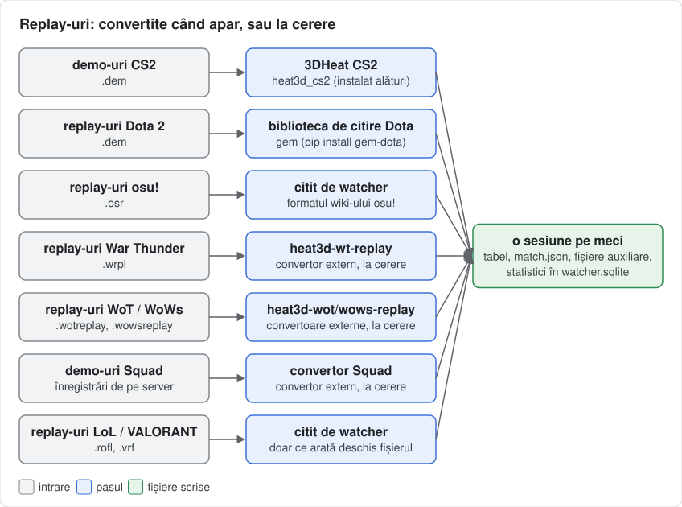

# Instalare și rulare {#installing-and-running}

## Cerințe {#requirements}

- **Windows.** Watcher-ul este scris pentru Windows, iar cele mai multe dintre sursele sale există doar acolo: memoria
  partajată pe care o creează jocurile (mapările `Local\...`), registrul (unde se află Steam), notificările Windows,
  lista proceselor cu căile executabilelor. Pe alt sistem programul pornește, dar acele surse nu găsesc nimic,
  notificările sunt doar înregistrate în jurnal, iar citirea memoriei refuză ("only implemented on Windows").
- **Python 3.10 sau mai nou**, de la <https://www.python.org/downloads/>: bifați **Add python.exe to PATH** în
  programul de instalare, apoi verificați cu `python --version` într-un terminal nou. Sunteți nou în asta? Citiți mai
  întâi [Înainte de a începe](before-you-start.md).
- **Pachete** (`requirements.txt`): `psutil>=6.0` (ce jocuri rulează, ce program ține un port, conexiunile unui joc; un
  psutil mai vechi funcționează încă, prin numele său mai vechi pentru conexiunile unui proces), `pyarrow>=15` (scrierea
  `heat.parquet`), `numpy>=1.24` și `pytest>=8.0` pentru teste. `requirements-optional.txt` nu listează deocamdată
  niciun pachet.

Fără `pyarrow`, sesiunile se înregistrează în continuare: `events.jsonl` este înregistrarea, iar tabelul poate fi făcut
mai târziu cu [`table`](commands.md#table).

### Ce trebuie în plus pentru unele jocuri {#extras-some-games-need}

| Joc | Ce are nevoie |
|---|---|
| Demo-uri Counter-Strike 2 | [3DHeat CS2](https://github.com/Holdi601/3DHeat-CS2) și cerințele sale (`demoparser2`). Watcher-ul îl caută în `HEAT3D_CS2`, apoi într-un dosar `3DHeat-CS2` sau `cs2` lângă dosarul propriu al watcher-ului, apoi oriunde de unde Python poate importa `heat3d_cs2`. Fără el, `games` marchează adaptorul ca indisponibil. |
| Microsoft Flight Simulator 2020 / 2024 | `SimConnect.dll` - nu este livrat. MSFS 2020 are unul în dosarul său de instalare; pentru MSFS 2024, instalați SDK-ul MSFS 2024. `MSFS_SDK` / `MSFS2024_SDK` indică dosarul SDK-ului. |
| Euro Truck Simulator 2, American Truck Simulator | modulul RenCloud `scs-telemetry.dll` (revizia 12) în `<game>\bin\win_x64\plugins` |
| BeamNG.drive | modificarea de protocol `heat3d`, instalată de `python -m heat3d_watch setup beamng --apply` |
| League of Legends (live) | opțional: certificatul rădăcină al Riot ca `<data>\riotgames.pem`, ca conexiunea locală să fie verificată |
| Minecraft | un dosar `%APPDATA%\.minecraft` (ediția Java) |

Pagina fiecărui joc din [Jocuri](games.md) spune ce trebuie pornit în jocul însuși. `python -m heat3d_watch games`
marchează un adaptor `[unavailable: ...]` când lipsește ceva de care are nevoie pe acest calculator.

## Instalare {#installing}

Sunteți nou în linia de comandă? Citiți mai întâi [Înainte de a începe](before-you-start.md). Dacă `pip` nu este găsit,
folosiți în schimb `python -m pip install -r requirements.txt`.

Dintr-o clonă:

```bash
git clone https://github.com/Holdi601/3DHeat-Watcher.git
cd 3DHeat-Watcher
pip install -r requirements.txt
```

Dintr-o versiune lansată: descărcați arhiva din lansările depozitului, dezarhivați-o, apoi rulați
`pip install -r requirements.txt` în dosar. Ambele tipuri de copii se actualizează singure (vezi
[Actualizări](updates.md)).

Rulați fiecare comandă din dosarul depozitului: `python -m heat3d_watch` importă pachetul de acolo, iar actualizatorul
(`heat3d_update`) stă alături.

## Rulare {#running}

```bash
python -m heat3d_watch run        # watch until stopped
python -m heat3d_watch run -v     # the same, with debug lines in the log
python -m heat3d_watch run --once # one look at the games running now, then stop and exit
```

La pornire, `run`:

1. scrie [fișierul de blocare](#the-lock-file);
2. termină sesiunile pe care le-a lăsat deschise o rulare anterioară, de exemplu după o prăbușire (vezi
   [Recuperarea](the-data.md#recovery-after-a-crash));
3. la fiecare `scan_seconds` (2 s), citește lista proceselor (doar nume și căi, niciun proces nu este deschis) și
   pornește un adaptor, într-un fir propriu, pentru fiecare joc găsit. Când procesul unui joc a dispărut, adaptorul său
   este oprit, iar sesiunile pe care le avea deschise se închid, ceea ce scrie tabelul lor și rândul lor în statistici.
   Adaptoarele care nu așteaptă un joc (statisticile Steam, Steam Timeline, evidențele NVIDIA, dosarele de replay)
   rulează tot timpul;
4. cât timp niciun joc nu rulează, caută o versiune mai nouă cel mult o dată pe oră (răspunsul în sine este păstrat în
   cache șase ore) și, cu `auto_update` pornit, o instalează și se pornește din nou (vezi [Actualizări](updates.md)).

Un adaptor care eșuează este înregistrat în jurnal și nu oprește pe ceilalți. Dacă o citire a unui adaptor eșuează de
20 de ori la rând, sau pornirea sa eșuează, adaptorul este oprit și nu repornește până când jocul este pornit din nou
(un id nou de proces).

Opriți watcher-ul cu Ctrl+C. Adaptoarele își închid sesiunile înainte să iasă. Dacă watcher-ul este oprit forțat (Task
Manager, o prăbușire, o pană de curent), nimic din ce a fost deja scris nu se pierde: următoarea `run` termină acele
sesiuni.

`--once` face o singură verificare: pornește adaptoarele pentru jocurile care rulează în acel moment (și pe cele
permanente), lasă fiecare să citească o dată - așteptând cel mult 10 secunde pentru asta - și apoi le oprește așa cum
s-ar opri la sfârșitul unui joc, ca sesiunile pe care le-au deschis să fie închise, tabelele lor scrise și rândurile lor
numărate în statistici înainte să iasă. Folosiți-l ca să verificați că un joc este detectat, nu pentru înregistrare.

### Replay-uri deja existente pe disc {#replays-already-on-disk}



Prima dată când un adaptor de replay vede unul dintre dosarele sale, doar notează replay-urile deja din el: un jucător
cu ani de demo-uri ar găsi altfel watcher-ul ocupat cu conversia timp de o zi. De atunci încolo, fiecare replay nou
este convertit după ce jocul a terminat de scris. Cele vechi se convertesc la cerere cu
[`replays`](commands.md#replays):

```bash
python -m heat3d_watch replays cs2-demos              # every demo in CS2's folders and replay_folders
python -m heat3d_watch replays osu-replays D:\Old     # the replays in one folder
```

### Rularea în fundal {#running-in-the-background}

Watcher-ul nu are o fereastră proprie; este un program de consolă care rulează până este oprit. Scrie totul în
`watcher.log`, deci nu are nevoie de o consolă vizibilă. Moduri de a-l ține deoparte:

- pornește-l într-o consolă și minimizează consola: `start "" /min python -m heat3d_watch run` din `cmd`, în dosarul
  depozitului;
- pornește-l fără consolă: `pythonw -m heat3d_watch run`. Ieșirea din consolă se pierde, dar `watcher.log` se scrie în
  continuare. Ca să-l oprești, încheie procesul `pythonw.exe`; următoarea pornire termină sesiunile pe care le-a lăsat
  deschise. Proiectul nu a testat această modalitate de rulare.

### Pornirea odată cu Windows (o idee) {#starting-with-windows-an-idea}

Watcher-ul nu se instalează singur ca să pornească odată cu Windows. Ca să pornească automat:

- **Task Scheduler**: creați o activitate cu declanșatorul *At log on* și acțiunea *Start a program*, programul
  `pythonw.exe` (sau `python.exe`), argumentele `-m heat3d_watch run`, *Start in* setat la dosarul depozitului;
- **Dosarul Startup**: puneți o scurtătură în `shell:startup` cu același program, aceleași argumente și același dosar
  *Start in*.

Niciuna nu face parte din watcher și nu este testată de el. [Fișierul de blocare](#the-lock-file) se asigură că o a
doua copie pornită din greșeală iese imediat.

## Fișierul de blocare {#the-lock-file}

`<data>\watcher.lock` ține id-ul procesului watcher-ului care rulează. Când `run` pornește și fișierul de blocare
numește un proces care încă există și al cărui nume conține `python`, afișează

```text
A watcher is already running (process 12345) for C:\Users\...\3DHeat\Watcher.
```

și iese cu codul 1. Doi watcheri pe același dosar de date ar înregistra fiecare joc de două ori, iar al doilea ar trata
sesiunile deschise ale primului drept rămășițe ale unei prăbușiri. Un fișier de blocare al cărui proces a dispărut, sau
care aparține altui program, este suprascris. Când `run` se termină, șterge fișierul de blocare dacă acesta mai numește
propriul său proces.

## Jurnalul {#the-log}

`<data>\watcher.log` este scris doar de `run`; celelalte comenzi afișează în consolă. Fiecare rând are ora, nivelul și
un mesaj:

```text
2026-05-01 20:15:01,123 INFO watching; data in C:\Users\...\AppData\Local\3DHeat\Watcher
2026-05-01 20:15:03,456 INFO f1-25: starting (EA SPORTS F1 25)
2026-05-01 21:02:11,789 INFO f1-25: stopping
```

Adaptoarele înregistrează ce nu pot face și de ce: "UDP 20777 is in use by ...; not taking it from that program",
"not reading memory: the game is played online", "could not start", "poll failed (3)" cu urma erorii. `run -v` adaugă
linii de depanare. Fișierul este completat și niciodată rotit sau golit de watcher; ștergeți-l oricând doriți. Aceleași
linii merg și în consolă.

## Unde este totul {#where-everything-is}

Dosarul de bază este `%LOCALAPPDATA%\3DHeat\Watcher`, sau `HEAT3D_WATCH_HOME` când este setat (fără `LOCALAPPDATA`, de
exemplu pe alt sistem, `~/.local/share/3DHeat/Watcher`). `settings.json` este mereu în dosarul de bază. Tot restul
merge în dosarul de date, care este dosarul de bază, dacă setarea `data` nu numește altul:

| Cale | Ce este |
|---|---|
| `<home>\settings.json` | setările |
| `<data>\sessions\` | înregistrările, câte un dosar pentru fiecare sesiune ([Datele](the-data.md)) |
| `<data>\watcher.sqlite` | baza de date a statisticilor |
| `<data>\watcher.log` | jurnalul lui `run` |
| `<data>\watcher.lock` | fișierul de blocare, cât timp rulează `run` |
| `<data>\state\` | ce au văzut deja adaptoarele permanente și cele de replay (`steam-stats.json`, `replays-cs2-demos.json`, ...), ca o repornire să nu înregistreze nimic de două ori |
| `<data>\profiles\*.json` | profilurile de memorie pe care le-ați scris ([Citirea memoriei](memory-reading.md)) |
| `<data>\riotgames.pem` | opțional, certificatul rădăcină al Riot pentru adaptorul live League of Legends |
| `%LOCALAPPDATA%\3DHeat\update-check-3DHeat-Watcher.json` | răspunsul din cache al ultimei verificări de versiune |

Watcher-ul nu șterge nimic din aceste dosare, cu excepția unui dosar de sesiune în care nu s-a înregistrat nimic (un joc
lăsat în meniuri).

## Setări {#settings}


`python -m heat3d_watch config` arată setările; `config --set key=value ...` le schimbă și salvează `settings.json`
(vezi [config](commands.md#config)). Fișierul este JSON simplu și poate fi editat și de mână, cât timp watcher-ul nu
rulează. Cheile necunoscute din el sunt ignorate. Setările se citesc când pornește o comandă, deci reporniți `run` după
ce le schimbați.

| Setare | Implicit | Ce face |
|---|---|---|
| `data` | `""` | Dosarul de date. Gol: dosarul de bază. |
| `disabled` | `[]` | Id-urile adaptoarelor care nu rulează niciodată, de exemplu `config --set disabled=steam-stats,nvidia-highlights`. Fiecare alt adaptor rulează când își găsește jocul. |
| `auto_update` | `true` | Cât timp niciun joc nu rulează, instalează o versiune mai nouă și repornește (vezi [Actualizări](updates.md)). `false`: doar o notificare în jurnal. |
| `scan_seconds` | `2.0` | Secunde între verificările listei proceselor. |
| `memory` | `false` | Permite adaptoarelor de memorie (jocuri pentru un singur jucător, cu un profil scris de dumneavoastră) să ruleze. Oprit implicit; vezi [Citirea memoriei](memory-reading.md). |
| `replays` | `true` | Rulează adaptoarele `replay`: toate (vezi `python -m heat3d_watch replays` și [Jocuri](games.md)) - demo-urile CS2, Dota 2, osu!, War Thunder, World of Tanks, World of Warships, Squad, replay-urile League of Legends și VALORANT, înregistrările Tacview ale IL-2. |
| `replay_folders` | `{}` | Dosare suplimentare după id-ul adaptorului, de exemplu `{"cs2-demos": ["D:\\Demos"]}`. Adaptoarele de replay le urmăresc pe lângă dosarele proprii ale jocului; `il2-tacview` acceptă și dosarele de instalare (atunci caută în `data\Tracks` al acestora); pentru `elite`, primul dosar ține locul dosarului jurnalului. Setați dosarele unui adaptor cu `config --set replay_folders.cs2-demos=D:\Demos,E:\More`, sau tot dicționarul ca JSON. |
| `riot_id` | `""` | ID-ul dumneavoastră Riot (`Name#TAG`), ca rândul dumneavoastră dintr-un replay League of Legends să devină statisticile dumneavoastră. Gol: se păstrează rândul fiecărui jucător, niciunul nu este marcat ca al dumneavoastră. |
| `riot_api_key` | `""` | Cheia dumneavoastră de API pentru dezvoltatori Riot, ca să luați cronologia oficială a fiecărui meci League redat (poziții în fiecare minut, eliminări unde au avut loc). Gol: nu se ia nimic. |
| `riot_platform` | `"EUW1"` | ID-ul platformei serverului dumneavoastră League (`EUW1`, `EUN1`, `NA1`, `KR`, ...), folosit ca să găsească gazda regională Match-V5. |
| `player_names` | `{}` | Numele dumneavoastră în jocurile a căror interfață numește fiecare jucător, dar nu spune care sunteți dumneavoastră, după id-ul adaptorului: `warthunder-webmap` (rândurile din fluxul de eliminări despre dumneavoastră devin eliminările și morțile dumneavoastră) și `rocketleague-stats` (rândurile dumneavoastră devin `me`; fără el, jucătorul urmărit de camera jocului). Setați cu `config --set player_names.warthunder-webmap=Name`. |

Un `settings.json` cu toate valorile implicite:

```json
{
  "data": "",
  "disabled": [],
  "auto_update": true,
  "scan_seconds": 2.0,
  "memory": false,
  "replays": true,
  "replay_folders": {},
  "riot_id": "",
  "riot_api_key": "",
  "riot_platform": "EUW1",
  "player_names": {}
}
```

## Variabile de mediu {#environment-variables}

| Variabilă | Efect |
|---|---|
| `HEAT3D_WATCH_HOME` | dosarul de bază (setările, și datele, dacă `data` nu spune altceva) |
| `HEAT3D_NO_UPDATE` | orice valoare în afară de gol, `0`, `false` sau `no` oprește verificarea versiunilor și actualizarea automată |
| `HEAT3D_NO_TOAST` | orice valoare nevidă: fără notificări Windows, doar rânduri în jurnal |
| `HEAT3D_CS2` | dosarul 3DHeat CS2, pentru demo-urile CS2 |
| `HEAT3D_CS2_GSI_PORT` | portul stării jocului CS2 (implicit 3311); fișierul cfg scris de `setup` îl folosește |
| `HEAT3D_DOTA_GSI_PORT` | portul stării jocului Dota 2 (implicit 3312) |
| `MSFS_SDK`, `MSFS2024_SDK` | dosarele SDK-ului MSFS, unde se caută `SimConnect SDK\lib\SimConnect.dll` |

Notificările Windows se folosesc doar pentru actualizări: "Updating to 1.2.0", sau "1.2.0 is out; not updated: ..."
când actualizarea nu a putut fi aplicată. Ele sunt afișate prin propria interfață de notificări a PowerShell, deci nu
trebuie instalat nimic. Titlul și textul sunt trimise PowerShell ca variabile de mediu, niciodată ca parte a scriptului.
