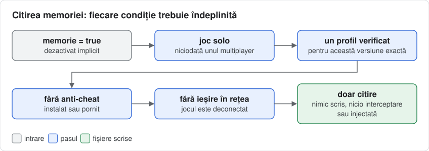

# Citirea memoriei {#reading-memory}

Unele jocuri pentru un singur jucător nu spun nimic altor programe. Pentru acestea, watcher-ul poate - dacă îl porniți
și scrieți singur un profil - să caute unde vă aflați în memoria jocului, doar în citire.

Pentru jocurile pentru un singur jucător care nu publică nimic, watcher-ul poate citi poziții și valori din memoria
jocului, printr-un **profil** pe care îl scrieți pentru propria versiune a jocului. Dintre toate sursele, aceasta este
singura pe care jocul nu a oferit-o, deci este împrejmuită mai strict decât celelalte:

- este **oprită implicit** (`python -m heat3d_watch config --set memory=true` o pornește);
- citește și nu are cum să scrie;
- **niciun profil nu vine odată cu uneltele.**

Profilurile nu sunt livrate, pentru că un decalaj este corect doar pentru versiunea pe care a fost găsit. După un patch,
un profil care era corect înainte citește gunoi, iar gunoiul arată exact ca niște numere. Un profil trebuie verificat pe
versiunea pe care o are jucătorul, de către acel jucător.

## Verificările, în ordine {#the-checks-in-order}



Fiecare verificare de mai jos trebuie să treacă. Primele patru se fac **înainte** ca jocul să fie deschis, pentru că
deschiderea unui joc protejat pentru citire este chiar ceea ce observă un anti-cheat, iar refuzul după aceea ar veni prea
târziu.

1. **Setarea**: `memory` este adevărat. Altfel adaptoarele de memorie nu pornesc niciodată.
2. **Un profil pentru joc**, al cărui `exe` numește procesul care rulează. Un profil spune dacă jocul poate fi jucat
   online (`"online"`); cel care lasă asta afară este respins.
3. **Niciun anti-cheat în apropiere**:
   - niciun fișier anti-cheat în dosarul jocului sau cu până la trei dosare mai sus (oprindu-se la dosarul `common` al
     unei biblioteci Steam, sau la un dosar care conține `steamapps`, pentru că alte jocuri trăiesc deasupra lui):
     `EasyAntiCheat`, `EasyAntiCheat_EOS_Setup.exe`, `start_protected_game.exe`, `BattlEye`, `BEClient_x64.dll`,
     `BEService_x64.exe`, `EAAntiCheat.GameServiceLauncher.exe`, `AntiCheatExpert`, `SGuard64.exe`, `GameGuard`,
     `GameMon.des`, `XIGNCODE`, `xhunter1.sys`, `Vanguard`, `FACEIT` (comparate cu litere mici, și ca început al unui
     nume). Dacă dosarul jocului este necunoscut, jocul este refuzat;
   - niciun driver sau serviciu anti-cheat care rulează pe calculator, așa cum le listează
     `sc query type= driver state= active` și `sc query type= service state= active`: EasyAntiCheat, EasyAntiCheat_EOS,
     BEService, BEDaisy, vgk, vgc, ACE-BASE, ACE-GAME, xhunter1, FACEIT, FACEITService, EAAntiCheatService, Denuvo
     Anti-Cheat, npggsvc, Ricochet. Un anti-cheat de nucleu instalat pentru alt joc urmărește totuși fiecare proces. Dacă
     serviciile nu pot fi listate, jocul este refuzat.
4. **Nu online**: un joc al cărui profil spune `"online": true` este citit doar cât timp nu are nicio conexiune către
   altceva decât acest calculator (orice adresă la distanță în afară de `127.x`, `::1`). Dacă conexiunile sale nu pot fi
   citite, este refuzat.
5. Apoi, pe măsură ce adaptorul pornește:
   - **versiunea exactă**: dimensiunea fișierului executabil, sau SHA-256 al lui, trebuie să se potrivească cu o versiune
     pe care o listează profilul. O versiune necunoscută nu se citește;
   - **modulele, încă o dată**: modulele încărcate ale jocului sunt listate (o captură Toolhelp, care nu cere drepturi de
     acces proprii) și verificate pentru un client anti-cheat (`BEClient_x64.dll`, `BEClient.dll`,
     `EasyAntiCheat_x64.dll`, `EasyAntiCheat.dll`, `EOSAntiCheat...`). Un proces protejat refuză captura, ceea ce este tot
     un refuz;
   - abia atunci procesul este deschis, cu `PROCESS_VM_READ | PROCESS_QUERY_LIMITED_INFORMATION` și nimic altceva.

Verificările 1 până la 4 se repetă la fiecare scanare (la fiecare 2 s) cât timp jocul rulează. Dacă una începe să
eșueze (jocul se conectează la un server, pornește un serviciu anti-cheat), adaptorul este oprit la următoarea scanare.
Un refuz este înregistrat în jurnal: `mem-<id>: not reading memory: <reason>`. Un eșec la pornire (versiune necunoscută,
un modul anti-cheat, un model negăsit) este înregistrat ca `mem-<id>: could not start`, iar adaptorul nu se mai încearcă
până când jocul este pornit din nou.

Nu există scriere, nicio alocare în celălalt proces, niciun fir pornit în el, nicio bibliotecă încărcată în el, niciun
privilegiu de depanare și nicio ridicare de privilegii. Un test (`test_memory_reading_cannot_write` din
`tests/test_core.py`) eșuează dacă apare oriunde în pachet vreun apel care scrie într-un alt proces, alocă în el sau
rulează cod în el - `WriteProcessMemory`, `VirtualAllocEx`, `CreateRemoteThread`, `PROCESS_VM_WRITE`, `SeDebugPrivilege`,
`LoadLibrary`, ...

Niciodată citite, orice ar spune un profil: jocurile jucate online și jocurile al căror mod pentru un singur jucător
rulează sub un anti-cheat, precum GTA V, sau Elden Ring pornit prin lansatorul său. Verificările de mai sus le refuză
oricum.

## Formatul profilului {#the-profile-format}

Un profil este un fișier JSON în `<data>\profiles\` (`<data>` este dosarul de date, vezi
[Instalare și rulare](installing-and-running.md#where-everything-is)), câte unul pentru fiecare joc, cu orice nume de
fișier care se termină în `.json`. Un exemplu inventat:

```json
{
  "schema": "heat3d.memprofile/1",
  "id": "mygame",
  "game": "My Game",
  "exe": "MyGame.exe",
  "online": false,
  "versions": [ { "label": "1.06", "size": 123456789 } ],
  "anchors": {
    "World": { "aob": "48 8B 05 ?? ?? ?? ?? 48 85 C0", "rip": [3, 7] }
  },
  "values": {
    "pos": { "type": "vec3f", "base": "World", "chain": ["0x10", "0x68", "0x70"] },
    "hp":  { "type": "i32",   "base": "World", "chain": ["0x10", "0x138"] },
    "map": { "type": "u32",   "base": "World", "chain": ["0x10", "0x1C0"] }
  },
  "events": [
    { "event": "death", "value": "hp",  "when": "to_zero" },
    { "event": "zone",  "value": "map", "when": "change" }
  ],
  "axes": { "up": "y", "units": "metres" },
  "rate": 10,
  "provenance": [ { "source": "https://example.com/my-notes", "verified_on": "1.06" } ]
}
```

| Cheie | Obligatorie | Ce este |
|---|---|---|
| `schema` | da | exact `heat3d.memprofile/1` |
| `id` | da | scurt și stabil; adaptorul se numește `mem-<id>` |
| `game` | da | numele jocului, după care se numește dosarul sesiunii |
| `exe` | da | numele fișierului executabil, care spune și că jocul rulează |
| `online` | da | `true` dacă jocul poate fi jucat online; atunci se citește doar cât timp este offline |
| `versions` | da | versiunile pe care a fost verificat profilul: fiecare cu un `label` și un `size` (dimensiunea executabilului în octeți) și/sau un `sha256`. Când sunt date ambele, trebuie să se potrivească ambele. O intrare cu niciunul nu se potrivește cu nimic. |
| `anchors` | da | adrese cu nume în modulul principal. `aob`: un model de octeți, octeți hexazecimali separați prin spații, `?` sau `??` pentru orice octet; trebuie să apară **exact o dată** în imaginea modulului (mai multe potriviri contează ca eșec, ca și niciuna). `rip: [d, n]`: modelul indică o instrucțiune cu un deplasament RIP relativ pe 32 de biți la octetul `d` și de lungime `n`; ancora devine adresa la care se referă instrucțiunea. `offset`: adăugat după aceea (text hexazecimal sau zecimal). În loc de `aob`, `module_offset` dă un decalaj fix față de baza modulului. |
| `values` | da | ce se citește la fiecare citire: `type` (`i32`, `u32`, `i64`, `u64`, `u8`, `f32`, `f64`, `vec3f`, `vec3d`), `base` (numele unei ancore), `chain` (decalaje ca text hexazecimal sau zecimal) |
| `events` | nu | reguli care transformă schimbările în evenimente: `when` `change` (valoarea diferă de ultima citire) sau `to_zero` (un număr scade de la peste 0 la 0 sau sub) |
| `axes` | nu | `up` (implicit `y`), `units` (implicit `game units`), `scale` (scara de unități a vizualizatorului, care înmulțește fiecare poziție; implicit 1, unitățile jocului) |
| `rate` | nu | citiri pe secundă, de la 1 la 60 (implicit 10) |
| `provenance` | nu | de unde vin decalajele și pe ce versiune le-ați verificat; se copiază în `meta.json` al fiecărei sesiuni |

**Cum se citește o valoare.** Adresa ancorei este începutul. Dacă `chain` este gol, valoarea se citește chiar acolo.
Altfel, mai întâi se citește indicatorul (pointer) stocat în ancoră. Apoi, pentru fiecare decalaj în afară de ultimul, se
citește indicatorul de la `adresă + decalaj`. Ultimul decalaj se adaugă pentru a da adresa valorii. Un indicator nul pe
drum (jocul este între niveluri sau într-un meniu) lasă valoarea goală la acea citire.

**Ce se înregistrează.** O valoare numită `pos` (un `vec3f` sau `vec3d`) devine un rând `position` al jucătorului `me`
la fiecare citire. Fiecare regulă de eveniment scrie rândul său `event`, cu noua valoare și, unde `pos` este cunoscut,
poziția, și adună 1 la o statistică cu același nume. Imaginea modulului se citește o singură dată la pornire pentru a
găsi ancorele, în blocuri de 64 KiB; blocurile care nu pot fi citite contează ca zerouri. `meta.json` al sesiunii numește
profilul, eticheta versiunii și sursa.

Un profil care nu poate fi folosit (JSON greșit, `schema` greșit, o cheie obligatorie lipsă) este sărit și înregistrat ca
`profile <file> not used: <reason>`. Profilurile se încarcă la pornirea watcher-ului, deci reporniți `run` după ce
adăugați sau schimbați unul.

## Scrierea și verificarea unui profil {#writing-and-verifying-a-profile}

1. **Doar pentru un joc pentru un singur jucător, fără anti-cheat.** Dacă jocul are un anti-cheat, sau îl jucați online,
   opriți-vă aici: watcher-ul îl va refuza, și așa trebuie.
2. **Găsiți valorile pe propria versiune.** Lucrați offline. Folosiți propriile unelte de depanare, sau notele publicate
   despre joc, ca să găsiți poziția jucătorului și valorile care vă interesează, și un drum de indicatori către fiecare,
   dintr-un loc static din executabil. Preferați un model de octeți (`aob`) în locul unui `module_offset` fix: un model tot
   își găsește locul când codul se mută puțin.
3. **Faceți modelul unic.** Trebuie să se potrivească exact o dată în modul. Puneți wildcard pe octeții care se schimbă
   (adrese, deplasamente) și păstrați destui octeți fixi în jur.
4. **Fixați versiunea.** Puneți dimensiunea exactă a executabilului în `versions`; PowerShell
   `(Get-Item .\MyGame.exe).Length` o dă, iar `Get-FileHash .\MyGame.exe -Algorithm SHA256` dă hash-ul. După un patch,
   profilul pur și simplu nu mai este folosit până când îl verificați din nou și adăugați versiunea nouă.
5. **Spuneți sincer dacă jocul merge online** (`online`).
6. **Încercați-l**: porniți citirea (`config --set memory=true`), puneți fișierul în `<data>\profiles\` și verificați că
   `python -m heat3d_watch games` listează `mem-<id>`. Porniți jocul și rulați `python -m heat3d_watch run -v`. În
   `watcher.log`, căutați `mem-<id>: starting`, sau motivul pentru care a fost refuzat sau nu a putut porni.
7. **Verificați cifrele cu jocul.** Mergeți într-un loc cunoscut și uitați-vă la rândurile `position` din `events.jsonl`
   al sesiunii. Se mișcă atunci când vă mișcați, cu cantitatea potrivită, pe axele potrivite? Deschideți `heat.parquet` în
   vizualizator și verificați că ruta se potrivește cu locurile pe unde ați trecut. Declanșați fiecare eveniment (pierdeți
   toată viața, schimbați zona) și verificați că apare o singură dată. Gunoiul arată ca niște numere, iar doar această
   comparație le deosebește.
8. **Notați ce ați verificat** în `provenance`: sursa decalajelor și versiunea pe care le-ați verificat.

Textul `verified` al unui adaptor de memorie, așa cum îl afișează `games`, este mereu "by the profile's author, for the
builds it lists". Watcher-ul nu poate ști mai mult decât atât.
