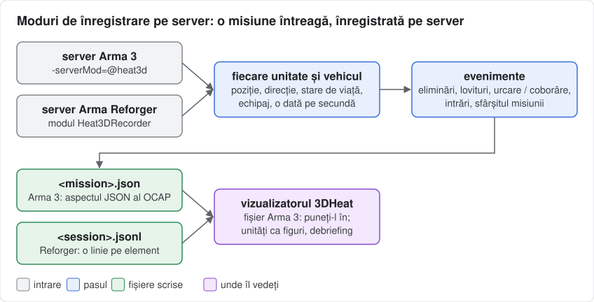

# Module de înregistrare pe server (Arma 3, Arma Reforger) {#server-recorder-mods-arma-3-arma-reforger}

Majoritatea jocurilor sunt înregistrate de watcher pe calculatorul jucătorului. Arma este altfel: un server poate înregistra o misiune întreagă - fiecare unitate și vehicul, nu doar ale tale - cu un mod care rulează pe server. Jucătorii nu configurează nimic: modul pentru Arma 3 este doar pe server, iar Reforger descarcă singur modurile unui server către jucători când aceștia se alătură (modul nu face nimic pe calculatoarele lor). Depozitul conține două astfel de module, în [`mods/arma3`](https://github.com/Holdi601/3DHeat-Watcher/tree/main/mods/arma3) și [`mods/reforger`](https://github.com/Holdi601/3DHeat-Watcher/tree/main/mods/reforger). README-urile lor sunt documentația completă; această pagină este prezentarea generală.

**Stare: ambele sunt netestate în joc.** Extensia Arma 3 a fost construită și rulată așa cum o apelează Arma, iar rezultatul ei a fost citit de 3DHeat; scripturile ei SQF nu au rulat încă în Arma 3. Modul Reforger a fost scris după API-ul de scripturi publicat de Bohemia și nu a fost compilat niciodată. Nu le pune pe un server public înainte de pașii de test din README-ul lor.

## Arma 3 {#arma-3}

1. Construiește extensia o dată pentru fiecare platformă (`mods/arma3/extension`). Este nevoie de un compilator C: Visual Studio Build Tools pe Windows, gcc pe Linux; dacă nu ai compilat niciodată nimic, întreabă gazda serverului.
   - Windows, într-un "x64 Native Tools Command Prompt for VS":
     `cl /nologo /O2 /LD heat3d.c /Fe:heat3d_x64.dll`
   - Linux: `gcc -O2 -shared -fPIC -o heat3d_x64.so heat3d.c -ldl`
2. Construiește modul: `python mods/arma3/build.py` scrie `mods/arma3/@heat3d/` (nu sunt necesare Arma 3 Tools).
3. Copiază `@heat3d` în folderul serverului și pornește serverul cu `-serverMod=@heat3d`.
4. Jurnalul `.rpt` al serverului spune `Heat3D recorder 0.1.0: recording <file> every 1 s`.

| Setare | Implicit | Ce face |
|---|---|---|
| `captureDelay` | 1 | secunde între cadre |
| `recordHits` | 1 | 0 oprește evenimentele de lovituri |
| `recordShots` | 1 | 0 oprește numărarea împușcăturilor |
| `minPlayers` | 0 | înregistrează doar când sunt conectați atâția jucători |

O misiune o suprascrie în `init.sqf` (`heat3d_captureDelay = 0.5;`). Înregistrările merg în `recordings/` din `@heat3d`, sau în `HEAT3D_DIR`.

**Rezultat:** un fișier pentru fiecare misiune, în formatul JSON al OCAP (formatul recorderului OCAP2), numit `<date>__<time>_<mission>.json`. În timpul misiunii este un jurnal (`.heat3d.part`), scris la fiecare scriere; jurnalul unei misiuni care a căzut este terminat data următoare când începe o misiune.

## Arma Reforger {#arma-reforger}

Modul (`Heat3DRecorder.gproj`) este deschis și construit în Workbench-ul Bohemia (Arma Reforger Tools), testat pe un server dedicat local, publicat din Workbench (nelistat cât timp testezi) și adăugat în lista `mods` din `config.json` al serverului - pas cu pas în README-ul lui. În fiecare secundă scrie poziția, direcția, starea de viață, vehiculul și id-ul jucătorului fiecărui personaj, precum și poziția, direcția, starea și echipajul fiecărui vehicul; și uciderile (ucigașul, arma, distanța), loviturile, urcatul și coborâtul din vehicule, jucătorii care intră și ies, și sfârșitul misiunii.

**Rezultat:** un obiect JSON pe linie, `$profile:heat3d/<UTC date>_<UTC time>_<world>.jsonl`: o linie `header` (formatul `heat3d-reforger`, axele x est, y sus, z nord), apoi linii `entity`, `frame` și `event` pe măsură ce apar, și o linie `end`. Rândurile de unități sunt `[id, x, y, z, dir, alive, vehicleId, playerId]`, cele de vehicule `[id, x, y, z, dir, alive, [crew ids]]`; evenimentele urmează layout-ul de evenimente OCAP2.

## În viewer {#in-the-viewer}

Trage o înregistrare Arma 3 pe [viewer-ul 3DHeat](https://holdi601.github.io/3DHeat/): o misiune este o sesiune, unitățile devin soldați, vehiculele tipul lor, iar uciderile și loviturile intră în lista de debrief. Playerul web al OCAP2 o redă și pe ea. Fișierul Reforger este formatul de linii al modului, cu layout-ul de evenimente OCAP2.
