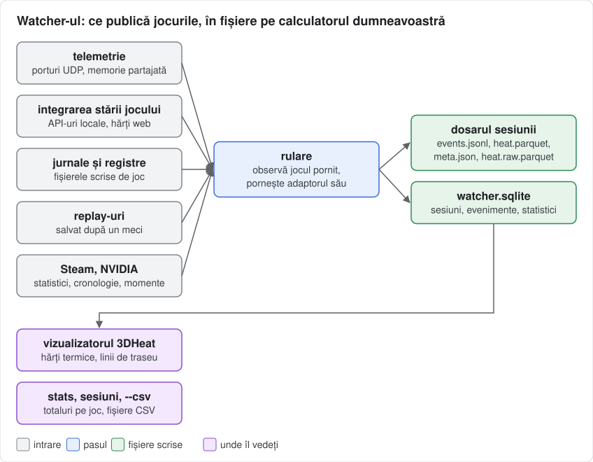

# Surse și reguli {#sources-and-rules}

Watcher-ul înregistrează doar ce le dau jocurile și platformele jucătorului. Această pagină explică ce surse acoperă asta, ce are voie watcher-ul să facă cu fiecare și ce jocuri sau ce părți de jocuri lasă afară intenționat.

## Cele șase tipuri de surse {#the-six-kinds-of-source}

Fiecare adaptor are un `kind` (tip), iar tipul decide ce are voie adaptorul să facă:

| Tip | Ce este | Jocuri multiplayer |
|---|---|---|
| `telemetry` | un port UDP sau o memorie partajată pe care jocul le publică pentru tablouri de bord, platforme de mișcare și volane (Forza Data Out, UDP-ul F1, memoria partajată Kunos și iRacing, SimConnect, interfața UDP a X-Plane, pluginul SCS SDK) | da - este ieșirea proprie a jocului |
| `gsi` | o integrare a stării jocului sau o API web locală pe care jocul o servește mașinii jucătorului (Valve GSI, Live Client Data API al League, API-ul de statistici Rocket League, harta web War Thunder) | da, în limitele a ce arată API-ul jucătorului |
| `log` | fișiere pe care jocul le scrie cât rulează: jurnale, statistici, salvări (Elite Dangerous, Minecraft, Path of Exile, Hearthstone, Star Citizen, EVE Online) | da |
| `replay` | demo-uri și reluări pe care jocul le salvează pentru jucătorii lui, convertite după meci (CS2, Dota 2, osu!, War Thunder, World of Tanks, World of Warships, Squad, League of Legends, VALORANT, IL-2 Tacview) | da, dacă nu sunt criptate, și doar părțile aflate în clar |
| `platform` | ce țin Steam și driverul grafic: statistici, realizări, cronologii, clipuri și highlight-uri | da |
| `memory` | memoria jocului, doar citită, de un profil pe care l-ai scris tu | **niciodată** - doar jocuri single-player |

Doar `memory` deschide alt proces, și doar pentru citire. Celelalte cinci tipuri citesc ce a scris deja jocul, Steam sau aplicația NVIDIA, sau ce trimit ele.

## Cum sunt citite sursele {#how-the-sources-are-read}

- **Nimic nu este injectat, agățat sau schimbat într-un joc.** Nu se încarcă niciun cod în joc, nu se agață nicio fereastră sau intrare, nu se modifică niciun fișier de joc. Singurele fișiere pe care watcher-ul le scrie în afara folderului lui de date sunt cele pe care le scrie [`setup --apply`](commands.md#setup) când îi ceri: un fișier de setări al jocului (cu originalul păstrat ca `<file>.heat3d-backup`), un fișier cfg de integrare a stării jocului, scriptul de hook DCS, modul de protocol BeamNG.
- **Memoria partajată se deschide doar pentru citire și nu se creează niciodată.** Modul obișnuit în Python de a deschide o mapare numită o creează când nu există încă. Un joc pornit după aceea ar găsi maparea goală și doar pentru citire a watcher-ului în loc să-și facă a lui, iar telemetria lui ar fi moartă. Watcher-ul deschide mapările doar cu `OpenFileMappingW` (care găsește doar una existentă), le mapează cu `FILE_MAP_READ` și încearcă din nou mai târziu dacă jocul nu le-a făcut încă.
- **Porturile sunt împrumutate, niciodată preluate.** Un port UDP de telemetrie pe care îl ascultă deja alt program (FH Companion, SimHub, o aplicație de tablou de bord) este lăsat programului respectiv. Dacă alt program începe să asculte pe un port pe care îl ține watcher-ul, watcher-ul îl eliberează în câteva secunde. Adaptoarele Forza așteaptă 15 s după ce pornește jocul înainte să ia portul 5300 și trimit fiecare pachet neschimbat mai departe către 127.0.0.1:5301, deci o a doua aplicație Data Out poate înregistra în continuare.
- **Local doar.** Serverele de stare ale jocului pe care le rulează watcher-ul (CS2, Dota 2) ascultă pe 127.0.0.1 și nicăieri altundeva. Când fișierul cfg al jocului are un token (cel scris de `setup` îl are), fiecare postare trebuie să-l poarte; postările fără el sunt numărate ca `bad_auth` și aruncate. Fără un fișier cfg cu token, orice postare locală este acceptată, iar jurnalul o spune. API-urile locale pe care le cer (League pe portul 2999, War Thunder pe 8111, Rocket League pe 49123, X-Plane pe 49000) sunt toate pe 127.0.0.1.
- **Fișierele de jurnal sunt partajate, niciodată blocate.** Fiecare citire deschide fișierul cu toate indicatoarele de partajare pe care le are Windows și îl închide din nou, ca jocul să poată scrie mai departe, să-l redenumească sau să-l înlocuiască.
- **Două servicii din afară, și doar în aceste cazuri.** Verificarea de versiune întreabă GitHub (`api.github.com`) cel mult o dată la șase ore și poate fi oprită (vezi [Actualizări](updates.md)). Adaptorul de reluări League întreabă API-ul Match-V5 al Riot doar când ai introdus propriul `riot_api_key`. Nimic altceva nu se trimite nicăieri.
- **Pornirea unei surse este decizia ta.** `setup` fără `--apply` doar spune ce ar schimba.

## Reguli pentru multiplayer {#multiplayer-rules}

- Un joc jucat online este înregistrat doar prin ce publică: telemetrie, API-uri de stare a jocului, jurnale, reluări, fișiere ale platformei. În aceste limite, watcher-ul înregistrează ce arată jocul jucătorului și nimic calculat în plus:
  - **integrarea stării jocului CS2** trimite jucătorul urmărit (tu, cât ești în viață, sau un coleg după moarte). Pozițiile celorlalți jucători (`allplayers_*`) se trimit doar spectatorilor și GOTV, deci watcher-ul nu le cere.
  - **Live Client Data API al League of Legends** nu are poziții. Politica Riot permite uneltelor să arate ce ar putea ști jucătorul din joc însuși și nimic calculat în plus (fără cronometre ale inamicilor). Watcher-ul înregistrează fluxul de eliminări și tabelul de scor pe care le vede jucătorul, și propriile cifre ale jucătorului.
  - **API-ul de statistici Rocket League** nu are poziții ale mașinilor (starea mașinii se trimite doar spectatorilor). Ce are loc este mingea, unde a fost lovită, marcată sau lovită de bară.
  - **Harta web War Thunder** arată ce arată minimap-ul, fără nume sau id-uri.
  - **F1 23/24/25** pun poziția fiecărei mașini în pachetul lor Motion, și online. Jocul le scoate singur și reține doar datele jucătorilor al căror „Your Telemetry” este restricționat.
  - **DCS World**: un server multiplayer poate interzice exportul datelor aeronavei proprii; sesiunea are atunci evenimente, dar nu poziții, și o spune.
- **Memoria nu se citește niciodată într-un joc multiplayer.** Un adaptor de memorie pentru un joc marcat ca jucat online este refuzat, iar un profil trebuie să spună dacă jocul său poate fi jucat online deloc. Un joc single-player care are și un mod online este citit doar cât timp nu are nicio conexiune decât cu acest calculator. Jocurile al căror mod single-player rulează sub un sistem anti-cheat nu sunt citite nici ele. Vezi [Citirea memoriei](memory-reading.md).
- Steagul `multiplayer` al unui adaptor (afișat ca „Online play” de `games --markdown`) decide doar citirea memoriei. Nu oprește celelalte tipuri să înregistreze jocul online.

## Ce este refuzat și de ce {#what-is-declined-and-why}

Unele jocuri, și unele părți din jocuri, nu sunt înregistrate: datele lor sunt protejate, nepublicate sau nu se află deloc pe calculatorul jucătorului:

| Joc | Ce lipsește | De ce |
|---|---|---|
| VALORANT | poziții, nume, scoruri din reluări; punctele de capăt ale fișierului de blocare al clientului | Fluxul de joc din reluare este ofuscat cu valori luate din executabilul fiecărei versiuni. Jocul rulează sub Vanguard. Punctele de capăt ale fișierului de blocare al clientului Riot nu sunt un API publicat. **Citit:** ce conține reluarea în clar - harta, id-ul meciului, agenții, cronologia de runde și eliminări a serverului. |
| League of Legends | partea din `.rofl` a reluărilor, mișcare cu mișcare; punctele de capăt ale fișierului de blocare al clientului | Ofuscată împotriva trișării, diferit la fiecare patch, și nu este decodată. **Citit:** tabelul cu scorul de final de meci pe care îl are fiecare reluare ca JSON simplu, Live Client Data API în timpul unui meci și - cu propria cheie de dezvoltator - cronologia oficială Match-V5 (poziții o dată pe minut, eliminări acolo unde s-au produs). |
| Fortnite | reluări | Criptate. |
| World of Tanks, World of Warships | reluări, în watcher | Cifrate. Watcher-ul nu le citește; convertoare separate din afara lui le citesc (`exporters/ext/wot-replay`, `exporters/ext/wows-replay`), fiecare un proiect de sine stătător. **Citit, cu un convertor instalat:** poziția fiecărui vehicul sau nave cât timp clientul de înregistrare o cunoștea, și eliminările. |
| Gran Turismo 7 | telemetrie | Doar pe consolă, iar telemetria ei este criptată cu o cheie recuperată din joc. |
| Apex Legends | tot | LiveAPI-ul său trimite evenimente complete doar în lobby-urile private și personalizate; altfel nimic nu este disponibil local. |
| Overwatch 2, Call of Duty, Battlefield 6, Hunt: Showdown 1896 | date în timp real | Nicio ieșire locală de reluare, jurnal sau stare a jocului de citit. Statisticile lor intră unde le păstrează Steam ([Statistici Steam](game-steam-stats.md), [Steam Timeline](game-steam-timeline.md)), iar clipurile lor ca [NVIDIA highlights](nvidia-highlights.md). |
| Star Citizen | orice în afara `Game.log` | Rulează Easy Anti-Cheat; watcher-ul citește doar fișierul de jurnal pe care îl scrie jocul și nu se apropie niciodată de procesul jocului. |
| osu!lazer | reluări | Ținute în depozitul propriu al jocului; sunt citite doar fișierele `.osr` ale osu! (versiunea stabilă). |
| Orice joc multiplayer | memoria | Niciodată. Nici jocurile single-player al căror mod rulează sub un anti-cheat (GTA V, Elden Ring prin launcher-ul lui) nu sunt citite. |

Reluările criptate nu sunt deschise: cititorul de VALORANT verifică indicatorul de criptare al reluării și refuză un fișier criptat („this replay is encrypted; it is not read”).

Jocuri cercetate, dar încă necreate (reluările Deadlock, fișierele `.replay` Rocket League, StarCraft II, Team Fortress 2, Rainbow Six Siege, Beat Saber, Trackmania, mai multe simulatoare de curse) sunt listate cu sursele lor în [Toate jocurile într-un tabel](watcher.md#researched-not-yet-built). Fiecare are nevoie de fișiere de probă pe care să fie verificat înainte să fie livrat.
