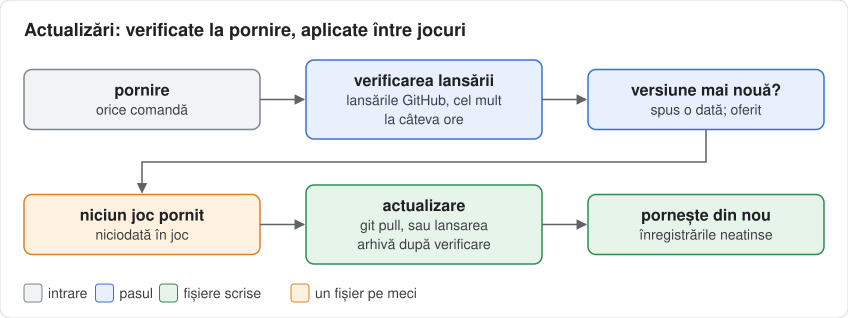

# Actualizări {#updates}

Watcher-ul se ține singur la zi după versiunile lansate în [Holdi601/3DHeat-Watcher](https://github.com/Holdi601/3DHeat-Watcher/releases). Actualizatorul este pachetul `heat3d_update`, lângă `heat3d_watch`, în depozit.

## Verificarea {#the-check}

- **Când**: fiecare comandă, în afară de `update`, verifică la pornire. `run` verifică și în timp ce rulează, cel mult o dată pe oră și doar cât timp nu rulează niciun joc.
- **Cum**: o singură cerere HTTPS către `https://api.github.com/repos/Holdi601/3DHeat-Watcher/releases/latest`, cu un timeout de 5 secunde. Răspunsul este ținut în cache șase ore în `%LOCALAPPDATA%\3DHeat\update-check-3DHeat-Watcher.json`, așa că cele mai multe porniri nu cer nimic. "Nicio versiune încă" (HTTP 404) este păstrat în cache ca orice răspuns. Fără internet, limitat de cereri sau în spatele unui proxy, verificarea eșuează discret, iar comanda continuă cu versiunea pe care o are.
- **Versiuni**: versiunea instalată este fișierul `VERSION` din folderul depozitului. Eticheta unei versiuni (`v1.2.0` sau `1.2.0`) este comparată ca numere, parte cu parte; orice după un `-` sau `+` este ignorat.
- **Oprit**: `HEAT3D_NO_UPDATE=1` (orice valoare în afară de gol, `0`, `false` sau `no`) oprește și verificarea, și actualizarea automată. Fiecare unealtă 3DHeat își ține propriul fișier de cache, așa că răspunsul uneia nu ține locul celuilalt.

## Ce se întâmplă când a apărut o versiune mai nouă {#what-happens-when-a-newer-release-is-out}

- **`run`** afișează o notificare la pornire și continuă să ruleze: `[heat3d_watch] 3DHeat Watcher 1.2.0 is out (this is 1.0.2). <release page>`. În timp ce rulează, cu `auto_update` pornit (implicit) și fără niciun joc pornit, se actualizează singur: linia de jurnal `3DHeat Watcher 1.2.0 is out (this is 1.0.2); updating`, o notificare Windows "Updating to 1.2.0", actualizarea, fiecare adaptor oprit și sesiunile lui închise, iar aceeași comandă pornită din nou, pe codul nou. Watcher-ul nu se actualizează niciodată în mijlocul unui joc. Dacă actualizarea nu poate fi aplicată, notificarea spune asta ("1.2.0 is out; not updated: ..."), iar watcher-ul continuă cu versiunea veche. Cu `auto_update` oprit există doar notificarea.
- **Celelalte comenzi** întreabă `Update now? [Y/n]` când rulează într-un terminal. Enter, `y`, `yes`, `j` sau `ja` actualizează, apoi rulează aceeași comandă din nou, pe versiunea nouă. Fără terminal (o rulare programată, un pipe), afișează cum se actualizează și continuă.
- **La cerere**: `python -m heat3d_watch update` (sau `python -m heat3d_update`) întreabă GitHub fără cache și actualizează. `--check` spune doar dacă a apărut o versiune mai nouă. Funcționează chiar și cu `HEAT3D_NO_UPDATE` setat.

## Cum se aplică o actualizare {#how-an-update-is-applied}

Depinde de cum a fost instalată copia:

- **Un clone git** (folderul are `.git` și `git` este în PATH): `git pull --ff-only`. Este refuzat cât timp clone-ul are modificări la fișierele urmărite (`git status --porcelain --untracked-files=no` nu este gol): acele modificări sunt munca cuiva, iar o actualizare nu decide ce se întâmplă cu ele. Fă commit sau stash, apoi fă pull.
- **O copie descărcată**: arhiva sursă a versiunii este descărcată și dezarhivată într-un folder temporar. Intrările care ar ieși din acel folder sunt sărite. `VERSION` din arhivă trebuie să fie versiunea pe care o declară lansarea, altfel nu se copiază nimic. Apoi fișierele ei sunt copiate peste folderul depozitului. Fișierele care nu fac parte dintr-o versiune - înregistrări, setări, medii virtuale, exporturi, orice ai făcut tu - nu sunt atinse. Un modul Python pe care o versiune mai veche îl avea și pe care cea nouă l-a eliminat este șters din pachetele versiunii (`heat3d_watch`, `heat3d_update`), ca niciun modul de adaptor vechi să nu fie încărcat după actualizare; în afara acelor pachete nu se șterge nimic.

Înregistrările și setările se află de obicei oricum în afara folderului depozitului (`%LOCALAPPDATA%\3DHeat\Watcher`), deci o actualizare nu se apropie niciodată de ele.

După o actualizare, aceeași comandă este pornită din nou. Pe Windows, watcher-ul pornește noul proces, îl așteaptă și îi transmite codul de ieșire, astfel că consola se comportă ca și cum primul proces ar fi făcut singur munca.
