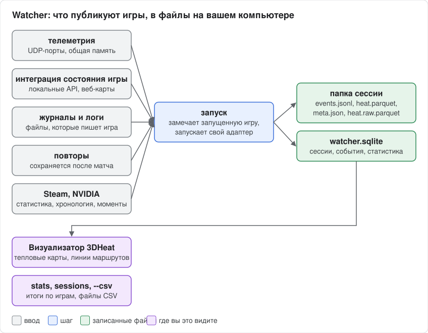

# 3DHeat Watcher {#dheat-watcher}

**Что это?** Вы играете в игру. Эта программа тихо записывает, где вы были и что произошло.
Позже вы можете посмотреть это как цветную карту в просмотрщике 3DHeat.

**Зачем это нужно?** Чтобы вести собственный учёт каждой сессии — где вы ехали, летали или сражались,
свои итоги по каждой игре — без каких-либо сайтов и без изменения игры.

**Пример:** вы проезжаете круг в гоночной игре, пока запущен watcher; потом файл в `sessions\<game>\`
хранит линию, по которой вы ехали, а просмотрщик её рисует.

Подробнее: 3DHeat Watcher — это фоновая программа, которая записывает то, что игры публикуют о вашей
игре: где вы были, что происходило и где, а также цифры, стоящие за этим, — в файлы на вашем компьютере.
Файлы нужны для вашей личной статистики и для тепловых карт и линий маршрутов просмотрщика 3DHeat.

Она работает тихо, замечает, какую игру вы запустили, и читает собственные выходные данные этой игры:
порт телеметрии или общую память, которую игра публикует для панелей; интеграцию состояния игры;
журнал или лог, который пишет игра; реплей, который она сохраняет после матча; статистику, которую
ведёт Steam; клипы, которые сохраняет приложение NVIDIA. Записи остаются на вашем компьютере. Программа
связывается только с двумя внешними сервисами, и только в этих случаях: GitHub — чтобы проверить,
нет ли более новой версии (см. [Обновления](../updates.md)), и API Match-V5 от Riot — только если вы
вводите свой собственный ключ API Riot (см. [Реплеи League of Legends](../game-lol-replays.md)).



## Что он записывает {#what-it-records}

- **Позиции**: машина, самолёт, герой или игрок, несколько раз в секунду там, где игра их публикует,
  со скоростью, курсом и всем, что игра отправляет вместе с ними.
- **События**: появления, смерти, убийства, круги, этапы, раунды, голы, задания, взлёты и посадки,
  смены зон, достижения, моменты. Каждое событие сохраняется с его временем и, если игра его даёт, с местом.
- **Статистика по сессиям**: убийства, смерти, круги, лучший круг, пройденное расстояние, максимальная
  скорость, время игры и собственная статистика игры, если она её ведёт.

Что даёт каждая игра и откуда это берётся, описано на её собственной странице в разделе [Игры](../games.md).
Один источник не может записать всё: многопользовательские игры записываются только через то, что они
публикуют, и watcher никогда не читает их память (см. [Источники и правила](../sources-and-rules.md)).

## Установка {#install}

Впервые в командной строке? Сначала прочитайте [С чего начать](before-you-start.md).

3DHeat Watcher — это программа на Python для Windows (Python 3.10 или новее). Многие его источники
существуют только в Windows: общая память, реестр, уведомления Windows.

```bash
git clone https://github.com/Holdi601/3DHeat-Watcher.git
cd 3DHeat-Watcher
pip install -r requirements.txt
```

Архив релиза работает так же: распакуйте его и выполните `pip install -r requirements.txt` внутри
папки. Подробности и дополнительные пакеты, которые нужны некоторым играм, — в
[Установка и запуск](../installing-and-running.md).

## Быстрый старт {#quick-start}

```bash
python -m heat3d_watch games            # что даёт каждая игра и откуда
python -m heat3d_watch setup all        # что нужно включить (ничего не меняется)
python -m heat3d_watch setup f1-25 --apply   # включить выходные данные одной игры (исходный файл сохраняется)
python -m heat3d_watch run              # наблюдать; оставьте запущенным, пока играете
python -m heat3d_watch stats            # итоги по каждой игре
python -m heat3d_watch stats --csv out  # сессии, события и статистика как файлы CSV
```

Вы должны увидеть: после `games` — таблицу с одной строкой на игру; `run` продолжает работать, пока вы
не нажмёте Ctrl+C или не закроете окно.

Всё записывается в `%LOCALAPPDATA%\3DHeat\Watcher`. Чтобы использовать другую папку, задайте
переменную окружения `HEAT3D_WATCH_HOME` или выполните `python -m heat3d_watch config --set data=D:\somewhere`.

- `sessions\<game>\<date>_<adapter>\` — по одной папке на сессию; в ней `events.jsonl` (каждое событие
  по мере его появления), `heat.parquet` (строки с позицией, готовые для просмотрщика 3DHeat) и
  `meta.json` (игра, источник, оси, счётчики, статистика)
- `watcher.sqlite` — статистика каждой сессии в трёх простых таблицах
- `watcher.log` — что делал watcher

Просмотрщик открывает `heat.parquet` сессии напрямую, без настройки (его оси и единицы записаны в
файле). Преобразованные реплеи записываются как таблицы и документы матчей рядом с ним; собственный
формат просмотрщика «один файл на матч» описан на его странице
[`.3dheat` container](https://holdi601.github.io/3DHeat/container.html), а столбцы каждой таблицы — на
странице [Данные](../the-data.md).

## Документация {#the-documentation}

| Страница | Что в ней |
|---|---|
| [С чего начать](before-you-start.md) | Python, терминал, заполнители, как выглядят успех и частые ошибки |
| [Установка и запуск](../installing-and-running.md) | требования, работа в фоне, автозапуск с Windows, файл блокировки, журнал, все настройки и переменные окружения |
| [Игры](../games.md) | по одной странице на игру: что записывается, откуда, как включить, как работает, оси, статистика, что проверено |
| [Данные](../the-data.md) | папки сессий, `events.jsonl`, `heat.parquet` и его подвал, `meta.json`, `watcher.sqlite`, восстановление после сбоя, экспорт CSV, открытие сессии в просмотрщике 3DHeat |
| [Команды](../commands.md) | каждая команда и параметр `python -m heat3d_watch` |
| [Источники и правила](../sources-and-rules.md) | шесть видов источников, правила для многопользовательских игр, какие игры исключены и почему |
| [NVIDIA Highlights](../nvidia-highlights.md) | что NVIDIA Highlights может и не может дать и как момент получает позицию |
| [Серверные моды-рекордеры](../server-mods.md) | моды серверов Arma 3 и Arma Reforger, которые записывают целые миссии для просмотрщика |
| [Чтение памяти](../memory-reading.md) | профили памяти для одиночных игр: формат, проверки, как написать и проверить профиль |
| [Обновления](../updates.md) | как watcher ищет новые релизы и обновляет себя |
| [Разработка](../development.md) | как написать адаптер: API, тесты, честный `verified`, перегенерация страниц игр |
| [Все игры в одной таблице](../watcher.md) | каждая игра в одной таблице, как её выводит `games --markdown`, плюс игры, которые изучены, но ещё не реализованы |
| [Справка по командам](../cli-reference.md) | `--help` каждой команды, создано из кода |
| [Сопровождение](../maintaining.md) | контрольный список выпуска для этих страниц |

## Часть 3DHeat {#part-of-3dheat}

3DHeat Watcher — один из бесплатных инструментов вокруг просмотрщика 3DHeat (watcher использует
3DHeat CS2, чтобы преобразовать демо CS2). Каждый — отдельный проект со своими выпусками и лицензией:

| Инструмент | Что делает | Документация |
|---|---|---|
| [3DHeat](https://github.com/Holdi601/3DHeat) | просмотрщик: тепловые карты, анализ заездов и разбор матчей в 3D | [сайт](https://holdi601.github.io/3DHeat/) |
| [GameFiles](https://github.com/Holdi601/3DHeat-GameFiles) | трассы и уровни из файлов, которые поставляют игры, как 3D-модели | [сайт](https://holdi601.github.io/3DHeat-GameFiles/) |
| [GameCapture](https://github.com/Holdi601/3DHeat-GameCapture) | телеметрия кругов из гоночных игр; уровни, восстановленные по видео игры | [сайт](https://holdi601.github.io/3DHeat-GameCapture/) |
| [Unreal Exporter](https://github.com/Holdi601/3DHeat-UnrealExporter) | плагин редактора Unreal, который экспортирует уровень как одну 3D-модель | [сайт](https://holdi601.github.io/3DHeat-UnrealExporter/) |
| [CS2](https://github.com/Holdi601/3DHeat-CS2) | демо Counter-Strike 2 в таблицы и документы матчей; карты в 3D-модели | [сайт](https://holdi601.github.io/3DHeat-CS2/) |
| [Watcher](https://github.com/Holdi601/3DHeat-Watcher) | записывает то, что игры публикуют о вашей игре, в фоне | [сайт](https://holdi601.github.io/3DHeat-Watcher/) |
| [Ext-WarThunder](https://github.com/Holdi601/3DHeat-Ext-WarThunder) | реплеи War Thunder в таблицы и документы матчей | [сайт](https://holdi601.github.io/3DHeat-Ext-WarThunder/) |
| [Ext-WoT](https://github.com/Holdi601/3DHeat-Ext-WoT) | реплеи World of Tanks в таблицы и документы матчей | [сайт](https://holdi601.github.io/3DHeat-Ext-WoT/) |
| [Ext-WoWs](https://github.com/Holdi601/3DHeat-Ext-WoWs) | реплеи World of Warships в таблицы и документы матчей | [сайт](https://holdi601.github.io/3DHeat-Ext-WoWs/) |
| [Ext-Squad](https://github.com/Holdi601/3DHeat-Ext-Squad) | демо серверов Squad в таблицы и документы матчей | [сайт](https://holdi601.github.io/3DHeat-Ext-Squad/) |
| [Ext-DCS](https://github.com/Holdi601/3DHeat-Ext-DCS) | карты DCS World в 3D-модели | [сайт](https://holdi601.github.io/3DHeat-Ext-DCS/) |
| [Ext-IL2](https://github.com/Holdi601/3DHeat-Ext-IL2) | карты IL-2 Sturmovik в 3D-модели | [сайт](https://holdi601.github.io/3DHeat-Ext-IL2/) |

Каждый модуль чтения игры — отдельный небольшой проект со своим файлом лицензии, выпусками и трекером
задач, поэтому его можно установить, обновить, сопровождать — или отозвать по запросу правообладателя —
отдельно, не затрагивая просмотрщик и другие инструменты.

Лицензия: MIT ([LICENSE](https://github.com/Holdi601/3DHeat-Watcher/blob/main/LICENSE)). Лицензии
сторонних пакетов, которые он использует, и то, что требуют игры, которые он читает, перечислены в
[LICENSES.md](https://github.com/Holdi601/3DHeat-Watcher/blob/main/LICENSES.md).
