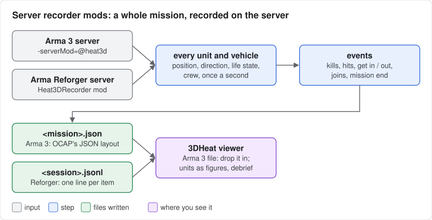

# Server recorder mods (Arma 3, Arma Reforger)

Most games are recorded by the watcher on the player's own machine. Arma is
different: a server can record a whole mission - every unit and vehicle, not
only your own - with a mod that runs on the server. Players set nothing up:
the Arma 3 mod is server-only, and Reforger downloads a server's mods to
players by itself when they join (the mod does nothing on their machines). The repository carries two such mods, in
[`mods/arma3`](https://github.com/Holdi601/3DHeat-Watcher/tree/main/mods/arma3)
and [`mods/reforger`](https://github.com/Holdi601/3DHeat-Watcher/tree/main/mods/reforger).
Their READMEs are the full documentation; this page is the overview.

**Status: both are untested in the game.** The Arma 3 extension was built and
driven the way Arma calls extensions, and its output read by 3DHeat; its SQF
scripts have not run in Arma 3 yet. The Reforger mod was written from
Bohemia's published script API and has never been compiled. Do not put either
on a public server before the test steps in its README pass.

## Arma 3

1. Build the extension once per platform (`mods/arma3/extension`):
   - Windows, in an "x64 Native Tools Command Prompt for VS":
     `cl /nologo /O2 /LD heat3d.c /Fe:heat3d_x64.dll`
   - Linux: `gcc -O2 -shared -fPIC -o heat3d_x64.so heat3d.c -ldl`
2. Build the mod: `python mods/arma3/build.py` writes `mods/arma3/@heat3d/`
   (no Arma 3 Tools needed).
3. Copy `@heat3d` into the server's folder and start the server with
   `-serverMod=@heat3d`.
4. The server's `.rpt` log says `Heat3D recorder 0.1.0: recording <file> every 1 s`.

| Setting | Default | What it does |
|---|---|---|
| `captureDelay` | 1 | seconds between frames |
| `recordHits` | 1 | 0 turns hit events off |
| `recordShots` | 1 | 0 turns shot counting off |
| `minPlayers` | 0 | record only once this many players are on |

A mission overrides one in its `init.sqf` (`heat3d_captureDelay = 0.5;`).
Recordings go to `recordings/` inside `@heat3d`, or to `HEAT3D_DIR`.

**Output:** one file per mission in OCAP's JSON layout (the OCAP2 recorder's
format), named `<date>__<time>_<mission>.json`. During the mission it is a
journal (`.heat3d.part`), flushed on every write; a crashed mission's journal
is finished the next time a mission starts.

## Arma Reforger

The mod (`Heat3DRecorder.gproj`) is opened and built in Bohemia's Workbench
(Arma Reforger Tools), tested on a local dedicated server, published from
Workbench (unlisted while testing) and added to the server's `config.json`
`mods` list - step by step in its README. Every second it writes every character's position, direction,
life state, vehicle and player id, and every vehicle's position, direction,
state and crew; and kills (killer, weapon, distance), hits, getting in and
out, players joining and leaving, and the mission's end.

**Output:** one JSON object per line, `$profile:heat3d/<UTC date>_<UTC time>_<world>.jsonl`:
a `header` line (format `heat3d-reforger`, axes x east, y up, z north), then
`entity`, `frame` and `event` lines as they happen, and an `end` line. Unit
rows are `[id, x, y, z, dir, alive, vehicleId, playerId]`, vehicle rows
`[id, x, y, z, dir, alive, [crew ids]]`; events follow OCAP2's event layout.

## In the viewer

Drop an Arma 3 recording on the [3DHeat viewer](https://holdi601.github.io/3DHeat/):
one mission is one session, units become soldiers, vehicles their type, and
kills and hits go into the debrief list. OCAP2's web player plays it too. The
Reforger file is the mod's own line format, with OCAP2's event layout.
